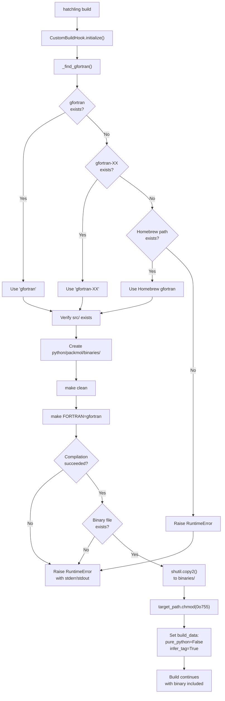
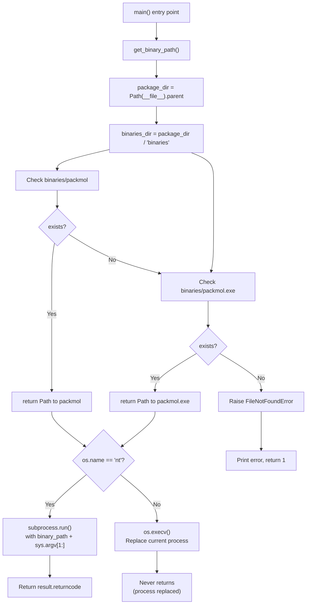
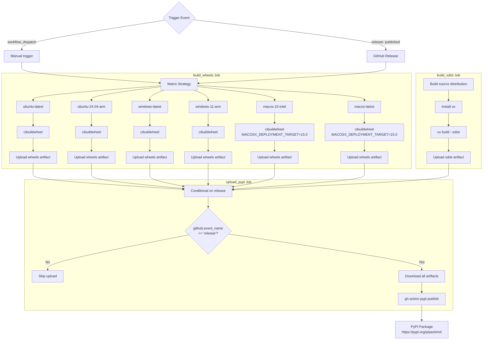

# Python Distribution

<details>
<summary>Relevant source files</summary>

The following files were used as context for generating this wiki page:

- [.github/workflows/build-wheels.yaml](.github/workflows/build-wheels.yaml)
- [.gitignore](.gitignore)
- [python/hatch_build.py](python/hatch_build.py)
- [python/packmol/__init__.py](python/packmol/__init__.py)
- [python/packmol/binaries/.gitignore](python/packmol/binaries/.gitignore)
- [python/packmol/cli.py](python/packmol/cli.py)

</details>


## Purpose and Scope

This document describes the Python distribution system for Packmol, which packages the compiled Fortran binary into a Python package distributed via PyPI. The system enables users to install Packmol with `pip install packmol` and run it as a Python command-line tool. This page covers the package structure, custom build hook that compiles the Fortran source during wheel building, CLI wrapper that executes the embedded binary, and the CI/CD pipeline that builds multi-platform wheels.

For information about building Packmol from source using Make or CMake, see [Building from Source](#2.1). For using Packmol through the Julia package, see [Julia Package Integration](#2.3). For details on how versions are managed across distribution channels, see [Version Management](#6.2).

---

## Package Architecture

The Python distribution consists of three key components: a package directory structure that embeds the compiled binary, a CLI wrapper module that executes the binary, and a custom build hook that compiles the Fortran source during package building.

### Directory Structure

```
python/
├── packmol/                    # Main package directory
│   ├── __init__.py            # Package initialization with version
│   ├── cli.py                 # CLI wrapper that executes binary
│   └── binaries/              # Compiled binary storage
│       ├── .gitignore         # Ignore compiled binaries in git
│       └── packmol            # Platform-specific binary (build artifact)
└── hatch_build.py             # Custom Hatchling build hook
```

**Sources**: [python/packmol/__init__.py:1-8](), [python/packmol/cli.py:1-69](), [python/hatch_build.py:1-111](), [python/packmol/binaries/.gitignore:1-2]()

### Package Initialization

The `__init__.py` module uses `importlib.metadata` to dynamically retrieve the package version from the installed package metadata, ensuring version consistency across the distribution. This avoids hardcoding the version in the Python source.

```python
import importlib.metadata
__version__ = importlib.metadata.version("packmol")
```

**Sources**: [python/packmol/__init__.py:1-8]()

---

## Build System Integration

The Python package uses Hatchling as the build backend with a custom build hook that compiles the Fortran source code during wheel construction. This approach embeds a platform-specific compiled binary directly into the Python wheel.

### Build Hook Execution Flow



**Diagram: Build hook execution flow from hook invocation to binary embedding**

**Sources**: [python/hatch_build.py:12-111]()

### Compilation Process

The `CustomBuildHook` class implements the `BuildHookInterface` from Hatchling and performs the following steps in the `initialize` method:

| Step | Action | Implementation |
|------|--------|----------------|
| 1. Find compiler | Search for `gfortran`, versioned variants, or Homebrew installations | [python/hatch_build.py:79-110]() |
| 2. Verify sources | Check that `src/` directory exists | [python/hatch_build.py:26-31]() |
| 3. Create output | Create `python/packmol/binaries/` directory | [python/hatch_build.py:34-35]() |
| 4. Clean | Run `make clean` to remove previous artifacts | [python/hatch_build.py:38-39]() |
| 5. Compile | Execute `make FORTRAN={gfortran}` | [python/hatch_build.py:42-53]() |
| 6. Verify binary | Check that `packmol` or `packmol.exe` exists | [python/hatch_build.py:56-63]() |
| 7. Copy binary | Copy compiled binary to `python/packmol/binaries/` | [python/hatch_build.py:66-68]() |
| 8. Set permissions | Make binary executable with `chmod 0o755` | [python/hatch_build.py:71]() |
| 9. Mark platform | Set `pure_python=False` and `infer_tag=True` | [python/hatch_build.py:76-77]() |

**Sources**: [python/hatch_build.py:15-77]()

### Compiler Discovery Strategy

The build hook searches for the gfortran compiler in the following order:

1. **Plain gfortran**: Check if `gfortran` is available in PATH using `shutil.which()`
2. **Versioned gfortran**: Try `gfortran-20` down to `gfortran-11` for compatibility with different systems
3. **Homebrew paths**: Check macOS-specific paths `/opt/homebrew/bin/gfortran` and `/usr/local/bin/gfortran`

If no compiler is found, the build fails with a `RuntimeError`. This multi-tiered approach ensures compatibility across different development environments.

**Sources**: [python/hatch_build.py:79-110]()

---

## CLI Wrapper Implementation

The CLI wrapper (`cli.py`) provides a Python entry point that locates and executes the embedded Fortran binary. It handles platform differences between Unix and Windows systems.

### Binary Location Mechanism



**Diagram: CLI wrapper binary location and execution flow**

**Sources**: [python/packmol/cli.py:9-68]()

### Platform-Specific Execution

The wrapper uses different execution strategies based on the operating system:

| Platform | Method | Rationale |
|----------|--------|-----------|
| **Unix/Linux/macOS** (`os.name != "nt"`) | `os.execv()` | Replaces the Python process with the binary, eliminating wrapper overhead and preserving Unix exec semantics | 
| **Windows** (`os.name == "nt"`) | `subprocess.run()` | Windows does not support process replacement; spawns subprocess and returns its exit code |

The distinction ensures that on Unix systems, the Python wrapper adds no runtime overhead once the binary is located, while on Windows it maintains compatibility with the OS's process model.

**Sources**: [python/packmol/cli.py:54-64]()

### Binary Path Resolution

The `get_binary_path()` function constructs the path to the binary by:

1. Locating the package directory using `Path(__file__).parent`
2. Constructing the binaries subdirectory path
3. Checking for platform-specific binary names (`packmol` or `packmol.exe`)
4. Returning the first existing binary, or raising `FileNotFoundError`

This approach ensures that the correct binary is located regardless of the installation path or platform.

**Sources**: [python/packmol/cli.py:9-35]()

---

## Wheel Building and Distribution

Packmol uses GitHub Actions to automatically build platform-specific wheels for multiple operating systems and architectures, then publishes them to PyPI when a new release is created.

### CI/CD Pipeline Architecture



**Diagram: CI/CD pipeline for building and distributing Python wheels**

**Sources**: [.github/workflows/build-wheels.yaml:1-67]()

### Multi-Platform Build Matrix

The `build_wheels` job uses a matrix strategy to build wheels for six platform configurations:

| Platform | Architecture | Runner | Special Configuration |
|----------|-------------|--------|----------------------|
| `ubuntu-latest` | x86_64 | GitHub-hosted | Standard Linux build |
| `ubuntu-24.04-arm` | ARM64 | GitHub-hosted | ARM Linux build |
| `windows-latest` | x86_64 | GitHub-hosted | Standard Windows build |
| `windows-11-arm` | ARM64 | GitHub-hosted | ARM Windows build |
| `macos-15-intel` | x86_64 | GitHub-hosted | Intel Mac, `MACOSX_DEPLOYMENT_TARGET=15.0` |
| `macos-latest` | ARM64 (Apple Silicon) | GitHub-hosted | ARM Mac, `MACOSX_DEPLOYMENT_TARGET=15.0` |

Each platform invokes `cibuildwheel` which internally calls the custom build hook to compile the binary for that platform. The macOS builds set `MACOSX_DEPLOYMENT_TARGET=15.0` to ensure compatibility with macOS 15+.

**Sources**: [.github/workflows/build-wheels.yaml:10-29]()

### Source Distribution Build

The `build_sdist` job creates a source distribution (`.tar.gz`) that includes the Fortran source code and build configuration. This allows users to build from source if pre-built wheels are not available for their platform.

The source distribution is built using `uv build --sdist`, which packages the source tree according to the `pyproject.toml` configuration.

**Sources**: [.github/workflows/build-wheels.yaml:31-46]()

### PyPI Publication

The `upload_pypi` job runs only when the trigger is a published GitHub release (`github.event_name == 'release' && github.event.action == 'published'`). It:

1. Downloads all wheel and sdist artifacts from the previous jobs
2. Merges them into a single `dist/` directory
3. Uses `pypa/gh-action-pypi-publish` with trusted publishing (OIDC) to upload to PyPI

The job requires the `id-token: write` permission for OIDC authentication with PyPI, eliminating the need for API tokens.

**Sources**: [.github/workflows/build-wheels.yaml:48-67]()

### Wheel Artifact Structure

Each build job produces wheel artifacts named following the pattern:

```
cibw-wheels-{os}-{job-index}
```

These artifacts contain `.whl` files in the `wheelhouse/` directory. The final publication step merges all artifacts using the `pattern: cibw-*` and `merge-multiple: true` options.

**Sources**: [.github/workflows/build-wheels.yaml:25-29](), [.github/workflows/build-wheels.yaml:58-63]()

---

## Installation and Usage

Users can install the Python package with:

```bash
pip install packmol
```

This installs the platform-appropriate wheel with the embedded binary and creates a `packmol` command-line entry point. The entry point is defined in `pyproject.toml` and maps to `packmol.cli:main`.

Once installed, users can run Packmol with standard command-line arguments:

```bash
packmol < input.inp
packmol -i input.inp
packmol -i input.inp -o output.pdb
```

The CLI wrapper transparently executes the embedded Fortran binary with all provided arguments.

**Sources**: [python/packmol/cli.py:38-68]()

---

## Platform-Specific Binary Handling

The distribution system handles platform differences through several mechanisms:

### Binary Name Selection

The build hook determines the binary name based on `os.name`:

```python
binary_name = "packmol.exe" if os.name == "nt" else "packmol"
```

This ensures the correct binary name is used during compilation and installation.

**Sources**: [python/hatch_build.py:56]()

### Execution Strategy

The CLI wrapper selects the execution method based on platform:

- **Unix systems**: Use `os.execv()` to replace the current process
- **Windows**: Use `subprocess.run()` to spawn a child process

This provides native behavior on each platform while maintaining consistent user experience.

**Sources**: [python/packmol/cli.py:54-64]()

### Wheel Metadata

The build hook sets `pure_python=False` and `infer_tag=True` to ensure the wheel is marked as platform-specific with appropriate tags (e.g., `cp311-cp311-macosx_15_0_arm64`). This prevents installation of incompatible binaries on different platforms.

**Sources**: [python/hatch_build.py:76-77]()

---

## Summary

The Python distribution system for Packmol provides a seamless installation experience by embedding the compiled Fortran binary into Python wheels. The custom Hatchling build hook compiles the source during wheel creation, the CLI wrapper transparently executes the binary with platform-appropriate methods, and the GitHub Actions CI/CD pipeline builds and publishes wheels for six platform configurations. This architecture enables `pip install packmol` to work out-of-the-box across Linux, macOS (Intel and ARM), and Windows (x86 and ARM) while maintaining the performance of the native Fortran implementation.

---