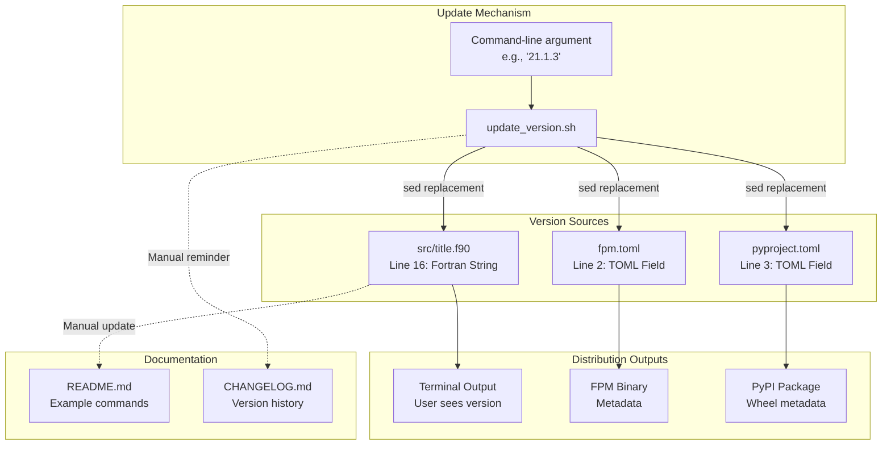
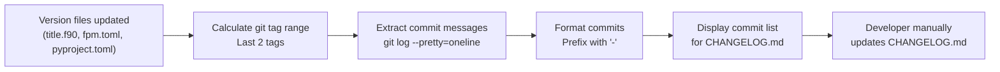

# Version Management

<details>
<summary>Relevant source files</summary>

The following files were used as context for generating this wiki page:

- [CHANGELOG.md](CHANGELOG.md)
- [README.md](README.md)
- [fpm.toml](fpm.toml)
- [pyproject.toml](pyproject.toml)
- [src/title.f90](src/title.f90)
- [update_version.sh](update_version.sh)

</details>


## Purpose and Scope

This page documents how version numbers are managed across Packmol's multi-platform distribution system. Packmol maintains version consistency across three different build systems (Make, FPM, Python) and user-facing output, requiring careful synchronization. This page covers version storage locations, the automated update process, and the versioning scheme used.

For information about how versions are published to PyPI, see [Python Distribution](#6.1). For the overall release process and CI/CD pipeline, see [Continuous Integration](#5.3).

---

## Version Storage Architecture

Packmol maintains version information in multiple files to support its diverse build ecosystem. Each distribution channel requires the version to be specified in a format-specific location.

### Version Storage Locations



**Sources:** [src/title.f90:16](), [fpm.toml:2](), [pyproject.toml:3](), [update_version.sh:17-19]()

### File-Specific Version Formats

Each file stores the version in a different format dictated by its build system requirements:

| File | Format | Line Number | Example | Purpose |
|------|--------|-------------|---------|---------|
| `src/title.f90` | Fortran string literal | 16 | `t61,' Version 21.1.3 ')` | User-visible output at runtime |
| `fpm.toml` | TOML key-value | 2 | `version = "21.1.3"` | Fortran Package Manager metadata |
| `pyproject.toml` | TOML key-value | 3 | `version = "21.1.3"` | Python package metadata (PEP 621) |
| `README.md` | Markdown text | 50, 54 | `packmol-21.0.0.tar.gz` | Documentation examples |
| `CHANGELOG.md` | Markdown heading | 13 | `Version 21.1.3` | Release history |

**Sources:** [src/title.f90:16](), [fpm.toml:1-6](), [pyproject.toml:1-7]()

---

## Version Update Process

Version numbers are updated using the `update_version.sh` script, which performs automated find-and-replace operations across all version-bearing files.

### Script Execution Flow

```mermaid
flowchart TD
    START["Execute: ./update_version.sh 21.1.3"]
    CHECK{"Version argument<br/>provided?"}
    ERROR["Print error message<br/>Show current version from fpm.toml"]
    EXIT1["Exit"]
    
    SET_VARS["Set variables:<br/>package='packmol'<br/>version='$1'<br/>versionfile, fpmfile, pyprojfile"]
    
    UPDATE_TITLE["Update src/title.f90<br/>sed: 's/Version.*/Version $version/'"]
    UPDATE_FPM["Update fpm.toml<br/>sed: 's/version.*/version = \"$version\"/'"]
    UPDATE_PY["Update pyproject.toml<br/>sed: 's/version.*/version = \"$version\"/'"]
    
    GIT_LOG["Generate commit log<br/>git log between last 2 tags"]
    REMIND["Print reminder:<br/>Update CHANGELOG.md manually"]
    
    DONE["Done"]
    
    START --> CHECK
    CHECK -->|No| ERROR
    ERROR --> EXIT1
    CHECK -->|Yes| SET_VARS
    SET_VARS --> UPDATE_TITLE
    UPDATE_TITLE --> UPDATE_FPM
    UPDATE_FPM --> UPDATE_PY
    UPDATE_PY --> GIT_LOG
    GIT_LOG --> REMIND
    REMIND --> DONE
```

**Sources:** [update_version.sh:1-46]()

### Sed Replacement Patterns

The script uses `sed` to perform in-place text replacements. Each file type requires a different regular expression pattern:

```
# For src/title.f90 (line 16)
Pattern: s/Version.*/Version\ $version \')\")/ 
Before:  t61,' Version 21.1.2 ')"
After:   t61,' Version 21.1.3 ')"

# For fpm.toml (line 2)
Pattern: s/version.*/version = \"$version\"/
Before:  version = "21.1.2"
After:   version = "21.1.3"

# For pyproject.toml (line 3)
Pattern: s/version.*/version = \"$version\"/
Before:  version = "21.1.2"
After:   version = "21.1.3"
```

**Sources:** [update_version.sh:29-36]()

---

## Versioning Scheme

Packmol uses a semantic-like versioning scheme with three components: `MAJOR.MINOR.PATCH`.

### Version Number Structure

```
21.1.3
│  │ │
│  │ └── PATCH: Bug fixes, minor updates
│  └──── MINOR: New features, backward-compatible changes
└─────── MAJOR: Year-based major version (21 = 2021)
```

### Version History Examples

From the CHANGELOG.md:

| Version | Release Type | Notable Changes |
|---------|--------------|-----------------|
| `21.1.3` | Patch | Update authors on pip distribution |
| `21.1.2` | Patch | Add pip install option, rename release script |
| `21.1.1` | Patch | Update CMake compatibility, CRYST1 documentation |
| `21.1.0` | Minor | Support CLI input/output file specifications (`-i`, `-o` flags) |
| `21.0.4` | Patch | Various bug fixes |

**Sources:** [CHANGELOG.md:13-34]()

---

## Automated Version Synchronization

### Pre-Update Validation

The script includes a safety check to ensure the version argument is provided:

```bash
if [[ $version < " " ]]; then
  version=`grep version fpm.toml`
  echo "ERROR: Please provide version number, with: ./release.sh 20.1.1"
  echo "       current $version"
  exit
fi
```

This validation:
1. Tests if the version variable is empty (line 22)
2. Reads the current version from `fpm.toml` for display (line 23)
3. Shows an error message with usage instructions (line 24)
4. Exits to prevent partial updates (line 26)

**Sources:** [update_version.sh:22-27]()

### Post-Update Workflow

After updating version files, the script assists with documentation updates:



**Sources:** [update_version.sh:38-44]()

The script generates a list of commits between the last two git tags:

```bash
range=`git tag | sort -V | tail -n 2 | xargs | sed 's! !...!'`
git log --pretty=oneline $range | awk '{$1=""; print "-"$0}'
```

This produces output like:
```
----------------------
Please update the CHANGELOG.md file. Commits:
----------------------
- Add pip install packmol installation option
- Update authors on pip distribution
- Fix version display bug
----------------------
```

**Sources:** [update_version.sh:41-43]()

---

## Integration with Build Systems

Each build system reads the version from its respective configuration file:

### Fortran Package Manager (FPM)

FPM reads version metadata from `fpm.toml`:

```toml
name = "packmol"
version = "21.1.3"
license = "MIT"
author = "Leandro Martinez, Ernesto Birgin, Jose Mario Martinez"
maintainer = "Leandro Martinez"
copyright = "University of Campinas - Brazil"
```

The version field (line 2) is used for package identification and metadata but does not affect the compiled binary's version display.

**Sources:** [fpm.toml:1-6]()

### Python Package (Hatchling)

The Python build backend (`hatchling`) reads version from `pyproject.toml`:

```toml
[project]
name = "packmol"
version = "21.1.3"
description = "Packmol - Creates Initial Configurations for Molecular Dynamics Simulations"
```

This version is embedded in:
- The wheel filename: `packmol-21.1.3-py3-none-*.whl`
- Package metadata accessible via `pip show packmol`
- PyPI package page

**Sources:** [pyproject.toml:1-7]()

### Runtime Display

The Fortran code displays the version at program startup through `title.f90`:

```fortran
subroutine title()
    use ahestetic
    write(*,hash3_line)
    write(*,"(' PACKMOL - Packing optimization for the automated generation of', /&
             &' starting configurations for molecular dynamics simulations.', /&
             &' ',/&
             &t61,' Version 21.1.3 ')")
    write(*,hash3_line)
end subroutine title
```

The version string on line 16 is printed to standard output when packmol runs, making it user-visible regardless of installation method.

**Sources:** [src/title.f90:9-19]()

---

## Manual Synchronization Requirements

Two files require manual updates and are not covered by `update_version.sh`:

### CHANGELOG.md

The changelog must be manually updated with:
- New version heading (e.g., `Version 21.1.3`)
- Release date
- List of changes with appropriate badges (FEATURE, BUGFIX, INFO, etc.)
- Breaking changes clearly marked

The script generates a commit list to assist with this task.

**Sources:** [CHANGELOG.md:1-34](), [update_version.sh:38-43]()

### README.md

Example commands in the README reference specific version numbers:

```markdown
tar -xzvf packmol-21.0.0.tar.gz
```

or

```markdown
unzip -xzvf packmol-21.0.0.zip
```

These must be manually updated to reflect the current version. However, they are typically left as examples rather than exact version specifications.

**Sources:** [README.md:50-56]()

---

## Version Update Checklist

When releasing a new version, follow this procedure:

| Step | Action | Tool/File |
|------|--------|-----------|
| 1 | Decide version number (MAJOR.MINOR.PATCH) | Team decision |
| 2 | Run update script | `./update_version.sh X.Y.Z` |
| 3 | Verify automatic updates | Check `title.f90`, `fpm.toml`, `pyproject.toml` |
| 4 | Update CHANGELOG.md | Manual edit using provided commit list |
| 5 | Update README.md examples (optional) | Manual edit |
| 6 | Commit changes | `git commit -am "Release vX.Y.Z"` |
| 7 | Create git tag | `git tag vX.Y.Z` |
| 8 | Push with tags | `git push --tags` |
| 9 | Trigger CI/CD | GitHub Actions builds and publishes |

**Sources:** [update_version.sh:1-46](), [CHANGELOG.md:1-34]()

---