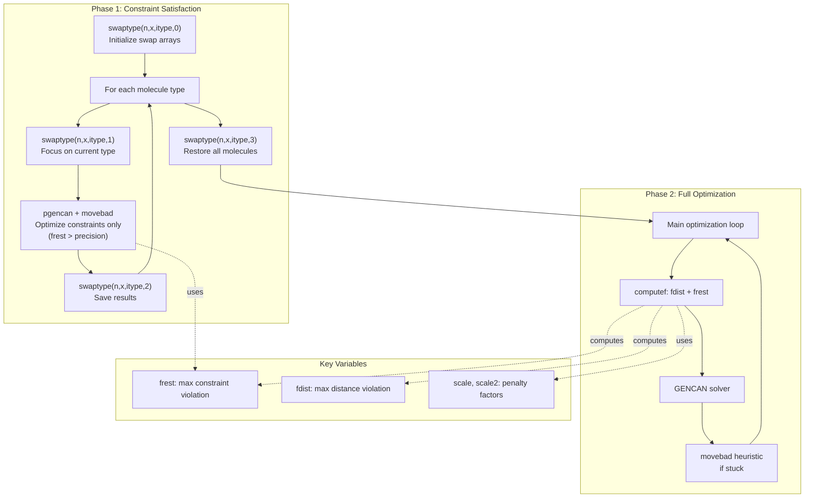
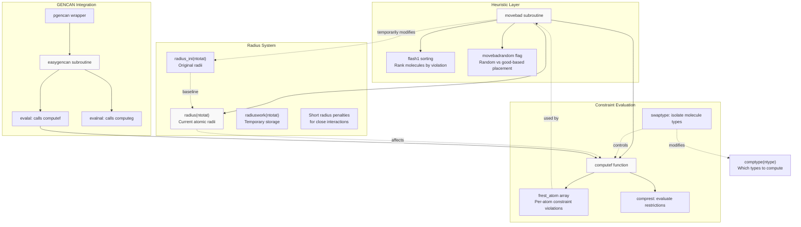
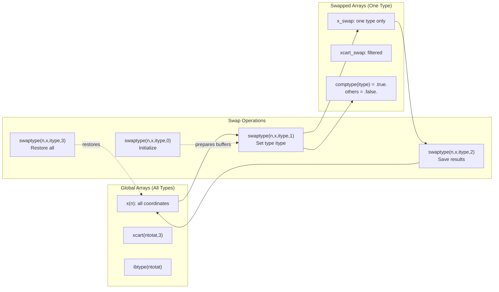

# Advanced Topics

<details>
<summary>Relevant source files</summary>

The following files were used as context for generating this wiki page:

- [src/ahestetic.f90](src/ahestetic.f90)
- [src/gencan.f](src/gencan.f)
- [src/gencan_ieee_signal_routines.f90](src/gencan_ieee_signal_routines.f90)
- [src/heuristics.f90](src/heuristics.f90)
- [src/initial.f90](src/initial.f90)

</details>


This document covers advanced optimization algorithms and sophisticated techniques employed by Packmol to achieve efficient and reliable molecular packing. These topics go beyond basic usage and architecture to explore the heuristics, constraint satisfaction mechanisms, and adaptive penalty systems that enable Packmol to handle complex packing scenarios.

**Scope**: This page provides an overview of three advanced subsystems that distinguish Packmol's optimization approach. For details on the basic optimization loop, see [Optimization Engine (GENCAN)](#4.4). For standard constraint definitions, see [Spatial Constraints](#3.2). For the overall execution flow, see [Program Execution Flow](#4.2).

The three subsystems covered here are:
- **Heuristics and Local Search** ([7.1](#7.1)): Strategies for escaping local minima
- **Constraint System Implementation** ([7.2](#7.2)): Two-phase optimization and type-based constraint satisfaction
- **Radius and Tolerance System** ([7.3](#7.3)): Adaptive penalty scaling and short-range interactions

## Overview of Advanced Optimization Strategies

Packmol employs several sophisticated techniques beyond standard gradient-based optimization to achieve robust molecular packing:

### Multi-Phase Optimization Strategy



**Sources**: [src/initial.f90:168-225](), [src/initial.f90:518-550]()

### Key Design Principles

| Principle | Implementation | Purpose |
|-----------|----------------|---------|
| **Type-based isolation** | `swaptype` mechanism | Optimize each molecule type independently during initialization |
| **Hierarchical objectives** | `frest` vs `fdist` | Satisfy constraints before minimizing distances |
| **Adaptive penalties** | `scale`, `scale2`, radius adjustments | Balance constraint satisfaction with distance optimization |
| **Escape mechanisms** | `movebad` heuristic | Overcome poor local minima by relocating worst molecules |
| **Gradual convergence** | `init1` flag, `comptype` array | Different behavior during initialization vs main optimization |

The variables `frest` and `fdist` represent maximum violations across all atoms:
- **`frest`**: Maximum constraint violation (geometric restrictions)
- **`fdist`**: Maximum distance penalty (atom-atom overlaps)

The objective function combines these: `f = fdist + scale*frest + scale2*other_terms`

**Sources**: [src/initial.f90:47-51](), [src/initial.f90:174-225]()

## Interaction Between Advanced Subsystems



**Sources**: [src/heuristics.f90:9-149](), [src/initial.f90:168-225](), [src/gencan.f:54-57]()

## The `swaptype` Mechanism

One of the most sophisticated features in Packmol is the `swaptype` mechanism, which enables type-based optimization. This mechanism temporarily modifies global arrays to focus computation on a single molecule type.



The `swaptype` operations:
- **Mode 0**: Initialize swap buffers and save original arrays
- **Mode 1**: Focus on molecule type `itype` by setting `comptype(itype)=.true.` and others to `.false.`
- **Mode 2**: Save optimized coordinates for current type back to buffers
- **Mode 3**: Restore all molecule types to global arrays

This allows the objective function `computef` to compute contributions only for the active type, significantly reducing computational cost during the constraint satisfaction phase.

**Sources**: [src/initial.f90:175-183](), [src/initial.f90:206]()

## Penalty Scaling Strategy

Packmol uses a hierarchical penalty system to balance competing objectives:

| Variable | Initial Value | Purpose | When Modified |
|----------|---------------|---------|---------------|
| `scale` | `1.0` | Constraint penalty multiplier | Line 50: set to 1.0 |
| `scale2` | `0.01` | Secondary penalty multiplier | Line 51: set to 1.0e-2 |
| `precision` | User-defined | Convergence threshold | Input parameter |
| `init1` | `.true.`/`.false.` | Initialization mode flag | Set before each phase |

The objective function structure:
```
f = fdist + scale * frest + scale2 * (other penalties)
```

During Phase 1 (constraint satisfaction):
- `init1 = .true.`
- Only `frest` is computed (constraint violations)
- Distance penalties (`fdist`) are ignored
- Goal: `frest < precision`

During Phase 2 (full optimization):
- `init1 = .false.`
- Both `fdist` and `frest` are computed
- Full objective function minimized

**Sources**: [src/initial.f90:47-52](), [src/initial.f90:174](), [src/initial.f90:225]()

## Performance Optimizations

### Adaptive Iteration Limits

The number of constraint satisfaction iterations per molecule type can be controlled:

```fortran
! From input parsing
nloop0_type(itype)  ! Per-type iteration limit

! Usage in initial.f90
do while( frest > precision .and. i <= nloop0_type(itype)-1 .and. hasbad)
   i = i + 1
   call pgencan(n,x,fx)
   call computef(n,x,fx)
   if(frest > precision) then
      call movebad(n,x,fx,movebadprint)
   end if
end do
```

**Sources**: [src/initial.f90:191-201](), [src/initial.f90:535-545]()

### The `move` Flag

The global logical variable `move` controls radius behavior in `movebad`:

```fortran
! Before movebad
move = .true.
do i = 1, ntotat
   radiuswork(i) = radius(i)     ! Save current radii
   radius(i) = radius_ini(i)      ! Reset to original
end do
call computef(n,x,fx)             ! Evaluate with original radii
move = .false.

! After movebad
do i = 1, ntotat
   radius(i) = radiuswork(i)      ! Restore working radii
end do
```

This temporarily reverts to original atomic radii when evaluating which molecules are "bad", ensuring consistent criteria for relocation decisions.

**Sources**: [src/heuristics.f90:43-50](), [src/heuristics.f90:144-146]()

## GENCAN Parameter Tuning

Packmol uses customized GENCAN parameters to balance accuracy and performance:

| Parameter | Value | Purpose |
|-----------|-------|---------|
| `delmin` | `1e-2` | Minimum trust region radius (modified from default) |
| `cgmaxit` | `min(20, calculated)` | Maximum CG iterations (capped for speed) |
| `fmin` | `1e-5` | Function value threshold |
| `trtype` | `1` | Trust region type (sup-norm) |
| `eta` | `0.9` | Face abandonment parameter |

The trust region radius is aggressively limited to accelerate convergence:

```fortran
! In gencan_ieee_signal_routines.f90
cgmaxit = int((1.0d0 - kappa) * max(1.0d0, 10.0d0 * log10(dfloat(nind))) 
           + kappa * dfloat(nind))
cgmaxit = min(20, cgmaxit)  ! L. Martinez addition
```

This modification speeds up iterations near the solution by limiting the computational effort spent on computing precise Newton directions.

**Sources**: [src/gencan.f:659](), [src/gencan_ieee_signal_routines.f90:32-34](), [src/gencan.f:667]()

## Error Handling and Diagnostics

When optimization fails, Packmol provides detailed diagnostics:

```fortran
if (hasbad .and. frest > precision) then
   write(*,*) ' ERROR: Packmol was unable to put the molecules'
   write(*,*) '        in the desired regions even without'
   write(*,*) '        considering distance tolerances.'
   write(*,*) ' >The maximum number of cycles (', nloop0_type(itype), &
              ') was achieved.'
   write(*,*) '  You may try increasing it with the nloop0 keyword'
   stop exit_code_failed_to_converge
end if
```

The system distinguishes between:
1. **Constraint satisfaction failure**: Cannot place molecules in specified regions
2. **Distance optimization failure**: Molecules placed but overlapping
3. **Iteration limit reached**: Need more optimization cycles

**Sources**: [src/initial.f90:208-223]()

## Summary of Advanced Subsystems

The three advanced subsystems work together to provide robust optimization:

1. **Heuristics ([7.1](#7.1))**: The `movebad` function identifies poorly placed molecules using `flash1` sorting and relocates them, either randomly or near well-placed molecules, to escape local minima.

2. **Constraint System ([7.2](#7.2))**: The `swaptype` mechanism enables type-by-type optimization during initialization, using the `comptype` array to control which molecules contribute to the objective function, ensuring geometric constraints are satisfied before distance optimization.

3. **Radius System ([7.3](#7.3))**: Atomic radii stored in the `radius` array are dynamically adjusted during optimization, with `radius_ini` providing baseline values and temporary modifications enabling different evaluation criteria for different optimization phases.

These subsystems are deeply integrated with the GENCAN solver through the `evalal` and `evalnal` callbacks, which invoke `computef` and `computeg` respectively to evaluate the objective function and gradient.

**Sources**: [src/initial.f90:1-558](), [src/heuristics.f90:1-150](), [src/gencan.f:1-740]()

---