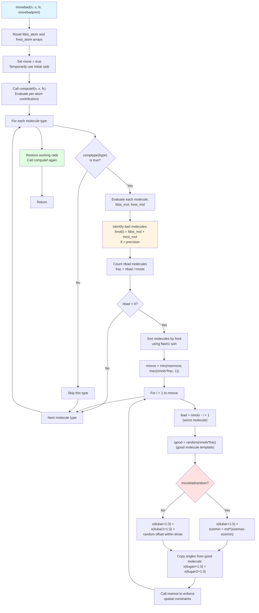
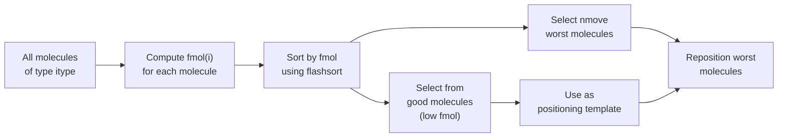
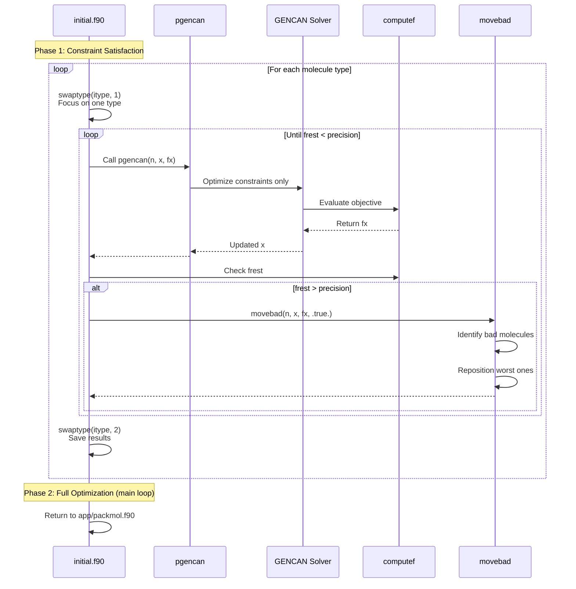
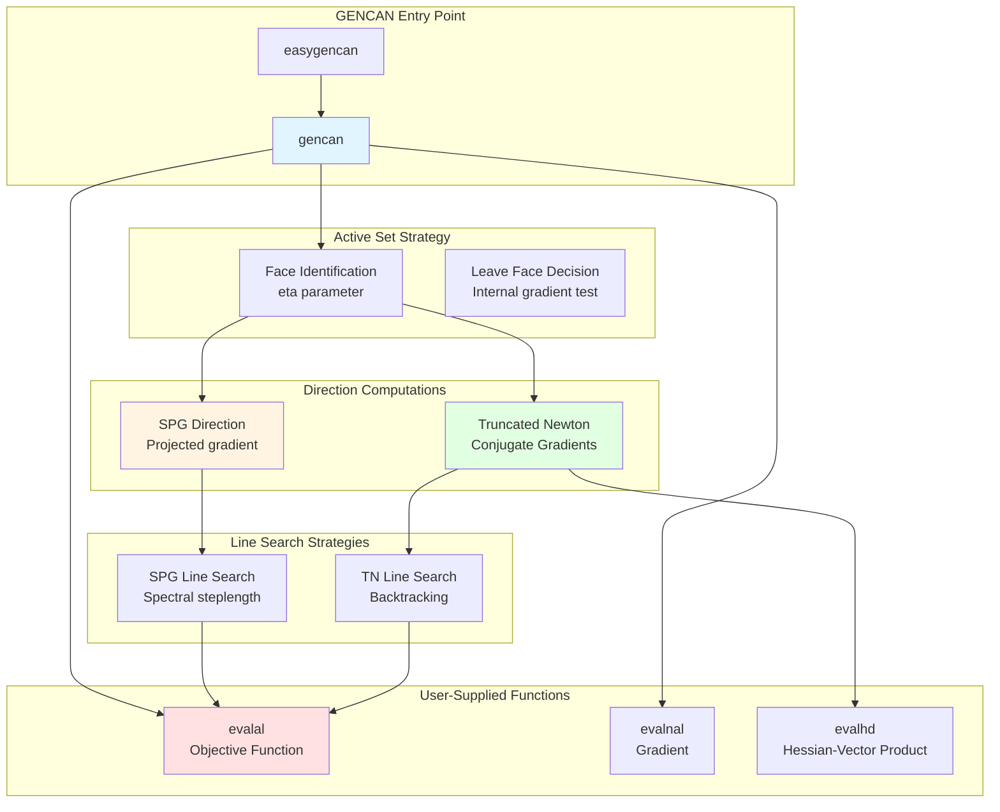
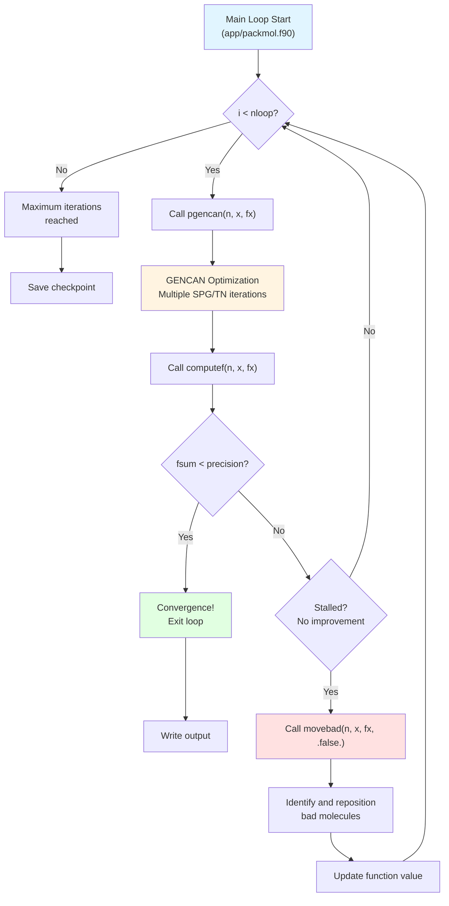

# Heuristics and Local Search

<details>
<summary>Relevant source files</summary>

The following files were used as context for generating this wiki page:

- [src/ahestetic.f90](src/ahestetic.f90)
- [src/gencan.f](src/gencan.f)
- [src/gencan_ieee_signal_routines.f90](src/gencan_ieee_signal_routines.f90)
- [src/heuristics.f90](src/heuristics.f90)
- [src/initial.f90](src/initial.f90)

</details>


## Purpose and Scope

This document describes the heuristics and local search strategies employed by Packmol to escape local minima and converge to feasible molecular packing solutions. The primary mechanisms are:

1. **The `movebad` heuristic** - repositions problematic molecules that violate constraints or have poor packing
2. **GENCAN local search** - the underlying bound-constrained optimization solver with spectral projected gradient and truncated Newton methods

For information about the overall optimization framework and objective function evaluation, see [Optimization Engine (GENCAN)](#4.4) and [Objective Function Evaluation](#4.6). For details on constraint evaluation, see [Constraint System Implementation](#7.2).

---

## The Challenge: Local Minima in Molecular Packing

Molecular packing problems have highly non-convex objective functions with numerous local minima. A molecule may satisfy spatial constraints but be trapped in a poor orientation relative to other molecules, or vice versa. The optimization can stagnate when the gradient-based GENCAN solver cannot find improving directions from such configurations.

Packmol addresses this through a hybrid approach: **pure gradient-based optimization** (GENCAN) alternating with **heuristic repositioning** (movebad) when convergence stalls.

---

## The movebad Heuristic

### Overview

The `movebad` subroutine identifies molecules with high objective function contributions and relocates them to potentially better positions. This provides a mechanism to escape local minima that gradient-based methods cannot overcome.

**Sources:** [src/heuristics.f90:1-150]()

### Algorithm Flow



**Sources:** [src/heuristics.f90:9-149]()

### Key Components

#### Per-Atom Contribution Tracking

The heuristic requires per-atom objective function contributions to identify problematic molecules:

| Array | Purpose |
|-------|---------|
| `fdist_atom(icart)` | Distance violation contribution for atom `icart` |
| `frest_atom(icart)` | Constraint violation contribution for atom `icart` |
| `fmol(imol)` | Total violation for molecule `imol` (sum over atoms) |

These arrays are populated during `computef` evaluation when the `move` flag is set to `.true.`.

**Sources:** [src/heuristics.f90:36-42](), [src/compute_data.f90]()

#### Molecule Selection Strategy



**Sources:** [src/heuristics.f90:89-93]()

#### Repositioning Strategies

The heuristic supports two repositioning modes controlled by the `movebadrandom` parameter:

**Random Repositioning** (`movebadrandom = true`):
```fortran
x(ilubar+1) = sizemin(1) + rnd()*(sizemax(1)-sizemin(1))
x(ilubar+2) = sizemin(2) + rnd()*(sizemax(2)-sizemin(2))
x(ilubar+3) = sizemin(3) + rnd()*(sizemax(3)-sizemin(3))
```

**Template-Based Repositioning** (`movebadrandom = false`, default):
```fortran
x(ilubar+1) = x(ilubar2+1) - 0.3*dmax(itype) + 0.6*rnd()*dmax(itype)
x(ilubar+2) = x(ilubar2+2) - 0.3*dmax(itype) + 0.6*rnd()*dmax(itype)
x(ilubar+3) = x(ilubar2+3) - 0.3*dmax(itype) + 0.6*rnd()*dmax(itype)
```

The template-based approach places the bad molecule near a randomly selected "good" molecule (one with low `fmol`), offsetting it by a random displacement within the molecular diameter `dmax(itype)`. This exploits the assumption that good molecules are in favorable regions of space.

**Sources:** [src/heuristics.f90:119-127]()

### Control Parameters

| Parameter | Type | Default | Description |
|-----------|------|---------|-------------|
| `movefrac` | `double precision` | 0.05 | Maximum fraction of molecules to move per call |
| `maxmove(itype)` | `integer` | - | Maximum number of molecules of type `itype` to move |
| `movebadrandom` | `logical` | `.false.` | If true, use random positioning; else use template-based |

The actual number of molecules moved is:
```fortran
nmove = min(maxmove(itype), max(int(nmols(itype)*frac), 1))
```

**Sources:** [src/heuristics.f90:80-96](), [src/input.f90]()

### Temporary Radius Adjustment

During `movebad` evaluation, atom radii are temporarily reset to their initial values (`radius_ini`) before applying any short-radius scaling. This ensures bad molecules are identified based on actual violations, not artificially reduced penalties.

```fortran
do i = 1, ntotat
   radiuswork(i) = radius(i)
   radius(i) = radius_ini(i)
end do
call computef(n,x,fx)
! ... movebad logic ...
do i = 1, ntotat
   radius(i) = radiuswork(i)
end do
```

**Sources:** [src/heuristics.f90:45-48](), [src/heuristics.f90:144-146]()

---

## Integration with GENCAN Optimization

### Two-Phase Optimization Strategy

Packmol employs a two-phase approach where GENCAN and `movebad` alternate:



**Sources:** [src/initial.f90:167-225](), [src/initial.f90:516-550]()

### The swaptype Mechanism

To handle molecule types independently during constraint satisfaction, Packmol uses a `swaptype` mechanism that temporarily focuses optimization on a single molecule type:

| Operation | Code | Effect |
|-----------|------|--------|
| Initialize | `swaptype(n, x, itype, 0)` | Allocate swap arrays |
| Set type | `swaptype(n, x, itype, 1)` | Configure for type `itype` only |
| Save results | `swaptype(n, x, itype, 2)` | Store current type's solution |
| Restore all | `swaptype(n, x, itype, 3)` | Return to full system |

This allows Packmol to ensure each molecule type can satisfy its constraints independently before attempting full system optimization.

**Sources:** [src/initial.f90:175-224](), [src/swaptype.f90]()

### Constraint-Only Optimization Phase

During Phase 1 initialization, `movebad` is called after each GENCAN iteration if constraint violations persist:

```fortran
do while(frest > precision .and. i <= nloop0_type(itype)-1 .and. hasbad)
   i = i + 1
   call pgencan(n,x,fx)
   call computef(n,x,fx)
   if(frest > precision) then
      movebadprint = .true.
      call movebad(n,x,fx,movebadprint)
   end if
end do
```

The `init1` flag (set to `.true.` during initialization) signals to `computef` that only constraint penalties should be evaluated, not distance penalties between molecules.

**Sources:** [src/initial.f90:189-201](), [src/initial.f90:534-545]()

---

## GENCAN Local Search Algorithm

### Overview

GENCAN (Gradient-based algorithm for Exact bound-Constrained Optimization with Active set strategy and Nonmonotone line search) is the core optimization solver. It implements a Spectral Projected Gradient (SPG) method combined with Truncated Newton directions.

**Sources:** [src/gencan.f:750-758]()

### Architecture



**Sources:** [src/gencan.f:750-990]()

### Spectral Projected Gradient Method

The SPG method computes a search direction as the projection of the negative gradient onto the feasible region, scaled by a spectral steplength:

1. **Spectral Steplength Computation:**
   - Based on previous iteration's change in position (`s = x_new - x_old`) and gradient (`y = g_new - g_old`)
   - Steplength: `lambda = <s,s> / <s,y>` (bounded by `[lspgmi, lspgma]`)

2. **Projected Gradient Direction:**
   ```
   d = P[x - lambda * g] - x
   ```
   where `P[·]` projects onto the box constraints `[l, u]`

3. **Non-monotone Line Search:**
   - Uses Armijo condition with reference to maximum of last several function values
   - Allows temporary increases in function value to escape local minima

**Sources:** [src/gencan.f:466-478]()

### Truncated Newton with Conjugate Gradients

When the SPG direction produces insufficient progress, GENCAN computes a Truncated Newton direction by approximately solving:

```
H d = -g
```

where `H` is the Hessian (or an approximation). This is done via Conjugate Gradients with:

- **Trust Region:** Either Euclidean ball or box constraint (controlled by `trtype` parameter)
- **Adaptive Termination:** CG stops when quadratic model stops improving or trust region boundary is reached
- **Inexact Solution:** Allows early termination based on current optimization progress

The trust region radius `delta` is adjusted based on agreement between actual and predicted function reduction.

**Sources:** [src/gencan.f:646-711]()

### Integration with Packmol

Packmol provides three key functions to GENCAN:

#### evalal - Objective Function

```fortran
subroutine evalal(n,x,m,lambda,rho,f,flag)
   flag = 0
   call computef(n,x,f)
end subroutine
```

**Sources:** [src/gencan.f:4-57]()

#### evalnal - Gradient

```fortran
subroutine evalnal(n,x,m,lambda,rho,g,flag)
   flag = 0
   call computeg(n,x,g)
end subroutine
```

**Sources:** [src/gencan.f:62-115]()

#### evalhd - Hessian-Vector Product (Not Used)

Packmol sets `htvtype = 1`, meaning GENCAN uses finite-difference approximations for Hessian-vector products rather than analytical derivatives. The `evalhd` subroutine is a stub.

**Sources:** [src/gencan.f:125-196]()

### GENCAN Parameters

Key parameters controlling GENCAN behavior (set in `easygencan`):

| Parameter | Value | Purpose |
|-----------|-------|---------|
| `gtype` | 0 | Use user-supplied gradient (analytical) |
| `htvtype` | 1 | Use finite-difference Hessian-vector products |
| `trtype` | 1 | Use sup-norm trust region (box) |
| `epsgpsn` | Input | Stopping criterion: sup-norm of projected gradient |
| `eta` | 0.9 | Face-leaving parameter (high = aggressive face exploration) |
| `lspgma` | 1.0e+10 | Maximum spectral steplength |
| `lspgmi` | 1.0e-10 | Minimum spectral steplength |
| `delmin` | 1.0e-2 | Minimum trust region radius |
| `cgmaxit` | -1 | Auto-determined CG iteration limit |

**Sources:** [src/gencan.f:569-678](), [src/gencan.f:659]()

---

## Main Optimization Loop Integration

### Complete Optimization Cycle



**Sources:** [src/initial.f90:189-201](), [app/packmol.f90]()

### Adaptive Radius Scaling

During optimization, Packmol may adjust atom radii to help convergence:

1. **Initial Radii** (`radius_ini`): User-specified values
2. **Short Radius** (`short_radius`, `short_radius_scale`): Temporarily reduced radii to allow closer packing
3. **Working Radii** (`radius`): Current values used in objective function

The radius scaling is gradually reduced as optimization progresses, allowing molecules to pack more tightly while maintaining constraint satisfaction.

**Sources:** [src/radius.f90](), [Page 7.3](#7.3)

### Convergence Criteria

The main loop terminates when:

```fortran
if (fsum < precision) then
   ! Success: all distance and constraint violations below tolerance
   exit
end if
```

Where:
- `fsum = fdist + frest`
- `fdist`: Maximum distance violation across all atom pairs
- `frest`: Maximum constraint violation
- `precision`: User-specified tolerance (default 0.01)

**Sources:** [src/compute_data.f90]()

---

## Performance Characteristics

### movebad Efficiency

The `movebad` heuristic uses flashsort for efficient molecule sorting:

```fortran
mflash = 1 + nmols(itype)/10
call flash1(fmol, nmols(itype), lflash, mflash, indflash)
```

Flashsort has O(n) average complexity for distributions with bounded range, making `movebad` scale linearly with the number of molecules.

**Sources:** [src/heuristics.f90:91-92](), [src/flashsort.f90]()

### GENCAN Complexity

Each GENCAN iteration requires:
- **Objective evaluation** (`computef`): O(N) with cell indexing (see [Spatial Management System](#4.5))
- **Gradient evaluation** (`computeg`): O(N) 
- **CG iterations**: O(n) to O(n²) depending on Hessian conditioning

Where N is the number of atoms and n is the optimization variable count (6 × number of molecules).

**Sources:** [src/gencan.f:729-738]()

### Hybrid Strategy Benefits

| Approach | Strengths | Limitations |
|----------|-----------|-------------|
| GENCAN alone | Fast convergence near optimal | Trapped in local minima |
| movebad alone | Escapes local minima | No refinement mechanism |
| Hybrid | Combines global exploration with local refinement | Requires parameter tuning |

The hybrid strategy allows Packmol to handle complex packing scenarios that pure gradient methods or pure heuristics cannot solve individually.

---

## Summary

Packmol's heuristic and local search framework combines:

1. **Gradient-based optimization** via GENCAN (SPG + Truncated Newton)
2. **Heuristic repositioning** via `movebad` to escape local minima
3. **Type-specific handling** via `swaptype` for constraint satisfaction
4. **Adaptive parameters** (radii, trust regions) to guide convergence

This multi-strategy approach enables robust convergence across diverse molecular packing problems, from simple box filling to complex biological assemblies with intricate spatial constraints.

**Sources:** [src/heuristics.f90:1-150](), [src/gencan.f:750-758](), [src/initial.f90:167-225]()

---