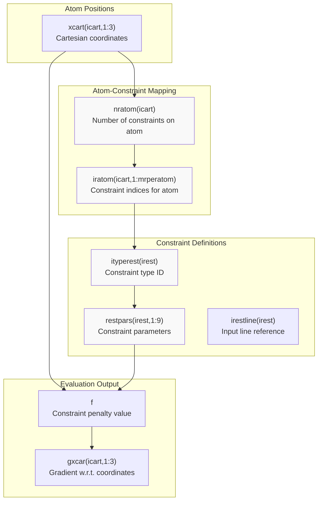
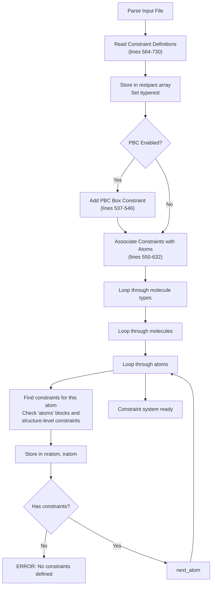
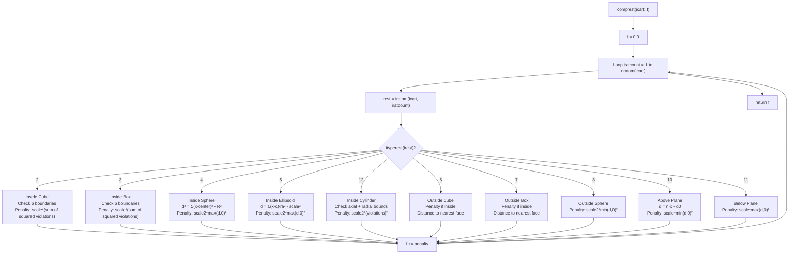
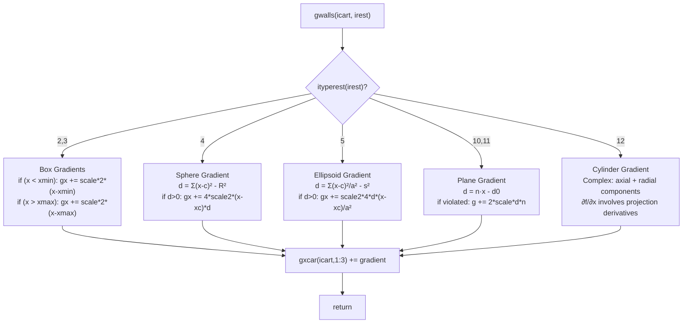

# Constraint System Implementation

<details>
<summary>Relevant source files</summary>

The following files were used as context for generating this wiki page:

- [app/packmol.f90](app/packmol.f90)
- [src/checkpoint.f90](src/checkpoint.f90)
- [src/comprest.f90](src/comprest.f90)
- [src/getinp.f90](src/getinp.f90)
- [src/gwalls.f90](src/gwalls.f90)
- [src/input.f90](src/input.f90)
- [src/output.f90](src/output.f90)

</details>


This page documents the geometric constraint system in Packmol, which restricts molecular placement to specific spatial regions. The constraint system evaluates penalty functions when atoms violate geometric boundaries and computes their gradients for optimization.

For information about how constraints are integrated into the optimization loop, see [Objective Function Evaluation](#4.6). For constraint input syntax, see [Spatial Constraints](#3.2).

## Overview

The constraint system consists of three main components:
1. **Constraint parsing** - reading constraint definitions from input files
2. **Constraint evaluation** - computing penalty values when constraints are violated
3. **Gradient computation** - computing derivatives for optimization

Constraints are applied at the atomic level, with each atom potentially subject to multiple geometric restrictions.

## Constraint Data Structures

The constraint system uses several key data structures to store and evaluate constraints:



**Sources:** [src/comprest.f90:11-27](), [src/gwalls.f90:9-22](), [src/compute_data.f90]()

| Data Structure | Type | Purpose |
|----------------|------|---------|
| `ityperest(irest)` | Integer | Constraint type identifier (1-15) |
| `restpars(irest,1:9)` | Double precision | Type-specific parameters (center, radius, etc.) |
| `irestline(irest)` | Integer | Line number in input file (for error reporting) |
| `nratom(icart)` | Integer | Number of constraints applied to atom `icart` |
| `iratom(icart,i)` | Integer | Index of i-th constraint for atom `icart` |
| `scale`, `scale2` | Double precision | Scaling factors for penalty functions |

**Sources:** [src/compute_data.f90](), [src/input.f90:13-81]()

## Constraint Type Hierarchy

Packmol supports 15 distinct constraint types, organized into categories:

```mermaid
graph TB
    root["Constraint Types"]
    
    root --> fixed["1: Fixed Position"]
    
    root --> inside["Inside Constraints"]
    inside --> cube_in["2: Inside Cube"]
    inside --> box_in["3: Inside Box"]
    inside --> sphere_in["4: Inside Sphere"]
    inside --> ellipsoid_in["5: Inside Ellipsoid"]
    inside --> cylinder_in["12: Inside Cylinder"]
    
    root --> outside["Outside Constraints"]
    outside --> cube_out["6: Outside Cube"]
    outside --> box_out["7: Outside Box"]
    outside --> sphere_out["8: Outside Sphere"]
    outside --> ellipsoid_out["9: Outside Ellipsoid"]
    outside --> cylinder_out["13: Outside Cylinder"]
    
    root --> planar["Planar Constraints"]
    planar --> above["10: Above Plane"]
    planar --> below["11: Below Plane"]
    planar --> above_gauss["14: Above XY Gaussian"]
    planar --> below_gauss["15: Below XY Gaussian"]
```



**Sources:** [src/comprest.f90:29-212](), [src/getinp.f90:564-730]()

### Constraint Parameter Definitions

Different constraint types use `restpars` array differently:

| Type | Parameters | Description |
|------|------------|-------------|
| 1 | `(x,y,z,beta,gama,teta)` | Fixed position and orientation |
| 2 | `(xmin,ymin,zmin,side_length)` | Cube corner and side length |
| 3 | `(xmin,ymin,zmin,xmax,ymax,zmax)` | Box bounds |
| 4 | `(xcenter,ycenter,zcenter,radius)` | Sphere center and radius |
| 5 | `(xcenter,ycenter,zcenter,a,b,c,scale)` | Ellipsoid center and semi-axes |
| 12 | `(x0,y0,z0,vx,vy,vz,radius,norm,length)` | Cylinder base, direction, dimensions |

**Sources:** [src/getinp.f90:564-690](), [src/comprest.f90:29-212]()

## Constraint Parsing and Association

The constraint parsing process occurs in `getinp.f90` and involves multiple stages:



**Sources:** [src/getinp.f90:558-738](), [app/packmol.f90:530-632]()

### Atom-Constraint Association Algorithm

The algorithm for associating constraints with atoms [src/getinp.f90:550-632]():

1. Initialize `nratom(icart) = 0` for all atoms
2. For each atom, scan through structure definition lines
3. Check if constraint applies to:
   - Specific atoms (via `atoms` block)
   - All atoms in structure (structure-level constraint)
4. Store constraint indices in `iratom(icart,1:mrperatom)`
5. If PBC is enabled, add the PBC box constraint to all non-fixed atoms
6. Verify each atom has at least one constraint (error if not)

**Sources:** [src/getinp.f90:550-632](), [app/packmol.f90:617-623]()

## Constraint Function Evaluation

The `comprest` subroutine computes the penalty value for constraint violations for a single atom:



**Sources:** [src/comprest.f90:11-215]()

### Penalty Function Formulations

The constraint system uses two primary penalty function types:

**1. Boundary Constraints (Inside/Outside Box/Cube)**

For axis-aligned boundaries, the penalty accumulates squared distances outside allowed regions:

- **Inside**: Penalty when `x < xmin` or `x > xmax`
- **Outside**: Penalty when `xmin < x < xmax`

```
f += scale * ((min(x-xmin,0))² + (max(x-xmax,0))²)
```

**Sources:** [src/comprest.f90:29-59]()

**2. Radial Constraints (Sphere/Ellipsoid)**

For spheres: `d² = (x-xc)² + (y-yc)² + (z-zc)² - R²`

- **Inside**: Penalty when `d > 0`: `f += scale2 * max(d,0)²`
- **Outside**: Penalty when `d < 0`: `f += scale2 * min(d,0)²`

**Sources:** [src/comprest.f90:60-75](), [src/comprest.f90:129-143]()

**3. Cylindrical Constraints**

The cylinder constraint (types 12 and 13) is the most complex, checking both axial and radial distances:

```
v = normalized direction vector
w = v · (atom_position - cylinder_base)  # projection along axis
d = distance from axis = |atom_position - cylinder_base - w*v|²

Penalty = scale2 * (max(-w,0)² + max(w-length,0)² + max(d-R²,0)²)
```

**Sources:** [src/comprest.f90:158-174]()

## Constraint Gradient Computation

The `gwalls` subroutine computes gradients of constraint penalties with respect to atomic Cartesian coordinates. Each constraint type has a corresponding analytical gradient:



**Sources:** [src/gwalls.f90:9-327]()

### Gradient Implementation Details

**Box/Cube Gradients** [src/gwalls.f90:24-62]():

```fortran
if (x < xmin) then
    gxcar(icart,1) += scale * 2.0 * (x - xmin)
end if
if (x > xmax) then
    gxcar(icart,1) += scale * 2.0 * (x - xmax)
end if
```

**Sphere Gradients** [src/gwalls.f90:63-75]():

```fortran
d = (x-xc)² + (y-yc)² + (z-zc)² - R²
if (d > 0) then
    gxcar(icart,1) += 4.0 * scale2 * (x - xc) * d
    ! Similar for y, z
end if
```

**Cylinder Gradients** [src/gwalls.f90:202-242]():

The cylinder gradient is most complex, involving:
1. Projection onto cylinder axis: `w = v · (x - x0)`
2. Perpendicular distance: `d = |x - x0 - w*v|²`
3. Three penalty terms: axial lower bound, axial upper bound, radial bound
4. Chain rule for derivatives involving projections

**Sources:** [src/gwalls.f90:202-287]()

## Integration with Optimization

The constraint system integrates with the optimization process through two main entry points:

```mermaid
graph TB
    subgraph "Objective Function Evaluation"
        computef["computef(n, x, fx)"]
        loop_atoms["Loop over all atoms"]
        comprest["comprest(icart, f)"]
        accumulate["fx += f"]
    end
    
    subgraph "Gradient Evaluation"
        computeg["computeg(n, x, g)"]
        loop_atoms2["Loop over all atoms"]
        loop_constr["Loop over atom constraints"]
        gwalls["gwalls(icart, irest)"]
        chain_rule["Apply chain rule<br/>glubar, glugan"]
    end
    
    computef --> loop_atoms
    loop_atoms --> comprest
    comprest --> accumulate
    
    computeg --> loop_atoms2
    loop_atoms2 --> loop_constr
    loop_constr --> gwalls
    gwalls --> chain_rule
    
    style computef fill:#f9f9f9
    style computeg fill:#f9f9f9
    style comprest fill:#f9f9f9
    style gwalls fill:#f9f9f9
```



**Sources:** [src/computef.f90](), [src/computeg.f90](), [src/comprest.f90:11-215](), [src/gwalls.f90:9-327]()

### Constraint Scaling

The constraint system uses two scaling factors:

- `scale`: Applied to box/cube/plane constraints (typically 1.0)
- `scale2`: Applied to radial constraints (sphere/ellipsoid/cylinder)

These are set in `compute_data` module and can be adjusted during optimization to emphasize constraint satisfaction.

**Sources:** [src/compute_data.f90](), [src/comprest.f90:14]()

## Special Cases

### Outside Constraints

Outside constraints (types 6-9) are implemented differently from inside constraints:

- For **outside box/cube**: Only penalize if atom is inside the region
- Calculate distance to nearest face and accumulate as penalty
- Uses linear penalty (`scale * distance`) rather than quadratic

**Sources:** [src/comprest.f90:75-128](), [src/gwalls.f90:89-152]()

### Gaussian Surface Constraints

Types 14 and 15 implement Gaussian surface constraints for membrane-like boundaries:

```
h(x,y) = H * exp(-(x-a)²/(2σx²) - (y-b)²/(2σy²))
Constraint: z > h(x,y) (above) or z < h(x,y) (below)
```

The gradient includes both z-component and xy-components due to surface curvature.

**Sources:** [src/comprest.f90:192-211](), [src/gwalls.f90:291-322]()

### PBC Box Constraint

When periodic boundary conditions are enabled, an additional constraint is automatically added to keep all non-fixed atoms inside the PBC box:

```fortran
nrest = nrest + 1
ityperest(nrest) = 3  ! Inside box
restpars(nrest,1:3) = pbc_min
restpars(nrest,4:6) = pbc_max
```

This constraint is associated with all movable atoms during the atom-constraint association phase.

**Sources:** [app/packmol.f90:537-546](), [src/getinp.f90:617-623]()

## Error Handling

The constraint system includes validation at multiple stages:

1. **Input parsing**: Validates constraint parameters (e.g., positive radii, non-zero cylinder directions)
2. **Atom association**: Ensures every movable atom has at least one constraint
3. **Gradient checking**: Optional `chkgrad` mode compares analytical gradients with numerical derivatives

**Sources:** [src/getinp.f90:621-630](), [src/getinp.f90:681-690](), [app/packmol.f90:626-631]()

---