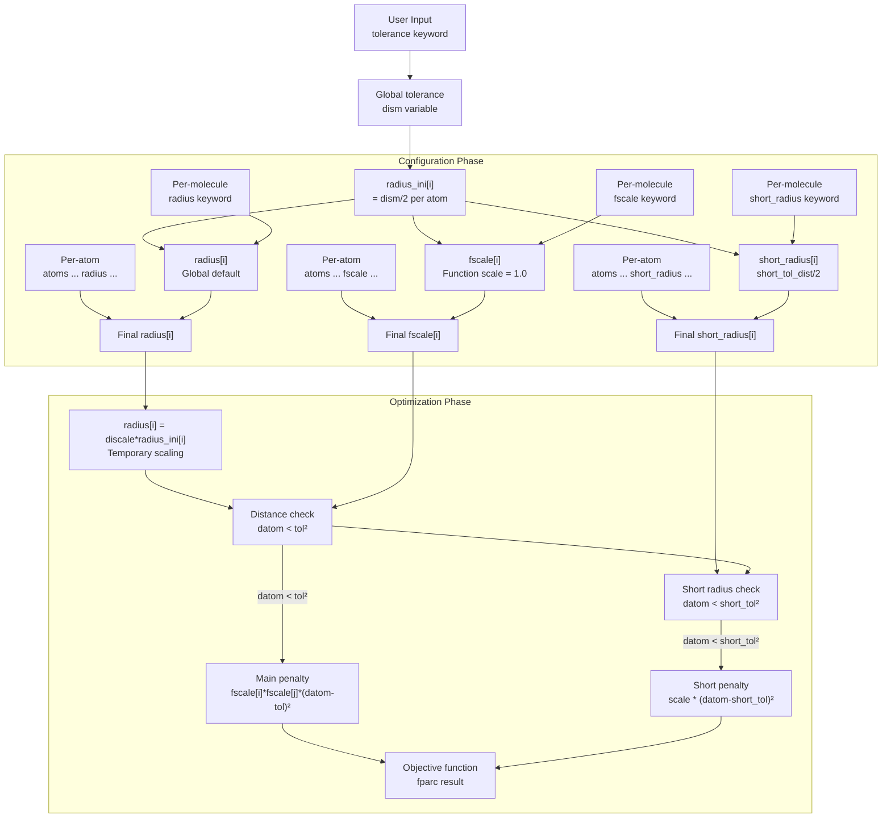
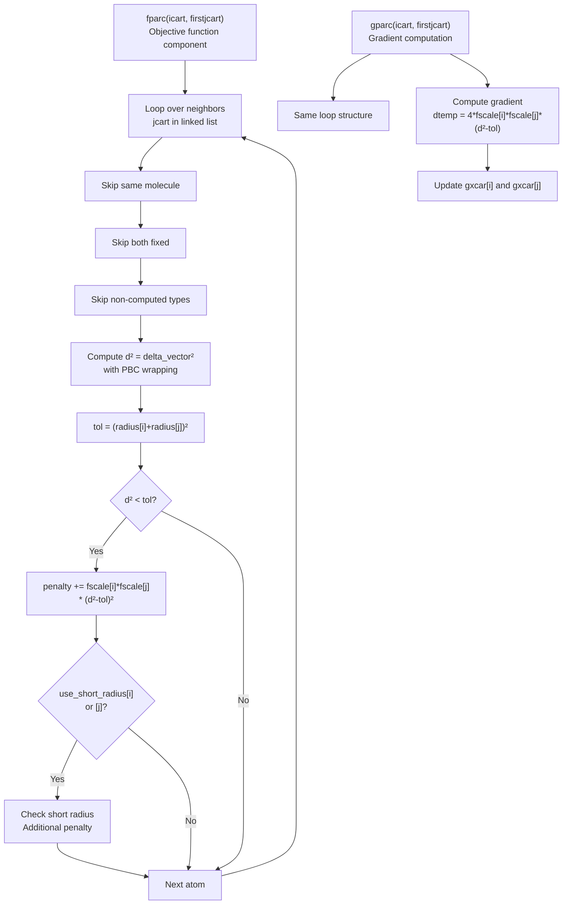
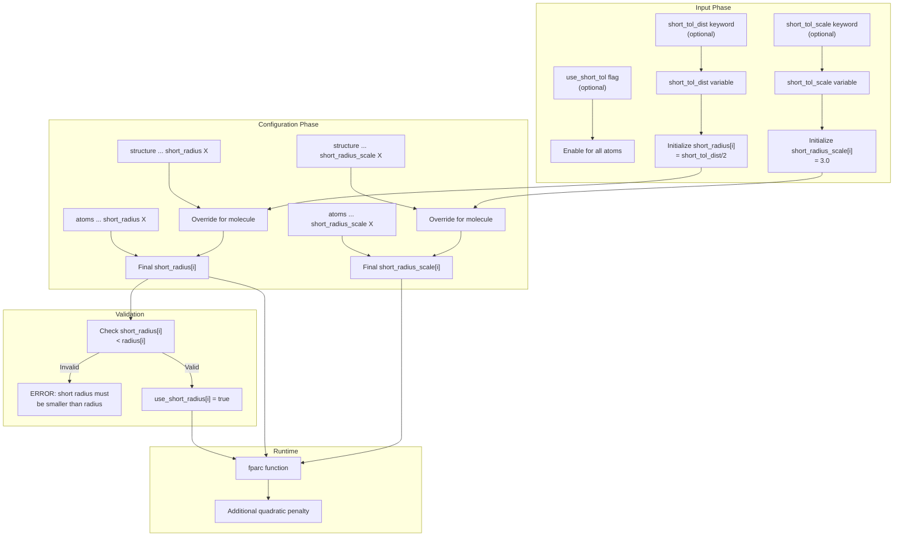
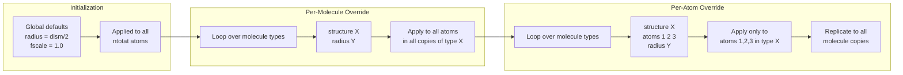
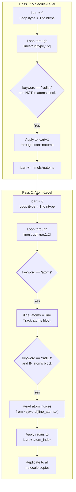
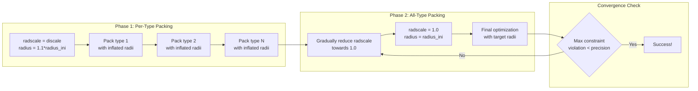
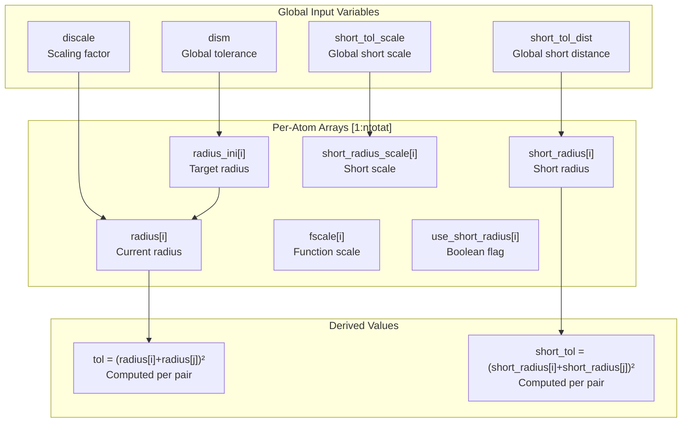
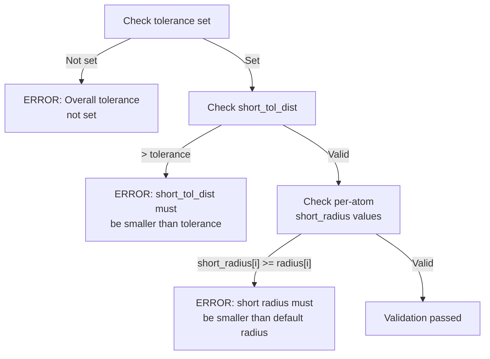

# Radius and Tolerance System

<details>
<summary>Relevant source files</summary>

The following files were used as context for generating this wiki page:

- [app/packmol.f90](app/packmol.f90)
- [src/checkpoint.f90](src/checkpoint.f90)
- [src/fparc.f90](src/fparc.f90)
- [src/getinp.f90](src/getinp.f90)
- [src/gparc.f90](src/gparc.f90)
- [src/input.f90](src/input.f90)
- [src/output.f90](src/output.f90)

</details>


## Purpose and Scope

This page documents Packmol's sophisticated radius and tolerance system, which controls how closely molecules can approach each other during packing. The system uses a two-tier penalty mechanism: a main tolerance that defines target minimum distances, and an optional short-radius penalty that severely penalizes very close contacts. Both can be customized globally, per-molecule, or per-atom.

For information about the objective function that uses these radii, see [Objective Function Evaluation](#4.6). For constraint systems that control molecular placement, see [Constraint System Implementation](#7.2).

## System Overview

The radius/tolerance system implements distance-based penalties in the objective function to prevent atoms from coming too close together. The system operates in generalized coordinate space (center-of-mass positions and Euler angles) but evaluates penalties in Cartesian space after coordinate transformation.

### Conceptual Architecture



**Sources:** [src/getinp.f90:538-776](), [app/packmol.f90:280-528](), [src/fparc.f90:10-77]()

## Main Tolerance System

### Tolerance Parameter

The fundamental parameter is `tolerance`, specified in the input file, which defines the target minimum distance between any two atoms from different molecules:

| Parameter | Variable | Default | Description |
|-----------|----------|---------|-------------|
| `tolerance` | `dism` | Required | Global minimum distance between atoms (Ångströms) |
| `radius[i]` | `radius` | `dism/2` | Per-atom radius, half of tolerance |
| `fscale[i]` | `fscale` | `1.0` | Function scale multiplier for atom i |

The tolerance is read and stored during input parsing:


**Sources:** [src/getinp.f90:538-556](), [app/packmol.f90:282-292]()

### Penalty Function

When two atoms are closer than the sum of their radii, a quadratic penalty is added to the objective function:

For atoms `i` and `j` with distance `d`:
- Tolerance: `tol = (radius[i] + radius[j])²`
- If `d² < tol`: penalty = `fscale[i] * fscale[j] * (d² - tol)²`

The penalty grows quadratically as atoms get closer, creating a strong repulsive force. The `fscale` parameter allows weighting the importance of certain atom pairs.

**Sources:** [src/fparc.f90:53-57](), [src/gparc.f90:51-64]()

### Implementation in fparc and gparc



**Sources:** [src/fparc.f90:25-77](), [src/gparc.f90:24-86]()

## Short Radius Penalty System

### Purpose and Design

The short radius system adds a second, more severe penalty for atoms that come very close together. This creates a two-tier penalty structure:

1. **Main penalty**: Active when `d < radius[i] + radius[j]`
2. **Short penalty**: Active when `d < short_radius[i] + short_radius[j]`

The short penalty has a larger scale factor, making it much more expensive to violate, which helps prevent numerical issues and unphysical configurations.

### Configuration Parameters

| Keyword | Variable | Default | Description |
|---------|----------|---------|-------------|
| `short_tol_dist` | `short_tol_dist` | `dism/2` | Global short distance threshold |
| `short_tol_scale` | `short_tol_scale` | `3.0` | Scale factor for short penalty |
| `use_short_tol` | `use_short_tol` | `false` | Enable for all atoms globally |
| `short_radius` | `short_radius[i]` | `short_tol_dist/2` | Per-atom short radius |
| `short_radius_scale` | `short_radius_scale[i]` | `3.0` | Per-atom scale factor |

**Sources:** [src/getinp.f90:739-776](), [src/input.f90:40-41]()

### Short Radius Penalty Formula

The short radius penalty is added on top of the main penalty:

```
short_tol = (short_radius[i] + short_radius[j])²
short_tol_scale = sqrt(short_radius_scale[i] * short_radius_scale[j]) * (tol² / short_tol²)

if (d² < short_tol):
    additional_penalty = fscale[i] * fscale[j] * short_tol_scale * (d² - short_tol)²
```

The scale factor is computed as the geometric mean of the individual atom scales, then adjusted by the ratio of squared tolerances, making the penalty stronger for shorter distances.

**Sources:** [src/fparc.f90:58-66](), [src/gparc.f90:65-81]()

### Short Radius Data Flow



**Sources:** [app/packmol.f90:518-528](), [src/getinp.f90:739-776]()

## Per-Atom and Per-Molecule Customization

### Configuration Hierarchy

Radius and scale parameters can be set at three levels, with each level overriding the previous:

1. **Global default**: Applied to all atoms initially
2. **Per-molecule**: Applied to all atoms in a specific molecule type
3. **Per-atom**: Applied to specific atoms within a molecule



**Sources:** [app/packmol.f90:294-515]()

### Input File Syntax

**Per-molecule radius:**
```
structure water.pdb
  number 1000
  radius 1.4
  fscale 2.0
  inside box 0 0 0 40 40 40
end structure
```

**Per-atom radius:**
```
structure protein.pdb
  number 1
  atoms 12 45 67  # Specific atoms
    radius 2.0
    short_radius 1.0
    short_radius_scale 5.0
  end atoms
  inside box 0 0 0 50 50 50
end structure
```

**Sources:** [app/packmol.f90:297-515]()

### Implementation Details

The code processes radius settings in two passes:

**Pass 1: Per-molecule settings** (lines 297-388)
- Loops through input lines for each structure block
- When outside `atoms` block, applies values to all atoms of that type
- Stores values in temporary position, then replicates to all molecule copies

**Pass 2: Per-atom settings** (lines 393-515)
- Loops through input lines again
- When inside `atoms` block, applies values only to specified atoms
- Reads atom indices from `atoms` line, applies overrides to those indices
- Replicates per-atom settings to all molecule copies



**Sources:** [app/packmol.f90:297-515]()

## Radius Scaling During Optimization

### Dynamic Scaling with discale

During optimization, Packmol temporarily increases all radii by a factor `discale` (default 1.1) to improve initial separation. As optimization progresses, radii are gradually reduced back to their target values:

```
radius[i] = discale * radius_ini[i]
```

The variable `radius_ini` stores the original target radii, while `radius` holds the currently active (possibly scaled) radii.

### Scaling Timeline



**Sources:** [app/packmol.f90:746-751](), [app/packmol.f90:820-829]()

## Data Structures and Storage

### Arrays and Variables

| Array/Variable | Size | Type | Description |
|----------------|------|------|-------------|
| `dism` | scalar | `double precision` | Global tolerance from input |
| `radius[i]` | `ntotat` | `double precision` | Current radius for atom i (may be scaled) |
| `radius_ini[i]` | `ntotat` | `double precision` | Target radius for atom i (unscaled) |
| `fscale[i]` | `ntotat` | `double precision` | Function scale multiplier for atom i |
| `use_short_radius[i]` | `ntotat` | `logical` | Whether atom i uses short radius |
| `short_radius[i]` | `ntotat` | `double precision` | Short radius for atom i |
| `short_radius_scale[i]` | `ntotat` | `double precision` | Scale factor for short penalty |
| `short_tol_dist` | scalar | `double precision` | Global short distance threshold |
| `short_tol_scale` | scalar | `double precision` | Global short scale factor |
| `discale` | scalar | `double precision` | Temporary scaling factor (default 1.1) |

**Sources:** [src/compute_data.f90](), [src/input.f90:32-41](), [app/packmol.f90:282-292]()

### Memory Layout



**Sources:** [src/input.f90:32-41](), [src/compute_data.f90]()

## Validation and Error Checking

### Constraint Validation

Packmol performs several validation checks on radius parameters:

1. **Tolerance must be set:** The `tolerance` keyword is mandatory
2. **Short radius constraints:** If `use_short_radius[i]` is true, then `short_radius[i] < radius[i]`
3. **Short tolerance bounds:** If set globally, `short_tol_dist < dism`
4. **Non-negative values:** All radius and scale values must be positive



**Sources:** [src/getinp.f90:552-556](), [src/getinp.f90:751-755](), [app/packmol.f90:518-528]()

## Usage Examples

### Example 1: Global Tolerance Only

```
tolerance 2.0

structure water.pdb
  number 1000
  inside box 0 0 0 40 40 40
end structure
```

Result: All atoms have `radius = 1.0` (half of tolerance).

### Example 2: Per-Molecule Custom Radius

```
tolerance 2.0

structure water.pdb
  number 1000
  radius 1.2
  inside box 0 0 0 40 40 40
end structure
```

Result: All water atoms have `radius = 1.2` instead of the default 1.0.

### Example 3: Short Radius Penalty

```
tolerance 2.0
short_tol_dist 1.0
short_tol_scale 5.0
use_short_tol

structure mixture.pdb
  number 500
  inside box 0 0 0 40 40 40
end structure
```

Result: All atoms have two-tier penalties:
- Main penalty: active when `d < 2.0`
- Short penalty: active when `d < 1.0` with 5× scale factor

### Example 4: Per-Atom Customization

```
tolerance 2.0

structure protein.pdb
  number 1
  atoms 1 2 3  # Backbone atoms
    radius 1.8
    short_radius 0.8
    short_radius_scale 10.0
  end atoms
  atoms 45 67 89  # Active site atoms
    radius 2.2
    fscale 3.0
  end atoms
  inside box 0 0 0 50 50 50
end structure
```

Result: Different atoms have different radii and penalties, allowing fine-grained control over packing density.

**Sources:** [src/getinp.f90:538-776](), [app/packmol.f90:294-515]()