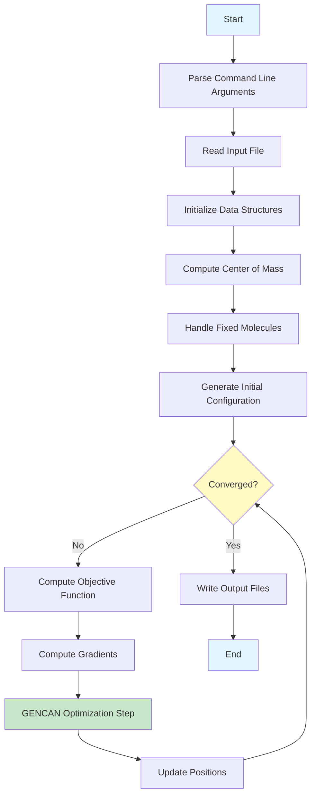

Packmol is a sophisticated molecular packing tool designed to create initial configurations for molecular dynamics simulations by strategically positioning molecules within defined spatial constraints. The program guarantees that short-range repulsive interactions remain stable, ensuring simulation reliability by preventing disruptive atomic overlaps.

The software's core strength lies in its extensive library of spatial constraint types—including boxes, spheres, cylinders, and planes—which enables users to construct highly ordered systems such as lamellar, spherical, or tubular lipid layers with minimal user input. Users simply provide single-molecule coordinate files, specify molecule counts, and define spatial constraints, allowing Packmol to handle the complex optimization problem automatically.

Sources: [README.md](README.md#L1-L15), [packmol.f90](app/packmol.f90#L1-L30)

## Architecture and Core Components

Packmol's architecture follows a modular Fortran design centered around the GENCAN optimization algorithm, which solves the complex nonlinear packing problem through gradient-based minimization of an objective function. The system is built upon three fundamental pillars: input parsing, spatial optimization, and output generation, with supporting modules providing efficient algorithms for neighbor searching, coordinate transformations, and constraint enforcement.

The main program flow orchestrates these components in a sequential pipeline. First, the system parses user input and validates molecular definitions, then initializes optimization variables including center-of-mass positions and Euler angles for each movable molecule. The optimization engine iteratively adjusts these parameters to minimize atomic overlaps and satisfy spatial constraints until convergence criteria are met. Finally, the optimized coordinates are written to user-specified output files in PDB, XYZ, or TINKER formats.

The modular source structure divides functionality across specialized files, each handling specific aspects of the packing problem. The optimization core resides in the GENCAN algorithm and its associated objective function and gradient computation modules, while spatial acceleration techniques like cell indexing and sorting algorithms ensure computational efficiency for large systems.

Sources: [packmol.f90](app/packmol.f90#L35-L98), [CMakeLists.txt](CMakeLists.txt#L12-L50), [computef.f90](src/computef.f90#L1-L30)

## Project Structure and Module Organization

The Packmol codebase is organized into a clear hierarchical structure separating application logic, core algorithms, and testing infrastructure. The top-level directory contains build configuration files and documentation, while implementation modules are distributed between the application entry point and the source library.

The `app/` directory contains the main program entry point `packmol.f90`, which orchestrates the overall execution flow. The `src/` directory houses 29 Fortran modules implementing specific functionality: input parsing (`input.f90`, `getinp.f90`, `cli_parser.f90`), optimization algorithms (`gencan.f`, `usegencan.f90`, `computef.f90`, `computeg.f90`), spatial operations (`cell_indexing.f90`, `pbc.f90`, `polartocart.f90`, `cenmass.f90`), constraint handling (`comprest.f90`, `gwalls.f90`, `restmol.f90`), and utility functions (`flashsort.f90`, `random.f90`, `jacobi.f90`, `strlength.f90`). The `testing/` directory provides comprehensive test suites with input and output file examples demonstrating various use cases.

Sources: [CMakeLists.txt](CMakeLists.txt#L1-L61), [testing/input_files/water_box.inp](testing/input_files/water_box.inp#L1-L15)

## Key Algorithmic Components

The GENCAN optimization method serves as Packmol's computational engine, implementing a gradient-based algorithm for bound-constrained nonlinear optimization. This method operates on a decision vector containing center-of-mass coordinates (3 values per molecule) and Euler angles (3 values per molecule) for all movable molecules, systematically adjusting these parameters to minimize atomic overlaps and constraint violations.

The objective function computes the total penalty score based on three categories of violations: interatomic distance constraints, geometric boundary constraints, and user-defined restrictions. Distance violations use a repulsive potential that scales sharply as atoms approach closer than their minimum allowed distance, while boundary constraints penalize atoms positioned outside their designated regions. The gradient computation provides analytical derivatives of this objective function, enabling efficient convergence through precise descent directions.

> [!TIP]
> Cell indexing is a critical performance optimization that divides the simulation space into a three-dimensional grid of cells. By restricting neighbor searches to adjacent cells, this technique reduces computational complexity from O(n²) to approximately O(n) for large systems, making it possible to pack thousands of molecules efficiently.

Coordinate transformations play a central role in the optimization process. Each molecule's position is represented by its center-of-mass coordinates and three Euler angles defining its orientation. The system continuously converts between this compact representation and full Cartesian coordinates for all atoms during optimization, computing rotation matrices from Euler angles and applying them to atomic coordinates relative to the center of mass.

Sources: [computef.f90](src/computef.f90#L40-L70), [computeg.f90](src/computeg.f90#L1-L50), [cell_indexing.f90](src/cell_indexing.f90#L1-L30), [polartocart.f90](src/polartocart.f90)

## Supported File Formats and Spatial Constraints

Packmol supports multiple molecular structure file formats to accommodate different simulation workflows and user preferences. The PDB (Protein Data Bank) format is the most commonly used, providing standard atomic coordinates along with optional residue and chain information suitable for biomolecular simulations. The XYZ format offers a simple text-based representation with atomic symbols and coordinates, ideal for small molecule systems and quick prototyping. The TINKER format provides additional molecular information including force field parameters, enabling seamless integration with the TINKER molecular modeling package.

The spatial constraint system represents one of Packmol's most powerful features, offering multiple geometric primitives for defining molecular placement regions. Box constraints create rectangular parallelepiped regions, sphere constraints define spherical volumes, cylinder constraints specify tubular volumes, and plane constraints create half-space restrictions. These constraints can be combined in sophisticated ways to construct complex geometries such as lipid bilayers, micelles, vesicles, and solvated protein systems. Users can also fix specific molecules in predetermined positions with specified orientations, serving as scaffolding for building more complex structures.

> [!TIP]
> Periodic boundary conditions (PBC) enable the construction of infinitely repeating systems by treating opposite box faces as connected. This feature is essential for bulk phase simulations and eliminates surface effects that would otherwise dominate the behavior of small systems.

Sources: [README.md](README.md#L20-L25), [input.f90](src/input.f90#L40-L83), [water_box.inp](testing/input_files/water_box.inp#L1-L15)

## Installation and Compilation Methods

Packmol provides multiple installation approaches to accommodate different user environments and expertise levels. The traditional Unix-style compilation using `make` and `configure` scripts offers maximum compatibility across Linux and Unix-like systems, requiring only a Fortran compiler such as gfortran. This method generates an executable in the source directory that can be added to the system PATH for convenient access.

The CMake build system provides a modern cross-platform compilation alternative with better dependency management and IDE integration. This approach automatically detects compiler capabilities and can generate build files for various platforms including Linux, macOS, and Windows. The Fortran Package Manager (fpm) offers the most streamlined installation experience for users familiar with the modern Fortran ecosystem, handling dependency resolution and executable placement automatically.

For users uncomfortable with manual compilation, the Julia package interface provides pre-compiled executables for all common platforms. This approach eliminates compilation concerns entirely while maintaining full access to Packmol's functionality through Julia's package management system. Installation requires only Julia and a single package installation command.

Sources: [README.md](README.md#L30-L65), [CMakeLists.txt](CMakeLists.txt#L1-L15), [Makefile](Makefile#L1-L50)

## Testing and Validation Framework

The comprehensive testing infrastructure ensures code reliability and provides extensive examples for users learning the system. The `testing/` directory contains a Julia-based test suite that validates functionality across diverse scenarios including simple water boxes, lipid bilayers, protein solvation, spherical assemblies, and various periodic boundary condition configurations.

Input file examples demonstrate the syntax and capabilities of different constraint types, from basic box packing to complex multi-region systems with fixed molecules and rotational constraints. Output files serve as references for expected results, while test scripts verify that the optimization produces consistent and physically correct configurations. The test suite also includes failure cases that verify proper error handling and input validation.

Sources: [testing/](testing/), [testing/input_files/water_box.inp](testing/input_files/water_box.inp#L1-L15)

## Scientific Context and Applications

Packmol fills a critical niche in the molecular simulation workflow by addressing the fundamental problem of creating physically reasonable starting configurations. Molecular dynamics simulations are highly sensitive to initial conditions—atomic overlaps or unrealistic geometries can cause simulations to become unstable or require extensive equilibration time. By generating configurations that satisfy geometric constraints while maintaining realistic molecular packing, Packmol enables researchers to begin productive simulations more quickly and with greater confidence.

The software has been widely adopted in academic and industrial research for applications including biomolecular solvation, membrane protein systems, materials science simulations, and drug discovery. Its ability to handle complex geometries makes it particularly valuable for studying lipid bilayers, protein-ligand complexes, nanoparticle assemblies, and other heterogeneous systems where precise molecular placement is critical.

The underlying research has been published in the Journal of Computational Chemistry, establishing the method's scientific validity and providing citations for users acknowledging the software in their publications.

Sources: [README.md](README.md#L70-L80), [packmol.f90](app/packmol.f90#L10-L30)

## Learning Path and Next Steps

For developers beginning their journey with Packmol, we recommend following this structured learning progression to build understanding systematically. Start with the [Quick Start](2-quick-start) guide to install the software and run your first packing job with a simple example. Then proceed to [Input File Syntax and Structure](3-input-file-syntax-and-structure) to master the declarative syntax for defining molecules and constraints.

Once comfortable with basic usage, explore the [Spatial Constraints Syntax](5-spatial-constraints-syntax-box-sphere-plane-cylinder) to understand the full range of geometric primitives available. The [GENCAN Optimization Method Overview](9-gencan-optimization-method-overview) provides insight into the algorithmic foundations, while [Objective Function Design](10-objective-function-design-in-computef-f90) and [Gradient Computation](11-gradient-computation-in-computeg-f90) explain the mathematical details of the optimization process.

For practical applications, refer to the tutorials on building specific systems: [Building Simple Water Boxes](25-building-simple-water-boxes), [Creating Lipid Bilayers](26-creating-lipid-bilayers), [Solvating Proteins with Ions](27-solvating-proteins-with-ions), and [Constructing Vesicles and Micelles](28-constructing-vesicles-and-micelles). These guides combine conceptual explanations with working examples that you can adapt to your own research needs.
