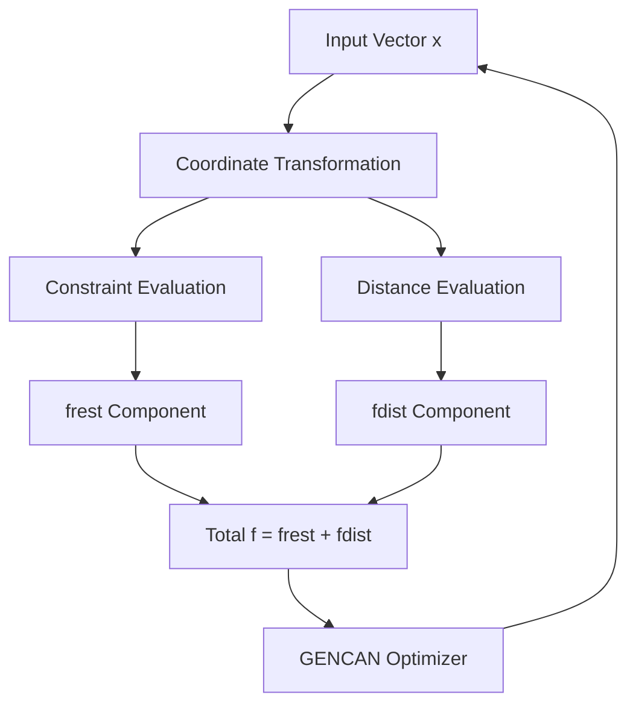

The objective function in Packmol represents a carefully engineered optimization target that encodes molecular packing constraints into a single scalar value. This design balances computational efficiency with mathematical rigor to enable the construction of complex molecular systems without steric clashes.

## Architecture Overview

The objective function architecture implements a **separable penalty formulation** where the total function value comprises two primary components: spatial constraint violations and intermolecular distance violations. This separation allows the GENCAN optimization algorithm to identify distinct regions of infeasibility and systematically eliminate them.



The input vector `x` contains optimization variables organized as concatenated blocks: the first `ntotmol × 3` elements specify molecular center-of-mass coordinates, followed by `ntotmol × 3` elements representing Euler angles for each molecule. This representation decouples translational and rotational degrees of freedom, which is particularly effective for rigid-body molecular packing problems.

## Spatial Constraint Evaluation (frest Component)

Spatial constraint evaluation occurs during the coordinate transformation phase, where each atom's Cartesian position is computed from its molecular baricenter, reference coordinates, and rotation matrix. The `comprest` subroutine assesses every atom against all applicable spatial constraints and accumulates quadratic penalties for violations.

Sources: [src/computef.f90](src/computef.f90#L57-L60), [src/comprest.f90](src/comprest.f90#L12-L216)

The constraint system supports multiple geometric types, each with a specialized penalty function:

| Constraint Type | Penalty Function | Use Case |
|----------------|------------------|----------|
| **Inside Box** (type 2, 3) | `scale × max(x_min - x, 0)²` | Confine atoms to rectangular regions |
| **Inside Sphere** (type 4) | `scale2 × max(r² - R², 0)²` | Spherical containment with smooth boundaries |
| **Inside Cylinder** (type 5) | `scale2 × max(ρ²/a² + z²/c² - 1, 0)²` | Elipsoidal or cylindrical confinement |
| **Outside Cube** (type 6) | `scale × distance_to_surface` | Create hollow regions or voids |
| **Above/Below Plane** (type 10, 11) | `scale × max(±(n·x - d), 0)²` | Planar boundaries with directionality |

The penalty formulation uses **one-sided quadratic functions** where the penalty is zero when the constraint is satisfied and increases quadratically with violation magnitude. This design ensures the objective function is continuously differentiable everywhere, a critical requirement for gradient-based optimization. The global constraint penalty `frest` tracks both the sum of individual atom penalties and the maximum violation across all atoms, providing dual metrics for convergence assessment.

Sources: [src/comprest.f90](src/comprest.f90#L30-L95)

## Coordinate Transformation Pipeline

The transformation from optimization variables to Cartesian coordinates follows a systematic pipeline that enables efficient constraint and distance evaluation:

1. **Variable extraction**: Extract baricenter coordinates `(xcm(1:3))` and Euler angles `(beta, gama, teta)` for each molecule from the input vector
2. **Rotation matrix computation**: Compute orthonormal rotation matrix vectors `(v1, v2, v3)` using the `eulerrmat` subroutine
3. **Atom coordinate computation**: Apply transformation `x_cart = x_cm + v1×x_ref[1] + v2×x_ref[2] + v3×x_ref[3]` for each atom
4. **Cell indexing**: Assign each atom to a spatial cell for efficient neighbor searching

Sources: [src/computef.f90](src/computef.f90#L37-L66), [src/polartocart.f90](src/polartocart.f90#L17-L48)

> [!TIP]
> The rotation convention used in Packmol differs from standard Euler angle definitions: beta rotates around the y-axis, gama around the z-axis, and teta around the x-axis. This convention was chosen for mathematical convenience in derivative calculations rather than human readability.

## Interatomic Distance Evaluation (fdist Component)

The distance evaluation component detects and penalizes atomic overlaps between different molecules, forming the core of the steric clash detection system. The `fparc` function implements a **smooth overlap penalty** that evaluates all atom pairs within neighboring cells and accumulates penalties when their separation distance falls below the sum of their van der Waals radii.

Sources: [src/computef.f90](src/computef.f90#L90-L155), [src/fparc.f90](src/fparc.f90#L17-L79)

The pairwise penalty function follows a **quadratic soft-core formulation**:

```
f_pair = fscale_i × fscale_j × (d_ij² - (r_i + r_j)²)²  when d_ij < r_i + r_j
f_pair = 0                                               when d_ij ≥ r_i + r_j
```

where `d_ij` is the interatomic distance, `r_i` and `r_j` are van der Waals radii, and `fscale` are weighting factors. This formulation ensures that the penalty and its first derivative are continuous at the threshold distance, preventing numerical instabilities in the gradient computation.

Sources: [src/fparc.f90](src/fparc.f90#L47-L51)

The implementation incorporates several important optimizations:

- **Short radius constraints**: When `use_short_radius` is enabled, a secondary tighter tolerance penalizes more severe overlaps with higher weight, creating a multi-scale penalty landscape
- **Pair filtering**: Skip pairs within the same molecule or between two fixed molecules, reducing unnecessary computations
- **Periodic boundary conditions**: The `delta_vector` function applies minimum image convention to compute distances across periodic boundaries

Sources: [src/fparc.f90](src/fparc.f90#L27-L45), [src/fparc.f90](src/fparc.f90#L52-L62)

## Cell-Based Neighbor Search Algorithm

The cell indexing system transforms the naïve O(n²) pairwise distance evaluation into an approximately O(n) algorithm by partitioning space into a regular grid of cells. Each cell dimension is sized to exceed the maximum atomic interaction radius, ensuring that only adjacent cells need to be checked for potential overlaps.

Sources: [src/cell_indexing.f90](src/cell_indexing.f90#L11-L20)

The neighbor search algorithm examines interactions across 27 neighboring cells organized by topological relationship:

| Cell Relationship | Count | Offset Pattern (i,j,k) |
|-------------------|-------|------------------------|
| **Same cell** | 1 | (0,0,0) |
| **Face-sharing** | 6 | (±1,0,0), (0,±1,0), (0,0,±1) |
| **Edge-sharing** | 12 | (±1,±1,0), (±1,0,±1), (0,±1,±1) |
| **Vertex-sharing** | 8 | (±1,±1,±1) |

The implementation traverses this 27-cell neighborhood using linked lists stored in `latomnext` and `latomfirst` arrays, avoiding explicit loops over empty cells and maintaining cache locality. When periodic boundary conditions are active, the `cell_ind` function wraps cell indices to maintain periodic connectivity across cell boundaries.

Sources: [src/computef.f90](src/computef.f90#L100-L154), [src/pbc.f90](src/pbc.f90#L26-L30)

> [!TIP]
> The cell indexing system is initialized once per optimization iteration through the `resetcells` subroutine, which preserves the positions of fixed molecules while resetting the occupancy status for all other atoms. This design avoids repeated cell assignment for fixed molecules, improving computational efficiency.

## Global Objective Function Structure

The complete objective function value `f` represents a weighted sum of all penalty components, with each violation type scaled by appropriate factors to balance their relative importance:

```
f = Σ_constraint_terms + Σ_distance_terms
frest = maximum individual constraint violation
fdist = minimum acceptable interatomic separation
```

Sources: [src/computef.f90](src/computef.f90#L26-L28)

The dual metrics `frest` and `fdist` serve complementary purposes: `frest` identifies the worst constraint violation requiring immediate correction, while `fdist` tracks the global steric quality and determines when the configuration satisfies all distance requirements. During optimization, these metrics guide heuristic operations like the `movebad` procedure, which relocates persistently violating molecules to new random positions when progress stalls.

## Integration with GENCAN Optimizer

The objective function interfaces with the GENCAN (Generalized Conjugate gradient with active set set) nonlinear optimization algorithm through the `evalal` subroutine, which serves as the bridge between the Fortran-based function evaluation and the GENCAN solver interface.

Sources: [src/gencan.f](src/gencan.f#L14-L69)

GENCAN requires a continuously differentiable objective function with known variable bounds, both of which are provided by the Packmol implementation. The gradient computation is delegated to the `computeg` subroutine, which uses analytical derivatives computed directly from the penalty functions rather than finite difference approximations, providing both accuracy and computational efficiency.

The optimization variables are bounded based on the system dimensions and constraint definitions, with baricenter coordinates typically restricted to lie within the spatial domain and Euler angles unconstrained (effectively bounded to [0, 2π] through periodic wrapping in distance calculations).

## Performance Characteristics

The objective function evaluation exhibits the following computational complexity characteristics:

| Component | Complexity | Scaling Factor |
|-----------|------------|----------------|
| **Coordinate transformation** | O(n) | Linear in number of atoms |
| **Constraint evaluation** | O(n × r) | n atoms, r constraints per atom |
| **Distance evaluation** | O(n × c) | n atoms, c neighbors per cell |

The cell-based neighbor search reduces the constant factor in distance evaluation dramatically compared to brute-force O(n²) approaches, with typical neighbor counts per cell ranging from 20-100 for dense liquid systems and 5-20 for sparse configurations. The most computationally intensive step is the distance evaluation, which benefits from the spatial locality of the cell indexing system.

## Special Cases and Edge Handling

The implementation handles several important edge cases that can affect objective function behavior:

- **Fixed molecules**: Molecules marked as fixed are excluded from both constraint and distance penalties, allowing them to serve as immobile templates around which other molecules pack
- **Partial constraints**: Atoms may be subject to multiple constraints simultaneously, with penalties summed across all constraint types
- **Boundary conditions**: The transition between constrained and unconstrained regions is handled smoothly through the quadratic penalty formulation
- **Numerical precision**: Distance calculations use squared quantities where possible to avoid unnecessary square root operations, with square roots computed only when reporting final distances

Sources: [src/computef.f90](src/computef.f90#L43-L45), [src/resetcells.f90](src/resetcells.f90#L12-L44)

## Summary

The objective function design in computef.f90 represents a sophisticated integration of molecular mechanics constraints with nonlinear optimization theory. The separable penalty formulation, efficient cell-based algorithms, and careful handling of boundary conditions enable Packmol to reliably construct complex molecular systems with millions of atoms while maintaining mathematical properties required for gradient-based optimization.

The next logical step in understanding the optimization framework is examining how gradients of this objective function are computed analytically in [computeg.f90](11-gradient-computation-in-computeg-f90), which forms the foundation for GENCAN's descent direction calculations. Alternatively, for deeper insight into the optimization algorithm itself, refer to [GENCAN Optimization Method Overview](9-gencan-optimization-method-overview).