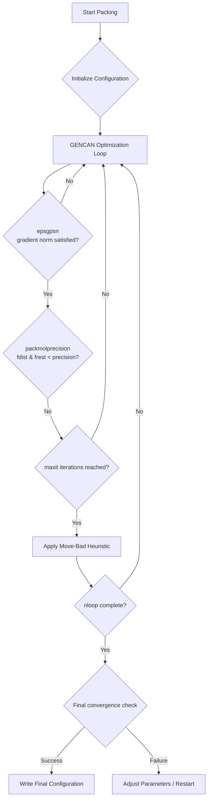

Packmol employs a sophisticated multi-stage convergence framework that combines GENCAN optimization termination conditions with domain-specific molecular packing criteria. Understanding these parameters enables precise control over the trade-offs between computational efficiency and structural quality in molecular system construction.

## Dual Convergence Architecture

The convergence system operates on two complementary levels: the mathematical optimization algorithm convergence (GENCAN) and the physical packing precision criteria. This dual-layered approach ensures that the optimization terminates not only when mathematical conditions are met, but when the molecular configuration achieves physically acceptable quality standards.

Sources: [src/pgencan.f90](src/pgencan.f90#L1-L99), [src/usegencan.f90](src/usegencan.f90#L1-L19)

### Packmol-Specific Convergence Test

The primary convergence test implemented in the `packmolprecision` function evaluates whether the molecular system meets the required precision criteria. This test must pass for the optimization to be considered successfully converged.

Sources: [src/pgencan.f90](src/pgencan.f90#L70-L82)

```fortran
function packmolprecision(n,x)
   use input, only : precision
   use compute_data, only : fdist, frest
   implicit none
   integer :: n
   double precision :: f, x(n)
   logical :: packmolprecision

   call computef(n,x,f)

   packmolprecision = .false.
   if ( fdist < precision .and. frest < precision ) then
      packmolprecision = .true.
   end if
end function packmolprecision
```

The function requires **simultaneous satisfaction** of two conditions:
1. `fdist < precision`: Minimum distance constraint violations must be below threshold
2. `frest < precision`: Spatial constraint violations must be below threshold

This AND logic ensures that both molecular overlap avoidance AND spatial positioning constraints are satisfied before declaring convergence.

> [!TIP]
> The dual-convergence requirement means that even if distances are perfect, the optimization continues if any molecule violates spatial constraints (box boundaries, plane positioning, etc.), and vice versa.

## Precision Parameters Configuration

### Primary Precision Parameter

The `precision` parameter defines the convergence threshold for both distance and constraint violations. This is the most critical parameter controlling when Packmol considers a configuration acceptable.

**Default Value**: `1.d-2` (0.01 Ų equivalent distance)  
**Setting Location**: `src/getinp.f90` lines 55, 85-89  
**Input Keyword**: `precision <value>`

Sources: [src/getinp.f90](src/getinp.f90#L55-L89)

The precision value applies to both `fdist` and `frest` components, establishing a unified quality standard for the final configuration. Lower values produce higher quality packing but require more computational time, while higher values allow faster termination at the cost of potentially small violations.

### Distance Computation and Tracking

Distance violations are computed and tracked atom-by-atom using the `fparc` function, which implements a squared penalty function based on atomic radii.

Sources: [src/fparc.f90](src/fparc.f90#L1-L79)

For each atom pair with squared distance `datom` and combined atomic radii squared `tol`:
- If `datom < tol`: A penalty is added to the objective function
- The maximum violation is tracked: `fdist = max(tol-datom, fdist)`
- The maximum violation per atom is also stored: `fdist_atom(icart)`

This tracking enables the move-bad heuristic to identify and reposition problematic molecules systematically.

## GENCAN Optimization Parameters

The underlying GENCAN algorithm provides mathematical convergence control through several tunable parameters that interface with Packmol's convergence framework.

Sources: [src/pgencan.f90](src/pgencan.f90#L28-L58)

### Iteration and Evaluation Limits

| Parameter | Variable | Default | Description | Setting Location |
|-----------|----------|---------|-------------|------------------|
| Max Iterations | `maxit` | 20 | Maximum GENCAN iterations per packing loop | `getinp.f90` L58, 125-129 |
| Max Function Calls | `maxfc` | 10×maxit | Maximum objective function evaluations | `pgencan.f90` L30 |
| Non-improvement Limit | `ncomp` | 50 | Consecutive iterations without improvement | `pgencan.f90` L31 |

The `maxit` parameter controls how long GENCAN attempts to optimize each molecular configuration before applying heuristic moves or declaring convergence. The `ncomp` parameter prevents infinite loops by terminating if the algorithm cannot improve the solution after 50 consecutive iterations.

Sources: [src/pgencan.f90](src/pgencan.f90#L28-L58), [src/getinp.f90](src/getinp.f90#L125-L129)

### Gradient and Step Size Tolerances

GENCAN employs two critical mathematical tolerances for convergence detection:

1. **Gradient Projection Norm** (`epsgpsn`): `1.0d-06`  
   Controls when the projected gradient is considered sufficiently small to indicate local convergence. This is a standard optimization termination criterion.

2. **Minimum Step Length** (`delmin`): `2.0`  
   Prevents excessively small steps that waste computational time without meaningful improvement.

These tolerances work together with Packmol's precision parameter: GENCAN may converge mathematically (gradient ≈ 0), but the outer packing loop continues until `packmolprecision` returns `.true.`.

Sources: [src/pgencan.f90](src/pgencan.f90#L28-L34)

### Verbosity Control

The `iprint1` and `iprint2` parameters control diagnostic output frequency, affecting the optimization feedback:

- **iprint1** (default: 2): Verbosity for initial packing loops  
- **iprint2** (default: 2): Verbosity for subsequent packing loops  
- Setting to 0 suppresses output, reducing I/O overhead during long runs

Sources: [src/getinp.f90](src/getinp.f90#L56-L57), [src/getinp.f90](src/getinp.f90#L191-L197)

## Multi-Loop Packing Architecture

Packmol employs a hierarchical multi-loop strategy where different precision and heuristics apply at different stages, controlled by several loop parameters.

Sources: [app/packmol.f90](app/packmol.f90#L1-L982)

### Global Loop Control

| Parameter | Variable | Default | Purpose |
|-----------|----------|---------|---------|
| Total Loops | `nloop` | 0 (auto) | Number of complete packing iterations |
| Initial Loops | `nloop0` | 0 | Pre-optimization packing cycles |
| Per-Type Loops | `nloop_type` | Varied | Type-specific iteration counts |

When `nloop = 0`, Packmol automatically determines the number of loops needed based on convergence criteria. Explicitly setting `nloop` forces a fixed number of iterations regardless of convergence status.

Sources: [src/getinp.f90](src/getinp.f90#L59-L60), [src/getinp.f90](src/getinp.f90#L138-L149)

### Move-Bad Heuristic Parameters

The move-bad heuristic relocates molecules with high violation contributions, controlled by precision and fraction parameters.

Sources: [src/heuristics.f90](src/heuristics.f90#L1-L151)

**Molecule Classification Logic** (lines 52-60):
```fortran
if(fdist_mol > precision .or. frest_mol > precision ) then
   hasbad = .true.
   nbad = nbad + 1
   fmol(imol) = fdist_mol + frest_mol
else
   fmol(imol) = 0.d0
end if
```

**Key Parameters**:
- `movefrac` (default: 0.05): Maximum fraction of molecules to move per iteration
- `maxmove` (per-type): Absolute limit on molecules moved per type
- `movebadrandom` flag: Controls whether new positions are random or based on good molecules

Sources: [src/heuristics.f90](src/heuristics.f90#L52-L86), [src/getinp.f90](src/getinp.f90#L66-L69), [src/getinp.f90](src/getinp.f90#L91-L97)

The precision parameter directly controls which molecules are flagged as "bad" for relocation. A tighter precision value identifies more molecules as problematic, increasing the aggressive application of the move-bad heuristic.

### Tolerance Scaling System

The `discale` parameter (default: 1.1) provides dynamic adjustment of tolerance parameters across optimization stages, enabling a progressive refinement strategy.

Sources: [src/getinp.f90](src/getinp.f90#L64-L65), [src/getinp.f90#L106-L110)

This scaling factor allows Packmol to start with looser constraints that gradually tighten, helping the optimization escape local minima while still achieving high-quality final configurations.

## Advanced Precision Features

### Short-Range Tolerance System

For systems requiring precise control over short-range interactions (e.g., hydrogen bonding networks), Packmol implements a two-tiered tolerance system.

Sources: [src/fparc.f90](src/fparc.f90#L33-L46)

**Parameters**:
- `short_radius`: Defines a tighter distance threshold for specific atoms
- `short_radius_scale`: Scales the penalty for short-range violations
- `short_tol_dist`: Alternative global short tolerance
- `short_tol_scale`: Global scaling for short tolerance penalties

**Computation Logic** (lines 33-46):
```fortran
if ( use_short_radius(icart) .or. use_short_radius(jcart) ) then
   short_tol = (short_radius(icart)+short_radius(jcart))**2
   if ( datom < short_tol ) then
      short_tol_penalty = datom-short_tol
      short_tol_scale = dsqrt(short_radius_scale(icart)*short_radius_scale(jcart))
      short_tol_scale = short_tol_scale*(tol**2/short_tol**2)
      fparc = fparc + fscale(icart)*fscale(jcart)*short_tol_scale*short_tol_penalty**2
   end if
end if
```

This system allows different penalty scales for normal intermolecular distances versus critical short-range interactions, enabling fine-tuned control over specific molecular features.

### Output Frequency Control

The `writeout` parameter (default: 10) controls how frequently intermediate configurations are written to disk during optimization.

Sources: [src/getinp.f90](src/getinp.f90#L63), [src/getinp.f90#L131-L135)

Lower values provide more checkpoint opportunities but increase I/O overhead, while higher values reduce disk writes but offer fewer recovery points if the computation is interrupted.

## Parameter Interaction and Default Strategy

The convergence parameters interact in a coordinated hierarchy designed to balance efficiency and quality:



**Default Parameter Philosophy**:
- Conservative `precision` (0.01) ensures physically acceptable configurations
- Modest `maxit` (20) prevents excessive time on difficult local minima
- Aggressive `movefrac` (0.05) and `discale` (1.1) enable escape from problematic configurations
- `nloop = 0` automatic determination allows the algorithm to run until convergence

This default configuration prioritizes reliability over raw speed, ensuring that typical molecular systems converge to valid configurations without parameter tuning.

Sources: [src/getinp.f90](src/getinp.f90#L55-L98)

## Practical Tuning Guidelines

### High-Performance Systems

For systems where computational speed is prioritized over extreme precision:
- Increase `precision` to 0.1-0.5
- Reduce `maxit` to 10-15
- Increase `movefrac` to 0.1-0.2
- Increase `discale` to 1.5-2.0

### Critical Precision Systems

For systems requiring exact molecular positioning (e.g., crystal structures, active sites):
- Decrease `precision` to 0.001-0.005
- Increase `maxit` to 50-100
- Decrease `movefrac` to 0.02-0.03
- Set `nloop` explicitly to ensure sufficient refinement
- Enable `check` mode to verify gradient computations

### Troubleshooting Non-Convergence

When systems fail to converge:
1. **Increase `discale`** to allow larger tolerance relaxations during early stages
2. **Enable `movebadrandom`** to try random repositioning of bad molecules
3. **Reduce `precision` temporarily** to identify if convergence is just slow or impossible
4. **Check `fdist` vs `frest` values** in output to determine if issue is distance or constraint violations
5. **Verify atomic radii definitions** - incorrect radii can prevent convergence

Sources: [src/heuristics.f90](src/heuristics.f90#L1-L151), [src/getinp.f90](src/getinp.f90#L98-L104)

## Next Steps

To fully understand how convergence criteria integrate with the complete optimization pipeline, explore:

- **[Objective Function Design in computef.f90](10-objective-function-design-in-computef-f90)** - Detailed examination of how `fdist` and `frest` are computed from atomic positions
- **[Gradient Computation in computeg.f90](11-gradient-computation-in-computeg-f90)** - Mathematical foundation of GENCAN's gradient-based optimization
- **[Main Program Execution Flow in packmol.f90](21-main-program-execution-flow-in-packmol-f90)** - Integration of all convergence components in the complete program flow

These pages provide the mathematical and algorithmic context that underlies the convergence criteria documented here, enabling comprehensive understanding of how Packmol transforms input specifications into converged molecular configurations.