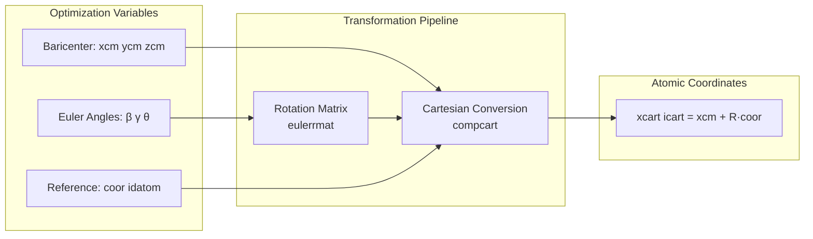

Packmol's molecular packing algorithm relies on a sophisticated coordinate system that separates internal molecular geometry from global positioning. This dual-layered approach uses center-of-mass coordinates for translation and Euler angles for rotation, enabling efficient optimization while maintaining molecular structure integrity. Understanding this coordinate system is essential for working with advanced features like fixed molecules, rotational constraints, and precise molecular placement.

## Architecture of the Coordinate System

The coordinate system operates on two distinct hierarchical levels: the optimization variables space and the physical Cartesian space. Each molecule in the system is represented by six degrees of freedom in the optimization space—three translation coordinates (x, y, z) for the baricenter position and three Euler angles (β, γ, θ) for orientation. These are transformed into Cartesian coordinates for all atoms during each function evaluation.

**The optimization variable vector x is organized as follows**:
- Positions: x(1:ntotmol*3) stores baricenter coordinates (x₁, y₁, z₁, x₂, y₂, z₂, ..., xₙ, yₙ, zₙ)
- Rotations: x(ntotmol*3+1:ntotmol*6) stores Euler angles (β₁, γ₁, θ₁, β₂, γ₂, θ₂, ..., βₙ, γₙ, θₙ)

Sources: [compute_data.f90](src/compute_data.f90#L10-L63), [computef.f90](src/computef.f90#L40-L42)

### Coordinate Transformation Flow

The transformation from optimization variables to atomic coordinates follows a deterministic pipeline:



This architecture enables Packmol to optimize a compressed 6N-dimensional space (where N is the number of molecules) while maintaining full atomic detail for energy calculations and constraint enforcement.

Sources: [computef.f90](src/computef.f90#L37-L72), [polartocart.f90](src/polartocart.f90#L14-L58)

## Center of Mass (Baricenter) Calculations

The center of mass serves as the fundamental translation point for each molecule, providing a physics-grounded reference that preserves molecular stability during optimization. Packmol implements a mass-weighted baricenter calculation that automatically handles isotopic variations and different atomic types.

### Computation Algorithm

The `cenmass` subroutine calculates baricenters for all molecule types in a single pass, computing the weighted average of atomic positions. The algorithm follows three distinct phases:

1. **Determination Phase**: Identify which molecule types require baricenter calculation. Fixed molecules are excluded unless explicitly overridden with the `centerofmass` keyword.
Sources: [cenmass.f90](src/cenmass.f90#L29-L54)

2. **Mass Accumulation Phase**: Compute total mass for each molecule type by summing individual atomic masses from the `amass` array.
Sources: [cenmass.f90](src/cenmass.f90#L64-L71)

3. **Coordinate Transformation Phase**: Apply the baricenter offset to shift all molecular coordinates such that the baricenter resides at the origin.
Sources: [cenmass.f90](src/cenmass.f90#L86-L98)

The mathematical formulation implements the standard center-of-mass equation:

**CM<sub>itype,k</sub> = Σᵢ(coor<sub>idatom(i),k</sub> · amass<sub>idatom(i)</sub>) / Σᵢ(amass<sub>idatom(i)</sub>)**

where k ∈ {1,2,3} represents spatial dimensions x, y, and z.

Sources: [cenmass.f90](src/cenmass.f90#L73-L84)

### Control Through Input Keywords

The behavior of baricenter calculations is controlled through input file keywords that interact with the `domass` boolean array:

| Keyword | Effect on `domass` | Use Case |
|---------|-------------------|----------|
| `fixed` | Sets to `.false.` for molecule type | Anchors molecules in original positions |
| `centerofmass` / `center` | Sets to `.true.` for molecule type | Forces baricenter normalization for fixed molecules |

The logic processes these keywords sequentially, with later keywords overriding earlier ones. This enables scenarios where a molecule is initially fixed but requires baricenter normalization for subsequent placement operations.

Sources: [cenmass.f90](src/cenmass.f90#L33-L54), [input.f90](src/input.f90#L14-L16)

> [!TIP]
> The baricenter calculation is performed once during initialization rather than during each optimization iteration. This design choice reduces computational overhead while ensuring that the reference coordinates (`coor` array) remain in the molecule's frame of reference, with translations applied only during Cartesian coordinate reconstruction.

### Practical Example

In the protein solvation test case, the protein is positioned at the origin using the fixed keyword with zero coordinates, and its center of mass is normalized:

```
structure ./structure_files/protein.pdb
  resnumbers 0
  number 1 
  fixed 0. 0. 0. 0. 0. 0.
  centerofmass
end structure
```

This configuration ensures the protein's baricenter coincides with the coordinate system origin, providing a clean reference for surrounding solvent molecules.

Sources: [solvprotein.inp](testing/input_files/solvprotein.inp#L9-L14)

## Euler Angles and Rotation Matrices

Packmol employs Euler angles to represent molecular orientation, providing a compact three-parameter representation that avoids issues with gimbal lock during optimization. The implementation uses a specific rotation convention that differs from standard textbook definitions to maintain consistency with analytical gradient calculations.

### Rotation Convention

The `eulerrmat` subroutine implements a rotation sequence with non-standard axis assignments:
- **β (beta)**: Rotation about the y-axis
- **γ (gamma)**: Rotation about the z-axis  
- **θ (theta)**: Rotation about the x-axis

This convention produces three orthonormal vectors (v₁, v₂, v₃) that form the columns of the rotation matrix R. The matrix elements are computed directly using trigonometric combinations of the Euler angles:

```
v₁ = [ -sb·sg·ct + cb·cg,  -sb·cg·ct - cb·sg,  sb·st ]
v₂ = [  cb·sg·ct + sb·cg,   cb·cg·ct - sb·sg, -cb·st ]
v₃ = [  sg·st,              cg·st,              ct    ]
```

where cb = cos(β), sb = sin(β), cg = cos(γ), sg = sin(γ), ct = cos(θ), st = sin(θ).

Sources: [polartocart.f90](src/polartocart.f90#L14-L41)

### Cartesian Coordinate Reconstruction

The `compcart` subroutine transforms reference coordinates (relative to the baricenter) into world coordinates by applying both translation and rotation:

**x<sub>world</sub> = x<sub>cm</sub> + x<sub>ref</sub>·v₁ + y<sub>ref</sub>·v₂ + z<sub>ref</sub>·v₃**

This formulation treats v₁, v₂, and v₃ as the rotated basis vectors, expressing the reference position in the molecule's frame within the global coordinate system. The computation is vectorized across spatial dimensions for efficiency.

Sources: [polartocart.f90](src/polartocart.f90#L49-L58)

### Alternative "Human" Convention for Fixed Molecules

A second rotation routine, `eulerfixed`, implements a more intuitive convention for fixed molecules where angles correspond directly to counterclockwise rotations about standard axes:
- β: Rotation about the x-axis
- γ: Rotation about the y-axis
- θ: Rotation about the z-axis

This convention produces a rotation matrix following the standard Z-Y-X intrinsic rotation sequence:

```
v₁ = [ c₂·c₃,  c₁·s₃ + c₃·s₁·s₂,  s₁·s₃ - c₁·c₃·s₂ ]
v₂ = [ -c₂·s₃, c₁·c₃ - s₁·s₂·s₃, c₁·s₂·s₃ + c₃·s₁ ]
v₃ = [ s₂,     -c₂·s₁,           c₁·c₂             ]
```

The dual convention exists because changing the primary routine would require re-deriving all analytical gradient calculations. The fixed molecule convention is used only for initial placement where intuitive angle specification is more important than optimization efficiency.

Sources: [polartocart.f90](src/polartocart.f90#L61-L99)

### Rotation in Function Evaluation

During each objective function evaluation in `computef`, the transformation pipeline executes for each movable molecule:

1. Extract baricenter position from optimization vector
2. Extract Euler angles from rotation segment of vector
3. Compute rotation matrix using `eulerrmat`
4. For each atom in molecule, compute world coordinates using `compcart`
5. Apply to both energy and constraint calculations

This occurs within nested loops iterating over molecule types (`itype`) and individual molecules (`imol`), with the rotation matrix computed once per molecule and reused for all constituent atoms.

Sources: [computef.f90](src/computef.f90#L44-L107)

## Variable Space Layout and Indexing

The optimization variables are organized into two contiguous blocks within the global vector x, with careful indexing to ensure correct association between positions and rotations.

### Index Calculation

The indexing scheme maintains consistent stride across the variable vector:

```
ilubar = 0                    ! Baricenter block start index
ilugan = ntotmol * 3          ! Rotation block start index

For each molecule:
  xcm = x(ilubar+1:ilubar+3)  ! Extract baricenter (3 variables)
  beta = x(ilugan+1)          ! Extract β angle
  gama = x(ilugan+2)          ! Extract γ angle
  teta = x(ilugan+3)          ! Extract θ angle
  
  ilubar = ilubar + 3         ! Advance to next molecule's baricenter
  ilugan = ilugan + 3         ! Advance to next molecule's angles
```

This layout enables efficient vectorized operations and clear correspondence between position and rotation variables for each molecule.

Sources: [computef.f90](src/computef.f90#L40-L108), [computeg.f90](src/computeg.f90#L43-L95)

### Gradient Computation Integration

The gradient computation in `computeg` mirrors the function evaluation structure, applying the chain rule to propagate gradients from Cartesian space back to the optimization variable space. The rotation matrix derivatives with respect to each Euler angle are precomputed:

```
∂v₁/∂β, ∂v₁/∂γ, ∂v₁/∂θ
∂v₂/∂β, ∂v₂/∂γ, ∂v₂/∂θ  
∂v₃/∂β, ∂v₃/∂γ, ∂v₃/∂θ
```

These derivatives enable analytical gradient computation for the GENCAN optimizer, providing superior convergence properties compared to finite-difference approximations.

Sources: [computeg.f90](src/computeg.f90#L25-L30), [computeg.f90](src/computeg.f90#L145-L150)

## Initialization and Random Positioning

The `initial` subroutine generates the starting point for optimization by sampling random positions and orientations within user-specified bounds, with special handling for rotational constraints.

### Position Initialization

Molecular positions are initialized uniformly within the computed system bounding box:

```
x(i+1) = sizemin(1) + rnd() * (sizemax(1) - sizemin(1))  ! x coordinate
x(i+2) = sizemin(2) + rnd() * (sizemax(2) - sizemin(2))  ! y coordinate  
x(i+3) = sizemin(3) + rnd() * (sizemax(3) - sizemin(3))  ! z coordinate
```

The `sizemin` and `sizemax` arrays are initially estimated by solving a single-molecule placement problem with `restmol`, then expanded by the `sidemax` parameter (default 80 Å). Users with larger systems should increase this parameter via input.

Sources: [initial.f90](src/initial.f90#L76-L85)

### Rotation Initialization

Rotational initialization respects user-specified bounds stored in `rot_bound` and `constrain_rot` arrays:

```
if (constrain_rot(itype,1)) then
  ! Use user-specified bounds for constrained rotations
  x(j+1) = (rot_bound(itype,1,1) - |rot_bound(itype,1,2)|) + 2*rnd()*|rot_bound(itype,1,2)|
  x(j+2) = (rot_bound(itype,2,1) - |rot_bound(itype,2,2)|) + 2*rnd()*|rot_bound(itype,2,2)|
  x(j+3) = (rot_bound(itype,3,1) - |rot_bound(itype,3,2)|) + 2*rnd()*|rot_bound(itype,3,2)|
else
  ! Sample full [0, 2π] range for unconstrained rotations
  x(j+1) = 2π * rnd()
  x(j+2) = 2π * rnd()
  x(j+3) = 2π * rnd()
end if
```

The rotational bounds are stored as (center, deviation) pairs, enabling specification of preferred orientations while allowing variation during optimization.

Sources: [initial.f90](src/initial.f90#L96-L109)

## Practical Applications and Examples

### Fixed Molecules with Specific Orientation

Fixed molecules combine position and rotation specification in the input file, with the `eulerfixed` convention applied for intuitive angle interpretation:

```
structure ./structure_files/water.pdb
  number 1
  fixed 0. 0. 0. 45. 45. 45.
end structure
```

This places a single water molecule at the origin with all three rotation angles set to 45° using the human-readable convention (x, y, z axis rotations).

Sources: [only_one_fixed.inp](testing/input_files/only_one_fixed.inp#L6-L9)

### Bilayer Construction with Orientation Constraints

Lipid bilayers require precise orientation to align molecules along the membrane normal (typically the z-axis). The coordinate system enables placement of molecules in specific layers with controlled orientation:

```
structure ./structure_files/palmitoil.pdb 
  number 10
  inside box 0. 0. 0. 40. 40. 14.
  atoms 31 32
    below plane 0. 0. 1. 2.
  end atoms
  atoms 1 2
    above plane 0. 0. 1. 12.
  end atoms
end structure
```

While this example uses plane constraints for atom positioning, the underlying coordinate system enables arbitrary orientation specification through rotational bounds when needed.

Sources: [bilayer.inp](testing/input_files/bilayer.inp#L17-L24)

> [!TIP]
> When working with fixed molecules, remember that the six numbers following the `fixed` keyword represent (x, y, z, β, γ, θ) in the human-readable convention, not the optimization convention. This distinction is crucial for debugging orientation issues in fixed molecule placements.

## Performance Considerations

The coordinate system design emphasizes computational efficiency through several architectural choices:

1. **Single Pass Baricenter Calculation**: Computed once during initialization rather than per iteration, saving significant computation for large systems.

2. **Rotation Matrix Reuse**: The rotation matrix is computed once per molecule per function evaluation and reused for all atoms, reducing trigonometric function calls.

3. **Vectorized Operations**: The Cartesian coordinate reconstruction uses SIMD-friendly expressions that can be efficiently compiled for modern processors.

4. **Analytical Gradients**: The explicit derivative formulas for rotation matrix elements enable exact gradient computation without finite differences, providing superior convergence properties.

Sources: [computef.f90](src/computef.f90#L54-L72), [computeg.f90](src/computeg.f90#L145-L150)

## Next Steps

To deepen your understanding of Packmol's coordinate systems and their role in molecular packing:

- Explore the mathematical foundations of the objective function in [Objective Function Design in computef.f90](10-objective-function-design-in-computef-f90)
- Understand how coordinate transformations enable efficient neighbor search in [Cell Indexing for Efficient Neighbor Search](14-cell-indexing-for-efficient-neighbor-search)
- Learn about the optimization algorithm that searches this coordinate space in [GENCAN Optimization Method Overview](9-gencan-optimization-method-overview)
- Examine how polar coordinates interface with Cartesian space in [Polar to Cartesian Coordinate Transformation](18-polar-to-cartesian-coordinate-transformation)

The coordinate system described here serves as the foundation for all spatial operations in Packmol, from simple random placement to complex constrained optimization involving thousands of molecules.