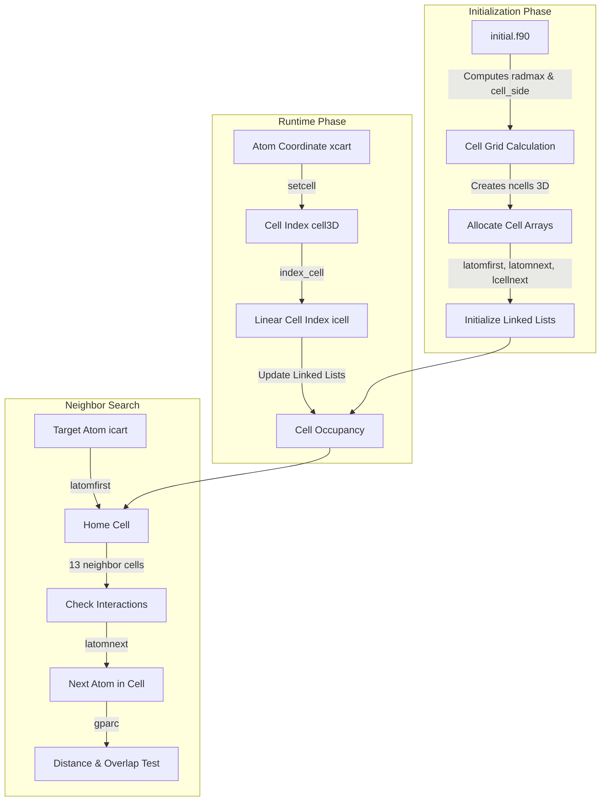

Cell indexing in packmol implements a spatial partitioning algorithm that transforms the expensive O(n²) pairwise distance computation into an approximate O(n) operation. This optimization is fundamental to packmol's ability to efficiently pack thousands of atoms while detecting overlaps during the optimization process. The system divides the computational domain into a regular 3D grid of cells, assigns each atom to a cell based on its spatial coordinates, and restricts overlap checks to atoms in adjacent cells only.

## Architectural Overview

The cell indexing architecture consists of three primary components: coordinate mapping functions, data structures for cell occupancy tracking, and neighbor search algorithms. The grid dimensions are dynamically calculated based on the system size and the maximum atomic radius, ensuring an optimal balance between memory usage and search efficiency. The implementation supports both periodic boundary conditions and non-periodic systems through a unified interface that wraps coordinates into the computational domain.

## Core Data Structures

The cell indexing system utilizes several key data structures defined in the compute_data module to track atom occupancy across the spatial grid. The `latomfirst` array serves as a 3D hash table where each entry stores the index of the first atom located within that specific cell. When multiple atoms occupy the same cell, they form a linked list through the `latomnext` array, which stores the index of the next atom in the same cell for each atom. This design allows O(1) access to all atoms within a given cell by following the linked list from the head pointer.

A secondary linked list structure tracks only non-empty cells to avoid iterating over the entire 3D grid during neighbor searches. The `lcellfirst` variable points to the first non-empty cell in a linear indexing scheme, while `lcellnext` provides traversal through the chain of occupied cells. The `empty_cell` boolean array marks cells that contain no atoms, enabling efficient identification of active regions. This optimization is particularly valuable for sparse molecular distributions where large portions of the grid remain unoccupied.

The grid dimensions are stored in `ncells(3)` (number of cells per dimension) and `cell_length(3)` (physical size of each cell in each dimension), which are computed during initialization based on the system size and maximum atomic radius.

Sources: [compute_data.f90](src/compute_data.f90#L12-L62)

## Coordinate to Cell Mapping

The core coordinate transformation is performed by the `setcell` subroutine, which maps 3D Cartesian coordinates to discrete cell indices. For periodic systems, coordinates are first wrapped into the simulation box using the `v_in_box` function from the pbc module, which applies a modulo operation to bring coordinates within the valid range. The transformation equation computes cell indices as `cell(i) = floor((xt(i) - pbc_min(i))/cell_length(i)) + 1`, where `xt` represents the wrapped coordinate and `pbc_min` defines the origin of the simulation box.

A safeguard prevents out-of-bounds indexing when coordinates exactly equal the maximum boundary. In such cases, the cell index is clamped to the maximum allowed value using `cell(i) = min(cell(i), ncells(i))`. This edge case handling ensures robust operation even with floating-point precision issues at cell boundaries. The cell indices use 1-based indexing consistent with Fortran conventions.

Sources: [cell_indexing.f90](src/cell_indexing.f90#L12-L22), [pbc.f90](src/pbc.f90#L14-L17)

## Linear Cell Indexing

The system provides bidirectional conversion between 3D cell coordinates `(i, j, k)` and a linear cell index `icell` for efficient array storage. The `index_cell` function computes the linear index using row-major ordering: `icell = (i-1)*n_y*n_z + (j-1)*n_z + (k-1) + 1`, where `n_y` and `n_z` are the number of cells in the y and z dimensions respectively. This mapping transforms the 3D grid into a contiguous 1D array for memory-efficient storage.

The reverse transformation `icell_to_cell` decomposes a linear index back into 3D coordinates using modulo arithmetic. The algorithm sequentially extracts each dimension by computing the remainder when dividing by the dimension size, then adjusting the index for the next dimension. This conversion is essential when iterating through the linear linked list of non-empty cells and needing to access neighbors in 3D coordinate space.

Sources: [cell_indexing.f90](src/cell_indexing.f90#L34-L63)

## Cell Grid Initialization

The cell grid dimensions are dynamically computed during the initialization phase in the `initial` subroutine. The calculation begins by determining the maximum atomic radius (`radmax`) across all atom types in the system, which represents the largest distance for which overlap detection is necessary. The optimal cell side length is calculated as `cell_side = discale * 1.01 * radmax`, where `discale` is a user-configurable scaling parameter (typically 1.0) and 1.01 provides a small safety margin. This ensures that interactions requiring detection will always be confined to adjacent cells.

The number of cells in each dimension is computed as `ncells(i) = floor(pbc_length(i)/cell_side)`, with a minimum of 1 cell per dimension. The actual cell length is then recalculated as `cell_length(i) = pbc_length(i)/ncells(i)` to ensure the grid exactly fills the simulation domain. After computing these parameters, the system allocates the cell arrays based on the calculated dimensions and initializes all linked lists to empty states.

For systems without explicit periodic boundary conditions, the code internally creates an "empty shell" around the system by extending the bounding box by 1.1 times the maximum radius. This prevents atoms near the boundary from interacting across the PBC wrap, effectively simulating a non-periodic system while maintaining the uniform PBC infrastructure.

Sources: [initial.f90](src/initial.f90#L275-L310)

## Building Cell Occupancy During Optimization

The cell occupancy data structures are rebuilt at the beginning of each gradient evaluation within the `computeg` subroutine. This dynamic rebuilding is necessary because molecular positions continuously change during the GENCAN optimization process, requiring updates to the spatial partitioning. The initialization phase sets the `init1` flag to false, triggering the cell building routine.

For each atom in the system, the code calls `setcell` to determine the appropriate cell indices based on the atom's current Cartesian coordinates. The atom is then added to the front of that cell's linked list: `latomnext(icart) = latomfirst(cell(1),cell(2),cell(3))` followed by `latomfirst(cell(1),cell(2),cell(3)) = icart`. This prepend operation is O(1) and maintains the linked list structure.

The system simultaneously tracks which cells contain atoms through the `empty_cell` boolean array and the linear linked list of non-empty cells. When an atom is added to a previously empty cell, the cell is marked as occupied and added to the linear linked list: `lcellnext(icell) = lcellfirst` and `lcellfirst = icell`. This enables efficient iteration through only the occupied cells during neighbor searches, skipping empty regions of the grid.

Sources: [computeg.f90](src/computeg.f90#L52-L75)

## Fixed Molecule Cell Assignment

Fixed molecules require special handling because their positions never change during optimization. The `resetcells` subroutine pre-populates the cell arrays with fixed molecules at the beginning of optimization and ensures these assignments persist across gradient evaluations. The algorithm iterates through all fixed atoms (identified by indices from `ntype + 1` to `ntype_with_fixed`), computes their cell indices using `setcell`, and permanently adds them to the cell linked lists.

Unlike the dynamic assignment for mobile atoms, fixed molecule assignments use separate data structures. The `latomfix` array stores the head of the fixed-atom linked list for each cell, while the main `latomfirst` array also includes fixed atoms. This dual representation allows the gradient computation to consider interactions between mobile atoms, between mobile and fixed atoms, and (optionally) between fixed atoms themselves, though the latter are typically excluded to reduce computation.

The `resetcells` function is called to rebuild these fixed assignments when needed, ensuring that the spatial partitioning remains consistent even as mobile atoms move through the domain.

Sources: [resetcells.f90](src/resetcells.f90#L16-L42)

## Neighbor Search Algorithm

The neighbor search in `computeg` implements a classic linked-cell algorithm that checks only the 26 adjacent cells (including the current cell) for potential interactions. The outer loop iterates through the linear linked list of non-empty cells using `icell = lcellnext(icell)`. For each occupied cell, the code retrieves the 3D coordinates via `icell_to_cell` and then iterates through all atoms in that cell using `latomnext`.

For each atom in the current cell, the algorithm performs distance checks against atoms in the home cell and 13 forward-direction neighboring cells. The 27-cell stencil (3×3×3 neighborhood) is symmetric, so checking only half of the neighbors (the "forward" cells in positive direction offsets) avoids duplicate pair evaluations. The neighbor offsets include: face-sharing cells (3 neighbors), edge-sharing cells (6 neighbors), and vertex-sharing cells (4 neighbors), totaling 13 forward neighbors plus the home cell.

The periodic boundary condition handling is embedded in the neighbor cell access through the `cell_ind` function, which applies modulo arithmetic: `cell_ind(i+1, ncells(1))`. This ensures that accessing a cell index beyond the grid boundaries wraps to the opposite face, correctly handling interactions across periodic boundaries.

Sources: [computeg.f90](src/computeg.f90#L102-L134)

## Distance Computation and Overlap Detection

The actual distance computation and overlap detection occurs in the `gparc` subroutine, which processes pairwise interactions between atoms. The function receives the target atom index (`icart`) and the head of the linked list for atoms to check (`firstjcart`). It iterates through the linked list using `jcart = latomnext(jcart)`, applying several filtering criteria before computing distances.

The algorithm filters out three types of pairs that should be ignored: atoms from non-computed types (controlled by the `comptype` flag), atoms belonging to the same molecule (identified by identical `ibmol` and `ibtype` values), and pairs where both atoms are from fixed molecules. These optimizations eliminate unnecessary computations for interactions that cannot contribute to the objective function.

For valid pairs, the minimum image distance vector is computed using `vdiff = delta_vector(xcart(icart,:), xcart(jcart,:), pbc_length)`. This function handles periodic boundary conditions by finding the shortest path between two points, accounting for wraps across the simulation box boundaries. The squared distance `datom` is then compared against the tolerance `tol = (radius(icart)+radius(jcart))²`. If the distance is below the sum of atomic radii, an overlap penalty contribution is added to the gradients for both atoms using the chain rule.

Sources: [gparc.f90](src/gparc.f90#L18-L88), [pbc.f90](src/pbc.f90#L20-L23)

## Periodic Boundary Condition Integration

The cell indexing system integrates seamlessly with periodic boundary conditions through three key mechanisms. First, the `v_in_box` function wraps coordinates into the primary simulation box before cell assignment, ensuring that atoms near boundaries are correctly mapped to cells. Second, the `delta_vector` function computes minimum image distances for overlap detection, automatically selecting the shortest path across periodic boundaries. Third, the `cell_ind` function applies modulo arithmetic to neighbor cell indices, enabling wraparound access to cells on opposite faces of the grid.

The combination of these mechanisms ensures that an atom in cell (1, j, k) correctly identifies its neighbor in cell (ncells, j, k) as an adjacent cell rather than a distant one. This is critical for molecular systems where molecules may straddle the periodic boundary and interact with their periodic images. The implementation correctly handles the corner cases where the minimum image path crosses multiple periodic boundaries simultaneously.

Sources: [pbc.f90](src/pbc.f90#L14-L29)

> [!TIP]
> The cell indexing algorithm's performance advantage derives from reducing the average number of distance checks per atom from O(n) in a brute-force approach to O(ρ × V_cell), where ρ is the number density and V_cell is the cell volume. For optimal performance, the cell dimensions should be slightly larger than twice the maximum interaction cutoff radius to ensure all relevant interactions are captured while minimizing empty cell overhead. The `discale` parameter controls this balance and can be tuned for specific system characteristics.

## Performance Characteristics

The computational complexity of the cell indexing approach is approximately O(n) for dense systems where each cell contains a bounded number of atoms, compared to O(n²) for brute-force pairwise checking. The dominant factors are: cell assignment (n × O(1) for setcell), neighbor iteration (n_occupied_cells × 13 × average_atoms_per_cell), and distance computation within each pair (O(1)). Memory overhead is O(n) for the linked lists plus O(ncells³) for the grid, where the latter is typically much smaller than the former for realistic molecular systems.

The algorithm exhibits excellent cache locality because atoms within the same cell are likely accessed contiguously during neighbor searches. The linked list structure minimizes memory footprint compared to storing full arrays for each cell, particularly beneficial for sparse distributions where most cells remain empty. The periodic boundary condition handling adds minimal computational overhead through simple modulo operations, avoiding conditional branching that could degrade pipeline efficiency.

Sources: [computeg.f90](src/computeg.f90#L52-L134), [gparc.f90](src/gparc.f90#L18-L88)

## Configuration Parameters

The cell indexing behavior is controlled by several user-accessible parameters defined in the input and processed during initialization. The `discale` parameter (default 1.0) scales the cell size relative to the maximum atomic radius, providing a trade-off between memory usage and search efficiency. Larger values create fewer cells with more atoms per cell, increasing memory per cell but reducing the number of neighbor cells to check. Smaller values create more cells with fewer atoms each, reducing per-cell memory but increasing the number of cell boundary checks.

The `sidemax` parameter defines the default simulation box size for non-periodic systems, indirectly affecting cell grid dimensions when the actual molecular extent is smaller. For periodic systems, the box dimensions are explicitly defined through the `pbc` keyword in the input file, which directly determines `pbc_length` and consequently the cell grid size. The `precision` parameter controls the convergence threshold, affecting how often the cell structures are rebuilt during optimization.

Sources: [initial.f90](src/initial.f90#L276-L281)

## Next Steps

For comprehensive understanding of how cell indexing integrates with packmol's optimization pipeline, explore the [GENCAN Optimization Method Overview](9-gencan-optimization-method-overview) to understand how gradient evaluations drive the optimization. The [Objective Function Design in computef.f90](10-objective-function-design-in-computef-f90) explains how overlap penalties contribute to the overall objective function. For related spatial algorithms, examine the [Flashsort Algorithm for Molecular Sorting](15-flashsort-algorithm-for-molecular-sorting), which implements a different spatial ordering technique. Understanding [Distance Constraints and Overlap Detection](17-distance-constraints-and-overlap-detection) provides deeper insight into how distance thresholds are applied in practice.