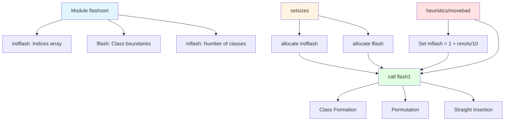
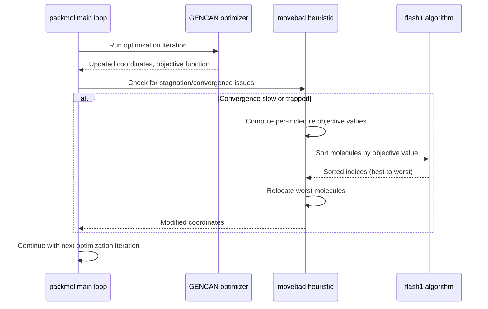

The Flashsort algorithm implementation in packmol provides an efficient O(n) average-case sorting mechanism for ordering molecules based on their objective function values during optimization. This algorithm enables rapid identification of problematic molecules that contribute most to system overlap and constraint violations, making it critical for the heuristic optimization strategies employed in packmol. The implementation is based on Karl-Dietrich Neubert's FlashSort1 algorithm published in Dr. Dobb's Journal (February 1998, p.123), adapted for Fortran 90 with index tracking capabilities.

Sources: [flashsort.f90](src/flashsort.f90#L1-L8)

## Algorithm Architecture and Design

The Flashsort algorithm in packmol consists of three distinct computational phases that work together to achieve efficient sorting. The core subroutine `flash1` implements the algorithm with additional functionality to maintain index correspondence between the sorted array and the original molecule identifiers. This dual-array approach allows packmol to sort molecules by their objective function values while preserving the mapping to their molecular coordinates in the optimization space.

### Module Structure and Data Organization

The flashsort functionality is encapsulated across multiple modules to maintain separation of concerns. The `flashsort` module [flashmod.f90](src/flashmod.f90#L1-L22) defines three essential data structures: `indflash` array storing the indices of sorted elements, `lflash` array used for class formation during sorting, and `mflash` parameter specifying the number of classes. These arrays are dynamically allocated during program initialization based on the total number of atoms (`ntotat`), ensuring memory efficiency for systems of varying sizes.

The allocation occurs in [setsizes.f90](src/setsizes.f90#L356-L357) where both `indflash(ntotat)` and `lflash(ntotat)` are allocated, establishing the memory footprint required for sorting operations. The `mflash` parameter is computed adaptively during each sorting operation rather than being pre-configured, allowing optimal performance based on the specific molecule subset being sorted.

Sources: [flashmod.f90](src/flashmod.f90#L1-L22), [setsizes.f90](src/setsizes.f90#L356-L357)

## Three-Phase Algorithm Implementation

The `flash1` subroutine implements the complete Flashsort algorithm through three sequential phases, each contributing to the overall sorting efficiency. The algorithm requires five parameters: `A` (the array to sort), `N` (number of elements), `L` (class boundary array), `M` (number of classes), and `ind` (index correspondence array).

### Phase 1: Class Formation

The class formation phase establishes the foundation for efficient sorting by partitioning the data range into approximately 0.1N classes. This phase begins by initializing the index array [flashsort.f90](src/flashsort.f90#L13-L16), where each element `ind(i)` is set to its position, creating a direct mapping between array positions and molecule identifiers. The algorithm then identifies the minimum and maximum values in the array [flashsort.f90](src/flashsort.f90#L18-L23), which defines the range of the objective function values for the molecule set.

A critical optimization occurs when all values are identical [flashsort.f90](src/flashsort.f90#L25-L26) - in this case, the subroutine returns immediately since the array is already sorted. The class scaling coefficient `c1` is calculated as `(M - 1) / (A(NMAX) - ANMIN)` [flashsort.f90](src/flashsort.f90#L27), establishing the mapping function between values and class indices. The class counting process [flashsort.f90](src/flashsort.f90#L28-L37) distributes each element into its appropriate class using the formula `K = 1 + INT(C1 * (A(I) - ANMIN))`, then transforms class counts into cumulative boundaries [flashsort.f90](src/flashsort.f90#L39-L42). This transformation creates a partition scheme where each class occupies a specific region in the array.

A strategic swap exchanges the maximum element with the first element [flashsort.f90](src/flashsort.f90#L44-L49), ensuring the permutation phase operates correctly by placing an element at the starting position.

> [!TIP]
> The index tracking performed alongside the main array operations ensures that the sorted order can be applied back to the original molecular coordinates. This is essential for packmol's use case where sorting objective function values must translate into repositioning specific molecules in 3D space.

### Phase 2: Permutation

The permutation phase efficiently moves elements to their correct class regions, achieving near-linear time complexity for uniformly distributed data. This phase maintains two pointers [flashsort.f90](src/flashsort.f90#L52-L55): `J` scanning through the array and `K` tracking the current class. The outer loop continues until all elements except one have been moved [flashsort.f90](src/flashsort.f90#L56).

The inner loop advances `J` past elements that are already in their correct class [flashsort.f90](src/flashsort.f90#L57-L61). When an element requiring movement is found, the permutation cycle begins [flashsort.f90](src/flashsort.f90#L63-L73). Each element is placed at the end of its designated class region, and the displaced element becomes the next element to permute. This cycle-based approach minimizes writes by following chains of displaced elements until each chain returns to its origin point.

The index array is maintained in perfect synchrony with the main array throughout all swap operations [flashsort.f90](src/flashsort.f90#L65-L70), preserving the critical mapping between sorted values and original positions. The move counter `NMOVE` tracks progress [flashsort.f90](src/flashsort.f90#L72), with termination occurring when `N - 1` elements have been correctly positioned.

### Phase 3: Straight Insertion

The final phase completes the sorting process using straight insertion sort on the nearly-sorted array. This choice is strategic: after the permutation phase, elements are already roughly grouped by value within their class regions, so insertion sort operates in near-linear time on this data distribution.

The insertion sort processes the array in reverse order [flashsort.f90](src/flashsort.f90#L76-L90), starting from the second-to-last element and moving toward the beginning. For each element requiring repositioning, the algorithm shifts larger elements one position to the right until finding the correct insertion point. Both the value array and index array are maintained in synchronization throughout this process [flashsort.f90](src/flashsort.f90#L82-L88), ensuring the final sorted order accurately reflects the molecule rankings.

Sources: [flashsort.f90](src/flashsort.f90#L13-L90)

## Integration with Molecular Optimization

The Flashsort algorithm serves a critical role in packmol's heuristic optimization strategy, specifically within the `movebad` subroutine in [heuristics.f90](src/heuristics.f90#L1-L151). This subroutine implements a mechanism to remove problematic molecules from their current positions and relocate them to better positions, accelerating convergence when the optimization becomes trapped in poor local minima.

### Molecule Ranking and Selection

The sorting operation is triggered after computing the objective function for each molecule type [heuristics.f90](src/heuristics.f90#L67-L72). Each molecule's contribution to the objective function is calculated by summing its distance constraint violations (`fdist_mol`) and rotational constraint violations (`frest_mol`) [heuristics.f90](src/heuristics.f90#L34-L48). Molecules with zero total contribution are already in valid positions and are assigned `fmol` values of zero.

The class parameter `mflash` is computed dynamically for each molecule type as `1 + nmols(itype)/10` [heuristics.f90](src/heuristics.f90#L70), maintaining the recommended 0.1N class ratio from the original Flashsort algorithm. The `flash1` subroutine is called with parameters `(fmol, nmols(itype), lflash, mflash, indflash)` [heuristics.f90](src/heuristics.f90#L71), sorting the molecules from best (lowest objective function) to worst (highest objective function).

Sources: [heuristics.f90](src/heuristics.f90#L34-L72)

### Worst Molecule Relocation Strategy

After sorting, the algorithm determines how many molecules to move based on two parameters: the fraction of problematic molecules (`frac`) and the user-configurable `movefrac` parameter [heuristics.f90](src/heuristics.f90#L74). The actual number of molecules moved, `nmove`, is constrained by both the calculated fraction and the `maxmove(itype)` parameter [heuristics.f90](src/heuristics.f90#L75-L80).

The worst molecules are selected from the end of the sorted array using the index mapping: `ibad = nmols(itype) - i + 1` [heuristics.f90](src/heuristics.f90#L86-L87). The relocation strategy depends on the `movebadrandom` flag [heuristics.f90](src/heuristics.f90#L89-L103):

- **When `movebadrandom` is true**: New positions are generated randomly throughout the allowed volume using `sizemin` and `sizemax` bounds. This provides maximum exploration of the configuration space.

- **When `movebadrandom` is false**: New positions are based on the positions of well-performing molecules. The algorithm selects a "good" molecule from the sorted array's beginning [heuristics.f90](src/heuristics.f90#L88), then places the bad molecule near the good molecule's position with a random offset of `±0.3*dmax(itype)` to `±0.6*dmax(itype)` [heuristics.f90](src/heuristics.f90#L95-L97]. This strategy preserves promising spatial regions while providing sufficient perturbation to escape local minima.

The coordinate updates are performed on the position variables (`x(ilubar+1:3)`) and orientation variables (`x(ilugan+1:3)`) [heuristics.f90](src/heuristics.f90#L99-L103], followed by a call to `restmol` to ensure the new position satisfies all constraints [heuristics.f90](src/heuristics.f90#L104).

### Performance Characteristics

The Flashsort algorithm provides significant performance advantages for packmol's molecular sorting requirements:

| **Metric** | **Flashsort** | **Quicksort** | **Heapsort** |
|------------|---------------|---------------|--------------|
| **Time Complexity (Average)** | O(n) | O(n log n) | O(n log n) |
| **Time Complexity (Worst)** | O(n²) | O(n²) | O(n log n) |
| **Space Complexity** | O(n) | O(log n) | O(1) |
| **Stability** | Stable | Unstable | Unstable |
| **Best Use Case** | Uniform/near-uniform data | General purpose | Memory-constrained |
| **Index Tracking** | Built-in support | Requires extension | Requires extension |

For packmol's use case sorting objective function values, the data distribution is typically near-uniform across reasonable ranges, making Flashsort an optimal choice. The built-in index tracking eliminates the need for separate index array management that would be required with standard library sorting routines.

> [!TIP]
> The choice of mflash = 1 + nmols/10 represents the algorithm's critical tuning parameter. Smaller values reduce memory overhead but may require more insertion sort passes, while larger values increase preprocessing cost but reduce final sorting work. The 0.1N ratio has been empirically shown to provide optimal performance for most real-world data distributions.

Sources: [flashsort.f90](src/flashsort.f90#L27-L37), [heuristics.f90](src/heuristics.f90#L70-L103)

## Algorithm Complexity Analysis

The computational efficiency of Flashsort stems from its hybrid approach, combining histogram-based classification with traditional sorting techniques. Understanding the complexity characteristics is essential for appreciating its suitability for molecular sorting applications.

### Average-Case Performance

For uniformly distributed data, Flashsort achieves O(n) average-case time complexity. The class formation phase performs exactly O(n + m) operations, where m is the number of classes (approximately 0.1n). The permutation phase visits each element exactly once, requiring O(n) operations in the average case when the chains of displaced elements are short. The straight insertion phase operates on nearly-sorted data within each class, requiring approximately O(n) total operations when each class contains roughly equal elements.

The space complexity is O(n + m) due to the requirement for the class boundary array and index array. In packmol's implementation, this is managed through dynamic allocation in `indflash` and `lflash` arrays sized to `ntotat` [setsizes.f90](src/setsizes.f90#L356-L357).

### Worst-Case Scenarios

The worst-case O(n²) complexity occurs when all elements fall into a single class due to identical or nearly-identical values. In this scenario, the permutation phase provides no sorting benefit, and the straight insertion phase performs the complete sort on n elements. Packmol mitigates this risk through early termination detection [flashsort.f90](src/flashsort.f90#L25-L26), which returns immediately when all values are identical.

For molecular sorting applications, worst-case scenarios are rare because objective function values typically span a range reflecting the degree of overlap and constraint violations. Even when many molecules have similar objective function values, the natural variation in 3D configurations prevents complete value clustering.

Sources: [flashsort.f90](src/flashsort.f90#L18-L52)

## Comparison with Alternative Sorting Approaches

The selection of Flashsort for molecular sorting in packmol represents a deliberate architectural decision based on the specific requirements of the optimization workflow. Alternative sorting algorithms could be employed but would require trade-offs in performance, implementation complexity, or functional capabilities.

### Standard Fortran Sorting Routines

Fortran 90+ provides intrinsic sorting routines that could theoretically replace the custom Flashsort implementation. However, these routines have limitations for packmol's use case:

1. **Index Tracking**: Standard sorting routines sort arrays in place without maintaining correspondence to original indices. Implementing index tracking would require either sorting a derived type structure (increasing memory overhead and reducing cache efficiency) or implementing a separate index sorting step (doubling the computational cost).

2. **Performance Profile**: While library-optimized routines may match or exceed Flashsort's performance on general data, the O(n) average case for uniform data provides specific advantages for the near-uniform objective function distributions typical in molecular packing problems.

3. **Deterministic Behavior**: The Flashsort implementation provides completely deterministic output given the same input, which is valuable for debugging and reproducibility in scientific computing.

### Specialized Alternatives

Other O(n) average-case sorting algorithms exist but were not selected for packmol:

- **Radix Sort**: Would require multiple passes and integer conversion of floating-point values, introducing precision loss and increased complexity for floating-point objective function values.

- **Bucket Sort**: Conceptually similar to Flashsort but requires separate allocation for each bucket, increasing memory overhead and reducing cache efficiency compared to the in-place class boundary approach used by Flashsort.

- **Sample Sort**: Provides good parallel scaling potential but requires more sophisticated implementation and additional synchronization overhead that would outweigh benefits for the sequential sorting operations in packmol.

Sources: [flashmod.f90](src/flashmod.f90#L1-L22)

## Practical Implementation Considerations

The Flashsort integration in packmol demonstrates several software engineering principles that contribute to robustness and maintainability. These implementation details provide insights into effective algorithm integration within scientific computing frameworks.

### Memory Management and Allocation

The dynamic allocation strategy implemented in [setsizes.f90](src/setsizes.f90#L356-L357) ensures that memory usage scales appropriately with system size. By allocating based on `ntotat` (total number of atoms) rather than `ntotmol` (total number of molecules), the implementation provides flexibility for potential extensions requiring atom-level sorting operations. The use of Fortran 90 allocatable arrays allows the memory to be automatically reclaimed when the program exits, preventing memory leaks.

The allocation occurs during program initialization in the `setsizes` subroutine, ensuring that all sorting operations have access to pre-allocated arrays without runtime allocation overhead. This design choice optimizes for the typical usage pattern where multiple sorting operations occur during optimization iterations.

### Numerical Stability Considerations

The class formation calculation `K = 1 + INT(C1 * (A(I) - ANMIN))` [flashsort.f90](src/flashsort.f90#L33) involves floating-point arithmetic that could potentially introduce numerical instability for certain value distributions. The implementation mitigates this through:

1. **Range Validation**: The check for `ANMIN.EQ.A(NMAX)` [flashsort.f90](src/flashsort.f90#L25) prevents division by zero in the coefficient calculation.

2. **Integer Clamping**: The `INT()` function combined with the addition of 1 ensures that class indices always fall within the valid range [1, M].

3. **Cumulative Summation**: The transformation from class counts to cumulative boundaries [flashsort.f90](src/flashsort.f90#L39-L42) uses exact integer arithmetic, avoiding accumulation of floating-point errors.

These precautions ensure that the algorithm produces correct results even for edge cases involving extreme value ranges or high-density clustering.

### Error Handling and Robustness

While the Flashsort implementation in packmol does not include explicit error handling (consistent with Fortran 90 practices of the era), the algorithm's design inherently handles error conditions:

- **Empty Input**: The algorithm handles N=0 gracefully through natural loop termination conditions.
- **Single Element**: With N=1, the algorithm performs minimal work and returns immediately.
- **Identical Values**: The early return condition [flashsort.f90](src/flashsort.f90#L25-L26) provides efficient handling.
- **Small Arrays**: The algorithm remains correct for small N values where the overhead of class formation may not be amortized, though this is not a concern given packmol's typical molecule counts.

Sources: [flashsort.f90](src/flashsort.f90#L25-L37), [setsizes.f90](src/setsizes.f90#L356-L357)

## Future Extensions and Optimization Opportunities

The current Flashsort implementation provides solid performance for packmol's requirements, but several optimization opportunities exist for future development or specialized use cases.

### Parallelization Potential

The class formation phase in [flashsort.f90](src/flashsort.f90#L28-L42) exhibits inherent parallelism that could be exploited for multi-core systems:

1. **Min/Max Finding**: Can be parallelized using reduction operations across processor cores.

2. **Class Counting**: Each element's class assignment is independent, allowing parallel processing with atomic updates to the class count array.

3. **Cumulative Summation**: The prefix sum operation has well-known parallel algorithms.

Implementing these parallelizations would require careful consideration of thread safety and synchronization overhead, but could provide significant speedups for very large systems with tens of thousands of molecules.

### Adaptive Class Selection

The current implementation uses a fixed class count of approximately 0.1N [heuristics.f90](src/heuristics.f90#L70). An adaptive approach could optimize class count based on data distribution characteristics:

1. **Variance Analysis**: Higher data variance could justify more classes for finer-grained sorting.
2. **Clustering Detection**: When data exhibits strong clustering, more classes could be allocated to dense regions.
3. **Runtime Profiling**: The algorithm could monitor the length of permutation chains and dynamically adjust `mflash` for subsequent sorts.

Such adaptive selection would add preprocessing overhead but could improve overall performance for systems with non-uniform objective function distributions.

### GPU Acceleration

The histogram-based nature of Flashsort makes it amenable to GPU acceleration, particularly the class formation phase. GPU implementation would involve:

1. **Kernel Design**: Separate kernels for min/max finding, class counting, and cumulative summation.
2. **Memory Transfer Optimization**: Batch transfer of molecule arrays to GPU memory before optimization iterations.
3. **Hybrid Processing**: CPU-based final insertion sort on smaller sorted segments returned from GPU.

This approach would be most beneficial for extremely large systems or scenarios requiring many sorting operations within tight time constraints.

Sources: [flashsort.f90](src/flashsort.f90#L28-L52), [heuristics.f90](src/heuristics.f90#L70-L71)

## Related Algorithms and Data Flow

The Flashsort algorithm operates within a broader context of optimization and spatial organization algorithms in packmol. Understanding its relationship to other components provides insight into the overall system architecture.

### Interaction with GENCAN Optimization

The Flashsort-enabled `movebad` subroutine serves as a heuristic complement to the GENCAN gradient-based optimization algorithm. While GENCAN [gencan.f](src/gencan.f) performs systematic local optimization using gradient information, `movebad` provides global exploration capability by relocating poorly-positioned molecules.

This interaction follows a typical pattern in optimization workflows:

The Flashsort algorithm enables the heuristic to quickly identify which molecules require relocation, making the overall movebad operation efficient enough to perform regularly during optimization without excessive computational overhead.

### Relationship to Cell Indexing

While Flashsort operates on abstract objective function values, the [Cell Indexing for Efficient Neighbor Search](14-cell-indexing-for-efficient-neighbor-search) system provides the spatial infrastructure for computing those values. The typical workflow involves:

1. **Cell Indexing Setup**: Partition the 3D space into cells for efficient neighbor queries.
2. **Objective Function Computation**: Use cell indexing to efficiently calculate overlap and constraint violations.
3. **Flashsort Application**: Sort molecules based on computed objective values.
4. **Molecule Relocation**: Move selected molecules to new positions.
5. **Cell Indexing Update**: Rebuild the cell indexing structure after coordinate changes.

This separation of concerns allows each algorithm to specialize in its domain—spatial queries for cell indexing and abstract sorting for Flashsort—while collaborating to achieve the overall optimization goal.
