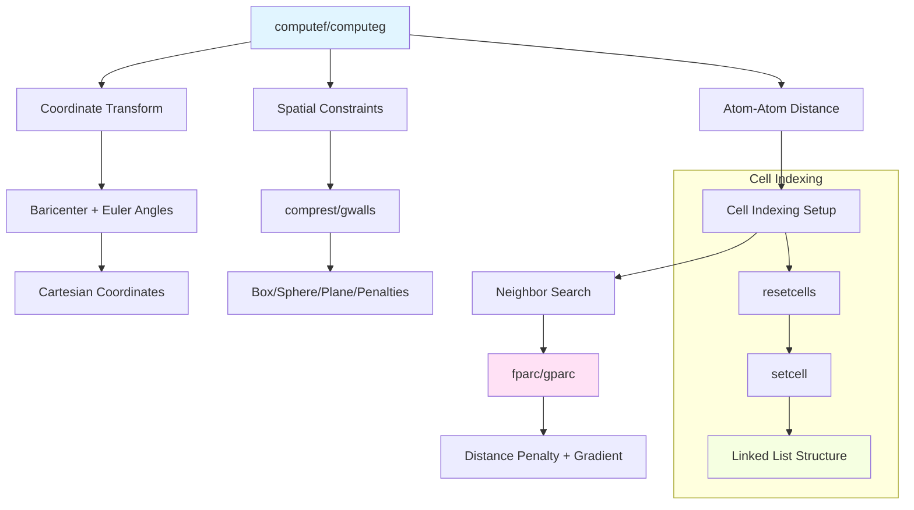

This page explains how PackMOL detects and resolves molecular overlaps through a sophisticated distance constraint system. The implementation uses efficient cell indexing for O(n) neighbor searching, coupled with smooth penalty functions that guide the GENCAN optimizer toward collision-free configurations.

## Architecture Overview

The distance constraint system operates as a two-layer architecture where spatial constraint evaluation and atom-atom overlap detection run in parallel during optimization iterations. The core computation occurs in the objective function `computef` and its gradient counterpart `computeg`, which coordinate the evaluation of both spatial boundaries and pairwise distance penalties through specialized subroutines.

Sources: [computef.f90](src/computef.f90#L9-L154), [computeg.f90](src/computeg.f90#L9-L244)



The architecture distinguishes between **spatial constraints** (keeping molecules within defined boundaries) and **distance constraints** (preventing molecule-molecule overlaps). These are computed separately but both contribute to the objective function value that the optimizer minimizes.

## Atom-to-Atom Distance Penalty Function

The core overlap detection uses a smooth quartic penalty function applied to all atom pairs whose separation falls below the sum of their radii. The function `fparc` computes this penalty by iterating through neighbor cells and evaluating each eligible atom pair.

Sources: [fparc.f90](src/fparc.f90#L10-L77)

The penalty function for a pair of atoms with centers at positions **rᵢ** and **rⱼ** is:

**fₚₐᵣc = fₛcₐₗₑ(ᵢ) × fₛcₐₗₑ(ⱼ) × (d² - R²)² when d² < R²**

Where:
- **d²** is the squared distance between atoms
- **R = radiusᵢ + radiusⱼ** is the sum of atomic radii
- **fₛcₐₗₑ** are user-specified scaling factors for each atom type

This quartic formulation provides a smooth, differentiable function with continuous first and second derivatives, which is essential for gradient-based optimization. The penalty increases smoothly from zero at the threshold distance to large values as atoms approach each other.

> [!TIP]
> The penalty is computed only when d² < R², making the system efficient—atoms beyond their interaction threshold contribute nothing to the objective function.

## Efficient Neighbor Search with Cell Indexing

To achieve O(n) complexity instead of the naive O(n²), PackMOL employs a linked-list cell indexing system. The simulation box is partitioned into a regular 3D grid of cells with dimensions specified by `ncells(3)`, where each cell's size is chosen to accommodate the maximum atomic radius.

Sources: [computef.f90](src/computef.f90#L113-L151), [cell_indexing.f90](src/cell_indexing.f90#L14-L25)

The cell indexing process works as follows:

1. **Cell Assignment**: Each atom is assigned to a cell based on its Cartesian coordinates using the `setcell` subroutine. For periodic boundary conditions, atoms are first wrapped into the primary box using `v_in_box`.

2. **Linked List Construction**: Within each cell, atoms are stored in a linked list via `latomfirst` (pointer to first atom) and `latomnext` (pointer to next atom in same cell).

3. **Neighbor Cell Traversal**: When checking overlaps, each atom interacts with atoms in its own cell plus 26 adjacent cells—specifically checking forward neighbors only (6 face-sharing, 12 edge-sharing, 8 corner-sharing) to avoid double-counting.

Sources: [computef.f90](src/computef.f90#L127-L144)

| Interaction Type | Cell Offset Pattern | Count |
|------------------|---------------------|-------|
| Same Cell | (0, 0, 0) | 1 |
| Face-sharing | (±1,0,0), (0,±1,0), (0,0,±1) | 6 |
| Edge-sharing | (±1,±1,0), (±1,0,±1), (0,±1,±1) | 12 |
| Corner-sharing | (±1,±1,±1) | 8 |

The forward-only traversal strategy ensures each unique pair is evaluated exactly once while maintaining cache efficiency through sequential memory access patterns.

Sources: [resetcells.f90](src/resetcells.f90#L10-L42)

> [!TIP]
> Fixed molecules are pre-loaded into the cell structure during initialization via `resetcells`, allowing them to serve as static obstacles during the optimization of movable molecules.

## Periodic Boundary Conditions

When periodic boundary conditions are enabled (PBC), the distance calculation accounts for the minimum image convention. The `delta_vector` function computes the shortest distance between two atoms across periodic boundaries by subtracting integer multiples of the box dimensions.

Sources: [pbc.f90](src/pbc.f90#L20-L24)

**Δv = v₁ - v₂ - pbc_length × round((v₁ - v₂)/pbc_length)**

This ensures that atoms near opposite box faces interact correctly as if they were close neighbors, preventing artificial barriers at boundaries. The cell indexing system also adapts to PBC by using the `cell_ind` function with modulo arithmetic to map coordinates to cell indices.

Sources: [computef.f90](src/computef.f90#L52-L54), [cell_indexing.f90](src/cell_indexing.f90#L26-L29)

## Distance Constraint Evaluation Process

The `fparc` function implements several filtering rules to skip unnecessary pairwise evaluations, significantly improving computational efficiency.

Sources: [fparc.f90](src/fparc.f90#L27-L49)

**Skip Conditions (evaluated in order):**

1. **Type Exclusion**: Skip if atom j's type is marked as non-computable (`comptype` is false)
2. **Same Molecule**: Skip if both atoms belong to the same molecule type and same molecule instance
3. **Both Fixed**: Skip if both atoms belong to fixed molecules (static structures don't penalize each other)

These filters prevent wasted computation on atom pairs that don't contribute to the optimization objective.

**Evaluation Process for Valid Pairs:**

```mermaid
flowchart TD
    A[Start fparc for atom i] --> B{j > 0?}
    B -->|No| Z[End]
    B -->|Yes| C{comptype[j]?}
    C -->|No| D[j = latomnext[j]]
    D --> B
    C -->|Yes| E{Same molecule?}
    E -->|Yes| D
    E -->|No| F{Both fixed?}
    F -->|Yes| D
    F -->|No| G[Compute delta_vector with PBC]
    G --> H[Calculate squared distance d²]
    H --> I{d² < R²?}
    I -->|No| J[Update fdist = max fdist, R²-d²]
    J --> D
    I -->|Yes| K[Add quartic penalty: d²-R²²]
    K --> L{Use short radius?}
    L -->|No| J
    L -->|Yes| M{d² < R²short?}
    M -->|No| J
    M -->|Yes| N[Add scaled short penalty]
    N --> J
```

The function also tracks the **minimum distance violation** through the `fdist` variable, which records the maximum value of (R² - d²) across all atom pairs. This provides a single metric for the worst overlap in the system.

Sources: [fparc.f90](src/fparc.f90#L68-L73)

## Gradient Computation for Distance Constraints

For gradient-based optimization, the `gparc` function computes analytical derivatives of the distance penalty with respect to atomic Cartesian coordinates. This gradient is then transformed back to the optimization variables (baricenters and Euler angles) using the chain rule.

Sources: [gparc.f90](src/gparc.f90#L9-L86), [computeg.f90](src/computeg.f90#L145-L241)

**Derivative Calculation:**

For the penalty function **f = fₛcₐₗₑᵢ × fₛcₐₗₑⱼ × (d² - R²)²**, the gradient with respect to the vector difference **v = rᵢ - rⱼ** is:

**∂f/∂v = 4 × fₛcₐₗₑᵢ × fₛcₐₗₑⱼ × (d² - R²) × v**

The implementation applies this gradient to both atoms in the pair with opposite signs (Newton's third law), ensuring conservation of momentum in the optimization space:

**gᵢ = +∂f/∂v**
**gⱼ = -∂f/∂v**

Sources: [gparc.f90](src/gparc.f90#L54-L64)

This symmetric gradient computation ensures that the total gradient remains physically meaningful and that the optimization maintains system balance.

## Short Radius Functionality

PackMOL provides an enhanced overlap detection mechanism through the **short radius** system, which allows different distance thresholds for specific atom pairs. This is particularly useful for systems where certain atoms should maintain stricter separation than their van der Waals radii would suggest.

Sources: [compute_data.f90](src/compute_data.f90#L32-L42), [fparc.f90](src/fparc.f90#L58-L66)

The short radius system works as follows:

1. **Additional Radii**: Each atom can have both a standard `radius` and a `short_radius` defined
2. **Activation Flag**: The `use_short_radius` flag indicates when short radius checking should apply
3. **Scaling Factor**: The `short_radius_scale` adjusts the penalty magnitude for short radius violations

**Composite Penalty Calculation:**

When short radii are active and the distance falls below the short threshold, an additional penalty term is added:

**fₜₒₜₐₗ = fₛₜₐₙdₐᵣd + fₛcₐₗₑᵢ × fₛcₐₗₑⱼ × short_scale × (d² - R²short)²**

The short_scale factor compensates for the different distance threshold, ensuring smooth gradient behavior across the transition between standard and short radius regimes.

Sources: [fparc.f90](src/fparc.f90#L62-L64), [gparc.f90](src/gparc.f90#L65-L81)

## Coordinate Transformation Chain

The distance constraint system operates in Cartesian coordinates, but the optimization variables are stored as baricenters and Euler angles. A coordinate transformation chain connects these representations.

Sources: [computef.f90](src/computef.f90#L37-L109)

**Transformation Flow:**

1. **Input Variables**: Vector **x** containing baricenter coordinates (first 3×n molecules) and Euler angles (β, γ, η)
2. **Rotation Matrix**: Computed from Euler angles using `eulerrmat`
3. **Atom Position**: **r = x_cm + R(β,γ,η) × r_local**
4. **Cartesian Gradients**: Accumulated in `gxcar` array
5. **Back-Transformation**: Gradients mapped back to optimization variables using derivatives of rotation matrices

Sources: [computeg.f90](src/computeg.f90#L206-L234)

The back-transformation uses precomputed derivatives of rotation matrix columns with respect to Euler angles:

**∂r/∂β = ∂R/∂β × r_local**
**∂r/∂γ = ∂R/∂γ × r_local**  
**∂r/∂η = ∂R/∂η × r_local**

These derivatives are then combined with the Cartesian gradients via the chain rule to compute ∂f/∂x where x represents the optimization variables.

## Integration with Optimization

The distance constraint system integrates seamlessly with the GENCAN optimization algorithm through the objective function framework.

Sources: [computef.f90](src/computef.f90#L29-L31)

**Objective Function Composition:**

**f = fᵣₑₛₜ + fₚₐᵣc**

Where:
- **fᵣₑₛₜ** accumulates spatial constraint penalties from `comprest`
- **fₚₐᵣc** accumulates atom-atom distance penalties

The optimizer receives both function values and gradients, allowing it to navigate the high-dimensional configuration space efficiently toward overlap-free states.

> [!TIP]
> The system tracks maximum individual penalty values separately in `frest` and `fdist`, providing insight into which constraint type dominates the optimization at any iteration.

Sources: [computef.f90](src/computef.f90#L76-L78), [compute_data.f90](src/compute_data.f90#L22-L26)

## Practical Considerations

When configuring distance constraints for molecular packing systems, several practical aspects influence performance and convergence:

**Cell Size Selection**: The grid cell dimensions (`cell_length`) should be at least twice the maximum atomic radius to ensure all potential overlaps are captured without excessive neighbor checks. This is typically set during initialization based on the system's `radmax` parameter.

**PBC Compatibility**: The cell indexing system inherently supports periodic boundary conditions, making the distance constraint mechanism work seamlessly for both confined and periodic systems without algorithm modification.

**Fixed-Molecule Optimization**: Fixed molecules are pre-populated in the cell structure, allowing the optimizer to treat them as static obstacles. This significantly reduces the effective problem size for systems with partially pre-positioned components.

Sources: [resetcells.f90](src/resetcells.f90#L24-L40)

## Related Documentation

For deeper understanding of related concepts:

- [Objective Function Design in computef.f90](10-objective-function-design-in-computef-f90) - Complete objective function architecture
- [Gradient Computation in computeg.f90](11-gradient-computation-in-computeg-f90) - Full gradient computation details
- [Cell Indexing for Efficient Neighbor Search](14-cell-indexing-for-efficient-neighbor-search) - Detailed cell indexing implementation
- [Periodic Boundary Conditions (PBC) Configuration](8-periodic-boundary-conditions-pbc-configuration) - PBC system configuration
- [Handling Fixed and Restricted Molecules](20-handling-fixed-and-restricted-molecules) - Fixed molecule integration