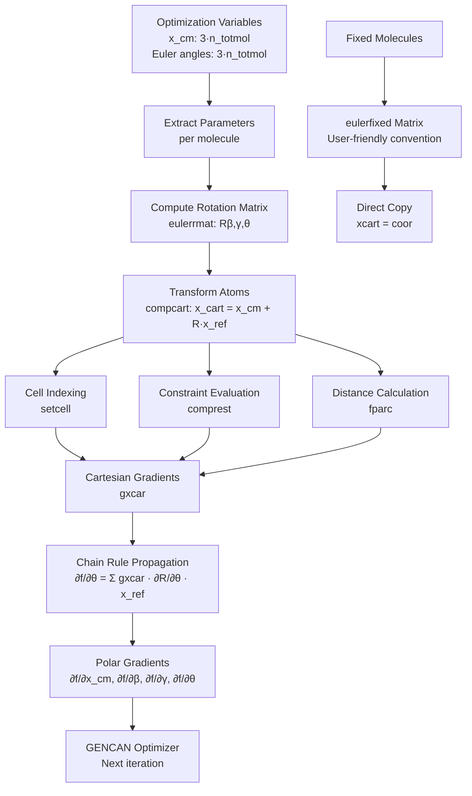

This documentation explains the coordinate transformation system that converts molecular position and orientation parameters from a compact polar representation into Cartesian coordinates for the GENCAN optimization algorithm. The transformation enables efficient optimization of molecular packing by reducing the degrees of freedom from 3N Cartesian coordinates per molecule to just 6 parameters (3 translational, 3 rotational) per molecule. This transformation is fundamental to packmol's ability to efficiently solve complex molecular packing problems through gradient-based optimization.

Sources: [polartocart.f90](/src/polartocart.f90#L1-L101), [computef.f90](/src/computef.f90#L37-L73)

## Mathematical Foundations and Representation

The polar representation employs a six-degree-of-freedom parameterization per molecule: three translational parameters representing the center of mass coordinates (xcm, ycm, zcm) and three rotational parameters using Euler angles (β, γ, θ). The canonical molecular geometry is stored in a body-fixed coordinate system relative to each molecule's center of mass, enabling efficient transformations during optimization iterations. This representation reduces the optimization space dimensionality from 3N to 6 per molecule, where N is the number of atoms, while preserving full molecular degrees of freedom.

The transformation from canonical coordinates to global Cartesian coordinates follows the linear equation: **x_cartesian = x_cm + R(β,γ,θ) · x_canonical**, where R is the rotation matrix constructed from Euler angles and x_canonical represents atomic positions in the molecule's reference frame. The canonical coordinates are precomputed from input files and stored in the `coor` array within `compute_data` module, serving as immutable reference geometry throughout the optimization process.

Sources: [polartocart.f90](/src/polartocart.f90#L49-L58), [compute_data.f90](/src/compute_data.f90#L28-L29)

## Core Transformation Algorithms

The transformation system implements three fundamental routines within `polartocart.f90`. The `eulerrmat` subroutine computes the rotation matrix from Euler angles using a specific axis convention where β rotates about the y-axis, γ about the z-axis, and θ about the x-axis. This convention, while non-intuitive from a human perspective, is mathematically consistent throughout the optimization framework. The subroutine computes 9 matrix elements efficiently using trigonometric functions, storing the three orthonormal basis vectors v1, v2, and v3 that constitute the rotation matrix columns.

The `compcart` subroutine performs the actual coordinate transformation by applying the rotation matrix to canonical coordinates and translating to the global center of mass position. This operation is performed atom-by-atom for each molecule during every function and gradient evaluation, making it computationally critical. The transformation formula explicitly computes each Cartesian coordinate as: **x(i) = xcm(i) + Σ[j=1 to 3] xref(j) · vj(i)**, where xref represents canonical coordinates and vj are rotation matrix column vectors.

The third routine, `eulerfixed`, implements an alternative rotation matrix calculation using the human-intuitive convention where β rotates about the x-axis, γ about the y-axis, and θ about the z-axis. This routine is exclusively used for positioning fixed molecules, providing user-friendly rotation specification while maintaining the efficiency of the primary optimization algorithm.

Sources: [polartocart.f90](/src/polartocart.f90#L14-L99), [computef.f90](/src/computef.f90#L54-L72)

## Integration with Optimization Workflow

The coordinate transformation is deeply integrated into packmol's optimization pipeline through the `computef` and `computeg` subroutines. During each objective function evaluation in `computef`, the system iterates through all molecules, extracts the 6 optimization variables (3 center of mass coordinates and 3 Euler angles), computes the rotation matrix via `eulerrmat`, then transforms all atoms of each molecule using `compcart`. The resulting Cartesian coordinates are stored in the `xcart` array for subsequent constraint evaluation and distance calculations.

The transformation process follows a structured indexing scheme where center of mass variables occupy indices 1 through 3·n_totmol, and Euler angle variables occupy indices 3·n_totmol+1 through 6·n_totmol. This indexing enables efficient variable extraction during transformation. The transformed coordinates are immediately used for cell indexing assignment, constraint violation evaluation, and intermolecular distance calculations within the same function call, minimizing memory access overhead.

During gradient computation in `computeg`, the transformation is repeated identically to ensure coordinate consistency with the function evaluation, enabling accurate gradient calculation through the chain rule. The Cartesian gradients computed from distance and constraint violations must be propagated back to the polar parameter space, requiring the rotation matrix and its partial derivatives.

Sources: [computef.f90](/src/computef.f90#L37-L109), [computeg.f90](/src/computeg.f90#L39-L96)

## Dual Rotation Matrix Architecture

Packmol employs a sophisticated dual rotation matrix architecture to balance human usability with computational efficiency. The primary rotation matrix, computed by `eulerrmat`, uses an unconventional axis sequence optimized for derivative calculations and efficient gradient propagation. The secondary rotation matrix, computed by `eulerfixed`, uses standard Euler angle conventions for user-specified fixed molecules.

> [!TIP]
> The dual matrix architecture eliminates the need for derivative recomputation when adopting human-friendly rotation conventions. Fixed molecules use `eulerfixed` for position specification, while the optimization variables continue using `eulerrmat`, maintaining gradient efficiency without requiring analytical derivative re-derivation.

This architectural separation is evident in the `initial` subroutine where fixed molecules bypass the polar-to-Cartesian transformation pipeline entirely. Fixed atoms are copied directly from canonical coordinates to Cartesian coordinates without rotation, marked with the `fixedatom` flag, and excluded from optimization. This design choice enables users to specify fixed molecule orientations using intuitive rotation parameters while preserving the mathematical consistency of the optimization framework.

The rotation matrix orthonormality properties (columns v1, v2, v3 form a right-handed orthonormal basis) are mathematically enforced through the trigonometric construction in both routines, ensuring coordinate transformations preserve interatomic distances and molecular geometry integrity.

Sources: [polartocart.f90](/src/polartocart.f90#L6-L69), [initial.f90](/src/initial.f90#L140-L150)

## Gradient Computation and Chain Rule

The most mathematically sophisticated aspect of the transformation system is gradient propagation from Cartesian coordinate space to polar parameter space using the chain rule. In `computeg`, after computing Cartesian gradients for all atoms, the system must transform these gradients back to gradient components for the 6 molecular parameters: ∂f/∂xcm, ∂f/∂ycm, ∂f/∂zcm, ∂f/∂β, ∂f/∂γ, and ∂f/∂θ.

The translational gradients are straightforward: **∂f/∂xcm_i = Σ[∂f/∂x_cartesian_j]** summed over all atoms j in molecule i, reflecting the fact that moving the center of mass translates all atoms equally. The rotational gradients require more complex calculations involving partial derivatives of the rotation matrix elements with respect to each Euler angle. The gradient components for each rotation angle are computed as: **∂f/∂θ = Σ[j,k] ∂f/∂x_cartesian[j,k] · (coor[j,1]·∂v1[k]/∂θ + coor[j,2]·∂v2[k]/∂θ + coor[j,3]·∂v3[k]/∂θ)**.

The partial derivatives of rotation matrix columns (∂v1/∂β, ∂v1/∂γ, ∂v1/∂θ, etc.) are computed analytically from the trigonometric expressions used in `eulerrmat`. These 27 partial derivative values (3 matrix columns × 3 angles × 3 spatial components) are precomputed for each molecule before the gradient summation loop, minimizing redundant trigonometric calculations. This analytical gradient computation ensures second-order convergence of the GENCAN optimization algorithm.

Sources: [computeg.f90](/src/computef.f90#L145-L241), [polartocart.f90](/src/polartocart.f90#L14-L41)

## Performance and Computational Considerations

The coordinate transformation system is a critical performance bottleneck due to its execution frequency during optimization. Each function evaluation requires transforming all atoms of all molecules, and each gradient evaluation repeats this transformation. For systems with thousands of molecules and atoms, this represents millions of coordinate transformations per optimization iteration.

The implementation addresses performance through several strategies. First, trigonometric computations (sines and cosines) are performed once per molecule and reused for all atoms, avoiding redundant calculations. Second, the transformation uses explicit vector operations rather than matrix multiplication for the coordinate transformation, reducing intermediate array allocations. Third, the rotation matrix columns are computed in place without temporary arrays, minimizing memory bandwidth requirements.

The cell indexing integration within the transformation loop in `computef` amortizes the cost of cell assignment across the transformation operation. As atoms are transformed, their cell indices are computed immediately, and they are added to the appropriate linked lists in a single pass through the atom array. This tight coupling between transformation and spatial indexing reduces loop overhead and cache misses.

Sources: [computef.f90](/src/computef.f90#L63-L101), [polartocart.f90](/src/polartocart.f90#L49-L58)

## Rotation Convention Comparison

The choice between the two rotation matrix implementations represents a fundamental trade-off between computational efficiency and human interpretability:

| Aspect | eulerrmat (Optimization) | eulerfixed (Fixed Molecules) |
|--------|-------------------------|------------------------------|
| β Rotation Axis | Y-axis | X-axis |
| γ Rotation Axis | Z-axis | Y-axis |
| θ Rotation Axis | X-axis | Z-axis |
| Primary Use | Optimization variables | User-specified fixed molecules |
| Derivative Efficiency | Optimized for chain rule | Not used in gradients |
| Human Interpretability | Low (non-intuitive) | High (standard convention) |
| Integration | computef, computeg, initial | initial (fixed molecules only) |

> [!TIP]
> The unconventional rotation convention in `eulerrmat` is deliberate and mathematically motivated. It simplifies the partial derivative expressions required for gradient propagation, reducing computational cost in the optimization inner loop where gradients are computed thousands of times.

This dual approach enables users to specify fixed molecule positions and orientations using intuitive rotation parameters while the optimization algorithm operates efficiently with mathematically convenient parameterizations internally.

Sources: [polartocart.f90](/src/polartocart.f90#L6-L99)

## Transformation Flow Architecture

The following diagram illustrates the complete data flow from polar parameters through transformation to Cartesian coordinates and back to polar gradients:

Sources: [computef.f90](/src/computef.f90#L37-L109), [computeg.f90](/src/computeg.f90#L145-L241), [initial.f90](/src/initial.f90#L140-L150)

## Next Steps

Understanding the polar to Cartesian coordinate transformation provides the foundation for exploring packmol's optimization architecture. The next logical step is to examine [Distance Constraints and Overlap Detection](17-distance-constraints-and-overlap-detection) to understand how transformed coordinates are used for molecular packing evaluation. For deeper insight into the mathematical foundations, refer to [Molecular Coordinate Systems: Baricenter and Euler Angles](13-molecular-coordinate-systems-baricenter-and-euler-angles). The optimization algorithm that drives these transformations is detailed in [GENCAN Optimization Method Overview](9-gencan-optimization-method-overview).