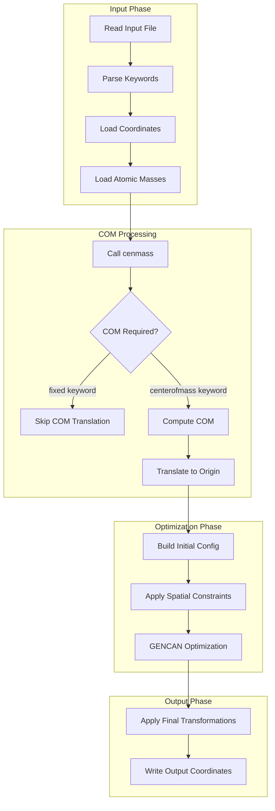
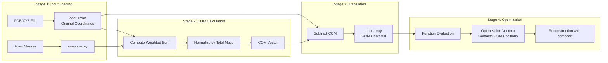

The Center of Mass (COM) calculation system in Packmol serves as the foundational coordinate normalization mechanism for molecular packing operations. This system establishes a consistent reference frame where each molecule's center of mass is positioned at the origin prior to optimization, ensuring predictable and efficient packing behavior. The COM subsystem integrates with spatial constraints, rotational dynamics, and the optimization algorithm to enable precise molecular positioning in complex systems.

## Architectural Overview

The COM calculation architecture operates as a preprocessing pipeline that transforms raw molecular coordinates into a standardized coordinate system. The system is anchored by the `cenmass()` subroutine in [cenmass.f90](src/cenmass.f90#L11-L103), which executes immediately after input parsing and before optimization initialization. This critical placement ensures that all subsequent operations—initial configuration generation, constraint evaluation, and optimization—operate on COM-centered coordinates.



The architecture reveals three key integration points: the input parsing stage in [packmol.f90](app/packmol.f90#L104-L108) where COM calculations are triggered, the optimization loop in [computef.f90](src/computef.f90#L52-L72) where COM-centered coordinates are reconstructed during function evaluation, and the coordinate transformation system that enables efficient molecular rotation and translation operations.

## COM Computation Algorithm

The core COM computation implements a weighted average calculation across all atoms within each molecule type. The algorithm processes molecules independently, computing three key values: the total mass (`totm`), the mass-weighted coordinate sum (`cm`), and the final normalized COM position. The mathematical foundation is expressed as:

**COM Calculation Formula:**
```
COM_i = (Σ_j m_j × r_j) / (Σ_j m_j)
```

where `COM_i` is the center of mass vector for molecule type `i`, `m_j` is the atomic mass of atom `j`, and `r_j` is the position vector of atom `j`.

The implementation in [cenmass.f90](src/cenmass.f90#L64-L84) follows a three-phase approach. First, the total mass for each molecule type is accumulated by iterating over all atoms and summing their atomic masses from the `amass` array. Second, the mass-weighted position vectors are computed by multiplying each atom's coordinates by its mass and accumulating the sum. Finally, the COM is normalized by dividing the weighted sums by the total mass.

**Critical Implementation Detail:** The atomic coordinate array `coor` stores relative positions from the molecule's COM reference point, not absolute positions. After COM calculation, the subroutine immediately translates all atom coordinates by subtracting the COM vector, effectively moving the COM to the origin [cenmass.f90](src/cenmass.f90#L86-L98). This transformation is fundamental to the molecular coordinate system described in [Molecular Coordinate Systems: Baricenter and Euler Angles](13-molecular-coordinate-systems-baricenter-and-euler-angles).

> [!TIP]
> The COM translation is performed in-place on the global `coor` array. This means subsequent references to `coor` implicitly assume COM-centered coordinates, and any external coordinate files must be interpreted in this context when analyzing optimization results.

## COM Control Through Input Keywords

Packmol provides two complementary keywords for controlling COM behavior at the molecule level: `fixed` and `centerofmass` (or `center`). These keywords are specified within structure blocks and enable fine-grained control over which molecules undergo COM translation.

### Keyword Behavior Matrix

| Keyword | Default State | COM Translation | Typical Use Case |
|---------|---------------|-----------------|------------------|
| `fixed` | Disabled | Disabled (skip) | Anchor molecules at specified positions |
| `centerofmass` | Enabled | Enabled | Standard free molecules requiring COM centering |
| Neither specified | Enabled | Enabled | Default behavior for free molecules |

The keyword processing logic in [cenmass.f90](src/cenmass.f90#L33-L54) implements a priority system. Initially, all molecule types are marked for COM translation (`domass(itype) = .true.`). The `fixed` keyword then selectively disables COM translation for molecules anchored at specific positions. The `centerofmass` keyword can override this behavior, explicitly enabling COM translation even for molecules that might otherwise be fixed.

### Input Syntax Examples

**Standard COM Translation (Default Behavior):**
```
structure water.pdb
  number 100
  inside box 0. 0. 0. 40. 40. 40.
end structure
```

**Explicit COM Translation:**
```
structure benzene.pdb
  number 2
  inside box 0. 0. 0. 40. 40. 40.
  centerofmass
end structure
```

**Fixed Molecule with COM Disabled:**
```
structure protein.pdb
  number 1
  fixed 20. 20. 20. 0. 0. 0.
end structure
```

**Fixed Molecule with COM Explicitly Enabled:**
```
structure ion.pdb
  number 1
  fixed 0. 0. -1. 0. 0. 0.
  centerofmass
end structure
```

The example from [toy_with_fixed.inp](testing/input_files/toy_with_fixed.inp#L8-L9) demonstrates a use case where fixed ions are explicitly centered using the `centerofmass` keyword, while the `fixed` keyword positions them at specific coordinates. This combination is useful for creating ionic pairs or defining reference points in simulation systems.

## COM Integration with Optimization Variables

The optimization vector `x` contains both translational and rotational degrees of freedom for each molecule. The COM system directly contributes to the translational components, which represent the position of each molecule's center of mass in the simulation space. This separation of concerns enables efficient optimization: the algorithm manipulates COM positions directly without needing to account for internal molecular geometry.

### Optimization Variable Structure

The optimization vector `x` is organized as follows:
- **Components 1 to `ntotmol × 3`**: COM coordinates (x, y, z) for each molecule
- **Components `ntotmol × 3 + 1` to end**: Euler angles (β, γ, θ) for rotational degrees of freedom

During each function evaluation in [computef.f90](src/computef.f90#L52-L72), the COM is extracted from the optimization vector:
```fortran
xcm = x(ilubar+1:ilubar+3)
```

This COM vector (`xcm`) is then combined with the rotation matrix (derived from Euler angles) and the COM-centered relative coordinates (`coor`) to reconstruct the absolute atomic positions:
```fortran
call compcart(xcart(icart,1:3), xcm, coor(idatom,1:3), v1, v2, v3)
```

The transformation from optimization variables to Cartesian coordinates is defined as:
```
r_absolute = r_COM + R × r_relative
```

where `r_absolute` is the final atomic position, `r_COM` is the center of mass position from the optimization vector, `R` is the rotation matrix from Euler angles, and `r_relative` is the COM-centered coordinate from the `coor` array.

## COM System Data Flow

The COM calculation system processes data through multiple arrays and data structures maintained across the program. Understanding this data flow is critical for debugging and extending the COM functionality.

### Key Data Structures

| Array | Module | Dimensions | Purpose in COM System |
|-------|--------|------------|----------------------|
| `coor` | compute_data | (ntotat, 3) | COM-centered relative coordinates |
| `amass` | input | (ntotat) | Atomic masses for COM weighting |
| `idfirst` | compute_data | (ntype) | Index of first atom for each type |
| `natoms` | compute_data | (ntype) | Number of atoms per molecule type |
| `xcm` | local | (3) | Current COM position during optimization |
| `xcart` | compute_data | (ntotat, 3) | Reconstructed absolute coordinates |

> [!TIP]
> The `coor` array is permanently modified by COM translation. If you need to access original coordinates, you must reload them from input files before calling `cenmass()`.

### COM Data Transformation Pipeline



This pipeline ensures that the COM system operates consistently throughout the packing process. The transition from Stage 3 to Stage 4 is particularly important: once coordinates are COM-centered, they remain in that frame throughout optimization, with absolute positions reconstructed on-the-fly during function evaluations.

## COM in Periodic Boundary Conditions

When periodic boundary conditions (PBC) are enabled, the COM system must account for the periodic nature of the simulation box. The COM calculation itself remains unchanged—it operates on the COM-centered relative coordinates stored in `coor`. However, the optimization variables (COM positions stored in `x`) and the reconstructed absolute coordinates must respect PBC boundaries.

The COM system interacts with PBC through several mechanisms described in [Periodic Boundary Conditions (PBC) Configuration](8-periodic-boundary-conditions-pbc-configuration):

1. **Initial Configuration**: The initial COM positions generated in [initial.f90](src/initial.f90#L93-L95) respect the PBC boundaries defined by `pbc_min` and `pbc_max`.
2. **Distance Calculations**: Pairwise distance computations in [fparc.f90](src/fparc.f90) apply minimum image conventions, ensuring that COM-based constraints are evaluated correctly across periodic boundaries.
3. **Fixed Molecules**: Fixed molecules must have all atoms within the PBC box after COM translation and rotation [initial.f90](src/initial.f90#L152-L162).

A critical validation occurs when fixed molecules are placed: the system verifies that all atoms of fixed molecules remain within the PBC boundaries after applying the COM transformation and any specified rotation. If any atom falls outside the defined PBC region, the program terminates with an error, preventing invalid initial configurations.

## Performance Considerations

The COM calculation is performed exactly once per molecule type during initialization, making it computationally negligible compared to the optimization loop. The algorithm complexity is O(N) where N is the total number of atoms, as each atom is visited exactly once during the mass summation and coordinate transformation phases.

However, the COM system has important implications for overall optimization performance:

1. **Reduced Search Space**: By centering molecules at their COM, the optimization algorithm operates on translational and rotational degrees of freedom separately, reducing the dimensionality of the search problem from 3N (N atoms) to 6 (3 translational + 3 rotational per molecule).

2. **Efficient Rotation Operations**: COM-centered coordinates enable efficient rotation matrix application without needing to recompute the COM during each rotation operation.

3. **Constraint Evaluation**: Spatial constraints defined in terms of COM positions (such as box or sphere constraints) are evaluated directly against optimization variables, avoiding repeated coordinate transformations.

The performance benefits are most pronounced in large systems with many molecules, where the reduced search space and efficient coordinate transformations significantly accelerate convergence.

## COM Calculation Limitations and Edge Cases

The COM system assumes accurate atomic mass data and well-defined molecular geometries. Several edge cases require special consideration:

### Zero-Mass or Undefined Masses

If atomic masses are not provided in input files or are set to zero, the COM calculation becomes mathematically undefined. The implementation protects against this by accumulating total mass first [cenmass.f90](src/cenmass.f90#L64-L71). If `totm(itype)` is zero, the subsequent division would cause division-by-zero errors. In practice, Packmol requires valid mass data for all atoms, and input parsing should validate mass values before COM calculation.

### Single-Atom Molecules

For single-atom molecules, the COM calculation is trivial: the COM is simply the atom's position. The algorithm handles this correctly, as the weighted sum contains a single term and the total mass is that atom's mass. After COM translation, the single atom's relative coordinate becomes (0, 0, 0), and its absolute position is determined entirely by the optimization variable.

### Degenerate Geometries

Molecules with degenerate geometries (all atoms at the same position) pose no algorithmic problems for COM calculation but represent physically unrealistic configurations. The COM calculation correctly computes the geometric center, and the subsequent translation positions the molecule at the origin. However, such configurations typically cause problems in subsequent overlap detection and constraint satisfaction.

## Integration with Constraint Enforcement

The COM system forms the foundation for spatial constraint enforcement. All spatial constraints—boxes, spheres, cylinders, planes—operate on COM positions for molecular placement. The constraint evaluation subsystem described in [Distance Constraints and Overlap Detection](17-distance-constraints-and-overlap-detection) uses COM positions from optimization variables to verify constraint satisfaction.

For example, when placing a molecule inside a box, the constraint is evaluated as:
```
x_min ≤ COM_x ≤ x_max
y_min ≤ COM_y ≤ y_max
z_min ≤ COM_z ≤ z_max
```

Because the optimization vector contains COM positions directly, these constraints are evaluated without needing to reconstruct atomic coordinates. This efficiency is a key advantage of the COM-centered coordinate system.

For constraints that operate on individual atoms (such as `displacement 2.0` constraints), the system first reconstructs absolute atomic positions using the COM and rotation matrix, then evaluates the constraint on individual atoms. This dual approach—COM-based for molecular constraints, atom-based for atomic constraints—provides maximum flexibility while maintaining computational efficiency.

## Next Steps

Understanding the COM system provides the foundation for exploring several interconnected concepts:

- [Molecular Coordinate Systems: Baricenter and Euler Angles](13-molecular-coordinate-systems-baricenter-and-euler-angles) describes how COM positions combine with rotational parameters to reconstruct absolute molecular positions
- [Distance Constraints and Overlap Detection](17-distance-constraints-and-overlap-detection) explains how COM positions are used in spatial constraint evaluation
- [Handling Fixed and Restricted Molecules](20-handling-fixed-and-restricted-molecules) details the interaction between COM calculations and fixed molecule placement
- [Objective Function Design in computef.f90](10-objective-function-design-in-computef-f90) shows how COM variables contribute to the optimization objective function

The COM system is fundamental to Packmol's efficiency and correctness. Mastering its behavior is essential for understanding the entire packing optimization pipeline and for debugging complex packing configurations.