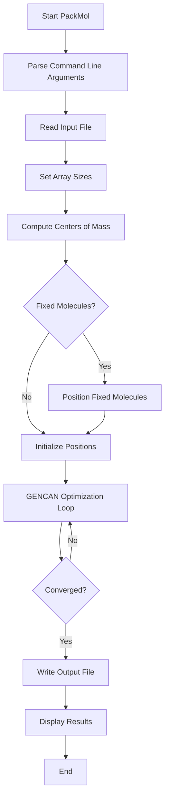
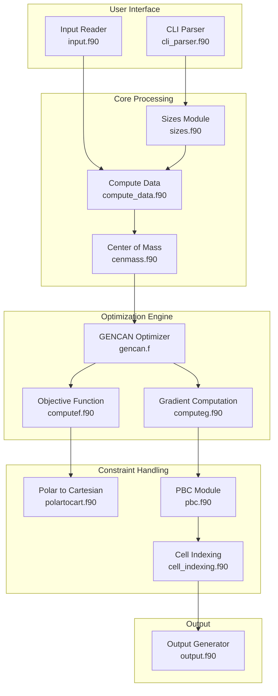

Packmol creates initial configurations for molecular dynamics simulations by packing molecules in defined spatial regions while preventing overlaps. This guide walks you through your first simulation from installation to execution.

## What PackMol Does

PackMol solves a fundamental problem in molecular modeling: starting configurations. When you begin a molecular dynamics simulation, you need atoms and molecules positioned in 3D space such that no two atoms are too close together (which would cause numerical instability). PackMol automates this by taking molecule templates and placing them according to geometric constraints you define.

The program uses a sophisticated optimization algorithm (GENCAN) to position molecules efficiently while respecting your spatial constraints and avoiding atomic overlaps. It supports multiple molecular file formats and complex constraint types, making it suitable for everything from simple water boxes to membrane systems with lipid bilayers.

## Installation

Choose one of the following installation methods based on your environment and expertise level:

| Method | Difficulty | Platform | Best For |
|--------|-----------|----------|----------|
| **Julia Package** | Easy | All platforms | Beginners or non-Fortran users |
| **Make** | Medium | Linux/macOS | Standard development environments |
| **fpm** | Medium | All platforms | Modern Fortran workflows |

### Option 1: Julia Package (Easiest)

If you're not familiar with compiling Fortran code, the Julia interface provides pre-built executables for all platforms:

```bash
# Install Julia from https://julialang.org/downloads/
# Then install Packmol.jl
julia -e 'using Pkg; Pkg.add("Packmol")'
```

The executable will be available after installation.

### Option 2: Standard Compilation with Make

Download and compile from source:

```bash
# Download from https://github.com/m3g/packmol/releases
tar -xzvf packmol-21.0.0.tar.gz
cd packmol
./configure [optional: path to fortran compiler]
make
```

The executable `packmol` will be created in the main directory. Add this directory to your system PATH for convenient execution.

Sources: [README.md](README.md#L40-L49)

### Option 3: Fortran Package Manager (fpm)

Install fpm first, then use it to build PackMol:

```bash
# Install fpm from https://fpm.fortran-lang.org
cd packmol
fpm install --profile release
```

This places the executable in `~/.local/bin` on Linux systems, making the `packmol` command available system-wide. To use a different Fortran compiler, set the `FPM_FC` environment variable.

Sources: [README.md](README.md#L52-L62)

## Your First Simulation

Let's create a simple water box containing 1000 water molecules. This example demonstrates the essential components of a PackMol input file.

### Step 1: Prepare Your Input File

Create a file named `water_box.inp` with the following content:

```fortran
#
# A box with water
#

tolerance 2.0
filetype pdb
output output.pdb

structure ./structure_files/water.pdb
  number 1000
  inside box -20. -20. -20. 20. 20. 20.
end structure
```

### Understanding the Input File Structure

PackMol input files follow a hierarchical structure. Here's what each component does:

| Keyword | Purpose | Example |
|---------|---------|---------|
| `tolerance` | Minimum distance between atoms (Å) | `2.0` |
| `filetype` | Input/output format | `pdb`, `xyz`, or `tinker` |
| `output` | Output filename | `output.pdb` |
| `structure` | Begin molecule definition | `structure water.pdb` |
| `number` | How many molecules of this type | `1000` |
| `inside box` | Spatial constraint (x_min y_min z_min x_max y_max z_max) | `-20. -20. -20. 20. 20. 20.` |
| `end structure` | End molecule definition | — |

The `tolerance` parameter is critical: it defines the minimum allowed distance between any two atoms in the system. A value of 2.0 Å is typical for water, but you may need to adjust this based on your molecular types and desired packing density.

Sources: [water_box.inp](testing/input_files/water_box.inp#L1-L15)

### Step 2: Run PackMol

Execute PackMol from the command line:

```bash
packmol < water_box.inp
```

PackMol will display progress information and output the final configuration to `output.pdb`. The program uses the GENCAN optimization algorithm to find positions that satisfy all constraints.

### Program Execution Flow

PackMol follows a well-defined sequence when processing your input:



The main program orchestrates these steps through a modular architecture, with each major phase handled by dedicated subroutines. The optimization loop continues until convergence criteria are met or the maximum number of iterations is reached.

Sources: [packmol.f90](app/packmol.f90#L30-L100), [title.f90](src/title.f90#L1-L20)

## Common Use Cases

Here are several practical examples demonstrating PackMol's versatility:

### Simple Water Box

Creates a cubic box filled with water molecules:

```fortran
tolerance 2.0
filetype pdb
output output.pdb

structure ./structure_files/water.pdb
  number 1000
  inside box -20. -20. -20. 20. 20. 20.
end structure
```

This is the starting point for most aqueous simulations. The box dimensions (±20 Å) create a 40 Å cubic volume.

Sources: [water_box.inp](testing/input_files/water_box.inp#L1-L15)

### Binary Mixture

Combines two different molecule types in the same box:

```fortran
tolerance 2.0
filetype pdb
output output.pdb

structure ./structure_files/water.pdb
  number 1000
  inside box 0. 0. 0. 40. 40. 40.
end structure

structure ./structure_files/urea.pdb
  number 400
  inside box 0. 0. 0. 40. 40. 40.
end structure
```

This places 1000 water molecules and 400 urea molecules in the same 40 Å cubic region, useful for studying solvation and molecular interactions.

Sources: [mixture.inp](testing/input_files/mixture.inp#L1-L19)

### Protein Solvation

Fixes a protein in place while adding solvent and ions:

```fortran
tolerance 2.0

structure ./structure_files/protein.pdb
  resnumbers 0
  number 1 
  fixed 0. 0. 0. 0. 0. 0.
  centerofmass
end structure

structure ./structure_files/water.pdb
  resnumbers 2
  number 1000 
  inside sphere 0. 0. 0. 50.
end structure

structure ./structure_files/CLA.pdb
  resnumbers 2
  number 20
  inside sphere 0. 0. 0. 50.
end structure

structure ./structure_files/SOD.pdb
  resnumbers 2
  number 30
  inside sphere 0. 0. 0. 50.
end structure

output output.pdb
avoid_overlap no
seed -1
```

This example demonstrates several advanced features: fixed molecules (`fixed`), spherical regions, resnumber control, and random seed specification. The protein remains stationary while water and ions pack around it in a spherical shell.

Sources: [solvprotein.inp](testing/input_files/solvprotein.inp#L1-L35)

## PackMol Architecture

Understanding PackMol's architecture helps you troubleshoot issues and use the tool effectively:



This modular design separates concerns: input parsing, data preparation, optimization, and output generation are distinct components. The main program in [packmol.f90](app/packmol.f90#L30-L100) coordinates these modules through a carefully orchestrated sequence.

> [!TIP]
> When troubleshooting, note that the optimization engine (GENCAN) operates on internal coordinate systems. If your molecules appear distorted in the output, check that your input structure files are properly centered and have reasonable coordinates before calling PackMol.

## Troubleshooting Quick Reference

| Issue | Common Cause | Solution |
|-------|-------------|----------|
| **No convergence** | Too tight constraints or high density | Increase box size or reduce molecule count |
| **Atoms too close** | Tolerance too low | Increase `tolerance` value |
| **Long runtime** | Many molecules with complex constraints | Use simpler constraints or reduce molecule count |
| **Missing atoms in output** | Input file format issues | Verify input PDB/XYZ file integrity |
| **Fixed molecules moving** | Syntax error in `fixed` statement | Check format: `fixed x y z rx ry rz` |

## What's Next

Now that you've run your first simulation, explore these advanced topics:

- **[Input File Syntax and Structure](3-input-file-syntax-and-structure)**: Detailed explanation of all input keywords and parameters
- **[Spatial Constraints Syntax](5-spatial-constraints-syntax-box-sphere-plane-cylinder)**: Master box, sphere, plane, and cylinder constraints
- **[Molecule Definition and File Formats](6-molecule-definition-and-file-formats-pdb-xyz-tinker)**: Understand supported file formats and molecule preparation
- **[Compilation and Installation Methods](4-compilation-and-installation-methods)**: Advanced build options and troubleshooting

PackMol's combination of geometric flexibility and robust optimization makes it a powerful tool for preparing initial configurations across a wide range of molecular simulation scenarios. Start with simple systems and gradually incorporate more complex constraints as you become familiar with the program's capabilities.