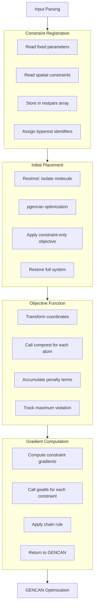

PackMOL provides sophisticated mechanisms for controlling molecular placement through fixed positioning and spatial restrictions. These capabilities enable precise molecular assembly for complex systems ranging from simple mixtures to elaborate biomolecular assemblies.

## Fixed Molecules: Absolute Positioning

Fixed molecules provide exact control over molecular placement by specifying both position and orientation. The `fixed` constraint takes six parameters: three translational coordinates (x, y, z) and three Euler angles (α, β, γ) defining molecular rotation.

**Syntax**: `fixed x y z alpha beta gamma`

For example, to place a water molecule at the origin with a specific orientation:

```
structure ./structure_files/water.pdb
  number 1
  fixed 0. 0. 0. 45. 45. 45.
end structure
```

Sources: [getinp.f90](testing/input_files/only_one_fixed.inp#L1-L11), [getinp.f90](src/getinp.f90#L540-L548)

The implementation distinguishes fixed molecules from restricted ones through a dedicated data structure. When the `fix` flag is enabled, fixed atoms are loaded directly from structure files into the `xcart` array and marked with `fixedatom(icart) = .true.` in [initial.f90](src/initial.f90#L132-L139). These atoms participate in distance calculations to prevent overlaps with movable molecules, but their positions remain immutable throughout optimization.

**PBC Compatibility**: When periodic boundary conditions are enabled, PackMOL validates that all fixed atoms reside within the simulation box boundaries [initial.f90](src/initial.f90#L140-L150). This prevents simulation artifacts from molecules spanning multiple periodic images.

## Spatial Restrictions: Constrained Placement

Spatial restrictions define regions where molecules must reside. PackMOL supports multiple geometric constraint types, each with a unique identifier in the `ityperest` array:

**Constraint Types**:

| Type | Keyword | Parameters | Description |
|------|---------|------------|-------------|
| 2 | `inside cube` | xc, yc, zc, length | Center coordinates + cube side length |
| 3 | `inside box` | xmin, ymin, zmin, xmax, ymax, zmax | Opposing corner coordinates |
| 4 | `inside sphere` | xc, yc, zc, radius | Center + radius |
| 5 | `inside ellipsoid` | xc, yc, zc, a, b, c, semiaxis | Center + three semiaxes + scale factor |
| 6 | `outside cube` | xc, yc, zc, length | Excludes volume within cube |
| 7 | `outside box` | xmin, ymin, zmin, xmax, ymax, zmax | Excludes volume within box |
| 8 | `outside sphere` | xc, yc, zc, radius | Excludes volume within sphere |
| 9 | `outside ellipsoid` | xc, yc, zc, a, b, c, semiaxis | Excludes volume within ellipsoid |
| 10 | `above plane` | nx, ny, nz, d | Normal vector components + distance |
| 11 | `below plane` | nx, ny, nz, d | Normal vector components + distance |
| 12 | `inside cylinder` | xc, yc, zc, nx, ny, nz, radius, height | Axis point + direction vector + dimensions |
| 13 | `outside cylinder` | xc, yc, zc, nx, ny, nz, radius, height | Excludes volume within cylinder |
| 14 | `above xygauss` | xc, yc, zc, σx, σy, A | Gaussian surface constraint |
| 15 | `below xygauss` | xc, yc, zc, σx, σy, A | Gaussian surface constraint |

Sources: [getinp.f90](src/getinp.f90#L552-L730)

## Constraint Enforcement Architecture

The constraint enforcement system operates through three core components working in sequence:



## The Restmol Subroutine: Isolated Constraint Satisfaction

The `restmol` subroutine in [restmol.f90](src/restmol.f90#L19-L71) implements a powerful technique for satisfying spatial constraints: it temporarily reduces the optimization problem to a single molecule.

The process works as follows:

1. **State Preservation**: Save the global problem state including molecule counts and coordinate arrays
2. **Problem Reduction**: Set `ntotmol = 1` and `nmols(itype) = 1` to focus on the target molecule
3. **Type Isolation**: Enable only the current molecule type via `comptype(i) = .true.` for the target and `.false.` for others
4. **Constraint Solution**: Either evaluate the constraint penalty or invoke `pgencan` to solve the placement problem
5. **State Restoration**: Return original molecule counts and coordinate arrays

This isolation strategy is crucial for systems with complex constraints. By solving each molecule's placement independently before considering intermolecular distances, PackMOL avoids local minima where molecules might become trapped in overlapping configurations while trying to satisfy multiple spatial constraints simultaneously.

Sources: [restmol.f90](src/restmol.f90#L19-L71)

## Constraint Penalty Functions

Each spatial constraint type implements a penalty function in `comprest.f90` that returns zero when atoms satisfy the constraint and positive values proportional to violation severity.

**Inside Constraints** (Types 2, 3): Use squared distance penalties from boundaries. For a box constraint with bounds [xmin, xmax], the penalty is:

```fortran
a1 = dmin1(xcart(icart,1) - xmin, 0.d0)
f = f + scale*(a1 * a1)
```

This penalizes atoms with x < xmin. A symmetric calculation penalizes x > xmax. The `scale` parameter (typically 10²) determines penalty severity.

Sources: [comprest.f90](src/comprest.f90#L26-L37)

**Spherical Constraints** (Types 4, 8): Compute radial distance from sphere center. For an inside sphere constraint:

```fortran
w = (xcart(icart,1)-restpars(irest,1))² + 
    (xcart(icart,2)-restpars(irest,2))² + 
    (xcart(icart,3)-restpars(irest,3))² - 
    restpars(irest,4)²
a1 = dmax1(w,0.d0)
f = f + scale2*a1*a1
```

The penalty activates when the radial distance exceeds the sphere radius.

Sources: [comprest.f90](src/comprest.f90#L38-L44)

**Planar Constraints** (Types 10, 11): Use dot product of position with normal vector. For `above plane`:

```fortran
w = restpars(irest,1)*xcart(icart,1) + 
    restpars(irest,2)*xcart(icart,2) + 
    restpars(irest,3)*xcart(icart,3) - 
    restpars(irest,4)
a1 = dmin1(w,0.d0)
f = f + scale * a1*a1
```

This computes signed distance from the plane and penalizes violations.

Sources: [comprest.f90](src/comprest.f90#L115-L121)

**Cylindrical Constraints** (Types 12, 13): Decompose position into components parallel and perpendicular to the cylinder axis. The penalty considers both radial confinement and axial bounds:

```fortran
! Radial component
d = (a1 - v1*w)² + (a2 - v2*w)² + (a3 - v3*w)²
! Combined penalty for inside cylinder
f = f + scale2 * (dmax1(-w, 0.d0)² + 
                  dmax1(w - height, 0.d0)² + 
                  dmax1(d - radius², 0.d0)²)
```

This enforces three conditions simultaneously: axial lower bound, axial upper bound, and radial confinement.

Sources: [comprest.f90](src/comprest.f90#L133-L144)

## Initial Placement Strategy

The initialization phase in [initial.f90](src/initial.f90#L164-L202) employs a two-stage approach for handling constrained molecules:

1. **Constraint-Only Optimization**: With `init1 = .true.`, PackMOL evaluates only spatial constraints (ignoring intermolecular distances) and optimizes each molecule type sequentially using `swaptype` to isolate types and `pgencan` for optimization

2. **Convergence Validation**: If `frest > precision` after `nloop0_type(itype)` iterations, the system reports failure, indicating that the constraints themselves are unsatisfiable

> [!TIP]
> The constraint-only optimization phase is critical for detecting impossible configurations early. If molecules cannot satisfy their spatial constraints even without considering intermolecular distances, the problem specification itself contains a geometric inconsistency that must be corrected before distance tolerances can be addressed.

Sources: [initial.f90](src/initial.f90#L164-L202)

## Fixed vs Restricted Molecules: Key Differences

Understanding the distinction between these two concepts is essential for effective use:

| Aspect | Fixed Molecules | Restricted Molecules |
|--------|----------------|---------------------|
| **Syntax** | `fixed x y z α β γ` | `inside/outside [geometry] parameters` |
| **Degrees of Freedom** | Zero (fully specified) | 6 (translation + rotation) |
| **Optimization** | None (coordinates constant) | Full GENCAN optimization |
| **Storage** | Special `fix` flag and `fixedatom` array | Standard optimization variables |
| **PBC Requirements** | Must be within simulation box | Automatically constrained to PBC region |
| **Use Case** | Reference structures, anchor molecules | Solvent shells, partitioned regions |

## Gradient Computation for Constraints

Analytical gradients for spatial constraints are computed in `computeg.f90` through the `gwalls` subroutine. This enables efficient optimization by providing exact sensitivity information to the GENCAN solver.

For each atom, the system loops through all applicable constraints [computeg.f90](src/computeg.f90#L56-L60):

```fortran
do iratcount = 1, nratom(icart)
   irest = iratom(icart,iratcount)
   call gwalls(icart,irest)
end do
```

The `gwalls` subroutine computes derivatives of the penalty function with respect to Cartesian coordinates, which are then transformed via chain rule to obtain derivatives with respect to the baricenter position and Euler angles (the actual optimization variables).

Sources: [computeg.f90](src/computeg.f90#L56-L60)

## Practical Example: Toy System with Fixed Molecules

The test file `toy_with_fixed.inp` demonstrates combining fixed and restricted molecules:

```
structure ./structure_files/SOD.pdb
  number 1 
  fixed 0. 0. -1. 0. 0. 0.
  centerofmass
end structure

structure ./structure_files/SOD.pdb
  number 1 
  fixed 0. 0. 1. 0. 0. 0.
  centerofmass
end structure

structure ./structure_files/CLA.pdb
  number 1
  inside box -1.0 -1.0 -2.0 1.0 1.0 3.0
end structure
```

This configuration places two sodium ions at fixed positions (z = -1 and z = +1) while allowing a chloride ion to occupy any position within the specified box region. The system demonstrates how fixed molecules can create asymmetric environments around which flexible molecules organize.

Sources: [toy_with_fixed.inp](testing/input_files/toy_with_fixed.inp#L1-L27)

## Performance Considerations

Fixed molecules provide computational advantages by reducing the optimization problem dimension. With `nfix` fixed molecules, the optimization variables decrease from `6 × (nfix + nmove)` to `6 × nmove`, significantly accelerating convergence for large systems.

Restricted molecules add computational overhead through penalty evaluations and gradient calculations for each constraint. However, the constraint system is designed to be efficient:
- Constraints are pre-assigned to atoms during input parsing via the `iratom` array
- Only applicable constraints are evaluated for each atom
- Analytical gradients avoid numerical differentiation overhead

> [!TIP]
> When designing systems with many constraints, prefer geometric primitives (box, sphere, cylinder) over complex composite regions. Simple constraints enable more efficient evaluation and typically lead to better convergence properties.

## Integration with Distance Constraints

Spatial constraints work in conjunction with distance tolerance constraints. The objective function combines both components [computef.f90](src/computef.f90#L24-L36):

```fortran
call comprest(icart,fplus)
f = f + fplus
frest = dmax1(frest,fplus)
```

The total objective includes:
- **Spatial constraint penalties** (via `comprest`)
- **Distance violation penalties** (via `fparc` function for neighbor pairs)
- **Scale factors** (`scale` ~ 10² for spatial, implicit for distance)

The optimization algorithm simultaneously satisfies both categories of constraints, with spatial constraints typically dominating during early iterations when molecules are far apart.

Sources: [computef.f90](src/computef.f90#L24-L36)

## Next Steps

For deeper understanding of related topics:

- [Spatial Constraints Syntax (Box, Sphere, Plane, Cylinder)](5-spatial-constraints-syntax-box-sphere-plane-cylinder) - Detailed syntax examples and geometric definitions
- [Molecular Coordinate Systems: Baricenter and Euler Angles](13-molecular-coordinate-systems-baricenter-and-euler-angles) - Mathematical foundation for position/rotation variables
- [GENCAN Optimization Method Overview](9-gencan-optimization-method-overview) - The optimization algorithm that solves constraint problems
- [Objective Function Design in computef.f90](10-objective-function-design-in-computef-f90) - How penalties combine into the total objective