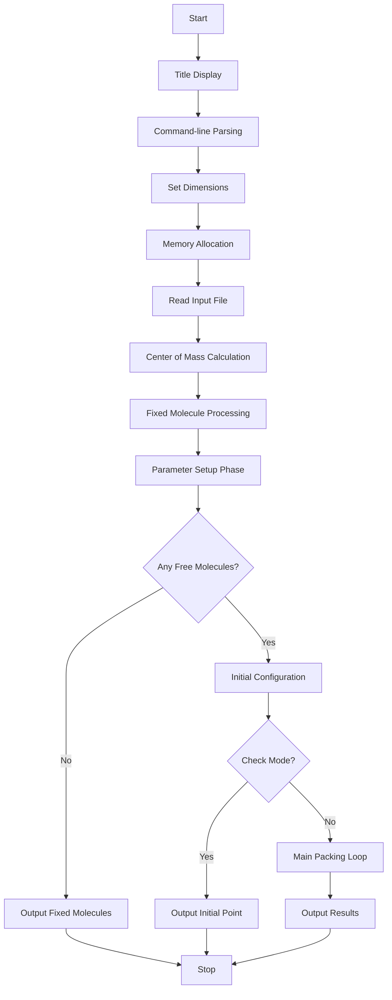

This documentation provides a comprehensive analysis of Packmol's main program execution architecture. The `packmol.f90` file serves as the orchestrator that coordinates input parsing, initialization, optimization, and output generation for molecular packing simulations. Understanding this flow is essential for developers seeking to extend functionality or debug complex packing scenarios.

Sources: [packmol.f90](app/packmol.f90#L34-L980)

## Program Architecture Overview

Packmol employs a modular architecture where the main program coordinates multiple specialized subsystems. The execution flow follows a carefully designed sequence that separates initialization, configuration, and optimization into distinct phases. This modular design enables clear separation of concerns while maintaining efficient data flow between components.

The program is structured around the optimization problem of placing molecules within spatial constraints while avoiding overlaps. Each molecule is parameterized by 6 degrees of freedom (3 translation + 3 rotation), forming the optimization variables that GENCAN manipulates to minimize the objective function.

Sources: [packmol.f90](app/packmol.f90#L34-L46), [usegencan.f90](src/usegencan.f90#L8-L18)

## Phase 1: Program Initialization

The initialization phase establishes the foundation for all subsequent operations by setting up memory structures, reading user input, and performing initial coordinate transformations.

**Module Dependencies**: The program begins by importing essential modules that define global data structures and utility functions. Key modules include `exit_codes` for standardized error handling, `sizes` for array dimensioning, `compute_data` for coordinate storage, `cli_parser` for command-line interface, `input` for parameter management, `usegencan` for optimization interfaces, and specialized modules for sorting and aesthetics.

**Startup Sequence**: The first executable action displays program header information via `call title()` [packmol.f90](app/packmol.f90#L83), followed by `call parse_command_line_args()` [packmol.f90](app/packmol.f90#L87) which processes command-line arguments such as input file specification and debugging flags. The `call setsizes()` [packmol.f90](app/packmol.f90#L91) routine dynamically determines array sizes based on input file contents.

**Memory Allocation**: Critical arrays are allocated after dimensioning, including the `fixed(ntype)` array tracking immobile molecules, the optimization variable array `x(nn)` containing 6 degrees of freedom per molecule, and working arrays `xprint(nn)` and `xfull(nn)` for state management [packmol.f90](app/packmol.f90#L95).

**Input Parsing**: The `call getinp()` [packmol.f90](app/packmol.f90#L104) subroutine reads the input file, parsing molecule definitions, spatial constraints, and optimization parameters. This routine populates the `input` module's data structures with all user-specified configuration.

**Coordinate Centering**: The `call cenmass()` [packmol.f90](app/packmol.f90#L108) routine centers each molecule at its center of mass, establishing a consistent reference frame for rotational operations and constraint applications.

Sources: [packmol.f90](app/packmol.f90#L36-L112), [input.f90](src/input.f90#L9-L82)

## Phase 2: Fixed Molecule Processing

Fixed molecules are molecules that remain stationary throughout the optimization process, serving as reference structures around which other molecules are arranged.

**Identification and Positioning**: The program iterates through restrictions (`nrest`) to identify fixed molecule specifications indicated by `ityperest(irest).eq.1` [packmol.f90](app/packmol.f90#L118). For each fixed molecule, the program retrieves the target position (`xcm`) from `restpars(irest,1:3)` and Euler angles (`beta, gama, teta`) from `restpars(irest,4:6)` [packmol.f90](app/packmol.f90#L122-L125).

**Coordinate Transformation**: Fixed molecules are rotated using `call eulerfixed(beta,gama,teta,v1,v2,v3)` [packmol.f90](app/packmol.f90#L129) which generates the rotation matrix from Euler angles. The transformation applies the rotation matrix to each atom's coordinates and translates to the target center of mass [packmol.f90](app/packmol.f90#L134-L143).

**Validation Checks**: The program enforces constraints that fixed molecules cannot have `nmols(itype) > 1` [packmol.f90](app/packmol.f90#L148-L152) and cannot use restart files [packmol.f90](app/packmol.f90#L153-L158). The `fixed(itype)` logical array marks which molecule types are immobile [packmol.f90](app/packmol.f90#L147).

**Array Reorganization**: To optimize subsequent operations, fixed molecules are moved to the end of the molecule type arrays. A bubble-sort-like operation swaps fixed molecule data with free molecule data, ensuring all free molecules occupy indices `1:ntype` while fixed molecules occupy `ntype+1:ntype_with_fixed` [packmol.f90](app/packmol.f90#L186-L247). This reorganization enables efficient subset operations during optimization.

Sources: [packmol.f90](app/packmol.f90#L114-L247)

## Phase 3: Parameter Setup

The parameter setup phase configures all optimization parameters, tolerances, and constraints based on input specifications and computed properties.

**Variable Count Calculation**: The total number of optimization variables `n = ntotmol * 6` accounts for 3 translational and 3 rotational degrees of freedom per free molecule [packmol.f90](app/packmol.f90#L264). The program distinguishes between `ntmol` (total molecules), `ntotmol` (free molecules), and `nfixedat` (fixed atoms) [packmol.f90](app/packmol.f90#L256-L278).

**Tolerance Configuration**: Default tolerances are initialized with `radius(i) = dism/2.d0` and `fscale(i) = 1.d0` for all atoms [packmol.f90](app/packmol.f90#L283-L284). Short-distance tolerances can be enabled globally or per-atom for specialized handling of specific atom pairs [packmol.f90](app/packmol.f90#L285-L292).

**Atom-Specific Parameters**: The program processes molecule-specific radius, fscale, and short_radius specifications, first applying to all atoms in a molecule [packmol.f90](app/packmol.f90#L317-L388), then overwriting with atom-specific values defined within `atoms...end` blocks [packmol.f90](app/packmol.f90#L409-L515). This hierarchical approach enables both efficient default assignment and precise per-atom control.

**Validation**: Short radius specifications are validated to ensure `short_radius(i) < radius(i)` [packmol.f90](app/packmol.f90#L519-L528), maintaining the hierarchical relationship between primary and secondary distance tolerances.

**Periodic Boundary Conditions**: When PBC is enabled, an additional box constraint is automatically added to keep non-fixed molecules within the simulation cell [packmol.f90](app/packmol.f90#L537-L546). This constraint uses `pbc_min` and `pbc_max` to define the bounding region.

**Constraint Array Construction**: The `nratom(icart)` array tracks the number of geometric constraints applying to each atom, while `iratom(icart,i)` stores the indices of these constraints [packmol.f90](app/packmol.f90#L548-L632). This enables efficient constraint evaluation during objective function computation.

**Rotation Constraints**: Rotational degrees of freedom can be constrained along specific axes using `constrain_rotation` keywords [packmol.f90](app/packmol.f90#L634-L691). These bounds are converted from degrees to radians for internal calculations.

Sources: [packmol.f90](app/packmol.f90#L249-L691)

## Phase 4: Initial Configuration

The initial configuration phase creates the starting point for optimization and validates that a meaningful problem exists.

**All-Fixed Check**: If no free molecules exist (`n.eq.0`), the program directly outputs the fixed molecule configuration without optimization [packmol.f90](app/packmol.f90#L695-L705). This handles the edge case of purely static arrangements.

**Initial Point Generation**: The `call initial(n,x)` [packmol.f90](app/packmol.f90#L711) subroutine creates the initial optimization variable vector. This involves computing maximum internal distances for each molecule type, defining system boundaries based on spatial constraints, and generating random positions and orientations for free molecules [initial.f90](src/initial.f90#L10-L100).

**Initial Function Evaluation**: The program evaluates the objective function at the initial point using `call computef(n,x,all_type_fx)` [packmol.f90](app/packmol.f90#L719). This provides a baseline for measuring optimization progress and validates that the initial configuration is physically reasonable.

**Check Mode**: When `check` mode is enabled, the program outputs the initial configuration and terminates without optimization, useful for debugging input files and verifying constraint definitions [packmol.f90](app/packmol.f90#L728-L733).

Sources: [packmol.f90](app/packmol.f90#L694-L733), [initial.f90](src/initial.f90#L9-L559), [computef.f90](src/computef.f90#L9-L100)

## Phase 5: Main Packing Loop

The main packing loop implements Packmol's sophisticated two-phase optimization strategy that balances efficiency with convergence quality.

**Loop Architecture**: The outer `main` loop iterates through molecule types from `itype = 1` to `ntype + 1` [packmol.f90](app/packmol.f90#L742-L765). When `packall` is enabled, the loop jumps directly to `itype = ntype + 1`, packing all molecules together. The inner `gencanloop` performs repeated GENCAN optimization iterations for each phase [packmol.f90](app/packmol.f90#L811-L961).

**Phase 1: Type-Specific Packing** (`itype ≤ ntype`): Each molecule type is optimized independently using `call swaptype(n,x,itype,1)` [packmol.f90](app/packmol.f90#L756), which configures the optimization variables to include only molecules of the current type. This decoupling reduces problem complexity and accelerates convergence. After each optimization, the all-type function value is computed using `call swaptype(n,x,itype,3)` to restore all molecules [packmol.f90](app/packmol.f90#L886-L888).

**Phase 2: Joint Packing** (`itype = ntype + 1`): All free molecules are optimized together using `call swaptype(n,x,itype,3)` [packmol.f90](app/packmol.f90#L758). This final phase resolves any residual overlaps between different molecule types and fine-tunes the configuration for overall optimality.

**Radius Scaling Strategy**: An adaptive tolerance strategy improves convergence by initially using larger effective radii (`radscale = discale`) to achieve coarse separation, then gradually reducing to user-specified tolerances [packmol.f90](app/packmol.f90#L748-L751). The scaling factor decreases when `fdist < precision` and improvement falls below thresholds [packmol.f90](app/packmol.f90#L940-L948).

> [!TIP]
> The radius scaling mechanism is crucial for efficiency. By starting with inflated molecular radii (typically 10-20% larger than specified), the optimization quickly achieves a good packing layout, then progressively tightens tolerances to achieve the precise user-specified distances. This staged approach significantly reduces overall computation time for large systems.

**GENCAN Optimization**: Each iteration calls `call pgencan(n,x,fx)` [packmol.f90](app/packmol.f90#L830), which invokes the GENCAN conjugate gradient method to minimize the objective function. The optimization operates on the active variable set defined by the current `swaptype` configuration.

**Bad Molecule Movement**: When enabled and convergence stalls, `call movebad(n,x,fx,movebadprint)` [packmol.f90](app/packmol.f90#L817) displaces molecules with severe constraint violations, helping escape local minima. This heuristic operates only when `radscale == 1.d0` (final tolerance phase) and `fimp ≤ 10.d0` (low improvement).

**Convergence Testing**: After each GENCAN iteration, the program checks `fdist < precision` and `frest < precision` [packmol.f90](app/packmol.f90#L875) to determine if convergence criteria are met. When satisfied during type-specific packing, the program advances to the next type. When satisfied during joint packing, the optimization terminates successfully [packmol.f90](app/packmol.f90#L896-L903).

**Progressive Output**: The program periodically writes the best configuration to the output file based on the `writeout` interval [packmol.f90](app/packmol.f90#L909-L925). The `writebad` option forces output even of non-converged configurations, enabling progress inspection for difficult problems.

**Maximum Iteration Handling**: When `loop.eq.nloop` is reached, the program either advances to the next packing phase or terminates with a convergence error if this is the final phase [packmol.f90](app/packmol.f90#L950-L959). A checkpoint file is written to enable resumption of long-running optimizations.

Sources: [packmol.f90](app/packmol.f90#L735-L965), [swaptypemod.f90](src/swaptypemod.f90#L10-L15)

## Phase 6: Termination and Output

The termination phase handles final output generation, cleanup, and program exit with appropriate status codes.

**Final Output**: Upon successful convergence, the program calls `call output(n,x,xyzout)` [packmol.f90](app/packmol.f90#L877) to write the final molecular configuration. Success messages are generated via `call writesuccess(itype,fdist,frest,fx)` [packmol.f90](app/packmol.f90#L880), which logs final constraint violations and objective function values.

**Timing and Statistics**: The total execution time is reported as `etime(tarray) - time0` [packmol.f90](app/packmol.f90#L967), providing users with performance metrics for their specific system configurations.

**Exit Code Handling**: The program terminates with status codes defined in the `exit_codes` module [packmol.f90](app/packmol.f90#L972-L978). A normal exit returns code 0, while convergence failures return `exit_code_failed_to_converge`. Other error conditions return `exit_code_general_error` for proper integration with shell scripting and workflow pipelines.

Sources: [packmol.f90](app/packmol.f90#L967-L980), [exit_codes.f90](src/exit_codes.f90)

## Key Data Structures and Interfaces

The main program interfaces with several critical data structures that maintain the simulation state throughout execution.

**Optimization Vector `x(nn)`**: The primary optimization variable array stores 6 values per free molecule: `x(1:3)` for the center-of-mass position and `x(4:6)` for Euler angles (β, γ, θ). The variable ordering groups all translational parameters first, followed by all rotational parameters [packmol.f90](app/packmol.f90#L256-L268).

**Coordinate Storage**: The `coor(ntotat,3)` array stores atomic coordinates in molecule-local reference frames, while `xcart(ntotat,3)` stores world-space coordinates computed during objective function evaluation [computef.f90](src/computef.f90#L72). This separation enables efficient coordinate transformations during optimization.

**Cell Indexing**: Spatial hashing via cell indexing enables efficient neighbor searching during overlap detection. The `latomfirst` and `latomnext` arrays implement linked lists of atoms within each spatial cell, reducing the computational complexity of distance calculations from O(N²) to approximately O(N) [computef.f90](src/computef.f90#L84-L96).

**Type Management**: The `swaptype` routine [packmol.f90](app/packmol.f90#L740) manipulates variable and atom indices to enable optimization of molecule subsets. By temporarily reassigning `ntype`, `nmols`, and related arrays, the program can optimize specific molecule types independently while preserving the global coordinate system.

Sources: [packmol.f90](app/packmol.f90#L59-L77), [computef.f90](src/computef.f90#L17-L100)

## Phase Comparison Summary

| Phase | Purpose | Key Operations | Variables Active | Convergence Target |
|-------|---------|----------------|------------------|-------------------|
| Initialization | Setup and validation | Memory allocation, input parsing, coordinate centering | All types | N/A |
| Fixed Processing | Position reference structures | Rotation and translation of fixed molecules | All types | N/A |
| Parameter Setup | Configure optimization tolerances | Radius assignment, constraint array construction | All types | N/A |
| Initial Config | Generate starting point | Random positions and orientations | Free types only | N/A |
| Type-Specific Packing | Separate each molecule type | GENCAN optimization per type | Single type | `fdist < precision`, `frest < precision` |
| Joint Packing | Final refinement | GENCAN optimization with all types | All free types | `fdist < precision`, `frest < precision` |
| Termination | Output and cleanup | File writing, statistics reporting | N/A | N/A |

## Performance Considerations

The execution flow design addresses several computational challenges inherent to molecular packing:

**Scalability**: The cell indexing system enables near-linear scaling with system size by limiting pairwise distance checks to spatially proximate atoms. The `radmax` parameter [packmol.f90](app/packmol.f90#L532-L535) determines cell dimensions based on the largest molecular radius.

**Memory Efficiency**: The program uses precise dimensioning based on input specifications rather than fixed maximum sizes. The `setsizes()` routine calculates optimal array dimensions, minimizing memory footprint while maintaining safety margins.

**Adaptive Complexity**: The two-phase packing strategy reduces problem complexity by isolating type-specific overlaps before addressing inter-type overlaps. This decomposition reduces the search space dimensionality and accelerates convergence for heterogeneous systems.

> [!TIP]
> For very large systems (>10,000 molecules), consider using the `nloop_type` parameter to increase iterations during type-specific packing. This allows each type to achieve better convergence before the more expensive joint packing phase begins. The `packall` option can be used to skip type-specific packing for simpler homogeneous systems.

Sources: [packmol.f90](app/packmol.f90#L746-L759), [cell_indexing.f90](src/cell_indexing.f90)

## Error Handling and Validation

The program implements comprehensive validation at each execution phase:

**Input Validation**: Fixed molecule constraints are checked for consistency with molecule count and restart file usage [packmol.f90](app/packmol.f90#L148-L158). Atom selections in parameter specifications are validated against molecule sizes [packmol.f90](app/packmol.f90#L423-L426).

**Constraint Verification**: The program ensures each movable molecule has at least one geometric constraint defined [packmol.f90](app/packmol.f90#L626-L630), preventing unconstrained degrees of freedom that would lead to divergence.

**Radius Validation**: Short radius specifications are validated to maintain the hierarchical relationship with primary radii [packmol.f90](app/packmol.f90#L519-L528), ensuring consistent constraint application.

**Convergence Validation**: The program explicitly checks that initial approximations are valid solutions when appropriate [packmol.f90](app/packmol.f90#L775-L780), preventing unnecessary optimization when constraints are already satisfied.

Sources: [packmol.f90](app/packmol.f90#L148-L158), [packmol.f90](app/packmol.f90#L626-L630)

## Next Steps

For deeper understanding of specific subsystems referenced in this execution flow:

- **Input Processing**: See [Input Parsing and Parameter Validation](22-input-parsing-and-parameter-validation) for detailed analysis of how input files are parsed and validated
- **Optimization Algorithm**: Refer to [GENCAN Optimization Method Overview](9-gencan-optimization-method-overview) for understanding the mathematical foundations of the optimization method
- **Objective Function**: Study [Objective Function Design in computef.f90](10-objective-function-design-in-computef-f90) to understand how constraints are evaluated and penalized
- **Coordinate Systems**: Review [Molecular Coordinate Systems: Baricenter and Euler Angles](13-molecular-coordinate-systems-baricenter-and-euler-angles) for details on coordinate transformations
- **Restart Mechanism**: See [Checkpoint and Restart Mechanism](23-checkpoint-and-restart-mechanism) for understanding how long-running optimizations can be resumed
