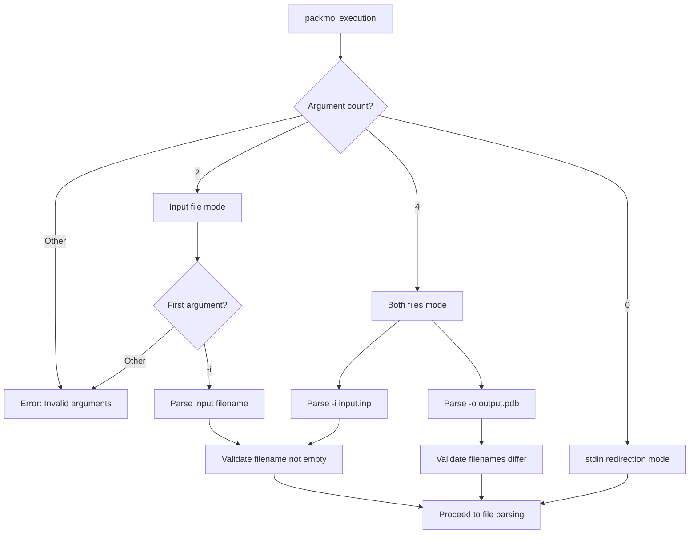
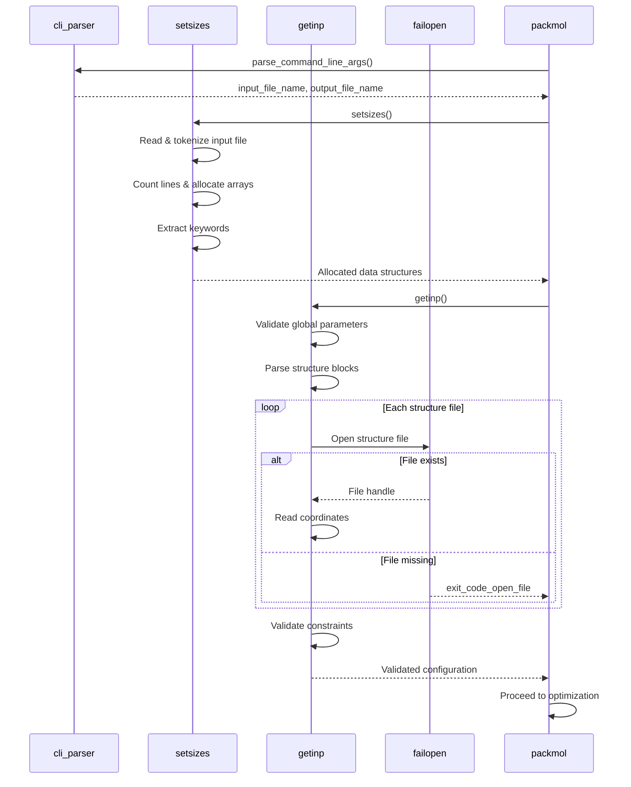

Packmol's input parsing and parameter validation system forms the critical first line of defense against configuration errors, implementing a multi-layered validation approach that spans command-line processing, file I/O, keyword recognition, and constraint verification. This system processes user input through three distinct stages—command-line parsing, file reading and tokenization, and semantic validation—before any molecular packing calculations commence.

## Command-Line Argument Processing

The parsing architecture supports three execution modes for flexible integration with different workflow paradigms. The `cli_parser` module implements a strict validation scheme that accepts only specific argument patterns, rejecting ambiguous or malformed invocations immediately with detailed error messages [Sources: src/cli_parser.f90#L1-L100].

**Supported Execution Modes:**

| Mode | Arguments | Input Source | Output Source |
|------|-----------|--------------|---------------|
| Standard Input | `packmol` | stdin | specified in input file |
| Single File | `packmol -i input.inp` | input.inp | specified in input file |
| Both Files | `packmol -i input.inp -o output.pdb` | input.inp | output.pdb |



The parser enforces strict separation of concerns: input and output filenames must be distinct paths, and only recognized flags (`-i`, `-o`) are permitted. Any deviation triggers an immediate termination with exit code `exit_code_command_line_error` (174) and displays usage examples to guide users toward correct invocation [Sources: src/cli_parser.f90#L100-L242].

## Input File Reading and Tokenization

The `setsizes` subroutine initiates the file parsing process by determining array dimensions and establishing the input file structure. This two-phase approach—first counting, then allocating—ensures memory efficiency by allocating precisely sized arrays rather than overestimating requirements [Sources: src/setsizes.f90#L1-L200].

The parsing pipeline handles several preprocessing tasks:

1. **Comment Stripping**: Lines beginning with `#` or containing `#` have comments removed, with trailing blank characters preserved to maintain line structure
2. **Whitespace Normalization**: All non-standard blank characters convert to standard spaces, ensuring consistent tokenization across different text editors and operating systems
3. **Quote-Aware Path Handling**: Filenames with spaces are wrapped in quotes and temporarily marked with `@` delimiters during tokenization, then reconstructed during keyword extraction [Sources: src/setsizes.f90#L50-L120]

The `keyword(nlines, maxkeywords)` array stores all parsed tokens, with `maxkeywords` dynamically determined during the initial counting pass. This 2D array enables efficient keyword access by line number during subsequent validation phases [Sources: src/setsizes.f90#L120-L160].

## Global Parameter Validation

The `getinp` subroutine performs comprehensive validation of all global parameters before structure-specific processing begins. This establishes baseline system configuration and validates file access patterns [Sources: src/getinp.f90#L1-L100].

**Primary Global Parameters:**

| Parameter | Default | Validation | Usage |
|-----------|---------|------------|-------|
| `tolerance` | Required | Must be positive | Minimum intermolecular distance |
| `filetype` | pdb | pdb, xyz, or tinker | Structure file format |
| `output` | Required | Valid filename path | Output coordinate file |
| `seed` | 1234567 | Integer, -1 triggers time-based | Random number generator seed |
| `precision` | 1.d-2 | Positive real number | Convergence tolerance |
| `discale` | 1.1d0 | Positive real number | Initial tolerance scaling factor |
| `maxit` | 20 | Positive integer | Maximum optimization iterations |
| `nloop` | 0 | Non-negative integer | Constraint enforcement loops |
| `writeout` | 10 | Positive integer | Output frequency (iterations) |

> [!TIP]
> The seed parameter accepts special value `-1` to trigger automatic seeding from system time via `seed_from_time` subroutine, ensuring different random configurations across runs without manual intervention.

Keyword validation employs an exhaustive whitelist approach: any unrecognized keyword triggers immediate termination with `exit_code_input_error` (171). The whitelist contains approximately 40 valid keywords, including both global parameters and structure-specific directives [Sources: src/getinp.f90#L100-L200].

## Structure Block Parsing

Each molecular type definition resides within a `structure`...`end structure` block, which the parser identifies and processes sequentially. The parsing maintains a `inside_structure` logical flag to track context, enabling proper scoping of keywords that are valid only within structure definitions [Sources: src/getinp.f90#L1-L100].

**Structure Block Keywords:**

| Category | Keywords | Validation Rules |
|----------|----------|------------------|
| Definition | `structure filename` | File must exist and match declared filetype |
| Quantity | `number N` | N must be positive integer |
| Spatial | `inside box/outside box` | Six coordinates: x1 y1 z1 x2 y2 z2 |
| Spatial | `inside sphere/outside sphere` | Four coordinates: x y z radius |
| Fixed | `fixed x y z α β γ` | Three coordinates, three Euler angles |
| Centering | `center`, `centerofmass` | Mutually exclusive options |
| Rotational | `constrain_rotation axis min max` | Axis: x/y/z, bounds: 0-360 degrees |
| Output | `resnumbers N`, `chain C`, `segid S` | N: integer, C: single char, S: 4-char string |

Fixed molecule validation includes critical constraints: fixed molecules must have `number 1`, and restart files cannot be combined with fixed positioning. These restrictions prevent logical inconsistencies in the optimization problem formulation [Sources: app/packmol.f90#L100-L200].

## Coordinate File Format Reading

Packmol supports three coordinate file formats, each with specific parsing routines and validation checks. The file format determination occurs through the global `filetype` keyword, defaulting to PDB format if unspecified [Sources: src/getinp.f90#L200-L400].

### PDB Format

PDB parsing validates strict column-based formatting according to PDB specification standards. Key validation checks include:

- **Coordinate columns**: Positions must be in columns 31-38, 39-46, 47-54 for x, y, z respectively
- **Residue numbers**: Must be parseable integers in columns 23-26, used for output formatting only
- **Atom records**: Only `ATOM` and `HETATM` records are processed; all others skipped
- **Connectivity**: Optional `CONECT` records read with index adjustment based on first atom number [Sources: src/getinp.f90#L300-L400]

> [!TIP]
> PDB connectivity information is optional and only preserved if present in input files. When `connect` parameter is set to `no` within structure blocks, all CONECT records are ignored regardless of input file contents.

### XYZ Format

XYZ format parsing follows the simpler three-line-per-atom structure: first line contains atom count, second line contains molecule title, subsequent lines contain element symbol and coordinates. This format lacks connectivity information and chain/residue metadata [Sources: src/getinp.f90#L450-L500].

### TINKER Format

TINKER format parsing includes an initial line with atom count and molecule title, followed by one line per atom containing atomic number, element symbol, x/y/z coordinates, and connectivity list. The `setcon` subroutine pre-processes files to determine connection counts before full coordinate reading [Sources: src/getinp.f90#L500-L600, src/getinp.f90#L1000-L1100].

## Constraint Syntax Validation

Spatial constraints undergo coordinate range and geometric validation during parsing. The parser converts constraint definitions into standardized parameter arrays used during optimization [Sources: src/getinp.f90#L700-L800].

**Constraint Parameter Storage:**

The `restpars(irest, 1:6)` array stores constraint parameters with the following indexing:
- Index 1-3: Primary spatial coordinates (origin for box/sphere, plane equation coefficients)
- Index 4-6: Secondary coordinates (opposite box corner for box constraints, rotation angles for fixed molecules)

Specialized constraints (gaussian distributions, cylindrical constraints) extend this storage to include width parameters in indices 5-6 [Sources: src/getinp.f90#L700-L800].

## Error Handling Architecture

Packmol employs a structured error code system that distinguishes between different failure modes, enabling precise error reporting and automated error handling in batch workflows [Sources: src/exit_codes.f90#L1-L20].

**Error Code Classification:**

| Code | Constant | Typical Trigger |
|------|----------|-----------------|
| 0 | exit_code_success | Successful completion |
| 171 | exit_code_input_error | Invalid keywords, malformed constraints |
| 172 | exit_code_open_file | Missing structure files, invalid paths |
| 173 | exit_code_failed_to_converge | Optimization exceeded maxit iterations |
| 174 | exit_code_command_line_error | Invalid CLI argument combinations |

File opening failures invoke the `failopen` subroutine, which provides context-aware error messages including the specific filename and suggestions for troubleshooting path issues [Sources: src/getinp.f90#L900-L1000].

## Validation Flow Integration

The complete parsing sequence integrates with the main program flow through well-defined entry points. The `packmol.f90` main program orchestrates the parsing pipeline: command-line parsing precedes file reading, which precedes structure validation, enabling early detection of configuration errors before memory-intensive operations [Sources: app/packmol.f90#L1-L100].



## Practical Validation Patterns

The test suite provides validated input file examples demonstrating correct parameter usage across various scenarios [Sources: testing/input_files/].

**Simple Box Packing:**

```fortran
tolerance 2.0
filetype pdb
output output.pdb

structure ./structure_files/water.pdb
  number 1000
  inside box -20. -20. -20. 20. 20. 20.
end structure
```

**Fixed Molecules with Explicit Positioning:**

```fortran
tolerance 2.0

structure ./structure_files/SOD.pdb
  number 1 
  fixed 0. 0. -1. 0. 0. 0.
  centerofmass
end structure

structure ./structure_files/SOD.pdb
  number 1 
  fixed 0. 0. 1. 0. 0. 0.
  centerofmass
end structure
```

Note the validation rule that `number` must be 1 for fixed molecules, enforced by the parser to prevent logical contradictions in constraint specification [Sources: testing/input_files/toy_with_fixed.inp].

**Complex Multi-Component System:**

```fortran
tolerance 2.0

structure ./structure_files/protein.pdb
  resnumbers 0
  number 1 
  fixed 0. 0. 0. 0. 0. 0.
  centerofmass
end structure

structure ./structure_files/water.pdb
  resnumbers 2
  number 1000 
  inside sphere 0. 0. 0. 50.
end structure
```

This example demonstrates mixing fixed molecules (number=1, explicit coordinates) with mobile molecules (number>1, spatial constraints), all within a single input file [Sources: testing/input_files/solvprotein.inp].

## Advanced Validation Features

**Restart File Validation:**

Restart file specifications can occur at global scope (affecting all structures) or within individual structure blocks (affecting only that molecule type). The parser validates that restart_from and restart_to specifications don't conflict with fixed molecule declarations, as fixed molecules cannot have restart configurations [Sources: src/getinp.f90#L900-L1000].

**PBC Parameter Validation:**

Periodic boundary condition validation ensures positive box dimensions and properly defined coordinate ranges. The parser checks that `pbc_length = pbc_max - pbc_min` is positive in all directions, rejecting degenerate or inverted boxes immediately [Sources: src/getinp.f90#L150-L200].

**Short Tolerance Validation:**

The `short_tol_dist` parameter (used for specialized close-contact penalties) must satisfy `short_tol_dist < tolerance`. This constraint ensures mathematical consistency in the multi-scale penalty function implementation [Sources: src/getinp.f90#L800-L900].

## Summary

Packmol's input parsing and parameter validation system implements a defense-in-depth approach, catching configuration errors at multiple stages from command-line invocation through constraint validation. The architecture prioritizes fail-fast behavior with detailed error messages, enabling users to rapidly identify and correct configuration issues before resource-intensive optimization calculations begin. For deeper understanding of how validated parameters are used in optimization algorithms, refer to [GENCAN Optimization Method Overview](9-gencan-optimization-method-overview). For practical examples of input file construction across different scenarios, explore [Building Simple Water Boxes](25-building-simple-water-boxes) and [Solvating Proteins with Ions](27-solvating-proteins-with-ions).