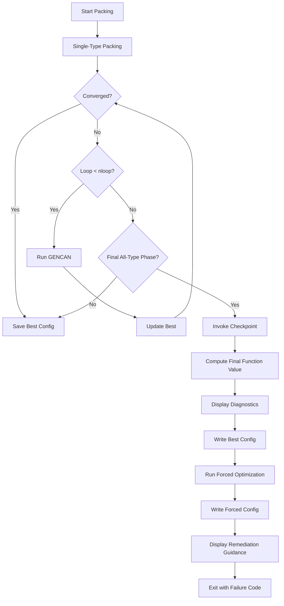

The checkpoint mechanism in Packmol represents a **failure recovery strategy** rather than traditional checkpoint-restart functionality. When the optimizer exhausts its iteration budget without achieving convergence, Packmol invokes checkpoint procedures to preserve the best partial solution and provide actionable diagnostic information. This mechanism ensures users receive useful output even when ideal packing cannot be achieved within computational constraints.

## Checkpoint Invocation Conditions

The checkpoint subroutine is triggered when the GENCAN optimization loop reaches the maximum number of iterations (`nloop`) without satisfying convergence criteria. This occurs specifically at the final stage of packing when processing all molecules together, as evidenced in the main program flow [packmol.f90](/app/packmol.f90#L950-L959). The system tracks iteration progress through a loop counter (`loop`) that increments with each GENCAN optimization cycle, comparing against the configured `nloop` threshold.

When this condition is met during the final packing phase (when `itype == ntype+1`), the program invokes the checkpoint mechanism with the best-known solution vector stored in `xprint`, then exits with a failure convergence status code. This design ensures that users receive meaningful output rather than encountering a complete failure state without diagnostic information.

## Checkpoint Subroutine Architecture

The checkpoint subroutine implements a multi-stage recovery process designed to extract maximum value from partial optimization results. Upon invocation, the routine first enables all molecule types for consideration by setting `comptype(i)` to `.true.` for all types in the system, then computes the final objective function value [checkpoint.f90](/src/checkpoint.f90#L28-L36). This establishes the quantitative baseline for the partial solution quality.

The subsequent output generation phase produces comprehensive diagnostic information formatted to guide user remediation strategies. The subroutine displays the achieved function value alongside structured recommendations covering constraint validation, random seed modification, and practical utility for molecular dynamics initialization [checkpoint.f90](/src/checkpoint.f90#L38-L60). This diagnostic approach transforms failure from a dead-end into an informative state.

Following diagnostic output, the subroutine invokes the standard output routine to write the best configuration to the primary output file (specified by `xyzout`), with optional CRD format output if enabled [checkpoint.f90](/src/checkpoint.f90#L62-L67). The system then executes a forced optimization phase that attempts to geometrically constrain molecules to satisfy spatial requirements, potentially sacrificing inter-molecular distances to achieve constraint compliance [checkpoint.f90](/src/checkpoint.f90#L68-L80).

The forced configuration is written to a separate output file with the `_FORCED` suffix, providing users with an alternative solution that prioritizes constraint satisfaction over inter-molecular separation [checkpoint.f90](/src/checkpoint.f90#L82-L89). Finally, the subroutine displays remediation guidance regarding iteration count modification through the `nloop` parameter, explaining the default behavior (50 iterations per molecule type) and suggesting strategies for extended optimization [checkpoint.f90](/src/checkpoint.f90#L90-L112).

## Partial Solution Utility

The checkpoint mechanism recognizes that partial solutions often possess practical value for computational chemistry workflows. Even when ideal separation between molecules cannot be achieved, the output configuration typically represents a viable starting point for molecular dynamics simulations after energy minimization and equilibration [checkpoint.f90](/src/checkpoint.f90#L52-L58). This design philosophy acknowledges that mathematical optimization constraints may exceed practical requirements for simulation initialization.

The forced output variant provides additional flexibility by prioritizing spatial constraint compliance, which may be preferable when geometric placement accuracy outweighs inter-molecular distance requirements. Users can select between the best-separation configuration (primary output) and the constraint-compliant configuration (`_FORCED` suffix) based on their specific application needs.

## Configuration Parameters Influencing Checkpoint Behavior

Several input parameters control the iteration budget and convergence criteria that determine whether checkpoint activation occurs. The primary parameter is `nloop`, which sets the maximum number of GENCAN optimization iterations. This parameter can be specified globally in the input file or per-molecule-type using `nloop0` [getinp.f90](/src/getinp.f90#L104-L113). When the default of 50 iterations proves insufficient for complex systems, users can increase this value to allow extended optimization attempts.

The convergence threshold is controlled by the `precision` parameter, which defaults to 1.0×10⁻² [getinp.f90](/src/getinp.f90#L78-L81). This parameter defines the acceptable violation tolerance for both distance constraints (`fdist`) and geometric restraints (`frest`). Relaxing the precision threshold can enable successful convergence where strict criteria prevent completion, though this may produce solutions with greater constraint violations.

## Restart File Handling Limitations

Packmol includes infrastructure for `restart_from` and `restart_to` file specifications within the input module [input.f90](/src/input.f90#L80), but these facilities are **not** used for checkpoint-restart functionality. The code contains explicit validation that prevents using restart files with fixed molecules, indicating these parameters serve a different purpose in the system architecture [packmol.f90](/app/packmol.f90#L153-L158).

The restart file arrays are manipulated during internal array reorganization when fixed molecules are removed from the optimization space [packmol.f90](/app/packmol.f90#L190-L213), but they do not implement periodic state preservation or resumption capabilities. Users cannot suspend a running optimization and later resume from intermediate progress—the checkpoint mechanism only provides output after complete execution, whether successful or unsuccessful.

## Practical Workflow Integration

The checkpoint mechanism should be viewed as a **graceful degradation** component within the broader packing workflow. When ideal convergence proves unattainable, the system provides multiple output variants that may serve as adequate starting points for subsequent simulation phases. Users should evaluate both the primary output (best separation) and forced output (constraint compliance) to determine which better suits their application requirements.

For systems that repeatedly trigger checkpoint activation despite increased iteration counts, users should consider whether the spatial constraints are physically achievable or whether system parameters (such as molecule count, box dimensions, or tolerance requirements) need adjustment. The diagnostic output generated during checkpoint provides quantitative function values that can guide parameter tuning decisions.

> [!TIP]
> The function value displayed during checkpoint (`f = `) represents the objective function value used by the optimizer, not a direct physical distance. Lower values indicate better satisfaction of both distance and geometric constraints, with zero representing perfect compliance with all specified requirements.

## Exit Code Behavior

When checkpoint activation occurs, the program exits with a specific failure status code (`exit_code_failed_to_converge`) rather than success termination [packmol.f90](/app/packmol.f90#L954). This enables automated workflow systems to distinguish between successful packing and partial results. The exit code infrastructure is defined in the exit_codes module, allowing programmatic detection of convergence failure for downstream decision making.

The exit code is handled through conditional logic at program termination, ensuring proper status propagation even on older Fortran compilers without non-constant exit code support [packmol.f90](/app/packmol.f90#L971-L978). This design maintains backward compatibility while providing clear failure signaling to calling processes.

## Next Steps

For understanding the optimization algorithm that determines convergence behavior, see [GENCAN Optimization Method Overview](9-gencan-optimization-method-overview). To understand how output files are generated during checkpoint execution, refer to [Output Generation and Format Conversion](24-output-generation-and-format-conversion). For information on controlling optimization parameters that influence checkpoint likelihood, see [Convergence Criteria and Precision Parameters](12-convergence-criteria-and-precision-parameters).