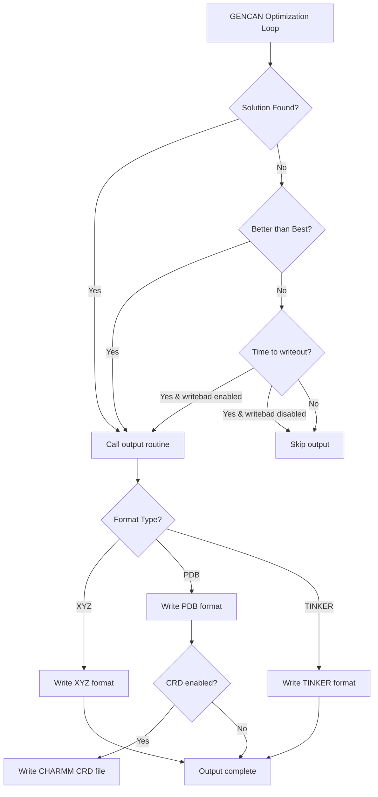

Packmol provides comprehensive output generation capabilities that convert the optimized internal molecular representation into standard molecular structure formats. The output system handles format-specific requirements, preserves connectivity information, and supports restart functionality for workflow continuity. Understanding these mechanisms is essential for integrating Packmol-generated structures into downstream molecular dynamics simulations.

## Output Generation Architecture

The output generation process in Packmol transforms the internal coordinate representation—where molecules are defined by center-of-mass positions and Euler angles—into Cartesian coordinates in user-specified formats. This transformation occurs at critical points throughout the optimization process: when solutions converge, when intermediate improvements are detected, and when the program checkpoints due to non-convergence.

The `output` subroutine in [src/output.f90](src/output.f90#L9-L39) serves as the central output generation engine. It receives the optimization vector `x(n)` containing baricenter coordinates (lower portion) and Euler angles (upper portion for each molecule), then converts these to absolute Cartesian coordinates for writing. The coordinate transformation uses `eulerrmat` to generate rotation matrices from Euler angles and `compcart` to compute final atomic positions [src/output.f90](src/output.f90#L110-L116).

The output generation flow is triggered at multiple points in the main program loop located in [app/packmol.f90](app/packmol.f90#L811-L925):



The writeout timing is controlled by the `writeout` parameter (default 10 seconds), which ensures periodic output even if convergence hasn't occurred [app/packmol.f90](app/packmol.f90#L909-L925). This checkpointing mechanism prevents loss of optimization progress and allows users to inspect intermediate results.

## Supported Output Formats

Packmol supports three primary molecular structure formats, each with format-specific handling for atom naming, connectivity, and metadata preservation.

### XYZ Format

The XYZ format provides a simple, widely-supported text format for molecular coordinates. When `xyz` flag is enabled, Packmol writes the output with two header lines followed by atomic records [src/output.f90](src/output.f90#L93-L131). The format specification:

```
ntotat
 Built with Packmol
element    x         y         z
```

Each line contains the element symbol followed by three floating-point coordinates with 6 decimal precision [src/output.f90](src/output.f90#L116). Fixed molecules are written using their original coordinates from input files, while optimized molecules use transformed coordinates from the optimization vector. The XYZ format is the simplest output option but lacks the rich metadata available in PDB format.

### PDB Format

The PDB format implementation in Packmol is the most comprehensive, handling many PDB specification details required for compatibility with downstream simulation packages. When `pdb` flag is enabled, Packmol generates a complete PDB file with header records, ATOM/HETATM records, optional CONECT records for connectivity, and termination records [src/output.f90](src/output.f90#L134-L469).

The PDB header includes standard records identifying Packmol as the source software:

```
HEADER
TITLE     Built with Packmol
REMARK   Packmol generated pdb file
REMARK   Home-Page: http://m3g.iqm.unicamp.br/packmol
REMARK
```

When periodic boundary conditions are enabled or `add_box_sides` is specified, Packmol writes a CRYST1 record containing the box dimensions calculated from coordinate extrema [src/output.f90](src/output.f90#L164-L171):

```
CRYST1    a        b        c    90.00   90.00   90.00 P 1           1
```

The ATOM/HETATM record generation preserves extensive metadata from input files while updating coordinates. Key formatting aspects include:

- **Atom indices**: Written with hexadecimal formatting when atom count exceeds 99,999 or when `hexadecimal_indices` is enabled, handled by the `i5hex` function [src/output.f90](src/output.f90#L541-L551)
- **Residue numbering**: Four modes supported via the `resnumbers` parameter [src/output.f90](src/output.f90#L270-L284):
  - Mode 0: Continuous numbering by molecule instance
  - Mode 1: Preserve original residue numbers from input
  - Mode 2: Offset numbering by molecule type and instance
  - Mode 3: Unique residue number for each molecule
- **Chain identifiers**: Can be fixed per molecule type or automatically alternating (using `#` specifier) with chain switching every 9,999 molecules to accommodate PDB limits [src/output.f90](src/output.f90#L221-L237)
- **Record type preservation**: ATOM records remain ATOM, HETATM records remain HETATM, preserving ligand/cofactor distinctions

The atom coordinate format uses 8.3 precision with proper column alignment [src/output.f90](src/output.f90#L135-L137):

```
ATOM  %5s %4s %1s %4s %1s    %8.3f%8.3f%8.3f %26s
      |    |    |    |    |    |       |       |
index name alt chain res icode x       y       z  (columns preserved)
```

> [!TIP]
> When working with systems exceeding 99,999 atoms, enable hexadecimal indices to avoid PDB field overflow. The `hexadecimal_indices` option can be set in the input file or will automatically trigger when atom count exceeds PDB limits.

### TINKER Format

The TINKER XYZ format combines atomic coordinates with explicit connectivity information in a single file. When `tinker` flag is enabled, Packmol generates TINKER-compatible output with connection tables [src/output.f90](src/output.f90#L473-L536). The format structure:

```
ntotat  Built with Packmol
%7d %3s %10.6f %10.6f %10.6f %7d %7d %7d %7d %7d %7d %7d
```

Each atom record includes the atom index, element symbol, three coordinates (6 decimal precision), followed by connectivity indices for up to 12 connected atoms [src/output.f90](src/output.f90#L475-L509). The connectivity information is derived from input file structure and properly offset to account for all atoms in the output system. This format is particularly useful for TINKER-based force field calculations and maintains bond topology essential for energy minimization workflows.

### CHARMM CRD Format

Packmol can generate CHARMM coordinate (CRD) files alongside the primary output when the `crd` flag and `crdfile` parameter are specified [src/output.f90](src/output.f90#L141-L148). The CRD format provides an alternative representation commonly used in CHARMM-based simulations. The CRD file includes:

- Header with title and attribution
- Atom count and EXT flag
- Records containing atom number, residue number, residue name, atom name, coordinates, segment identifier, residue type, and charge (set to 0.0) [src/output.f90](src/output.f90#L302-L312)

The CRD generation occurs parallel to PDB writing, using the same coordinate transformations and metadata preservation [src/output.f90](src/output.f90#L138-L148).

## Restart File Generation

Packmol supports restart file generation for workflow continuity and checkpointing. Two types of restart files are created: global restart files containing all molecule states, and type-specific restart files for individual molecule types [src/output.f90](src/output.f90#L46-L89).

Restart files are written whenever the `restart_to` parameter is specified in the input. The file format stores center-of-mass coordinates and Euler angles for each molecule in high-precision exponential notation (ES23.16) [src/output.f90](src/output.f90#L58-L59):

```
baricenter_x baricenter_y baricenter_z beta gamma theta
```

This format preserves the exact internal state needed to resume optimization from the current configuration. Restart files are written for both successful and failed packing attempts, enabling recovery from interrupted runs or continuation with modified parameters.

## Connectivity Preservation

Packmol preserves molecular connectivity information when available from input files, essential for maintaining bond topology in downstream simulations. The connectivity writing mechanism, implemented in the `write_connect` subroutine [src/output.f90](src/output.f90#L565-L598), handles PDB CONECT records with the following considerations:

- Connectivity data is read from input files during parsing and stored in the `nconnect` array
- When writing output, connectivity indices are offset to account for previous molecules in the system [src/output.f90](src/output.f90#L508)
- CONECT records follow PDB format specifications with proper hexadecimal formatting for large systems
- Multiple CONECT records are generated when an atom has more than 4 connections, with each line containing at most 4 connected atom indices [src/output.f90](src/output.f90#L586-L594]

The connectivity writing ensures that bond information is preserved for molecules like proteins, nucleic acids, and other polymeric structures where bond topology is critical for simulation setup.

## Coordinate Transformation Process

The core transformation from Packmol's internal representation to Cartesian coordinates involves two mathematical operations. First, Euler angles (β, γ, θ) are converted to a rotation matrix using the `eulerrmat` subroutine [src/output.f90](src/output.f90#L110):

```
R = Rz(θ) · Ry(γ) · Rx(β)
```

This rotation matrix is then applied to each atom's original coordinates relative to the molecular baricenter:

```
r_final = r_cm + R · (r_atom - r_cm_original)
```

The `compcart` subroutine performs this final transformation [src/output.f90](src/output.f90#L115). For fixed molecules, the transformation uses the original coordinates directly [src/output.f90](src/output.f90#L401-L408), while for optimized molecules, the coordinates are computed from the optimization vector components.

> [!TIP]
> The transformation process ensures that internal molecular geometry is preserved exactly while position and orientation are optimized. This is critical for maintaining accurate bond lengths, angles, and dihedrals from input structures.

## Checkpoint and Failure Handling

When Packmol fails to converge within the specified tolerance or maximum iterations, the checkpoint mechanism ensures the best found configuration is preserved [src/checkpoint.f90](src/checkpoint.f90#L12-L115). The checkpoint process:

1. Evaluates the final objective function value for all molecules
2. Writes the best configuration to the specified output file
3. Generates an additional "_FORCED" output after running forced optimization to minimize constraint violations [src/checkpoint.f90](src/output.f90#L82-L89]
4. Provides detailed guidance on troubleshooting and alternative approaches [src/checkpoint.f90](src/checkpoint.f90#L38-L59]

The checkpoint output includes both the main output file (XYZ/PDB/TINKER) and the CRD file if enabled, ensuring that users have access to the best configuration even when perfect packing isn't achieved. This is particularly valuable for large systems where achieving exact distance tolerances may be impractical.

## Success Reporting

When successful packing is achieved, Packmol generates comprehensive success messages through the `writesuccess` subroutine [src/writesuccess.f90](src/writesuccess.f90#L11-L46]. The reporting distinguishes between partial success (individual molecule types packed) and complete system convergence, providing:

- Objective function value (f)
- Maximum violation of target distance constraints
- Maximum violation of spatial constraints
- Proper citation information for academic use

For complete system solutions, the output includes formatted success indicators and citation requirements [src/writesuccess.f90](src/writesuccess.f90#L28-L44]:

```
###############################################
               Success!  
             Final objective function value:  x.xxxxxx
   Maximum violation of target distance:  x.xxxxxx
   Maximum violation of the constraints:  x.xxxxxx
###############################################
```

## Format Selection and Configuration

Output format selection is controlled through input file parameters that specify both the format type and output filename. The configuration parameters include:

- **xyz** / **output xyz**: Enable XYZ format output
- **pdb** / **output pdb**: Enable PDB format output
- **tinker** / **output tinker**: Enable TINKER format output
- **crdfile**: Specify CHARMM CRD filename when CRD output is desired
- **restart_to**: Specify restart filename for state preservation
- **hexadecimal_indices**: Enable hexadecimal atom numbering for large systems
- **writebad**: Enable output of intermediate structures even when not improved
- **writeout**: Set time interval (seconds) for periodic output during optimization

The choice of output format should be guided by the requirements of downstream simulation packages. PDB format is recommended for most molecular dynamics workflows due to its wide support and rich metadata, while TINKER format is preferred when explicit connectivity is required. XYZ format offers simplicity and compatibility but lacks metadata preservation.

## Next Steps

Now that you understand Packmol's output generation capabilities, you may want to explore:

- [Building Simple Water Boxes](25-building-simple-water-boxes) to practice with output generation in realistic scenarios
- [Creating Lipid Bilayers](26-creating-lipid-bilayers) to understand how PBC box dimensions are handled in output
- [Solvating Proteins with Ions](27-solvating-proteins-with-ions) to see how complex multi-component systems are formatted in output

For understanding how input files are structured and parsed to generate these outputs, refer to [Input Parsing and Parameter Validation](22-input-parsing-and-parameter-validation). The molecular coordinate systems that form the basis of output transformations are detailed in [Molecular Coordinate Systems: Baricenter and Euler Angles](13-molecular-coordinate-systems-baricenter-and-euler-angles).