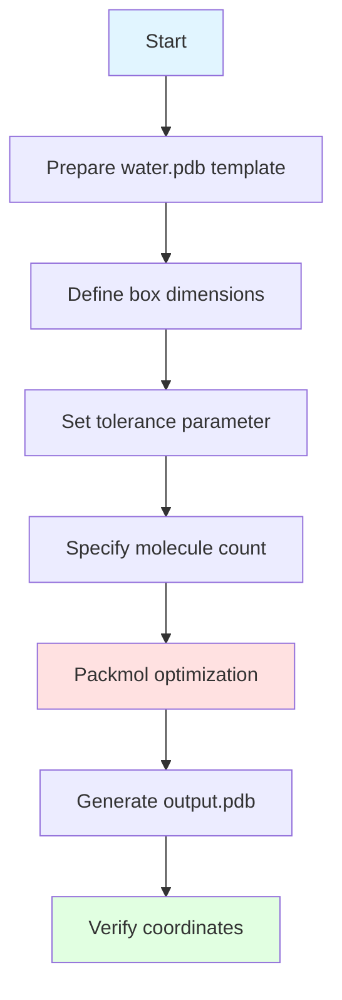
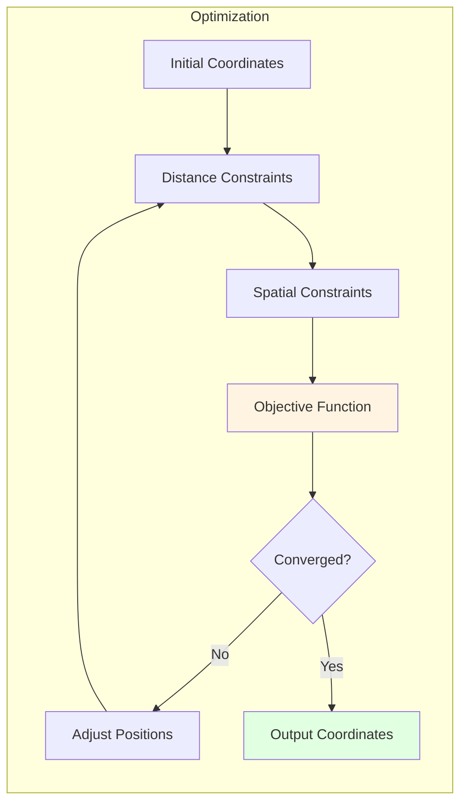

This guide teaches you how to create water boxes using Packmol, starting from simple cubic containers to periodic boundary condition systems optimized for molecular dynamics simulations. Water boxes are fundamental building blocks for solvation systems, providing the solvent environment essential for biomolecular simulations.

## Basic Water Box Construction

The simplest water box configuration defines a cubic region and populates it with water molecules. Packmol automatically positions molecules while maintaining a minimum distance between them to prevent unrealistic atomic overlaps during MD simulations.

### Minimal Input File Structure

Consider this basic water box example:

```
tolerance 2.0
filetype pdb
output output.pdb

structure ./structure_files/water.pdb
  number 1000
  inside box -20. -20. -20. 20. 20. 20.
end structure
```

This configuration creates a 40 Å × 40 Å × 40 Å box containing 1000 water molecules. The `tolerance 2.0` parameter ensures that no two atoms approach closer than 2.0 Å during packing, which corresponds to the `short_tol_dist` parameter used in distance computations [fparc.f90](src/fparc.f90#L1-L79). The `inside box` constraint defines a rectangular volume with specified minimum and maximum coordinates in each dimension, processed through the spatial constraint validation system [getinp.f90](src/getinp.f90#L150-L250).

### Required Components

Every water box input file requires three essential parameters:

| Parameter | Purpose | Example Value |
|-----------|---------|---------------|
| **tolerance** | Minimum allowed interatomic distance | 2.0 Å |
| **filetype** | Molecular structure format | pdb, xyz, tinker |
| **output** | Destination file for packed coordinates | output.pdb |

The `structure` block defines what molecules to place and where:
- **Structure file**: Path to a single water molecule template
- **Number**: Quantity of molecules to place
- **Constraint**: Spatial definition (`inside box`, `outside box`, etc.)

### Water Box Creation Workflow



The optimization process in Packmol minimizes an objective function that penalizes molecular overlaps and constraint violations [computef.f90](src/computef.f90#L1-L155). The algorithm iteratively adjusts molecular positions (barycenter coordinates) and orientations (Euler angles) until convergence criteria are met or maximum iterations are reached.

Sources: [water_box.inp](testing/input_files/water_box.inp#L1-L15), [computef.f90](src/computef.f90#L1-L100), [getinp.f90](src/getinp.f90#L150-L250)

## Water Boxes with Periodic Boundary Conditions

Periodic boundary conditions (PBC) are essential for simulating bulk solvent properties without surface effects. PBC systems eliminate boundary artifacts by replicating the simulation box infinitely in all three dimensions, creating an effectively infinite system.

### PBC Configuration Syntax

Add the `pbc` keyword to specify periodic boundaries:

```
tolerance 2.0
filetype pdb
output output.pdb
pbc 40. 40. 40.

structure ./structure_files/water.pdb
  number 1150
end structure
```

The `pbc` directive accepts either 3 or 6 numeric arguments. With 3 arguments, it defines box dimensions with the origin at (0,0,0) [getinp.f90](src/getinp.f90#L150-L250):

- **3 arguments**: `pbc x y z` → Box spans (0,0,0) to (x,y,z)
- **6 arguments**: `pbc xmin ymin zmin xmax ymax zmax` → Custom coordinate range

The PBC implementation stores minimum and maximum coordinates in the `pbc` module and computes box lengths as `pbc_length = pbc_max - pbc_min` [pbc.f90](src/pbc.f90#L1-L33). Two critical functions handle periodic geometry:

- **`v_in_box`**: Wraps coordinates into the primary simulation cell using modulo arithmetic
- **`delta_vector`**: Computes minimum image distances accounting for periodic boundaries

### Distance Calculations in PBC

When PBC is active, all atomic distance calculations use minimum image convention. The `delta_vector` function subtracts the box length multiplied by the nearest integer to maintain distances within half the box width [pbc.f90](src/pbc.f90#L1-L33), [fparc.f90](src/fparc.f90#L1-L79):

```fortran
delta_vector = v1 - v2
delta_vector = delta_vector - pbc_length * nint(delta_vector/pbc_length)
```

This ensures that when an atom is near one box face, its periodic image on the opposite face is considered for distance calculations rather than distant atoms within the same box.

### PBC Water Box Variants

Multiple PBC configurations exist for different simulation needs:

| Configuration | Box Definition | Molecule Count | Constraint Type |
|---------------|----------------|----------------|-----------------|
| Standard PBC | 40×40×40 Å | 1150 | None (fill entire box) |
| Centered Box | -20 to +20 Å | 1000 | Outside sphere exclusion |
| Slab Geometry | 40×40×40 Å | 1000 | Spherical exclusion |
| Layered System | 45×45×45 Å | 500+500 | Plane separation |

Sources: [water_box_pbc.inp](testing/input_files/water_box_pbc.inp#L1-L18), [water_box_pbc_slab.inp](testing/input_files/water_box_pbc_slab.inp#L1-L18), [pbc.f90](src/pbc.f90#L1-L33), [getinp.f90](src/getinp.f90#L150-L250)

## Advanced Water Box Configurations

Complex solvation environments require sophisticated constraint combinations that go beyond simple cubic boxes. Packmol's spatial constraint system allows you to create multi-phase systems, exclude regions for solutes, or build layered geometries.

### Negative Coordinate Systems

Water boxes can utilize negative coordinate ranges for symmetric placement around the origin:

```
pbc -20. -20. -20. 20. 20. 20.

structure ./structure_files/water.pdb
  number 1000
  outside sphere 0. 0. 0. 10.
end structure
```

This configuration creates a 40 Å cube centered at the origin, excluding a spherical cavity of radius 10 Å from water placement [water_box_pbc_negative_coordinates.inp](testing/input_files/water_box_pbc_negative_coordinates.inp#L1-L17). The `outside sphere` constraint prevents water molecules from entering the excluded region, creating a void suitable for later solute insertion.

### Layered and Partitioned Systems

Using plane constraints, you can create separated water regions or build interfaces:

```
pbc 45. 45. 45.

structure ./structure_files/water.pdb
  number 500
  below plane 0.0 0.0 1.0 20.0
end structure

structure ./structure_files/water.pdb
  number 500
  over plane 0.0 0.0 1.0 25.0
end structure
```

This creates two water layers separated by a 5 Å gap, with the plane defined by normal vector (0,0,1) at z=20.0 for the lower layer and z=25.0 for the upper layer [water_box_pbc2.inp](testing/input_files/water_box_pbc2.inp#L1-L20). Such configurations are useful for studying interfacial phenomena or creating vapor-liquid equilibrium systems.

### Mixed Solvent Water Boxes

Water boxes can incorporate multiple solvent types simultaneously:

```
structure ./structure_files/water.pdb 
  number 1000 
  inside box 0. 0. 0. 40. 40. 40. 
end structure

structure ./structure_files/urea.pdb
  number 400
  inside box 0. 0. 0. 40. 40. 40. 
end structure
```

This example creates a water-urea mixture with 1000 water and 400 urea molecules co-packed in the same volume [mixture.inp](testing/input_files/mixture.inp#L1-L19). Each structure type has independent constraint specifications, allowing precise control over molecular distribution.

> [!TIP]
> When building mixed solvent systems, consider the relative molecular volumes and target concentrations. The `tolerance` parameter applies globally to all atom-atom interactions, so adjust it based on the smallest repulsive distance among all molecule types in your system.

### Constraint Architecture

The constraint system operates through modular evaluation in the optimization cycle:



Each molecule's contribution to the objective function includes both distance penalties (atomic overlaps) and constraint violations (spatial restrictions) [computef.f90](src/computef.f90#L1-L100). The cell indexing system optimizes neighbor searches for large systems by dividing the simulation box into spatial cells, reducing the complexity from O(n²) to approximately O(n) [computef.f90](src/computef.f90#L100-L155).

Sources: [water_box_pbc_negative_coordinates.inp](testing/input_files/water_box_pbc_negative_coordinates.inp#L1-L17), [water_box_pbc2.inp](testing/input_files/water_box_pbc2.inp#L1-L20), [mixture.inp](testing/input_files/mixture.inp#L1-L19), [computef.f90](src/computef.f90#L100-L155)

## Parameter Tuning for Water Boxes

Successful water box construction requires balancing several parameters that affect packing efficiency, computational time, and output quality. Understanding the trade-offs between these parameters enables you to optimize your specific application.

### Critical Parameters

| Parameter | Typical Range | Effect | When to Adjust |
|-----------|---------------|--------|----------------|
| **tolerance** | 1.5-3.0 Å | Minimum interatomic distance | Larger values reduce overlap risk but increase packing difficulty |
| **maxit** | 10-50 | Maximum optimization iterations | Increase for dense systems or complex constraints |
| **precision** | 0.001-0.1 | Convergence threshold | Decrease for higher-quality packing |
| **seed** | Any integer | Random number generator seed | Use -1 for time-based seeding, fix for reproducibility |

### Density Considerations

Water density in your packed system depends on box volume, molecule count, and molecular geometry:

**Approximate water density calculation**:
```
Density (g/cm³) = (Number of molecules × Molecular weight) / (Box volume × Avogadro's number)
```

For TIP3P water (molecular weight ≈ 18.015 g/mol):
- 1000 molecules in a 40 Å box ≈ 0.998 g/cm³ (near experimental density)
- 1150 molecules in a 40 Å box with PBC ≈ 1.148 g/cm³ (compressed)

> [!TIP]
> When targeting specific densities, start with a slightly higher molecule count and use the `short_tol_dist` parameter to fine-tune packing tightness. Remember that different water models (TIP3P, TIP4P, SPC/E) have slightly different molecular volumes.

### Performance Optimization

For large water boxes (thousands of molecules), consider these optimization strategies:

1. **Increase tolerance slightly**: Values of 2.0-2.5 Å provide reasonable packing quality while reducing convergence time
2. **Use checkpointing**: Enable `restart_from` and `restart_to` keywords for long-running jobs [input.f90](src/input.f90#L1-L83)
3. **Adjust output frequency**: Set `writeout` to control intermediate output frequency during optimization [getinp.f90](src/getinp.f90#L1-L100)
4. **Disable unnecessary checks**: Remove `check` and `chkgrad` keywords for production runs to skip gradient verification

The cell indexing system automatically adapts to system size, but extremely large boxes (>100 Å per dimension) may benefit from adjusted `ncells` parameters if performance degrades [cell_indexing.f90](src/cell_indexing.f90#L1-L50).

### Common Issues and Solutions

| Symptom | Cause | Solution |
|---------|-------|----------|
| "Cannot pack" errors | Overly restrictive constraints or insufficient space | Increase box dimensions or reduce molecule count |
| Long runtime | Dense packing with small tolerance | Increase tolerance to 2.5 Å or reduce molecule count |
| Low density output | Large tolerance value or box too large | Decrease tolerance or reduce box dimensions |
| Coordinates outside box | Missing PBC specification or negative coordinates without PBC | Add appropriate `pbc` keyword or verify constraint definitions |

Sources: [getinp.f90](src/getinp.f90#L1-L100), [sizes.f90](src/sizes.f90#L1-L30), [cell_indexing.f90](src/cell_indexing.f90#L1-L50)

## Next Steps

Now that you understand water box construction, consider these related topics:

- **[Spatial Constraints Syntax (Box, Sphere, Plane, Cylinder)](5-spatial-constraints-syntax-box-sphere-plane-cylinder)**: Detailed exploration of all constraint types and their geometric interpretations
- **[Periodic Boundary Conditions (PBC) Configuration](8-periodic-boundary-conditions-pbc-configuration)**: In-depth coverage of PBC options and advanced periodic systems
- **[Solvating Proteins with Ions](27-solvating-proteins-with-ions)**: Applying water boxes to biomolecular solvation scenarios
- **[Mixed Solvent Systems and Partitioned Configurations](29-mixed-solvent-systems-and-partitioned-configurations)**: Advanced multi-component solvent systems

Water boxes provide the foundation for more complex solvation scenarios. Mastering the basic configurations prepares you for protein solvation, ion placement, and multi-phase system construction.