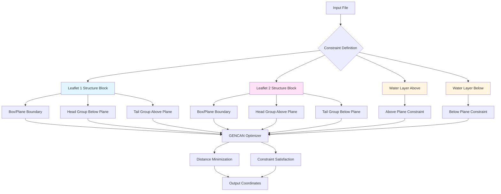
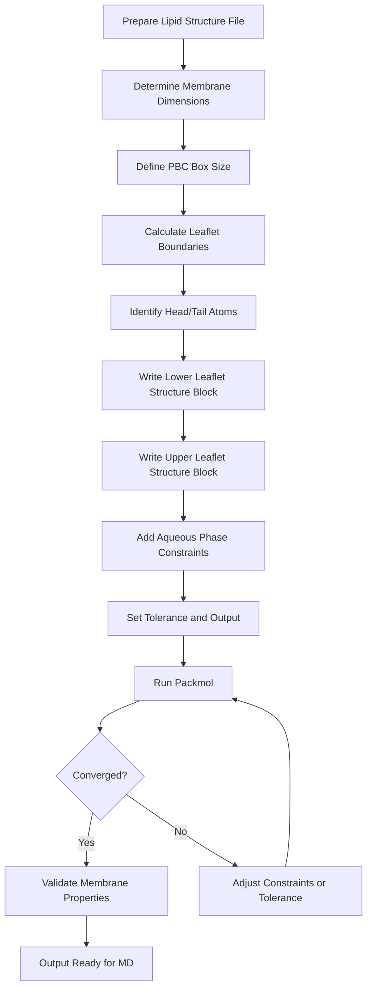

Lipid bilayers represent one of the most biologically relevant and architecturally complex systems you can construct with Packmol. This page demonstrates how to build realistic membrane configurations by leveraging Packmol's sophisticated spatial constraint system, specifically combining planar orientation constraints with precise atomic positioning to create symmetric lipid leaflets with aqueous interfaces.

The architectural challenge of lipid bilayer construction centers on two fundamental requirements: **controlled molecular orientation** to align head groups outward and tail groups inward, and **spatial confinement** within well-defined lateral boundaries. Packmol addresses these challenges through a multi-layered constraint approach that treats each leaflet as a separate optimization problem while maintaining overall system coherence.

## Lipid Bilayer Architecture

The fundamental architecture of lipid bilayer creation in Packmol relies on three coordinated constraint systems working together: volumetric boundaries for lateral confinement, planar constraints for molecular orientation, and atomic-level positioning for head/tail group alignment. This hierarchical constraint approach enables precise control over membrane thickness, leaflet composition, and aqueous phase integration.

The core architectural pattern involves defining separate `structure` blocks for each leaflet, each with its own set of atomic constraints that orient lipid molecules in opposite directions. The optimization algorithm simultaneously satisfies distance constraints preventing overlap while enforcing planar orientation requirements that ensure proper head/tail group alignment.



The optimization engine processes all constraints simultaneously through the objective function computed in `computef.f90`, which transforms baricenter coordinates and Euler angles into Cartesian positions while accumulating constraint violations. Each lipid molecule's position is evaluated against its planar constraints, with gradient information from `gwalls.f90` driving the iterative optimization toward convergence.

## Basic Bilayer Construction

The simplest approach to lipid bilayer construction uses box constraints to define the lateral boundaries of each leaflet combined with plane constraints to orient the lipid molecules. This method is demonstrated in `testing/input_files/bilayer.inp`, which creates a palmitoil lipid bilayer with water layers on both sides.

The input file structure reveals the essential pattern: separate structure blocks for each leaflet, with atoms constrained by two parallel planes that define the acceptable range for head and tail groups. The first leaflet places head groups near the lower boundary (z=0) and tail groups extending toward the midplane (z=14), while the second leaflet mirrors this pattern.

**Example Input File Structure**:
```
tolerance 2.0 
filetype pdb
output output.pdb

# Water below membrane
structure ./structure_files/water.pdb 
  number 50
  inside box 0. 0. -10. 40. 40. 0.
end structure

# Lower leaflet
structure ./structure_files/palmitoil.pdb 
  number 10
  inside box 0. 0. 0. 40. 40. 14.
  atoms 31 32
    below plane 0. 0. 1. 2.
  end atoms
  atoms 1 2
    above plane 0. 0. 1. 12.
  end atoms
end structure 

# Upper leaflet
structure ./structure_files/palmitoil.pdb 
  number 10
  inside box 0. 0. 14. 40. 40. 28.
  atoms 1 2
    below plane 0. 0. 1. 16.
  end atoms
  atoms 31 32
    above plane 0. 0. 1. 26 
  end atoms
end structure
```
Sources: [bilayer.inp](testing/input_files/bilayer.inp#L1-L41)

The plane constraint syntax `a b c d` defines a plane where ax + by + cz = d. For a horizontal plane parallel to the xy-plane, the normal vector is (0, 0, 1), and the d-value defines the z-coordinate of the plane. The gradient computation for these constraints in `gwalls.f90` ensures molecules are pushed toward the valid region when they violate plane boundaries, with types 10 (below plane) and 11 (above plane) implementing the directional penalties.

**Constraint Type Comparison**:

| Constraint Type | Syntax | Purpose | Implementation |
|---|---|---|---|
| Box Boundary | `inside box x0 y0 z0 x1 y1 z1` | Define lateral membrane dimensions | Types 2/3 in gwalls.f90 |
| Below Plane | `atoms i1 i2 ... below plane a b c d` | Constrain head groups to aqueous side | Type 10 in gwalls.f90 |
| Above Plane | `atoms i1 i2 ... above plane a b c d` | Constrain tail groups away from aqueous side | Type 11 in gwalls.f90 |

The key insight from this architecture is that the plane constraints define the **orientation envelope** for each leaflet: head groups must remain below a specific plane (keeping them in the aqueous region), while tail groups must remain above another plane (extending into the hydrophobic core). The separation between these planes (typically 10 Å for lipid bilayers) determines the membrane thickness and allows for molecular packing optimization.

## Lipid Bilayers with Periodic Boundary Conditions

For realistic molecular dynamics simulations, lipid bilayers must incorporate periodic boundary conditions to eliminate surface effects and simulate infinite membrane systems. The enhanced example in `testing/input_files/bilayer_pbc.inp` demonstrates how to modify the basic bilayer architecture for PBC compatibility.

The critical differences in the PBC-optimized approach include the `pbc` keyword defining the box dimensions, replacement of box constraints with plane constraints for the aqueous layers, and adjustment of plane positions to account for the periodic cell. The PBC system enforces that molecules leaving one side of the simulation box re-enter from the opposite side, which requires careful constraint design to avoid molecular splitting across periodic boundaries.

**PBC-Enabled Input File Structure**:
```
tolerance 2.0 
filetype pdb
output output.pdb
pbc 50.0 40.0 40.0

# Water below membrane
structure ./structure_files/water.pdb 
  number 200
  below plane 1.0 0.0 0.0 10.0
end structure

# Lower leaflet
structure ./structure_files/palmitoil.pdb 
  number 20
  atoms 31 32
    below plane 1.0 0.0 0.0 12.0
  end atoms
  atoms 1 2
    above plane 1.0 0.0 0.0 22.0
  end atoms
end structure 

# Upper leaflet
structure ./structure_files/palmitoil.pdb 
  number 20
  atoms 1 2
    below plane 1.0 0.0 0.0 26.0
  end atoms
  atoms 31 32
    above plane 1.0 0.0 0.0 36.0
  end atoms
end structure 
```
Sources: [bilayer_pbc.inp](testing/input_files/bilayer_pbc.inp#L1-L40)

The architectural evolution in the PBC version is significant: box constraints are replaced by plane constraints to avoid artificial boundaries within the periodic cell, and the water layers extend across the entire lateral dimensions rather than being confined to sub-regions. The plane normal vector (1.0, 0.0, 0.0) indicates that the membrane normal aligns with the x-axis in this example, demonstrating the flexibility to orient bilayers along any coordinate axis.

> [!TIP]
> The critical PBC consideration is ensuring that the lipid molecules themselves don't span the periodic boundary. The plane constraints must be positioned such that no molecule is required to extend across the periodic box edge, which would cause the molecule to be "cut" during PBC wrapping. This typically requires ensuring the lipid length plus constraint margins is less than the PBC box dimension along the membrane normal.

## Step-by-Step Bilayer Construction Process

The systematic construction of lipid bilayers follows a well-defined workflow that progresses from structural preparation through constraint definition to optimization and validation. This process ensures reproducible results and facilitates troubleshooting when convergence issues arise.



**Step 1: Prepare Lipid Structure Files**
Obtain or generate a single lipid molecule in PDB format, ensuring that atom indices for head group and tail group atoms are clearly identified. The structure file should be centered at the origin with the molecular axis aligned along the z-axis for simpler constraint application.

**Step 2: Determine Membrane Geometry**
Calculate the desired lateral dimensions (e.g., 40×40 Å for small membranes, 100×100 Å for larger systems) and the expected bilayer thickness (typically 35-40 Å for phospholipids). The area per lipid should guide the number of lipids per leaflet (e.g., ~65 Ų per lipid for DPPC).

**Step 3: Define Leaflet Boundaries**
Establish the z-coordinate boundaries for each leaflet. For a membrane centered at z=20 with thickness 30 Å, the lower leaflet might span z=5-20 and the upper leaflet z=20-35. The plane constraints for head/tail groups should be positioned within these ranges.

**Step 4: Identify Constraint Atoms**
Determine which atoms represent the head group (typically charged or polar atoms) and tail group (hydrocarbon chain atoms). In the example, atoms 31-32 represent the head group and atoms 1-2 represent the tail group for the palmitoil lipid.

**Step 5: Configure Constraints**
For each leaflet, apply two parallel plane constraints: one keeping head groups on the aqueous side (below the midplane for the lower leaflet, above the midplane for the upper leaflet) and one keeping tail groups on the hydrophobic side. The separation between these planes should accommodate the lipid length plus some tolerance.

**Step 6: Optimize Tolerance**
The global `tolerance` parameter defines the minimum allowed interatomic distance. For lipid bilayers, values between 1.5-2.5 Å are typical, with smaller values requiring longer optimization times but producing denser packing.

## Constraint Optimization Mechanism

The optimization engine processes lipid bilayer constraints through a sophisticated gradient-based approach that combines distance minimization with constraint enforcement. The objective function computed in `computef.f90` accumulates contributions from both intermolecular distance penalties and constraint violations, with each lipid molecule's position expressed as a combination of baricenter coordinates and Euler angles.

The transformation from internal coordinates (baricenter + Euler angles) to Cartesian coordinates occurs through the `compcart` subroutine, which applies rotation matrices derived from the Euler angles to translate atomic positions from the molecular reference frame to the global simulation frame. This representation allows the optimizer to manipulate molecular orientation efficiently while maintaining internal geometry.

> [!TIP]
> The optimization process is most efficient when initial positions are reasonably close to the target configuration. For bilayers, this means positioning the lipid structures within their intended leaflet bounds before optimization begins, rather than allowing random initialization which may place molecules in energetically unfavorable configurations requiring extensive optimization.

Constraint violations are evaluated through the `comprest` subroutine in `computef.f90`, which checks each atom against its assigned constraints and accumulates penalty terms. The corresponding gradient computation in `gwalls.f90` provides directional information to guide molecules back into valid regions, with different penalty functions for different constraint types (box, sphere, cylinder, plane).

## Advanced Bilayer Configurations

The basic bilayer architecture can be extended to create more complex membrane systems by incorporating additional constraint types and molecular species. Common advanced configurations include mixed lipid bilayers, cholesterol-containing membranes, protein-embedded systems, and asymmetric membranes with different lipid compositions in each leaflet.

**Mixed Lipid Bilayers** can be constructed by adding additional structure blocks for each lipid type, each with its own plane constraints defining its position within the bilayer. The optimization algorithm automatically handles size differences between lipid types through the distance constraint system.

**Asymmetric Membranes** require careful specification of different lipid compositions and potentially different head/tail group atom indices for each lipid type in the upper and lower leaflets. The architectural pattern remains the same, but each leaflet may contain multiple lipid types with individualized constraints.

**Protein-Embedded Membranes** integrate fixed protein molecules with mobile lipid bilayers, using the `fixed` keyword for protein structures and appropriate constraints to ensure lipids pack around the protein surface. This configuration typically requires higher tolerance values to accommodate the protein's irregular shape.

## Troubleshooting and Optimization

Common issues in lipid bilayer construction include convergence failures, membrane defects, and unrealistic lipid packing. These problems typically stem from overly restrictive constraints, insufficient tolerance values, or inappropriate initial configurations.

**Convergence Failures** often occur when constraints are too tight relative to the lipid size or when the tolerance is set too low. Solutions include increasing the tolerance parameter, expanding the constraint envelopes (increasing the separation between head and tail group planes), or providing better initial positions.

**Membrane Defects** such as holes or water penetration through the hydrophobic core typically result from insufficient lipid density or inappropriate constraint geometry. Increasing the number of lipids per leaflet or adjusting the area per lipid calculations can resolve these issues.

**Unrealistic Tilt Angles** may occur when the plane constraints don't provide sufficient guidance for molecular orientation. Adding rotational constraints or adjusting the separation between head and tail group planes can improve alignment.

## Parameter Reference

The complete set of parameters relevant to lipid bilayer construction includes both global optimization parameters and per-molecule constraint specifications. Understanding the interplay between these parameters enables fine-tuning of membrane properties.

**Global Parameters**:

| Parameter | Default | Typical Bilayer Range | Effect |
|---|---|---|---|
| `tolerance` | 2.0 | 1.5-2.5 | Minimum interatomic distance |
| `discale` | 1.1 | 1.05-1.2 | Distance constraint scaling factor |
| `movefrac` | 0.05 | 0.01-0.1 | Fraction of molecules moved per iteration |
| `precision` | 0.01 | 0.001-0.1 | Convergence criterion |

**Constraint Parameters**:

| Constraint | Parameters | Bilayer Application |
|---|---|---|
| `below plane` | a b c d | Head group confinement to aqueous phase |
| `above plane` | a b c d | Tail group extension into hydrophobic core |
| `inside box` | x0 y0 z0 x1 y1 z1 | Lateral membrane boundaries (non-PBC) |
| `pbc` | x y z | Periodic boundary cell dimensions |

## Next Steps

After successfully constructing lipid bilayers, several related topics expand your membrane simulation capabilities:

- [Periodic Boundary Conditions (PBC) Configuration](8-periodic-boundary-conditions-pbc-configuration) - Deep dive into PBC theory and advanced boundary condition setup for membrane systems
- [Solvating Proteins with Ions](27-solvating-proteins-with-ions) - Integrate protein structures into lipid bilayers and add ionic solutions for electrostatic screening
- [Advanced Input Options: Fixed Molecules, Rotational Constraints, and Center of Mass](7-advanced-input-options-fixed-molecules-rotational-constraints-and-center-of-mass) - Learn rotational constraints and center of mass positioning for precise lipid orientation control
- [Distance Constraints and Overlap Detection](17-distance-constraints-and-overlap-detection) - Understand the underlying algorithm that prevents molecular overlap in dense membrane systems
