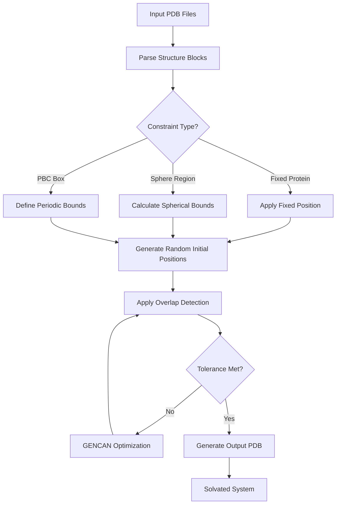
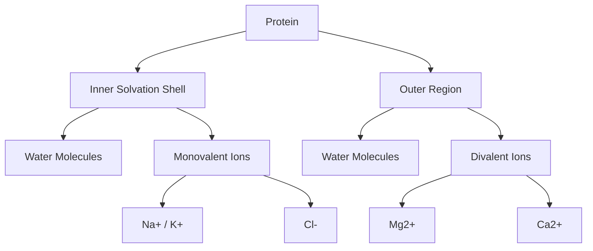

Protein solvation with ions is a fundamental task in molecular dynamics simulations that requires careful placement of solvent molecules and ionic species around a protein structure. Packmol provides a robust framework for building these solvated systems through spatial constraints that ensure proper distribution while preventing molecular overlaps. This documentation explores the methodology for creating solvated protein systems with controlled ion placement, covering both spherical confinement approaches and periodic boundary condition setups.

## Architectural Overview

The protein solvation workflow in Packmol follows a systematic process where the protein serves as the fixed central structure, while water and ions are distributed within defined spatial regions. The architecture relies on constraint-based optimization using the GENCAN algorithm to find optimal molecular positions that satisfy geometric restrictions while minimizing overlap penalties.



The constraint processing in `getinp.f90` handles multiple structure definitions with different spatial requirements, enabling complex multi-component systems like proteins with water and ions. Each structure type maintains its own set of constraint parameters stored in the `restpars` array, with constraint type identifiers in `ityperest` [Sources: testing/input_files/solvprotein.inp#L1-L35](testing/input_files/solvprotein.inp#L1-L35), [src/getinp.f90#L564-L634](src/getinp.f90#L564-L634)].

> [!TIP]
> When solvating large proteins, increase the `sidemax` parameter in your input file if the system dimensions exceed the default 1000 Å limit. This prevents premature truncation of the solvation region and ensures ions can reach their intended positions [Sources: src/initial.f90#L73-L85](src/initial.f90#L73-L85).

## Input Configuration for Protein Solvation

### Basic Spherical Solvation Structure

The most straightforward approach for protein solvation uses spherical confinement, where the protein is fixed at the center and solvent molecules are distributed within a specified radius. This method is ideal for globular proteins and provides excellent control over solvation shell thickness.

| Parameter | Description | Typical Values | Example |
|-----------|-------------|----------------|---------|
| `tolerance` | Minimum distance between non-bonded atoms | 1.5-2.5 Å | `tolerance 2.0` |
| `fixed` | Protein position and orientation | 6 values (x,y,z, θx,θy,θz) | `fixed 0. 0. 0. 0. 0. 0.` |
| `centerofmass` | Center the protein at specified coordinates | boolean | `centerofmass` |
| `inside sphere` | Solvent placement region | x,y,z,radius | `inside sphere 0. 0. 0. 50.` |
| `number` | Molecule count per type | integer | `number 1000` |
| `resnumbers` | Residue numbering scheme | 0,1,2 | `resnumbers 2` |

```fortran
tolerance 2.0

structure ./structure_files/protein.pdb
  resnumbers 0
  number 1 
  fixed 0. 0. 0. 0. 0. 0.
  centerofmass
end structure

structure ./structure_files/water.pdb
  resnumbers 2
  number 1000 
  inside sphere 0. 0. 0. 50.
end structure

structure ./structure_files/CLA.pdb
  resnumbers 2
  number 20
  inside sphere 0. 0. 0. 50.
end structure

structure ./structure_files/SOD.pdb
  resnumbers 2
  number 30
  inside sphere 0. 0. 0. 50.
end structure
```

This configuration demonstrates a complete solvated protein system with 1000 water molecules, 20 chloride ions, and 30 sodium ions distributed within a 50 Å radius sphere centered on the protein. The `fixed` keyword ensures the protein remains stationary during optimization, while `centerofmass` positions the protein's center of mass at the origin [Sources: testing/input_files/solvprotein.inp#L5-L30](testing/input_files/solvprotein.inp#L5-L30)].

### Ion Selection and Concentration Control

Effective ion solvation requires careful consideration of ionic strength and charge neutrality. The ratio between cations and anions should be adjusted to match the protein's net charge, ensuring overall system neutrality for accurate electrostatic behavior in subsequent MD simulations.

> [!TIP]
> Always verify charge neutrality in your solvated system. Calculate the protein's total charge from its PDB file, then adjust ion counts to achieve net zero charge: `n_ions_neutral = -protein_charge` [Sources: testing/input_files/solvprotein.inp#L20-L29](testing/input_files/solvprotein.inp#L20-L29).

## Periodic Boundary Condition Solvation

For systems requiring periodic boundary conditions (PBC), the solvation approach differs by using box constraints instead of spherical regions. PBC systems are essential for simulating bulk solution properties and eliminating surface effects.

### PBC Configuration Syntax


The PBC implementation in Packmol processes box coordinates through a dedicated parsing routine in `getinp.f90` that handles both symmetric boxes (where bounds are offset from origin) and asymmetric boxes with explicit minimum and maximum coordinates. The system stores these boundaries in the `pbc_min` and `pbc_max` arrays, computing box dimensions as the difference `pbc_length = pbc_max - pbc_min` [Sources: src/getinp.f90#L167-L195](src/getinp.f90#L167-L195)].

```fortran
tolerance 2.0
pbc -25 -25 -25 45 45 45

structure ./structure_files/protein.pdb
  resnumbers 0
  number 1 
  fixed 10. 3. 19. 0. 0. 0.
  centerofmass
end structure

structure ./structure_files/water.pdb
  number 2000 
  resnumbers 2
end structure

output output.pdb
```

This PBC configuration defines a 70 × 70 × 70 Å box spanning from -25 to +45 Å in each dimension, containing the protein at a specified internal position and water molecules distributed throughout the entire box volume. Notice the absence of explicit `inside` constraints for water—when PBC is active, molecules automatically fill the entire periodic volume unless otherwise constrained [Sources: testing/input_files/solvprotein_pbc.inp#L5-L18](testing/input_files/solvprotein_pbc.inp#L5-L18)].

| Constraint Type | PBC Active | PBC Inactive | Use Case |
|-----------------|------------|--------------|----------|
| `inside box` | Required for regions | Optional | Define specific solvation regions |
| `inside sphere` | Still functional | Primary method | Localized solvation shells |
| `fixed` | Position relative to box | Position in absolute space | Anchor molecules |
| `outside` | Useful for creating voids | Less common | Exclude regions from packing |

## Optimization and Convergence

The solvation process relies on Packmol's constraint-based optimization engine to find valid molecular arrangements. The objective function combines distance penalties with constraint violations, minimized through the GENCAN gradient-based optimization algorithm.

### Objective Function Components

The optimization function `computef.f90` evaluates two primary penalty components during solvation:

1. **Distance Penalties (`fdist`)**: Computed via pairwise atom interactions using cell indexing for efficiency. When atoms from different molecules approach closer than the specified `tolerance`, a penalty is applied proportional to the distance violation [Sources: src/computef.f90#L113-L151](src/computef.f90#L113-L151)].

2. **Constraint Penalties (`frest`)**: Evaluated for each atom against all spatial restrictions through the `comprest` subroutine. This ensures atoms remain within their designated regions (spheres, boxes, etc.) [Sources: src/computef.f90#L74-L78](src/computef.f90#L74-L78)].

The total objective function is:
```
f_total = scale × f_distance + scale2 × f_constraints
```

where `scale` and `scale2` are weighting factors defaulting to 1.0 and 0.01 respectively, giving higher priority to maintaining minimum distances while satisfying spatial constraints [Sources: src/initial.f90#L50-L52](src/initial.f90#L50-L52)].

### Convergence Control Parameters

| Parameter | Description | Default | Effect |
|-----------|-------------|---------|--------|
| `precision` | Function value tolerance | 0.01 | Lower = more precise, slower |
| `discale` | Initial tolerance scaling | 1.1 | Higher = looser initial constraints |
| `nloop` | Maximum GENCAN iterations | 200 × ntype | More iterations = better convergence |
| `maxit` | GENCAN internal iterations | 20 | Affects optimization depth |

### Initialization and Random Seed

The initial configuration generation occurs in `initial.f90`, which creates random positions and orientations for all non-fixed molecules within the system boundaries. Random seed control is crucial for reproducibility and can be set explicitly using the `seed` keyword or set to -1 for time-based seeding [Sources: src/initial.f90#L87-L106](src/initial.f90#L87-L106), [src/getinp.f90#L68-L71](src/getinp.f90#L68-L71)].

```fortran
seed -1              # Use system time for randomness
# or
seed 1234567        # Fixed seed for reproducibility
```

## Advanced Solvation Strategies

### Multi-Region Ion Placement

Different ion species can be placed in distinct spatial regions to create specialized solvation patterns. This is particularly useful for simulating membrane systems where ion concentrations differ across membrane interfaces.



### Constraint Combination Techniques

Complex solvation requirements can be achieved by combining multiple constraint types within a single structure block. The constraint processing system in `getinp.f90` supports combinations that enable sophisticated placement strategies:

- **Exclusion Zones**: Use `outside` constraints to create protein-free regions
- **Layered Shells**: Combine `inside sphere` with different radii for concentric solvation layers
- **Directional Constraints**: Use `above` and `below` plane constraints for asymmetric solvation

Each constraint is assigned a type identifier stored in `ityperest`, with the `restpars` array containing the geometric parameters needed for evaluation [Sources: src/getinp.f90#L558-L737](src/getinp.f90#L558-L737)].

## Troubleshooting and Best Practices

### Common Issues and Solutions

| Issue | Symptom | Solution |
|-------|---------|----------|
| Insufficient solvation | Ions aggregate at sphere boundary | Increase sphere radius or ion count |
| Slow convergence | Optimization exceeds iteration limit | Increase `nloop` or adjust `discale` |
| Overlap warnings | Atoms too close despite tolerance | Increase `tolerance` or check structure quality |
| PBC boundary issues | Molecules placed outside box | Verify protein position within box bounds |

### Performance Optimization

For large protein systems, several parameters can be tuned to improve performance:

1. **Cell Binning Parameter (`fbins`)**: Controls the granularity of the cell indexing system. Larger values reduce the number of cells but increase the neighbor search range. Default is automatically calculated based on system size [Sources: src/getinp.f90#L122-L125](src/getinp.f90#L122-L125)].

2. **Movement Limits (`maxmove`)**: Restricts how many molecules of each type can be moved during optimization phases. Can be set per structure type to prioritize optimization of certain molecule categories [Sources: src/getinp.f90#L795-L797](src/getinp.f90#L795-L797)].

3. **Initial Packing (`nloop0`)**: Controls the number of optimization iterations for the initial random configuration phase. Increasing this value can help with difficult-to-pack systems [Sources: src/getinp.f90#L109-L113](src/getinp.f90#L109-L113)].

## Output Analysis and Validation

After generating a solvated protein system, validation of the output structure is critical before proceeding to MD simulations. Packmol provides several output mechanisms for quality assessment:

### Output File Structure

The output PDB file contains all molecules with consistent residue numbering controlled by the `resnumbers` parameter. For PDB format, residue numbering can be set to:
- `0`: Continuous numbering across all molecules
- `1`: Sequential numbering with reset per molecule type
- `2`: Sequential numbering with reset per molecule

Chain identifiers are automatically assigned for systems with more than 9999 molecules of a given type, ensuring PDB format compliance [Sources: src/getinp.f90#L812-L868](src/getinp.f90#L812-L868)].

### Validation Checklist

- Verify all atoms are within intended spatial regions
- Check minimum distances approach but do not violate the tolerance
- Confirm ion charges balance the protein's net charge
- Ensure proper residue and chain numbering in output PDB
- Validate PBC boundaries if applicable (molecules should not exceed box bounds)

## Next Steps

After successfully generating a solvated protein system, consider these related topics:

- Explore [Periodic Boundary Conditions (PBC) Configuration](8-periodic-boundary-conditions-pbc-configuration) for advanced PBC setups and handling membrane systems
- Review [Spatial Constraints Syntax (Box, Sphere, Plane, Cylinder)](5-spatial-constraints-syntax-box-sphere-plane-cylinder) for comprehensive constraint options
- Study [Distance Constraints and Overlap Detection](17-distance-constraints-and-overlap-detection) to understand the underlying collision detection algorithms
- Learn about [Building Simple Water Boxes](25-building-simple-water-boxes) for pure solvent systems
- Understand [GENCAN Optimization Method Overview](9-gencan-optimization-method-overview) for deeper insight into the optimization algorithm

Protein solvation with ions represents a foundational skill in computational biochemistry. Mastering these techniques with Packmol provides reliable starting structures for molecular dynamics simulations, ensuring proper electrostatic environments and realistic solvent behavior around biomolecular systems.