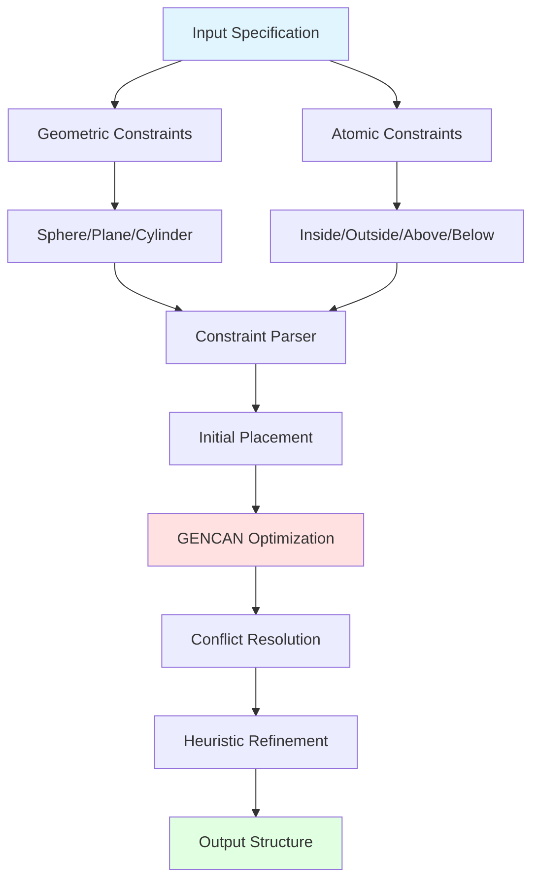
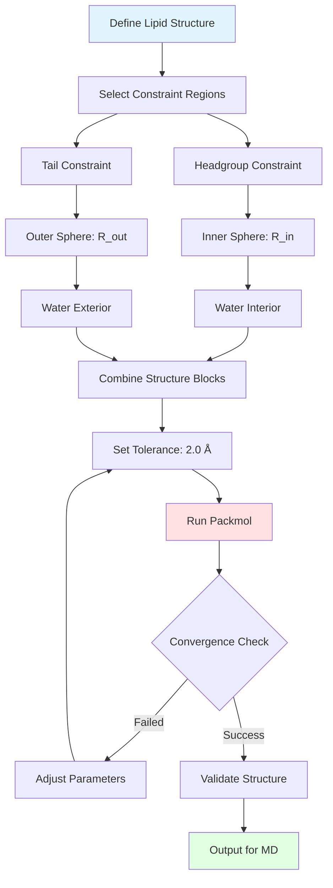

Vesicles and micelles are fundamental self-assembled structures in molecular systems, typically formed by amphiphilic molecules such as lipids or surfactants. Packmol provides sophisticated constraint-based approaches for constructing these biomolecular assemblies with precise control over molecular positioning and orientation. This documentation covers the theoretical foundations, practical implementation strategies, and optimization techniques for building vesicles, bilayers, and micelles using Packmol's spatial constraint system.

Sources: [spherical.inp](/testing/input_files/spherical.inp#L1-L43), [bilayer.inp](/testing/input_files/bilayer.inp#L1-L41)

## Architectural Overview

The construction of vesicles and micelles leverages Packmol's hierarchical constraint system, combining geometric primitives with atom-specific positioning. The architecture separates molecular placement into three conceptual layers: geometric constraint definition, molecular orientation control, and optimization-driven packing. This modular design enables complex multi-shell structures with precise control over lipid headgroup and tail positioning.



The constraint parsing system in `getinp.f90` identifies constraint types (sphere, plane, box) and assigns integer identifiers (ityperest) for efficient evaluation. Sphere constraints use type codes 8 (inside) and 13 (outside), while plane constraints use types 10 (above) and 11 (below). These codes trigger specialized geometric distance calculations in the constraint satisfaction functions.

Sources: [getinp.f90](/src/getinp.f90#L600-L799), [restmol.f90](/src/restmol.f90#L1-L71)

## Vesicle Construction Strategies

### Spherical Vesicle Architecture

Vesicles consist of concentric lipid bilayers forming spherical shells, typically with water molecules inside the lumen and in the external solution. The key insight is that vesicles require precise positioning of lipid headgroups at specific radii from the sphere center, with hydrophobic tails oriented radially inward or outward depending on the bilayer leaf.

The spherical vesicle implementation demonstrates atom-specific constraint application:

```
tolerance 2.0 

structure ./structure_files/palmitoil.pdb 
  resnumbers 2
  number 20
  atoms 37
    inside sphere 0. 0. 0. 14. 
  end atoms
  atoms 5
    outside sphere 0. 0. 0. 26.
  end atoms
end structure
```

This configuration constrains specific atoms (headgroups vs. tails) to distinct spherical regions, creating a bimodal radial distribution characteristic of vesicle membranes. The dual sphere constraints enforce that selected atoms must satisfy both conditions simultaneously—atoms must be inside the inner sphere AND outside the outer sphere, positioning them precisely in the vesicle membrane region.

Sources: [spherical.inp](/testing/input_files/spherical.inp#L8-L20), [computef.f90](/src/computef.f90#L1-L100)

### Multi-Layer Vesicle Systems

Complex vesicle structures with multiple concentric layers can be constructed by defining multiple structure blocks with overlapping but distinct constraint regions. The algorithm handles this through sequential constraint evaluation, where each molecule type receives independent constraint sets but all participate in the global distance-based optimization.

> [!TIP]
> When constructing multi-layer vesicles, ensure sufficient spacing between concentric layers (typically 4-6 Å) to prevent atomic overlap and allow proper lipid packing. The tolerance parameter should be set smaller than the layer spacing to maintain separation during optimization.

### Periodic Boundary Considerations

Vesicles can be constructed within periodic boundary conditions by defining a simulation box that encapsulates the entire vesicle structure. The spherical constraints operate in absolute coordinates, while the PBC system ensures proper wrapping for molecular dynamics simulations:

```
pbc -47.5 -47.5 -47.5 47.5 47.5 47.5
```

The combination of absolute geometric constraints with periodic wrapping requires careful parameter selection to prevent artifacts at box boundaries. The vesicle radius must be significantly smaller than the box dimensions to avoid self-interaction across periodic images.

Sources: [spherical_pbc.inp](/testing/input_files/spherical_pbc.inp#L5-L43), [pbc.f90](/src/pbc.f90)

## Bilayer Construction Techniques

### Planar Bilayer Assembly

Planar lipid bilayers represent the fundamental membrane architecture and utilize plane constraints to position headgroups at specific z-coordinates while maintaining random distribution in the xy-plane:

```
structure ./structure_files/palmitoil.pdb 
  number 10
  atoms 31 32
    below plane 0. 0. 1. 2.
  end atoms
  atoms 1 2
    above plane 0. 0. 1. 12.
  end atoms
end structure 
```

The plane equation `0. 0. 1. z_offset` defines a horizontal plane normal to the z-axis, with the fourth parameter specifying the z-coordinate offset. By constraining different atoms to be below one plane and above another, the system establishes a bilayer thickness with precise control over headgroup positioning.

Sources: [bilayer.inp](/testing/input_files/bilayer.inp#L16-L26), [getinp.f90](/src/getinp.f90#L740-L765)

### Asymmetric Bilayer Systems

Asymmetric bilayers with different lipid compositions in each leaflet can be constructed by defining separate structure blocks with complementary plane constraints. The optimization algorithm treats each structure block independently but enforces distance-based exclusion across all molecule types, preventing inter-leaflet mixing while allowing proper packing.

| Constraint Type | Parameters | Typical Application | Implementation |
|----------------|------------|-------------------|----------------|
| Plane (above) | nx, ny, nz, d | Upper leaflet positioning | ityperest = 10 |
| Plane (below) | nx, ny, nz, d | Lower leaflet positioning | ityperest = 11 |
| Sphere (inside) | cx, cy, cz, r | Inner vesicle membrane | ityperest = 8 |
| Sphere (outside) | cx, cy, cz, r | Outer vesicle membrane | ityperest = 13 |

Sources: [getinp.f90](/src/getinp.f90#L660-L780)

## Molecular Orientation and Rotational Constraints

### Euler Angle Parameterization

Molecular orientation in Packmol uses Euler angles (β, γ, θ) stored in the optimization vector alongside positional coordinates. The transformation from Euler angles to rotation matrices follows a specific convention optimized for gradient computation:

```fortran
subroutine eulerrmat(beta,gama,teta,v1,v2,v3)
   cb = dcos(beta); sb = dsin(beta)
   cg = dcos(gama); sg = dsin(gama)
   ct = dcos(teta); st = dsin(teta)
   
   v1(1)=-sb * sg * ct + cb * cg
   v2(1)= cb * sg * ct + sb * cg
   v3(1)= sg * st
   ! ... remaining components
end subroutine eulerrmat
```

The rotation matrix columns (v1, v2, v3) transform canonical molecular coordinates to final Cartesian coordinates. This parameterization enables continuous orientation optimization while maintaining orthonormality constraints through the trigonometric relationship between angles.

Sources: [polartocart.f90](/src/polartocart.f90#L8-L43), [initial.f90](/src/initial.f90#L88-L115)

### Constrained Rotation for Bilayers

For planar bilayers, rotational constraints can limit lipid orientation to maintain proper alignment with the membrane normal:

```
constrain rotation 1 0. 0. 0. 
constrain rotation 2 0. 0. 6.28
constrain rotation 3 0. 0. 3.14
```

These constraints restrict specific Euler angles to prescribed ranges, limiting the orientation search space and improving convergence for membrane systems where lipid orientation is physically constrained.

Sources: [initial.f90](/src/initial.f90#L88-L115), [polartocart.f90](/src/polartocart.f90#L48-L73)

## Optimization Algorithm and Convergence Strategies

### GENCAN Optimization Framework

The GENCAN (Generalized Nonlinear Conjugate Gradient) algorithm serves as the core optimization engine, minimizing an objective function that combines distance-based repulsion terms with constraint penalty functions. The objective function structure enables simultaneous satisfaction of spatial constraints and avoidance of atomic overlap:

```
f = Σ w_ij · max(0, r_ij² - (R_i + R_j)²) + Σ λ_k · C_k
```

Where r_ij is the interatomic distance, R_i are atomic radii, and C_k are constraint violations. The optimization proceeds iteratively, with gradient information computed analytically for efficiency.

Sources: [computef.f90](/src/computef.f90#L1-L100), [gparc.f90](/src/gparc.f90#L1-L88)

### Heuristic Molecule Rejection

The move-bad heuristic identifies and relocates molecules contributing significantly to the objective function, improving convergence for complex systems like vesicles where local minima are prevalent:

```fortran
subroutine movebad(n,x,fx,movebadprint)
   ! Identify molecules with high function contributions
   ! Sort molecules using flashsort
   ! Relocate worst molecules based on good molecules
   ! Re-optimize with updated positions
end subroutine movebad
```

The flashsort algorithm provides O(n) sorting performance for molecule ranking, enabling efficient identification of problematic molecules. Relocation strategies include random placement within constraint regions or copying positions from well-placed molecules.

Sources: [heuristics.f90](/src/heuristics.f90#L1-L151), [flashsort.f90](/src/flashsort.f90#L1-L96)

### Iterative Packing Strategy

For large vesicles with hundreds of lipid molecules, an iterative packing strategy improves convergence:

1. **Initial Placement**: Random placement within broad constraint regions
2. **Core Optimization**: GENCAN minimization with loose tolerance
3. **Molecule Rejection**: Move-bad heuristic removes worst 5-10% of molecules
4. **Refinement**: Re-optimization with tighter tolerance
5. **Validation**: Check constraint satisfaction and overlap statistics

The iterative process can be controlled using the `nloop` parameter to repeat the optimization cycle, with each iteration tightening the convergence criteria.

Sources: [initial.f90](/src/initial.f90#L116-L150), [getinp.f90](/src/getinp.f90#L70-L95)

## Practical Implementation Guide

### Vesicle Construction Workflow

The following flowchart illustrates the systematic approach to constructing vesicles:



> [!TIP]
> For vesicle construction, start with a small system (20-30 lipids) to validate constraint definitions, then scale up gradually. This approach prevents wasted computation on misconfigured large systems and allows rapid debugging of constraint logic.

### Parameter Selection Guidelines

Selecting appropriate parameters is critical for successful vesicle and bilayer construction:

| Parameter | Recommended Range | Effect | Trade-offs |
|-----------|------------------|--------|------------|
| Tolerance | 1.5 - 2.5 Å | Overlap prevention | Lower values = slower convergence |
| discale | 1.05 - 1.15 | Initial spacing | Higher values = looser initial packing |
| movefrac | 0.03 - 0.10 | Molecule relocation rate | Higher values = aggressive rearrangement |
| maxit | 20 - 100 | GENCAN iterations | Higher values = better convergence |
| nloop | 0 - 5 | Optimization cycles | Higher values = iterative refinement |

Sources: [getinp.f90](/src/getinp.f90#L70-L95), [initial.f90](/src/initial.f90#L40-L65)

## Advanced Applications

### Micelle Construction

Micelles are smaller, single-layer structures with a hydrophobic core and hydrophilic surface. Construction requires constraining headgroup atoms to an outer spherical region while tail atoms remain interior:

```
structure ./structure_files/surfactant.pdb
  number 50
  atoms 1 2 3
    outside sphere 0. 0. 0. 10.
  end atoms
  atoms 4 5 6 7 8
    inside sphere 0. 0. 0. 8.
  end atoms
end structure
```

The smaller radius differential between inner and outer constraints compared to vesicles reflects the single-layer structure of micelles.

### Multi-Component Membranes

Complex membranes containing cholesterol, proteins, and mixed lipid types can be constructed by defining multiple structure blocks with shared spatial regions but different molecular types. The optimization algorithm treats all molecule types equivalently in distance calculations, enabling heterogeneous membrane composition while maintaining proper packing.

For membrane protein insertion, fixed molecule positioning can establish anchor points for lipid assembly:

```
structure ./structure_files/protein.pdb
  number 1
  fixed
end structure

structure ./structure_files/lipid.pdb
  number 100
  inside box -40. -40. -10. 40. 40. 10.
  atoms 1 2
    above plane 0. 0. 1. -8.
  end atoms
end structure
```

Sources: [initial.f90](/src/initial.f90#L145-L155), [restmol.f90](/src/restmol.f90#L1-L71)

## Troubleshooting and Optimization

### Common Convergence Issues

**Problem**: Vesicle construction fails with high residual function values

**Solution**: Increase `movefrac` to 0.10-0.15 and enable `movebadrandom` for more aggressive rearrangement. The random relocation strategy can escape local minima where lipids become trapped in energetically unfavorable orientations.

**Problem**: Lipid headgroups penetrate the vesicle interior

**Solution**: Tighten sphere constraints by reducing the radius differential and decrease the tolerance parameter. Add specific constraints to prevent tail atom penetration of the inner sphere.

**Problem**: Bilayer thickness is inconsistent across the membrane

**Solution**: Use rotational constraints to limit lipid orientation perpendicular to the membrane plane. The `constrain rotation` directive can restrict the relevant Euler angle to maintain proper alignment.

Sources: [heuristics.f90](/src/heuristics.f90#L80-L130), [getinp.f90](/src/getinp.f90#L100-L120)

### Performance Optimization

For large vesicles (>1000 lipids), computational efficiency becomes critical:

1. **Reduce computational domain**: Use the `sidemax` parameter to limit the search space to the vesicle region, avoiding unnecessary optimization in empty solvent regions
2. **Adjust cell indexing**: The `fbins` parameter controls the linked-cell bin size; larger values reduce memory usage but increase neighbor search overhead
3. **Incremental construction**: Build vesicle in stages, starting with the lipid shell then adding water molecules to reduce optimization complexity

Sources: [initial.f90](/src/initial.f90#L55-L75), [cell_indexing.f90](/src/cell_indexing.f90)

## Integration with Molecular Dynamics

The output from Packmol provides initial coordinates ready for molecular dynamics simulations, provided that the simulation box dimensions are correctly specified. For vesicle simulations, the box must be large enough to prevent vesicle self-interaction across periodic boundaries—typically 2-3 times the vesicle diameter.

The PDB output format includes residue information from the input structure files, enabling direct mapping to force field parameters. For complex systems, connectivity information from CONECT records in the input PDB files preserves molecular topology.

Sources: [output.f90](/src/output.f90), [README.md](/README.md#L1-L30)

## Next Steps

For comprehensive understanding of related topics, explore the following documentation:

- [Spatial Constraints Syntax (Box, Sphere, Plane, Cylinder)](5-spatial-constraints-syntax-box-sphere-plane-cylinder) for detailed constraint parameter specifications
- [Advanced Input Options: Fixed Molecules, Rotational Constraints, and Center of Mass](7-advanced-input-options-fixed-molecules-rotational-constraints-and-center-of-mass) for orientation control strategies
- [Periodic Boundary Conditions (PBC) Configuration](8-periodic-boundary-conditions-pbc-configuration) for boundary condition setup
- [GENCAN Optimization Method Overview](9-gencan-optimization-method-overview) for algorithm details
- [Creating Lipid Bilayers](26-creating-lipid-bilayers) for focused bilayer construction techniques