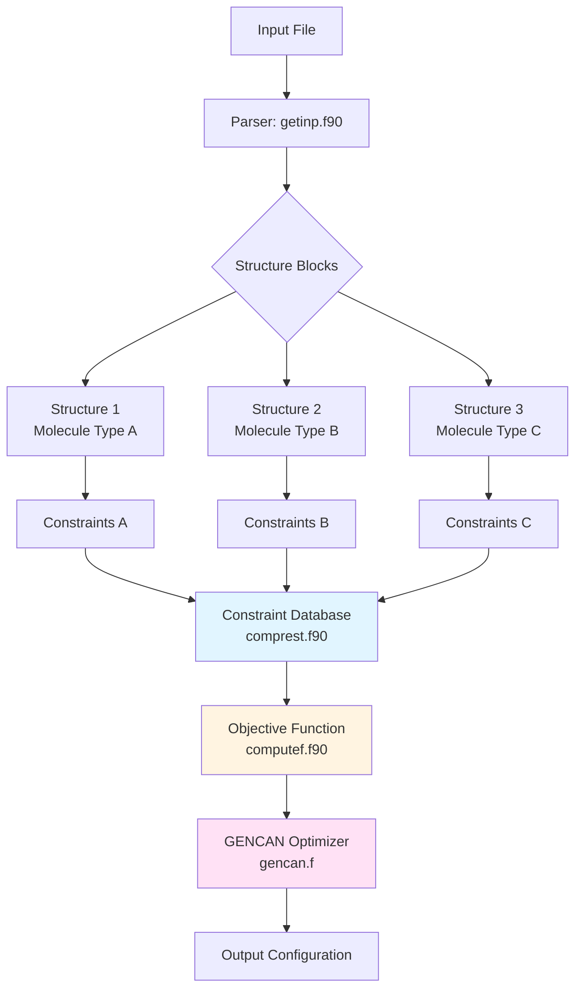

This page explores the architecture and implementation of multi-component molecular systems in Packmol, focusing on mixed solvent systems and spatially partitioned configurations. These capabilities enable the construction of complex simulation boxes containing multiple molecular species with distinct spatial distributions, essential for biomolecular simulations, interfacial studies, and solvent screening applications.

## Architectural Foundations of Multi-Component Systems

Mixed solvent systems in Packmol are built upon a unified constraint enforcement framework where each molecular type maintains independent constraint sets while participating in a global optimization objective. The system processes each `structure` block sequentially, accumulating spatial constraints into a single constraint database indexed by atom identifiers. This design enables arbitrary complexity in molecular composition while maintaining computational efficiency through cell-based neighbor search algorithms.

The constraint architecture supports both homogeneous distributions (where all molecules occupy the same spatial region) and partitioned configurations (where different molecular types are confined to distinct sub-regions). This flexibility is implemented through the constraint type system in `comprest.f90`, which processes 15 different constraint types including boxes, spheres, cylinders, planes, and Gaussian distributions. Each constraint type contributes a penalty term to the objective function based on distance from the valid region, allowing the GENCAN optimizer to simultaneously satisfy all spatial requirements.



The optimizer evaluates the objective function through a two-stage process: first computing constraint penalties for each atom based on its assigned constraints, then computing pairwise distance penalties to prevent intermolecular overlap. This separation allows different molecular types to have different spatial requirements while maintaining a unified collision detection system. The `fparc.f90` function implements the distance penalty using a quadratic penalty function that activates when interatomic distances fall below the sum of atomic radii.

Sources: [getinp.f90](src/getinp.f90#L261-L293), [computef.f90](src/computef.f90#L50-L93), [fparc.f90](src/fparc.f90#L31-L63)

## Mixed Solvent System Implementation

Mixed solvent systems combine two or more molecular species in a shared spatial region, typically representing aqueous solutions with co-solvents, ionic solutions, or binary solvent mixtures. The implementation follows a straightforward pattern where each molecular type defines the same spatial constraint region but maintains independent molecular properties such as radii, scaling factors, and flexible/rigid behavior.

The fundamental constraint specification for mixed solvents uses the `inside` keyword with box or sphere geometry. In the test example `mixture.inp`, water and urea molecules are both constrained to the same cubic region but with different concentrations:

```
structure ./structure_files/water.pdb 
  number 1000 
  inside box 0. 0. 0. 40. 40. 40. 
end structure

structure ./structure_files/urea.pdb
  number 400
  inside box 0. 0. 0. 40. 40. 40. 
end structure
```

This specification creates a 40×40×40 ų box containing 1000 water molecules and 400 urea molecules. The optimization treats water-urea, water-water, and urea-urea interactions identically in the distance penalty calculation, ensuring uniform packing density across species. The `radius` and `fscale` parameters, which control effective atomic sizes and penalty scaling, can be set independently per molecule type to account for different molecular geometries and interaction preferences.

> [!TIP]
> When constructing mixed solvent systems with molecules of significantly different sizes, adjust the `fscale` parameter for larger molecules to prevent excessive separation from smaller molecules. This parameter multiplies the distance penalty, allowing fine-tuning of effective molecular "hardness" during optimization.

The constraint evaluation in `comprest.f90` uses type codes to identify the constraint type: code 2 for cubes (defined by corner and side length) and code 3 for boxes (defined by two opposite corners). Both implementations apply quadratic penalties outside the valid region, ensuring molecules remain confined to the specified volume while allowing free movement within the region.

Sources: [mixture.inp](testing/input_files/mixture.inp#L11-L19), [comprest.f90](src/comprest.f90#L18-L36)

## Partitioned Configurations with Spatial Constraints

Partitioned configurations divide the simulation space into distinct sub-regions, each populated by different molecular species. This approach is essential for creating interfaces, membranes, or concentration gradients. Packmol implements spatial partitioning through planar constraints using the `above plane`, `below plane`, and distance-based keywords.

Plane constraints are defined by the plane equation ax + by + cz = d, where (a,b,c) is the normal vector and d is the distance from the origin. The `above plane` constraint penalizes atoms on the negative side of the plane (below the plane), while `below plane` penalizes atoms on the positive side (above the plane). In `comprest.f90`, these are implemented as type codes 10 and 11 respectively:

- Type 10 (above plane): `w = a·x + b·y + c·z - d`, penalty for w < 0
- Type 11 (below plane): `w = a·x + b·y + c·z - d`, penalty for w > 0

The test example `mixture_pbc.inp` demonstrates partitioned configuration with periodic boundary conditions:

```
pbc -20 -20 -20 20 20 20

structure ./structure_files/water.pdb 
  number 500
  below plane 0. 0. 1.0 0.
end structure

structure ./structure_files/urea.pdb
  number 300
  over plane 0. 0. 1.0 0.
end structure
```

This creates a 40×40×40 Å periodic cell divided at z = 0 by a horizontal plane. Water molecules are confined to the region z < 0 (below the plane), while urea molecules occupy z > 0 (above the plane). The normal vector (0, 0, 1.0) defines the plane orientation, and the distance parameter (0.) specifies the plane's offset from the origin.

Sources: [mixture_pbc.inp](testing/input_files/mixture_pbc.inp#L6-L21), [comprest.f90](src/comprest.f90#L117-L131)

## Advanced Partitioning Strategies

Beyond simple planar division, Packmol supports complex partitioning through combination of multiple constraint types. The constraint system allows stacking constraints within a single `structure` block, requiring molecules to satisfy all specified constraints simultaneously. This enables creation of regions such as spherical shells, cylindrical pores, or intersecting volumes.

Gaussian distribution constraints (types 14 and 15) enable concentration gradients by using a normalized Gaussian function to define the spatial preference. The constraint penalty increases with distance from the Gaussian peak position, allowing smooth spatial distributions rather than hard boundaries. This is particularly useful for modeling interfaces where molecular concentration varies continuously across space.

The heuristic system in `heuristics.f90` plays a crucial role in multi-component optimization by identifying poorly placed molecules and repositioning them based on successful configurations. The `movebad` subroutine evaluates the objective function contribution of each molecule, identifies the worst-performing fraction (controlled by `movefrac` parameter), and repositions them either randomly or relative to well-placed molecules. This heuristic is applied independently to each molecular type, allowing the optimization to address specific difficulties encountered by different species without disrupting successfully placed components.

> [!TIP]
> For challenging multi-component systems, use the `packall` option to force optimization of all molecule types simultaneously from the beginning, rather than the default sequential approach. This prevents earlier-placed types from monopolizing favorable positions and can improve packing efficiency for heterogeneous mixtures.

Sources: [getinp.f90](src/getinp.f90#L117-L119), [heuristics.f90](src/heuristics.f90#L50-L119)

## Constraint Type Comparison

Packmol provides multiple constraint types suitable for different partitioning scenarios. The following table summarizes the primary constraint types used in mixed solvent and partitioned configurations:

| Constraint Type | Code | Syntax | Use Case | Penalty Function |
|----------------|------|--------|----------|------------------|
| Cube | 2 | `inside box x0 y0 z0 size` | Simple cubic regions | Quadratic outside boundaries |
| Box | 3 | `inside box x0 y0 z0 x1 y1 z1` | Rectangular regions | Quadratic outside boundaries |
| Sphere | 4 | `inside sphere x0 y0 z0 radius` | Spherical regions | Quadratic for r > radius |
| Ellipsoid | 5 | `inside ellipsoid x y z rx ry rz` | Ellipsoidal regions | Quadratic for normalized distance > 1 |
| Above Plane | 10 | `above plane a b c d` | Half-space confinement | Quadratic for w < 0 |
| Below Plane | 11 | `below plane a b c d` | Half-space confinement | Quadratic for w > 0 |
| Cylinder | 12 | `inside cylinder ...` | Cylindrical pores | Combined axial and radial penalties |
| Above Gaussian | 14 | `above xygauss ...` | Gradients/interfaces | Exponential weighting |

The penalty function scale factors (`scale` and `scale2`) control the relative importance of constraint satisfaction versus distance minimization. For partitioned systems, higher scale values ensure molecules respect region boundaries, while lower values allow some boundary crossing if it improves overall packing density.

Sources: [comprest.f90](src/comprest.f90#L18-L200)

## Practical Implementation Patterns

Building effective mixed solvent and partitioned configurations requires understanding the interaction between constraint definitions and optimization parameters. The following patterns, demonstrated in the test suite, provide starting templates for common scenarios.

### Protein Solvation with Multiple Components

The `solvprotein.inp` example demonstrates solvating a fixed protein with water and ions using spherical confinement:

```
structure ./structure_files/protein.pdb
  resnumbers 0
  number 1 
  fixed 0. 0. 0. 0. 0. 0.
  centerofmass
end structure

structure ./structure_files/water.pdb
  resnumbers 2
  number 1000 
  inside sphere 0. 0. 0. 50.
end structure

structure ./structure_files/CLA.pdb
  resnumbers 2
  number 20
  inside sphere 0. 0. 0. 50.
end structure

structure ./structure_files/SOD.pdb
  resnumbers 2
  number 30
  inside sphere 0. 0. 0. 50.
end structure
```

The `fixed` keyword places the protein at the origin, and `centerofmass` ensures it remains centered. The `avoid_overlap no` option prevents the initial configuration from attempting to avoid overlap with the fixed protein, which can be problematic for tightly constrained systems. The water and ions all share the same spherical constraint, creating a homogeneous solvation shell around the protein.

Sources: [solvprotein.inp](testing/input_files/solvprotein.inp#L7-L34), [getinp.f90](src/getinp.f90#L149-L156)

### Bilayer Construction with Partitioning

The `bilayer_pbc.inp` and `bilayer.inp` examples demonstrate constructing lipid bilayers using planar constraints. Lipid molecules are partitioned into upper and lower leaflets using `above plane` and `below plane` constraints, creating the characteristic bilayer structure. Water molecules are then added to both sides or constrained to interfacial regions depending on the desired hydration level.

For bilayer construction, the planar normal typically aligns with the z-axis, and the plane offset defines the bilayer center. Lipid tail orientations can be controlled using rotational constraints to ensure proper alignment with the bilayer normal. The combination of planar partitioning with rotational constraints enables creation of realistic membrane structures with proper lipid packing and orientation.

### Optimization Strategy Selection

Multi-component systems often require careful tuning of optimization parameters for efficient convergence. The following parameters control optimization behavior in mixed systems:

- `nloop`: Number of optimization loops for each molecular type (default: 0, auto-selected)
- `nloop0`: Initial loops before type-by-type optimization (default: 0)
- `precision`: Convergence tolerance (default: 0.01)
- `movefrac`: Fraction of worst molecules to reposition (default: 0.05)
- `maxmove`: Maximum number of molecules of each type to move (default: all movable)

For mixed solvents with similar molecular sizes, the default parameters typically suffice. For systems with large size disparities (e.g., proteins with small solvent molecules), increase `nloop` for the smaller molecules to allow more optimization time, and consider using `packall` to optimize all types simultaneously. The `precision` parameter should be set tighter (e.g., 0.001) for systems requiring high spatial accuracy, such as interfacial configurations with sharp concentration gradients.

## Summary and Further Reading

Mixed solvent systems and partitioned configurations extend Packmol's capabilities from simple single-component systems to complex multi-component architectures essential for realistic molecular simulations. The constraint-based architecture provides a unified framework for defining spatial relationships between molecular species, while the optimization algorithms handle the complexity of satisfying multiple simultaneous requirements.

Key architectural principles include the separation of constraint definition (in input files) from constraint evaluation (in `comprest.f90`), the unified distance penalty system (in `fparc.f90`) that treats all molecular types equally in collision detection, and the heuristics system (in `heuristics.f90`) that adapts to the specific difficulties encountered by each component type.

For deeper understanding of related concepts, explore the [Spatial Constraints Syntax (Box, Sphere, Plane, Cylinder)](5-spatial-constraints-syntax-box-sphere-plane-cylinder) for comprehensive constraint documentation, [Periodic Boundary Conditions (PBC) Configuration](8-periodic-boundary-conditions-pbc-configuration) for implementing periodic systems with mixed components, and [Objective Function Design in computef.f90](10-objective-function-design-in-computef-f90) for details on the optimization mathematics.
