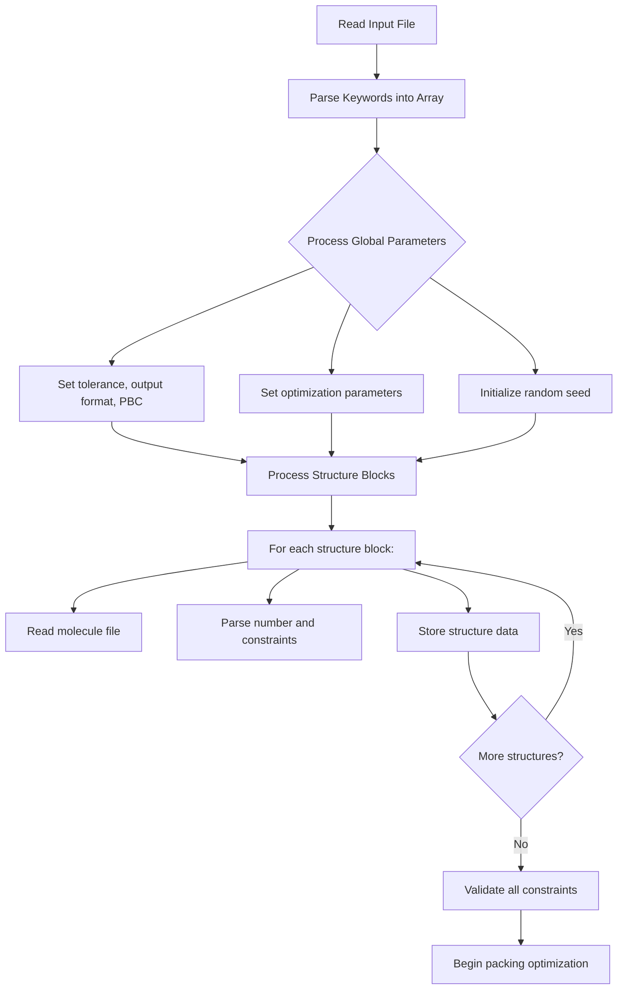

The PackMol input file uses a straightforward keyword-based syntax that defines how molecules should be arranged in 3D space. The input parser reads all keywords into a structured array and processes them sequentially, with special handling for `structure` blocks that define molecule-specific constraints. The parsing logic resides primarily in [getinp.f90](src/getinp.f90#L1-L1147), which validates keywords and builds the internal data structures for the packing algorithm.

## Global Parameters

Global parameters are defined at the top level of the input file and apply to the entire packing process. These parameters are read by scanning through all input lines before processing structure blocks [getinp.f90](src/getinp.f90#L30-L200).

### Required Global Parameters

Two parameters are mandatory for any PackMol input file:

- **`tolerance <distance>`**: Sets the minimum allowed distance between any two atoms in the final configuration. This is typically set between 1.5 and 2.5 Å depending on the molecular system. For example, `tolerance 2.0` [getinp.f90](src/getinp.f90#L536-L548).
  
- **`output <filename>`**: Specifies the output file path where the packed structure will be saved. The file extension typically indicates the format (.pdb, .xyz) unless explicitly overridden [getinp.f90](src/getinp.f90#L236-L251).

### Common Optional Parameters

Several frequently used parameters control basic execution behavior:

| Parameter | Default | Description |
|-----------|---------|-------------|
| `filetype` | `pdb` | Output format: `pdb`, `xyz`, or `tinker` |
| `pbc <x> <y> <z>` | None | Periodic boundary conditions (box dimensions) |
| `seed <value>` | 1234567 | Random seed for reproducibility; use `seed -1` for system time [getinp.f90](src/getinp.f90#L51-L59) |
| `avoid_overlap yes/no` | yes | Whether to prevent overlaps with fixed molecules at initialization [getinp.f90](src/getinp.f90#L149-L157) |


## Structure Block Syntax

The core of PackMol input syntax revolves around `structure` blocks, each defining a molecule type to be placed. Every structure block must begin with `structure <file>` and end with `end structure` [getinp.f90](src/getinp.f90#L36-L39). The structure file can be in PDB, XYZ, or TINKER format, as determined by the global `filetype` parameter or the file extension.

### Basic Structure Block

A minimal structure block requires only the molecule file and the number of molecules to place:

```
structure ./structure_files/water.pdb
  number 1000
  inside box 0. 0. 0. 40. 40. 40.
end structure
```

The `number` parameter specifies how many molecules of this type to insert, while spatial constraints like `inside box` define where they can be placed [testing/input_files/water_box.inp](testing/input_files/water_box.inp#L8-L12).

### Structure Block Parameter Hierarchy

Structure block parameters can be categorized by their scope and purpose:

**Molecule Definition** (applies to all instances of this molecule type):
- `number <n>` - Number of molecules to place
- `resnumbers <0|1|2>` - Residue numbering scheme for PDB output (0=keep original, 1=renumber, 2=increment) [getinp.f90](src/getinp.f90#L817-L821)
- `maxmove <n>` - Maximum number of molecules of this type that can be moved during optimization [getinp.f90](src/getinp.f90#L777-L779)
- `connect yes/no` - Whether to include connectivity information in output [getinp.f90](src/getinp.f90#L827-L830)
- `changechains` - Assign different chain identifiers to molecules of this type [getinp.f90](src/getinp.f90#L815-L817)
- `chain <id>` - Use specific chain identifier for all molecules [getinp.f90](src/getinp.f90#L833-L834)
- `segid <name>` - Segment identifier for PDB output [getinp.f90](src/getinp.f90#L836-L837)

**Positional Constraints** (where molecules can be placed):
- `inside box <x1> <y1> <z1> <x2> <y2> <z2>` - Rectangular box constraint [getinp.f90](src/getinp.f90#L535-L540)
- `inside sphere <x> <y> <z> <radius>` - Spherical constraint [getinp.f90](src/getinp.f90#L541-L544)
- `outside box/sphere` - Inverse of inside constraints [getinp.f90](src/getinp.f90#L563-L580)
- `fixed <x> <y> <z> <dx> <dy> <dz>` - Fixed position and orientation [getinp.f90](src/getinp.f90#L514-L520)

**Orientation Constraints** (how molecules should be oriented):
- `centerofmass` - Use center of mass for positioning instead of molecule origin [getinp.f90](src/getinp.f90#L199-L200)
- `above/below plane <nx> <ny> <nz> <d>` - Relative to plane defined by normal vector and offset [getinp.f90](src/getinp.f90#L627-L650)

## Advanced Constraint Syntax

For complex molecular assemblies, PackMol supports atom-level constraints using nested `atoms` blocks within structure definitions. This allows specific atoms of a molecule to satisfy different geometric constraints.

### Atoms Block Syntax

```
atoms <atom1> <atom2> ...
  <constraint1>
  <constraint2>
  ...
end atoms
```

The `atoms` block specifies which atoms within the molecule should satisfy the contained constraints. This is particularly useful for orientation control in lipid bilayers and micelles [testing/input_files/bilayer.inp](testing/input_files/bilayer.inp#L18-L29).

### Example: Lipid Bilayer Orientation

```
structure ./structure_files/palmitoil.pdb 
  number 10
  inside box 0. 0. 0. 40. 40. 14.
  atoms 31 32
    below plane 0. 0. 1. 2.
  end atoms
  atoms 1 2
    above plane 0. 0. 1. 12.
  end atoms
end structure
```

In this example, the lipids are constrained to a specific region of the box, with tail atoms (31, 32) forced below z=2 and head atoms (1, 2) forced above z=12, creating a properly oriented lipid monolayer [testing/input_files/bilayer.inp](testing/input_files/bilayer.inp#L18-L29).

## Comment and Format Conventions

Input files support flexible formatting conventions:

- **Comments**: Lines beginning with `#` are treated as comments and ignored by the parser
- **Whitespace**: Keywords and parameters can be separated by any amount of whitespace (spaces or tabs)
- **Case sensitivity**: Keywords are case-insensitive; both `structure` and `STRUCTURE` work identically
- **Line breaks**: Parameters can span multiple lines if needed, but each keyword must be on its own line

> [!TIP]
> The parser uses a maximum keyword length of 1000 characters (defined in `sizes.f90`), but practical input files should keep lines under 80 characters for readability and compatibility across text editors.

## Multiple Structure Blocks

Input files can contain any number of structure blocks, allowing creation of complex multi-component systems. The example below shows a protein solvation system with water and ions:

```
structure ./structure_files/protein.pdb
  resnumbers 0
  number 1 
  fixed 0. 0. 0. 0. 0. 0.
  centerofmass
end structure

structure ./structure_files/water.pdb
  resnumbers 2
  number 1000 
  inside sphere 0. 0. 0. 50.
end structure

structure ./structure_files/CLA.pdb
  resnumbers 2
  number 20
  inside sphere 0. 0. 0. 50.
end structure

structure ./structure_files/SOD.pdb
  resnumbers 2
  number 30
  inside sphere 0. 0. 0. 50.
end structure
```

This demonstrates the use of `resnumbers` for different residue numbering schemes per molecule type, `fixed` for immobile molecules (protein), and spherical constraints for solvation shells [testing/input_files/solvprotein.inp](testing/input_files/solvprotein.inp#L9-L32).

## Input File Processing Flow



The input parser processes the file sequentially, first gathering all global parameters, then processing each structure block to build the internal data structures used by the GENCAN optimization algorithm [getinp.f90](src/getinp.f90#L30-L200).

## Common Pitfalls and Validation

The parser performs extensive validation and provides clear error messages for common mistakes:

1. **Missing `end structure`**: Each structure block must be properly terminated [getinp.f90](src/getinp.f90#L795-L799)
2. **Invalid keywords**: Any unrecognized keyword triggers an error with the keyword name [getinp.f90](src/getinp.f90#L201-L232)
3. **Parameter type mismatches**: Numeric parameters that can't be parsed cause immediate termination
4. **Incompatible parameters**: Some parameter combinations (like `changechains` and `chain`) are mutually exclusive [getinp.f90](src/getinp.f90#L855-L859)
5. **File not found**: Missing structure files trigger clear error messages with expected paths [getinp.f90](src/getinp.f90#L950-L960)

> [!TIP]
> Always verify that structure file paths are relative to the working directory or provide absolute paths. The parser does not search for files in alternative locations.

## Next Steps

With the input file syntax mastered, you can explore specific constraint types in detail: [Spatial Constraints Syntax (Box, Sphere, Plane, Cylinder)](5-spatial-constraints-syntax-box-sphere-plane-cylinder). For understanding the molecule files referenced in structure blocks, see [Molecule Definition and File Formats (PDB, XYZ, TINKER)](6-molecule-definition-and-file-formats-pdb-xyz-tinker).