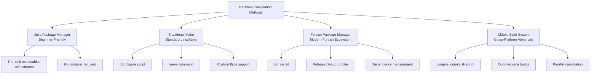
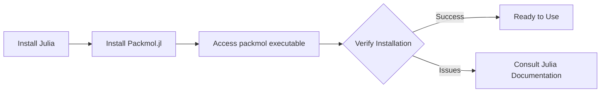
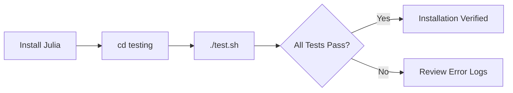

This page provides comprehensive guidance on compiling and installing Packmol across different platforms and build systems. Packmol is a Fortran-based molecular simulation package that offers multiple compilation approaches to suit various development environments and expertise levels. Whether you're a beginner seeking pre-built executables or an advanced user requiring custom build configurations, this guide covers all available installation methods from simplest to most advanced.

Sources: [README.md](/README.md#L1-L86), [CMakeLists.txt](/CMakeLists.txt#L1-L61)

## Build System Architecture Overview

Packmol supports four distinct compilation approaches, each designed for different use cases and technical requirements. Understanding the relationships between these systems helps you choose the most appropriate method for your needs.



The architecture demonstrates a clear progression from easiest to most complex methods. Each approach produces the same executable (`packmol`) but offers different levels of control over compilation parameters, optimization settings, and integration with development workflows.

Sources: [Makefile](/Makefile#L1-L50), [CMakeLists.txt](/CMakeLists.txt#L1-L20), [fpm.toml](/fpm.toml#L1-L20)

## Method 1: Julia Package Manager (Recommended for Beginners)

The Julia package approach provides the simplest installation path for users unfamiliar with compiling Fortran code. The Packmol.jl wrapper package distributes pre-built executables for all major platforms, eliminating the need for compiler installation or manual compilation steps.


**Advantages:**
- Zero compiler setup required
- Automatic binary downloads for your platform
- Simple package management through Julia's ecosystem
- Regular updates maintained by the Packmol team

**Installation Steps:**



To begin, install Julia from the official website, then use Julia's package manager to install Packmol.jl. The package automatically provides the `packmol` executable in your system path, making it immediately available from the command line. This method is ideal for researchers and students who want to focus on using Packmol rather than managing compilation environments.

Sources: [README.md](/README.md#L28-L34), [testing/install_julia.sh](/testing/install_julia.sh#L1-L9)

## Method 2: Traditional Make Build System

The traditional Make approach represents the standard compilation method for Linux and Unix systems. This method uses the `./configure` script to detect available Fortran compilers and the `make` utility to compile the source code with appropriate optimization flags.

The build system is structured around two key files: the [`configure`](/configure#L1-L54) script for compiler detection and [`Makefile`](/Makefile#L1-L216) for compilation orchestration. The configure script searches for compilers in a predefined priority order: the compiler you specify, `gfortran`, `f77`, `fort77`, `ifc`, `ifort`, and `ifx`.

**Standard Compilation Procedure:**


The Makefile defines three distinct build targets with different compilation flags suited for various development scenarios:

| Build Target | Compiler Flags | Use Case |
|-------------|---------------|----------|
| `make` (default) | `-O3 -march=native -funroll-loops` | Production-ready optimized builds |
| `make devel` | `-Wall -fcheck=bounds -g -fbacktrace -ffpe-trap=zero,overflow,underflow` | Development and debugging with comprehensive error checking |
| `make perf` | `-g -pg` | Performance profiling with gprof support |
| `make static` | `-O3 --fast-math -static` | Static linking for maximum portability |

> [!TIP]
> The default build target enables aggressive optimizations including native architecture tuning (`-march=native`) and loop unrolling, which provides maximum performance for your specific hardware. However, this reduces binary portability across different processor families.

Sources: [Makefile](/Makefile#L16-L40), [Makefile](/Makefile#L65-L85), [configure](/configure#L10-L54)

### Compiler Configuration

The configure script offers flexible compiler selection. Simply run `./configure /path/to/compiler` to specify your preferred Fortran compiler. The script automatically modifies the Makefile to use your selected compiler by updating the `FORTRAN` variable.

If no compiler is specified and no suitable compiler is found in the system path, the script provides clear error messages listing supported compilers and installation guidance.

Sources: [configure](/configure#L5-L54)

### Build Process Details

The Makefile orchestrates compilation of 39 Fortran source files organized into a specific dependency order. The build process begins with module dependencies (`exit_codes.o`, `sizes.o`, `pbc.o`, etc.) followed by algorithmic components and finally the main application (`packmol.o`).

All compilation artifacts are automatically cleaned after successful linking, leaving only the final `packmol` executable in the root directory. This keeps the source tree clean and ready for distribution or version control.

Sources: [Makefile](/Makefile#L86-L148), [Makefile](/Makefile#L150-L160)

## Method 3: Fortran Package Manager (FPM)

The Fortran Package Manager provides a modern, dependency-aware build system that integrates Packmol into the broader Fortran ecosystem. FPM handles compiler detection, dependency management, and executable installation automatically.

The project configuration in [`fpm.toml`](/fpm.toml#L1-L20) defines Packmol as an executable with the main program located in `app/packmol.f90`. FPM automatically discovers and compiles all required source files from the `src/` directory.

**Installation with FPM:**


**Basic Installation:**
```bash
fpm install --profile release
```

This command compiles Packmol with release optimizations and installs the executable to `~/.local/bin` (on Linux systems), making it available system-wide as the `packmol` command.

**Compiler Selection:**
FPM defaults to `gfortran` but respects the `FPM_FC` environment variable for custom compiler selection:
```bash
export FPM_FC=ifort  # Use Intel Fortran compiler
fpm install --profile release
```

Sources: [fpm.toml](/fpm.toml#L1-L20), [README.md](/README.md#L51-L57)

### FPM Build Profiles

FPM supports multiple build profiles similar to Make targets:

| Profile | Characteristics | Use Case |
|---------|---------------|----------|
| `release` | Full optimization, no debugging symbols | Production use |
| `debug` | No optimization, full debugging information | Development and troubleshooting |
| `test` | Test configuration | Running test suites |

The `--profile release` flag is recommended for standard usage, providing optimized binaries without the overhead of debugging information.

Sources: [README.md](/README.md#L51-L57)

## Method 4: CMake Build System

The CMake approach offers cross-platform build capabilities with support for out-of-source builds, parallel compilation, and integration with modern development environments. The [`compile_cmake.sh`](/compile_cmake.sh#L1-L27) script provides a convenient wrapper around CMake configuration.

**CMake Build Process:**


**Build Configuration:**
The script sets several important build parameters:
- **Compiler**: `gfortran` (default, customizable via `FC` environment variable)
- **Flags**: `-g -O2 -Wall` (balanced optimization and warnings)
- **Build Type**: Release mode with `DNDEBUG` macro
- **Parallel Processes**: 4 concurrent compilation jobs (`make -j4`)

The CMake configuration in [`CMakeLists.txt`](/CMakeLists.txt#L1-L61) automatically enables compiler warnings for GNU Fortran (`-Wall`) and treats warnings as errors in Debug builds. It compiles all 39 source files and installs the executable to the `bin/` directory.

Sources: [compile_cmake.sh](/compile_cmake.sh#L1-L27), [CMakeLists.txt](/CMakeLists.txt#L1-L30)

### Custom CMake Builds

For advanced usage, you can manually invoke CMake with custom parameters:

```bash
mkdir objdir
cd objdir
cmake .. \
      -DCMAKE_INSTALL_PREFIX=/custom/path \
      -DCMAKE_BUILD_TYPE=Release \
      -DCMAKE_Fortran_COMPILER=ifort
make -j8 install
```

This approach allows fine-grained control over installation directories, compiler selection, and build type without modifying any project files.

Sources: [compile_cmake.sh](/compile_cmake.sh#L19-L27), [CMakeLists.txt](/CMakeLists.txt#L1-L61)

## Build System Comparison

Each compilation method offers distinct advantages suited to different scenarios. The following comparison helps you choose the optimal approach for your specific requirements.

| Feature | Julia Package | Make | FPM | CMake |
|---------|--------------|------|-----|-------|
| **Ease of Use** | ★★★★★ (Simplest) | ★★★☆☆ (Standard) | ★★★★☆ (Modern) | ★★★☆☆ (Advanced) |
| **Compiler Required** | No | Yes | Yes | Yes |
| **Custom Flags** | Limited | Full control | Moderate | Full control |
| **Cross-Platform** | Excellent | Good | Very Good | Excellent |
| **Dependency Management** | Automatic | Manual | Automatic | Manual |
| **Parallel Builds** | N/A | Manual | Automatic | Automatic |
| **Static Linking** | N/A | Supported | Limited | Supported |
| **Integration** | Julia ecosystem | Traditional | Fortran ecosystem | General IDE support |

> [!TIP]
> For most users, the Julia package method provides the quickest path to a working installation. However, if you need to modify Packmol's source code or integrate it into custom workflows, the Make or CMake methods offer greater flexibility and control over the build process.

Sources: [README.md](/README.md#L28-L57), [Makefile](/Makefile#L1-L50), [fpm.toml](/fpm.toml#L1-L20), [compile_cmake.sh](/compile_cmake.sh#L1-L27)

## Post-Installation Verification

After successful compilation, verify your installation by running Packmol's test suite. The testing framework uses Julia to execute comprehensive validation across various molecular packing scenarios.

**Test Execution:**



The test script executes 18 test cases covering:
- Basic water box construction
- Periodic boundary conditions
- Mixed molecule systems
- Spherical and bilayer geometries
- Protein solvation
- Error handling scenarios
- CLI functionality
- Connectivity analysis

All test cases must pass successfully to confirm a proper build. Any failures indicate potential compilation issues or runtime environment problems that require investigation.

Sources: [testing/test.sh](/testing/test.sh#L1-L35)

## Troubleshooting Common Build Issues

**Compiler Not Found:**
If the `./configure` script fails to locate a Fortran compiler, install one of the supported compilers:
- **GNU Fortran (gfortran)**: Included with most Linux distributions
- **Intel Fortran (ifort/ifx)**: Available from Intel oneAPI toolkit
- **Other compilers**: `f77`, `fort77`, `ifc` may work but are less tested

**Compilation Errors:**
For development builds with `make devel`, compilation errors often indicate bounds checking violations or floating-point exceptions. Review the specific error messages and check corresponding source files for issues.

**Runtime Issues:**
If Packmol executes but produces unexpected results, try rebuilding with debug flags to enable additional runtime checks and error reporting.

**Platform-Specific Notes:**
- **macOS**: May require Xcode command line tools for Fortran compiler support
- **Windows**: Consider using Windows Subsystem for Linux (WSL) or MinGW for Make-based builds
- **HPC Systems**: Use module loading systems to access optimized Fortran compilers before compilation

Sources: [configure](/configure#L35-L54), [Makefile](/Makefile#L20-L40)

## Installation Summary

Successfully compiling and installing Packmol requires selecting the appropriate build method for your expertise level and requirements. From the beginner-friendly Julia package to the advanced CMake system, each approach provides a valid path to a functional installation.

After completing installation, proceed to [Input File Syntax and Structure](3-input-file-syntax-and-structure) to learn how to configure Packmol for your molecular simulation projects. For understanding how Packmol processes these configurations, explore [Main Program Execution Flow in packmol.f90](21-main-program-execution-flow-in-packmol-f90).
