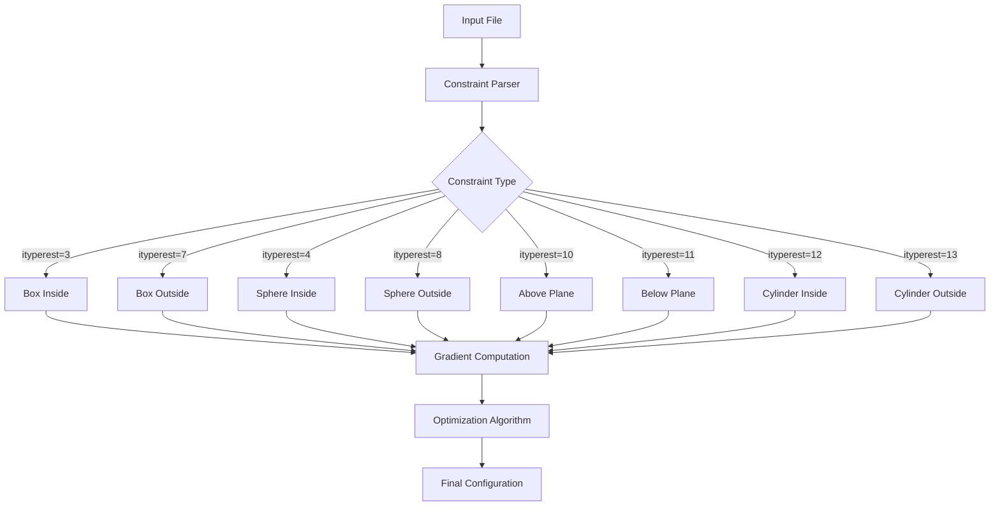

Spatial constraints form the foundation of Packmol's packing capabilities, allowing you to precisely define where molecules can be placed in 3D space. These constraints work together with the global tolerance parameter to create initial configurations for molecular dynamics simulations. Understanding these four fundamental constraint types—Box, Sphere, Plane, and Cylinder—will enable you to build complex molecular systems with confidence.

Sources: [getinp.f90](src/getinp.f90#L550-L750), [gwalls.f90](src/gwalls.f90#L1-L200)

## Constraint System Architecture

Packmol uses a unified constraint enforcement system where each spatial constraint type is assigned a numeric identifier and processed through the same gradient-based optimization pipeline. The optimizer evaluates constraints by computing penalty functions that drive molecules toward valid regions of space while maintaining minimum separation distances.



Sources: [getinp.f90](src/getinp.f90#L554-L650), [restmol.f90](src/restmol.f90#L1-L71)

## Box Constraints

Box constraints define rectangular regions in 3D space using two opposite corners. The syntax requires six coordinates representing the minimum and maximum boundaries along each axis.

**Syntax**:
```
inside box <xmin> <ymin> <zmin> <xmax> <ymax> <zmax>
outside box <xmin> <ymin> <zmin> <xmax> <ymax> <zmax>
```

**Parameters**:
- `xmin, ymin, zmin`: Coordinates of the box corner with minimum values
- `xmax, ymax, zmax`: Coordinates of the box corner with maximum values

The box constraint implementation uses piecewise quadratic penalty functions that activate when atoms cross the boundary. For "inside" constraints, penalties apply when atoms fall outside the defined region. For "outside" constraints, the inverse logic applies with the optimizer driving atoms away from the interior.
Sources: [gwalls.f90](src/gwalls.f90#L29-L48)

**Example - Simple Water Box**:
```
tolerance 2.0
filetype pdb
output water_box.pdb

structure ./water.pdb
  number 1000
  inside box -20. -20. -20. 20. 20. 20.
end structure
```

This configuration packs 1000 water molecules into a cubic region centered at the origin with dimensions 40 Å × 40 Å × 40 Å. The tolerance value ensures a minimum 2.0 Å separation between all atoms.
Sources: [testing/input_files/water_box.inp](testing/input_files/water_box.inp#L1-L15)


## Sphere Constraints

Sphere constraints define spherical regions using a center point and radius. These are particularly useful for creating vesicles, micelles, or spherical protein solvation shells.

**Syntax**:
```
inside sphere <xcenter> <ycenter> <zcenter> <radius>
outside sphere <xcenter> <ycenter> <zcenter> <radius>
```

**Parameters**:
- `xcenter, ycenter, zcenter`: Coordinates of the sphere center
- `radius`: Distance from center to sphere surface

The sphere constraint computes the squared distance from each atom to the sphere center. The penalty function uses a quartic form `d² × (distance² - radius²)`, providing smooth gradients that guide atoms toward valid regions.
Sources: [gwalls.f90](src/gwalls.f90#L49-L58)

**Example - Vesicle Construction**:
```
tolerance 2.0

structure ./palmitoil.pdb
  resnumbers 2
  number 20
  atoms 37
    inside sphere 0. 0. 0. 14.
  end atoms
  atoms 5
    outside sphere 0. 0. 0. 26.
  end atoms
end structure

structure ./water.pdb
  resnumbers 2
  number 50
  inside sphere 0. 0. 0. 13.
end structure

output vesicle.pdb
```

This example builds a double-layered vesicle where lipid headgroups are constrained between radii of 14 Å and 26 Å, while water fills the interior up to 13 Å. The selective application of constraints to specific atoms demonstrates Packmol's molecular-level control.
Sources: [testing/input_files/spherical.inp](testing/input_files/spherical.inp#L1-L43)

**Sphere Constraint Applications**:

| Application | Typical Radius Range | Use Case |
|------------|---------------------|----------|
| Protein Solvation | 5-15 Å from protein surface | First hydration shell |
| Vesicle Interior | 10-30 Å | Water-filled compartments |
| Micelle Core | 5-15 Å | Hydrophobic regions |
| Nanoparticle Coating | 2-10 Å | Surface functionalization |

Sources: [testing/input_files/spherical.inp](testing/input_files/spherical.inp#L1-L43)

## Plane Constraints

Plane constraints define half-spaces bounded by infinite planes. The plane equation is defined as `ax + by + cz - d = 0`, where the normal vector (a, b, c) determines the plane orientation and d determines its offset from the origin.

**Syntax**:
```
above plane <a> <b> <c> <d>
below plane <a> <b> <c> <d>
```

**Parameters**:
- `a, b, c`: Components of the plane's normal vector
- `d`: Offset parameter defining plane position

The normal vector (a, b, c) points toward the "above" region. For a horizontal plane parallel to the xy-plane, use `plane 0 0 1 d` where d equals the z-coordinate of the plane. The constraint computes the signed distance from each atom to the plane, applying a quadratic penalty when the violation condition is met.
Sources: [gwalls.f90](src/gwalls.f90#L137-L154)

**Example - Lipid Bilayer**:
```
tolerance 2.0

structure ./palmitoil.pdb
  number 10
  inside box 0. 0. 0. 40. 40. 14.
  atoms 31 32
    below plane 0. 0. 1. 2.
  end atoms
  atoms 1 2
    above plane 0. 0. 1. 12.
  end atoms
end structure

output bilayer.pdb
```

This configuration places lipids in a rectangular region while ensuring specific atoms stay above or below horizontal planes at z = 2 Å and z = 12 Å respectively. This technique creates well-defined leaflets in membrane simulations.
Sources: [testing/input_files/bilayer.inp](testing/input_files/bilayer.inp#L1-L41)

**Common Plane Configurations**:

| Plane Type | Normal Vector | Description |
|------------|--------------|-------------|
| Horizontal (z-axis) | `0 0 1` | Parallel to xy-plane |
| Horizontal (y-axis) | `0 1 0` | Parallel to xz-plane |
| Horizontal (x-axis) | `1 0 0` | Parallel to yz-plane |
| Diagonal | `1 1 1` (normalized) | 45° angle to all axes |
| Arbitrary | `a b c` (normalized) | Any orientation |

> [!TIP]
> The normal vector components (a, b, c) do not need to be normalized in the input file—Packmol automatically normalizes them internally. This simplifies specifying planes with convenient integer components like `1 1 1` for diagonal planes.

Sources: [gwalls.f90](src/gwalls.f90#L137-L154), [testing/input_files/bilayer.inp](testing/input_files/bilayer.inp#L1-L41)

## Cylinder Constraints

Cylinder constraints define cylindrical regions using two points defining the cylinder axis and a radius. This is the most complex of the four constraint types but enables creation of tubular structures like ion channels, nanotubes, and fiber systems.

**Syntax**:
```
inside cylinder <x1> <y1> <z1> <x2> <y2> <z2> <radius>
outside cylinder <x1> <y1> <z1> <x2> <y2> <z2> <radius>
```

**Parameters**:
- `x1, y1, z1`: Coordinates of point 1 on the cylinder axis
- `x2, y2, z2`: Coordinates of point 2 on the cylinder axis
- `radius`: Distance from axis to cylinder surface

The cylinder axis is defined by the vector from point 1 to point 2. Packmol automatically normalizes this direction vector during input parsing. The constraint computes the perpendicular distance from each atom to the cylinder axis and applies penalties when atoms violate the radial boundary constraint.
Sources: [getinp.f90](src/getinp.f90#L603-L629)

**Implementation Details**:
The direction vector `v = (x2-x1, y2-y1, z2-z1)` is normalized to unit length: `v̂ = v/||v||`. The distance from a point P to the cylinder axis is then: `d = ||(P - P1) - ((P - P1)·v̂)v̂||`, where P1 is the first point on the axis.
Sources: [getinp.f90](src/getinp.f90#L615-L629)

**Example - Transmembrane Channel**:
```
tolerance 2.0

structure ./protein.pdb
  number 1
  fixed 0. 0. 0. 0. 0. 0.
end structure

structure ./water.pdb
  number 500
  inside cylinder 0. 0. -15. 0. 0. 15. 10.
end structure

structure ./water.pdb
  number 1000
  outside cylinder 0. 0. -15. 0. 0. 15. 10.
  inside box -30. -30. -20. 30. 30. 20.
end structure

output channel.pdb
```

This example creates a membrane protein with water both inside the transmembrane channel (radius 10 Å) and in the surrounding bulk solution. The combination of cylinder and box constraints creates a well-defined membrane patch.
Sources: [getinp.f90](src/getinp.f90#L603-L629)

**Cylinder Constraint Parameters Summary**:

| Parameter | Range | Effect |
|-----------|-------|--------|
| Axis Length | Any finite value | Longer than cylinder height is acceptable |
| Radius | Positive only | Zero radius causes error |
| Axis Points | Any distinct points | Cannot be identical (zero-length axis) |

## Combining Multiple Constraints

Packmol allows multiple constraints to be applied to the same molecule or specific atoms within a molecule. Constraints are evaluated independently and their penalties are summed, creating complex interaction regions.

**Constraint Combination Types**:

1. **Multiple constraints on same molecule**: All constraints must be satisfied simultaneously (logical AND)
2. **Constraints on specific atom groups**: Different constraints for different parts of a molecule
3. **Multiple structure blocks**: Independent constraints for different molecule types

**Example - Multi-Region Packing**:
```
tolerance 2.0

structure ./water.pdb
  number 50
  inside box 0. 0. -10. 40. 40. 0.
end structure

structure ./water.pdb
  number 50
  inside box 0. 0. 28. 40. 40. 38.
end structure

structure ./palmitoil.pdb
  number 20
  inside box 0. 0. 0. 40. 40. 28.
  atoms 31 32
    below plane 0. 0. 1. 2.
  end atoms
  atoms 1 2
    above plane 0. 0. 1. 26.
  end atoms
end structure
```

This configuration builds a lipid bilayer with water above and below the membrane, demonstrating how constraints can define separate regions that together form a complete system.
Sources: [testing/input_files/bilayer.inp](testing/input_files/bilayer.inp#L1-L41)

> [!TIP]
> When combining multiple constraints, ensure the constraint regions overlap sufficiently to allow molecule placement. If constraint regions are disjoint or too narrow relative to molecule size, the optimization may fail to converge.

## Constraint Syntax Quick Reference

| Constraint Type | Keyword | Parameters | Type Code |
|----------------|---------|------------|-----------|
| Box (inside) | `inside box` | xmin ymin zmin xmax ymax zmax | 3 |
| Box (outside) | `outside box` | xmin ymin zmin xmax ymax zmax | 7 |
| Sphere (inside) | `inside sphere` | xcenter ycenter zcenter radius | 4 |
| Sphere (outside) | `outside sphere` | xcenter ycenter zcenter radius | 8 |
| Plane (above) | `above plane` | a b c d | 10 |
| Plane (below) | `below plane` | a b c d | 11 |
| Cylinder (inside) | `inside cylinder` | x1 y1 z1 x2 y2 z2 radius | 12 |
| Cylinder (outside) | `outside cylinder` | x1 y1 z1 x2 y2 z2 radius | 13 |

Sources: [getinp.f90](src/getinp.f90#L554-L650)

## Troubleshooting Common Issues

**Issue: Molecules appear outside specified constraint regions**
- **Cause**: Tolerance parameter may be too large relative to constraint region size
- **Solution**: Reduce tolerance value or increase constraint region dimensions
- **Verification**: Check that constraint boundaries are sufficiently larger than molecule dimensions

**Issue: Optimization fails to converge with cylinder constraints**
- **Cause**: Cylinder axis points too close together or radius too small
- **Solution**: Ensure axis length is significantly larger than radius and molecule size
- **Verification**: Confirm distinct axis points: `sqrt((x2-x1)² + (y2-y1)² + (z2-z1)²) >> radius`

**Issue: Plane constraints produce unexpected orientations**
- **Cause**: Normal vector direction misunderstood
- **Solution**: Remember that "above" follows the direction of the normal vector (a, b, c)
- **Verification**: Test with a single atom to confirm which side satisfies the constraint

Sources: [getinp.f90](src/getinp.f90#L550-L750)

## Next Steps

Now that you understand the fundamental spatial constraints, you can explore more advanced configuration techniques:

- **[Molecule Definition and File Formats](6-molecule-definition-and-file-formats-pdb-xyz-tinker)**: Learn about the molecular structure files you'll reference in your constraints
- **[Advanced Input Options](7-advanced-input-options-fixed-molecules-rotational-constraints-and-center-of-mass)**: Discover how to control molecule orientation and fixation within constraints
- **[Building Simple Water Boxes](25-building-simple-water-boxes)**: Apply box constraints in practical simulation setup
- **[Creating Lipid Bilayers](26-creating-lipid-bilayers)**: Master the art of combining plane and box constraints for membrane systems
