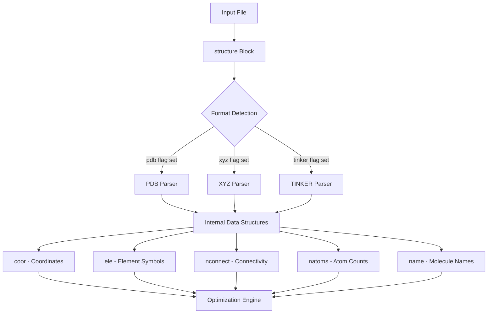

This page explains how Packmol defines molecules through external structure files and processes three primary molecular coordinate formats: PDB (Protein Data Bank), XYZ, and TINKER. Understanding these formats is essential for preparing molecular building blocks that will be arranged according to your spatial constraints.

## Architecture Overview

Packmol's molecule definition system centers on the `structure` block within input files, which references external molecular structure files. The system uses format-specific parsers to extract atomic coordinates, connectivity information, and molecular properties into a unified internal representation for optimization algorithms.



The `input` module in `src/input.f90` defines the core data structures for molecular definitions, including format flags (`pdb`, `xyz`, `tinker`), coordinate arrays (`coor`), element symbols (`ele`), connectivity matrices (`nconnect`), and molecule metadata (`name`, `pdbfile`) [input.f90#L1-L83].

## Input File Structure Syntax

The fundamental unit for molecule definition is the `structure` block, which specifies the source file and format:

```
tolerance 2.0
output system.pdb
filetype pdb

structure water.pdb
  number 100
  inside box 0. 0. 0. 20. 20. 20.
end structure

structure benzene.xyz
  number 50
  inside box 0. 0. 0. 20. 20. 20.
end structure
```

The `filetype` keyword determines which parser will process subsequent structure blocks. All molecules share the same file format within a single input file - you cannot mix PDB, XYZ, and TINKER formats in one execution. The `structure` keyword is followed by the filename, then the block contains placement constraints and ends with `end structure` [getinp.f90#L208-L218].

## PDB Format Support

Packmol implements comprehensive PDB file support following the standard format specification from the RCSB Protein Data Bank. The PDB parser extracts both structural data and connectivity information.

### PDB Record Parsing

The parser reads `ATOM` and `HETATM` records, extracting coordinates from fixed column positions:

```
ATOM      1  N   MET A   1      12.345  23.456  34.567  1.00  0.00
HETATM    2  CA  ALA B   2      45.678  56.789  67.890  1.00  0.00
```

Key column specifications used by Packmol:
- **Coordinates**: Columns 31-38 (X), 39-46 (Y), 47-54 (Z) [getinp.f90#L257-L259]
- **Residue number**: Columns 23-26 [getinp.f90#L268-L272]
- **Atom index**: Columns 7-11 (used for connectivity adjustment) [getinp.f90#L253]

The parser reads these values using fixed-format Fortran I/O: `read(record,"( t31,f8.3,t39,f8.3,t47,f8.3 )",iostat=ioerr) (coor(idatom,k),k=1,3)` [getinp.f90#L257-L259]. If parsing fails, Packmol provides detailed error messages directing users to the standard specification at www.rcsb.org/pdb [getinp.f90#L260-L267].

> [!TIP]
> **Critical**: Packmol strictly enforces standard PDB column positions. Non-standard formats or variations in column placement will cause parsing errors. Always validate your PDB files against the RCSB specification before use.

### Connectivity in PDB Files

Packmol optionally reads `CONECT` records to establish bonding relationships between atoms:

```
CONECT    1    2    3
CONECT    2    1    4    5
```

The connectivity parser adjusts atom indices relative to the first atom of the structure using: `iatom = iatom - idfirstatom + 1` [getinp.f90#L315-L318]. This ensures connectivity indices are internally consistent even when molecules are placed at different positions. Connectivity information is stored in the `nconnect` matrix with up to 9 connections per atom [getinp.f90#L310-L345].

### PDB-Specific Options

When using PDB format, Packmol offers additional structure-level options:

| Option | Purpose | Default |
|--------|---------|---------|
| `changechains` | Assign different chain identifiers to molecules | `.false.` |
| `resnumbers` | Control residue numbering strategy (0=input file, 1=incremental) | Auto-detected |
| `connect` | Read/write connectivity information (no/value) | `.true.` |
| `chain` | Set specific chain identifier for this structure type | Auto-assigned |
| `segid` | Set segment identifier for CRD output compatibility | Empty |

These options are processed for PDB files only, as shown in lines 800-856 of `getinp.f90` [getinp.f90#L800-L856]. The system automatically detects whether a structure contains single or multiple residues to set appropriate default residue numbering behavior [getinp.f90#L1061-L1098].

## XYZ Format Support

The XYZ format provides a simple, human-readable molecular structure format commonly used in computational chemistry.

### XYZ File Structure

XYZ files follow a standardized three-part structure:

```
12                                          <- Number of atoms
Benzene molecule                            <- Comment/title line
C     0.000000    1.396800    0.000000
C     1.208500    0.698400    0.000000
C     1.208500   -0.698400    0.000000
... (remaining atoms)
```

### XYZ Parsing Algorithm

The XYZ parser implements a straightforward three-step reading process:

1. **Atom count**: First line contains integer `natoms` [getinp.f90#L453]
2. **Molecule name**: Second line stored as `name(itype)` [getinp.f90#L454-L455]
3. **Atom records**: Each remaining line contains element symbol and three coordinates [getinp.f90#L460-L464]

The atom record parsing uses: `read(record,*) ele(idatom), (coor(idatom,k),k=1,3)` where `ele` stores the element symbol and `coor` stores the coordinate triplet [getinp.f90#L464]. All atoms are assigned unit mass (`amass(idatom) = 1.d0`) by default in XYZ format [getinp.f90#L465].

> [!TIP]
> **Important**: XYZ format does not natively support connectivity information. For molecular systems requiring bond definitions (like ring structures with intramolecular constraints), use PDB or TINKER formats instead.

## TINKER Format Support

TINKER format offers the most complete molecular representation with integrated connectivity information, making it ideal for complex molecular systems.

### TINKER File Structure

TINKER files begin with a header line containing atom count and molecule name, followed by atom-specific records:

```
12  Benzene
    1  C      0.000000    1.396800    0.000000    2    3    6    0
    2  C      1.208500    0.698400    0.000000    1    4    5    0
    3  C      1.208500   -0.698400    0.000000    2    5    8    0
... (remaining atoms)
```

Each atom record contains:
- Atom index (field 1)
- Element symbol (field 2)
- X, Y, Z coordinates (fields 3-5)
- Variable number of connectivity indices (fields 6+)

### TINKER Parsing Algorithm

The TINKER parser handles variable-length connectivity information through a two-pass approach:

1. **First pass (setcon subroutine)**: Scans each line to count space-separated fields, subtracting 5 (index, element, 3 coordinates) to determine connectivity count: `maxcon(idatom) = ic - 5` [getinp.f90#L1038-L1056]

2. **Second pass (main parser)**: Reads the complete atom record, extracting all fields including connectivity: `read(record(i:strl),*) (coor(idatom,k), k = 1, 3), (nconnect(idatom, k), k = 1, maxcon(idatom))` [getinp.f90#L433-L434]

This design allows TINKER files to accommodate atoms with varying numbers of bonds (e.g., hydrogen vs. carbon) without requiring fixed-width records.

## Format Comparison and Selection

Different molecular formats serve different use cases based on information content and file size:

| Feature | PDB | XYZ | TINKER |
|---------|-----|-----|--------|
| **Coordinates** | Yes (fixed columns) | Yes (free format) | Yes (free format) |
| **Element info** | Yes (columns 13-16) | Yes (first field) | Yes (second field) |
| **Connectivity** | Via CONECT records | Not supported | Integrated |
| **Residue info** | Yes | No | No |
| **Chain/segment** | Yes | No | No |
| **Human readability** | Medium | High | Medium |
| **File size** | Large | Smallest | Medium |
| **Best for** | Biomolecules, proteins | Small molecules | Complex molecules with bonds |

Choose PDB format when working with biomolecular systems where residue numbering and chain identifiers matter. Select XYZ format for simple small molecules where file compactness is prioritized. Use TINKER format when you need integrated connectivity information for complex organic molecules or when working with molecular mechanics force fields.

## Data Storage and Indexing

After parsing, Packmol stores all molecular data in unified arrays optimized for fast access during optimization:

- **Coordinate storage**: `coor(idatom, 1:3)` stores X, Y, Z coordinates for all atoms across all structure types [input.f90#L42]
- **Element symbols**: `ele(ntotat)` stores 3-character element identifiers [input.f90#L76]
- **Atom indexing**: `idfirst(itype)` tracks the starting atom index for each structure type, enabling type-specific operations [getinp.f90#L224-L227]
- **Connectivity matrix**: `nconnect(ntotat, 9)` stores up to 9 connections per atom with `maxcon(ntotat)` tracking actual connection counts [input.f90#L26-L27]
- **Structure metadata**: `name(ntype)` stores molecule names extracted from file headers or PDB records [input.f90#L73]

The system calculates global atom indices by accumulating counts from previous structure types: `idfirst(itype) = idfirst(itype) + natoms(ii)` [getinp.f90#L224-L227]. This indexing scheme allows efficient coordinate lookup during distance calculations and overlap detection.

## Error Handling and Validation

Packmol implements comprehensive validation during molecule definition parsing:

- **File access**: The `failopen` subroutine provides detailed error messages when structure files cannot be found, checking both current directory and specified paths [getinp.f90#L1000-L1012]
- **Format validation**: Each parser validates expected fields and provides context-specific error messages indicating which field failed parsing [getinp.f90#L260-L272]
- **Residue number validation**: PDB parser checks that residue numbers are readable integers within columns 23-26, which is critical for output file generation [getinp.f90#L268-L284]
- **Chain identifier conflicts**: Validates that `changechains` and specific `chain` settings are mutually exclusive [getinp.f90#L838-L843]

The `setrnum` subroutine performs automatic detection of single vs. multi-residue structures by scanning PDB files and checking residue number consistency [getinp.f90#L1059-L1098]. This automation reduces user configuration burden while maintaining flexibility for manual override.

## Best Practices for Molecular Structure Files

For optimal Packmol performance and reliability:

1. **Use consistent atom ordering**: Maintain consistent atom ordering within structure files to ensure reproducible results
2. **Validate coordinates**: Ensure coordinates are physically reasonable (no extreme values, proper bond lengths) before packing
3. **Check connectivity**: Verify that connectivity records (CONECT in PDB, integrated in TINKER) match expected molecular topology
4. **Standardize formats**: Use RCSB-validated PDB files or ensure PDB column specifications are strictly followed
5. **Clean headers**: Remove non-standard records that might confuse parsers
6. **Test individual molecules**: Validate structure files independently before incorporating into complex packing scenarios

Sources: [input.f90](src/input.f90#L1-L83), [getinp.f90](src/getinp.f90#L208-L498), [getinp.f90](src/getinp.f90#L800-L1098)

## Next Steps

Now that you understand molecular file formats, explore:

- **[Spatial Constraints Syntax (Box, Sphere, Plane, Cylinder)](5-spatial-constraints-syntax-box-sphere-plane-cylinder)** - Learn how to position molecules within geometric regions
- **[Advanced Input Options: Fixed Molecules, Rotational Constraints, and Center of Mass](7-advanced-input-options-fixed-molecules-rotational-constraints-and-center-of-mass)** - Control molecular orientation and placement precision
- **[Building Simple Water Boxes](25-building-simple-water-boxes)** - Practical tutorial applying these concepts to construct solvent systems