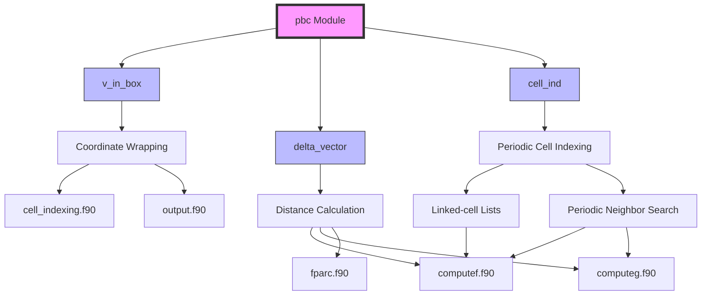

The Periodic Boundary Conditions (PBC) module in packmol provides essential functionality for simulating bulk materials, interfaces, and periodic systems by applying mathematical boundary constraints that mimic infinite crystal lattices. This documentation examines the architectural design, implementation details, and advanced configuration options for working with PBC in packmol, targeting developers who need to understand the underlying mechanisms or extend the system's capabilities.

## PBC Architecture Overview

The PBC implementation follows a modular design that integrates with the optimization workflow at multiple critical points. The core module ([`pbc.f90`](src/pbc.f90#L1-L33)) provides three elemental functions that handle coordinate wrapping, distance computation, and cell indexing with periodic boundaries. These functions are invoked throughout the optimization pipeline in [`computef.f90`](src/computef.f90#L1-L155), [`computeg.f90`](src/computeg.f90#L1-L246), and [`cell_indexing.f90`](src/cell_indexing.f90#L1-L64), creating a comprehensive periodic boundary system that maintains computational efficiency through the linked-cell algorithm.

The module exports global state variables including `using_pbc` (logical flag), `pbc_min` and `pbc_max` (3D vectors defining box boundaries), and `pbc_length` (box dimensions). These variables are initialized during input parsing in [`getinp.f90`](src/getinp.f90#L139-L168) and remain accessible throughout the optimization process. The architecture separates coordinate transformation concerns from optimization logic, enabling clean integration with both the GENCAN optimizer and the linked-cell neighbor search algorithm.

## PBC Configuration Syntax

The PBC directive in packmol input files accepts multiple syntax formats to accommodate different simulation scenarios. The basic syntax requires either three or six real-valued parameters defining the periodic box geometry. Input parsing occurs in [`getinp.f90`](src/getinp.f90#L139-L168) with comprehensive validation including positive length checks and coordinate ordering verification.

**Table: PBC Input Syntax Variants**

| Syntax Format | Parameters | Interpretation | Example | Use Case |
|---------------|------------|----------------|---------|----------|
| 3-parameter | `Lx Ly Lz` | Box from (0,0,0) to (Lx,Ly,Lz) | `pbc 40. 40. 40.` | Standard cubic/rectangular boxes centered at origin |
| 6-parameter | `xmin ymin zmin xmax ymax zmax` | Box defined by minimum and maximum coordinates | `pbc -20 -20 -20 20 20 20` | Arbitrary box placement in space |
| 7-parameter | `Lx Ly Lz none` | Explicit 3-parameter form | `pbc 40. 40. 40. none` | Future-proof specification requiring explicit box origin |

The 6-parameter format provides maximum flexibility for positioning periodic boxes anywhere in coordinate space, as demonstrated in [`mixture_pbc.inp`](testing/input_files/mixture_pbc.inp#L1-L22) where the box spans from (-20,-20,-20) to (20,20,20). This enables precise alignment with experimental coordinate systems or combination with spatial constraints. The 3-parameter format automatically sets `pbc_min` to (0,0,0) and derives `pbc_max` from the provided dimensions, as shown in [`water_box_pbc.inp`](testing/input_files/water_box_pbc.inp#L1-L18).

## Core PBC Algorithms

The PBC module implements three fundamental mathematical operations using elemental functions that apply element-wise operations across vector arrays, enabling efficient vectorized computation of periodic boundary conditions.

**Coordinate Wrapping (`v_in_box`)**: This function maps any coordinate into the primary periodic cell using the mathematical formulation `v_wrapped = pbc_min + modulo((v - pbc_min), pbc_length)`. The modulo operation ensures periodic repetition, effectively creating an infinite tiling of the simulation box. The function is called in [`cell_indexing.f90`](src/cell_indexing.f90#L12-L21) within the `setcell` subroutine to ensure all atoms are mapped into valid cell indices before spatial indexing.

**Distance Computation (`delta_vector`)**: Calculates the minimum image distance between two points in periodic systems using the nearest image convention: `Δ = v1 - v2 - pbc_length × round(Δ/pbc_length)`. This algorithm finds the shortest path through periodic boundaries, which is essential for accurate energy and force calculations. The function is extensively used in [`fparc.f90`](src/fparc.f90#L50-L52) for computing squared distances between atom pairs during overlap detection, ensuring that atoms near box boundaries interact correctly with their periodic images.

**Cell Indexing (`cell_ind`)**: Implements periodic boundary handling for cell indices in the linked-cell algorithm using the formula `cell_ind = modulo(icell - 1 + ncells, ncells) + 1`. This wraps cell indices around the grid boundaries, enabling efficient neighbor searches that account for periodic images. The function appears in both [`computef.f90`](src/computef.f90#L110-L127) and [`computeg.f90`](src/computeg.f90#L109-L125) where it defines interaction patterns between periodic neighboring cells.

## PBC Integration with Optimization Process

The PBC system integrates with packmol's optimization workflow through three critical mechanisms: coordinate transformation during cell indexing, minimum image distance calculations in the objective function, and periodic neighbor patterns in the linked-cell search algorithm.

**Cell Indexing Integration**: The [`setcell`](src/cell_indexing.f90#L11-L21) subroutine in [`cell_indexing.f90`](src/cell_indexing.f90#L1-L64) applies `v_in_box` to all coordinates before computing cell indices, ensuring atoms outside the primary cell are mapped to their periodic images before spatial partitioning. The implementation includes a safeguard condition `cell(:) = min(cell(:), ncells(:))` to handle edge cases where atoms lie exactly on the upper box boundary. This approach maintains consistent cell indexing throughout optimization regardless of temporary coordinate excursions beyond box boundaries.

**Objective Function Integration**: In [`computef.f90`](src/computef.f90#L1-L155), the PBC-aware distance calculation is delegated to the [`fparc`](src/fparc.f90#L11-L79) function which uses `delta_vector` to compute minimum image distances between atom pairs. The function computes squared distances as `datom = vdiff(1)² + vdiff(2)² + vdiff(3)²` where `vdiff` is the periodic minimum image vector. This ensures that overlap detection and penalty functions correctly account for periodic interactions, which is critical for systems with molecules near box boundaries.

**Neighbor Search Integration**: The linked-cell algorithm in [`computef.f90`](src/computef.f90#L104-L138) defines a comprehensive interaction pattern including 13 periodic neighbor configurations: the current cell, 3 forward face neighbors, 6 forward edge neighbors, and 4 forward vertex neighbors. Each neighbor cell reference uses `cell_ind` to wrap indices around periodic boundaries. For example, the face neighbor in the +x direction is accessed as `latomfirst(cell_ind(i+1, ncells(1)),j,k)` which automatically wraps `i+1` to 0 when `i == ncells(1)`. This pattern ensures complete coverage of all interatomic interactions across periodic boundaries without double-counting or missing interactions.

> [!TIP]
> The choice of 13 neighbor cells (forward only) rather than all 26 possible neighbors is an intentional optimization that avoids double-counting interactions while maintaining completeness. This pattern works because for any pair of interacting atoms, exactly one of the forward neighbors will contain the partner atom, and the linked list structure ensures each interaction is evaluated exactly once during the cell traversal.

## PBC-Specific Applications and Use Cases

The PBC configuration enables several advanced molecular building scenarios that would be impractical with finite boundary conditions. The testing suite provides representative examples demonstrating the integration of PBC with various spatial constraints.

**Bulk Systems**: The [`water_box_pbc.inp`](testing/input_files/water_box_pbc.inp#L1-L18) example creates a simple bulk water box with 1150 molecules in a 40×40×40 Å periodic cell. This configuration demonstrates the basic use case where molecules are packed within the box boundaries without additional spatial constraints. The output coordinates will be wrapped into the primary cell during output generation, producing a physically realistic bulk liquid configuration suitable for molecular dynamics simulations.

**Periodic Bilayers**: The [`bilayer_pbc.inp`](testing/input_files/bilayer_pbc.inp#L1-L40) example showcases PBC combined with planar constraints to create lipid bilayers with water layers above and below. The system uses `pbc 50.0 40.0 40.0` defining a rectangular box with extended x-dimension. Water molecules are constrained using `below plane` and `above plane` directives to position them relative to lipid head groups, while the periodic boundaries maintain continuity across the x and y directions. This demonstrates how PBC enables realistic membrane simulations with proper periodic replication.

**Vesicle Systems**: The [`spherical_pbc.inp`](testing/input_files/spherical_pbc.inp#L1-L43) example combines PBC with spherical constraints to build vesicle structures. The periodic box spans from (-47.5,-47.5,-47.5) to (47.5,47.5,47.5), creating a large spherical volume. Lipid molecules are positioned using `inside sphere` and `outside sphere` constraints to form a bilayer membrane, while water fills both interior and exterior regions. The PBC ensures that the exterior water extends infinitely, avoiding artificial boundary effects that would distort the vesicle structure.

**Complex Mixtures**: The [`mixture_pbc.inp`](testing/input_files/mixture_pbc.inp#L1-L22) example demonstrates PBC with multiple molecular types using planar partitioning. Water and urea molecules are separated using `below plane` and `over plane` constraints respectively, creating an interface in a periodic box from (-20,-20,-20) to (20,20,20). This configuration is useful for studying partitioning behavior and interfacial properties in mixed solvent systems.

**Table: PBC Configuration Patterns and Applications**

| Configuration Pattern | Box Definition | Spatial Constraints | Molecular Count | Application Area |
|---------------------|----------------|---------------------|-----------------|------------------|
| Simple bulk | `pbc 40. 40. 40.` | None | 1150 water | Homogeneous bulk liquids |
| Bilayer membrane | `pbc 50.0 40.0 40.0` | `above/below plane` | 440 molecules | Membrane simulations |
| Vesicle structure | `pbc -47.5 -47.5 -47.5 47.5 47.5 47.5` | `inside/outside sphere` | 5150 molecules | Encapsulated systems |
| Interface mixture | `pbc -20 -20 -20 20 20 20` | `above/below plane` | 800 molecules | Partitioning studies |
| Solvated protein | `pbc -25 -25 -25 45 45 45` | `centerofmass` | 2001 molecules | Biomolecular simulations |

## Implementation Considerations and Best Practices

Working with PBC in packmol requires understanding several technical considerations that affect both input configuration and output interpretation. These considerations stem from the interplay between periodic boundaries, spatial constraints, and the optimization algorithm.

**Box Boundary Handling**: The PBC implementation automatically wraps coordinates into the primary cell during output generation, but intermediate coordinates during optimization may temporarily exceed box boundaries. This is handled by the `v_in_box` function in [`cell_indexing.f90`](src/cell_indexing.f90#L12-L21) which ensures correct cell indexing regardless of coordinate excursions. Users should not be concerned if intermediate checkpoint files show coordinates outside the defined box—the final output will contain properly wrapped coordinates.

**Spatial Constraint Interaction**: When combining PBC with spatial constraints like `inside box`, the constraint region should ideally be fully contained within the periodic cell to avoid ambiguous boundary conditions. For example, [`water_box_pbc.inp`](testing/input_files/water_box_pbc.inp#L9-L10) includes a commented-out `inside box 0. 0. 0. 40. 40. 40.` constraint that exactly matches the PBC boundaries. However, [`water_box_pbc2.inp`](testing/input_files/water_box_pbc2.inp#L1-L20) demonstrates that planar constraints can be effectively used instead of box constraints for more flexible control over molecular distribution within periodic systems.

**Coordinate Systems and Output**: When using the 6-parameter PBC format with non-zero minimum coordinates (e.g., `pbc -25 -25 -25 45 45 45` in [`solvprotein_pbc.inp`](testing/input_files/solvprotein_pbc.inp#L1-L22)), the output coordinates will be relative to the absolute coordinate system, not shifted to the box origin. This maintains consistency with input coordinates and facilitates direct use in downstream simulation tools. Users should be aware that the output box origin may not be at (0,0,0) when using 6-parameter PBC specifications.

**Performance Optimization**: The linked-cell algorithm with PBC neighbor patterns provides O(N) scaling for systems with periodic boundaries. The cell size parameter `fbins` can be adjusted using the input directive to balance memory usage and performance for different system sizes. Larger systems benefit from finer cell divisions that reduce the average number of atoms per cell, while smaller systems may use coarser divisions to reduce overhead.

**Validation and Testing**: The PBC implementation is validated through multiple test cases in the repository, including [`water_box_pbc.inp`](testing/input_files/water_box_pbc.inp#L1-L18), [`water_box_pbc2.inp`](testing/input_files/water_box_pbc2.inp#L1-L20), [`bilayer_pbc.inp`](testing/input_files/bilayer_pbc.inp#L1-L40), and [`spherical_pbc.inp`](testing/input_files/spherical_pbc.inp#L1-L43). These test cases cover various molecular types, box sizes, and spatial constraint combinations to ensure robust PBC functionality across diverse application scenarios. Additionally, [`protein_outside_pbc_error.inp`](testing/input_files/protein_outside_pbc_error.inp) demonstrates error handling for invalid configurations where molecules exceed periodic boundaries.

> [!TIP]
> When building large periodic systems with many thousands of molecules, consider using the `nloop` and `precision` parameters to control the optimization process. The `nloop` parameter controls the number of packing iterations for each molecule type, while `precision` sets the convergence tolerance. For complex PBC systems, starting with lower precision and fewer loops, then restarting with tighter constraints can significantly improve convergence speed while maintaining final accuracy.

Sources: [pbc.f90](src/pbc.f90#L1-L33), [getinp.f90](src/getinp.f90#L139-L168), [computef.f90](src/computef.f90#L1-L155), [computeg.f90](src/computeg.f90#L1-L246), [cell_indexing.f90](src/cell_indexing.f90#L1-L64), [fparc.f90](src/fparc.f90#L1-L79), [water_box_pbc.inp](testing/input_files/water_box_pbc.inp#L1-L18), [bilayer_pbc.inp](testing/input_files/bilayer_pbc.inp#L1-L40), [mixture_pbc.inp](testing/input_files/mixture_pbc.inp#L1-L22), [spherical_pbc.inp](testing/input_files/spherical_pbc.inp#L1-L43), [solvprotein_pbc.inp](testing/input_files/solvprotein_pbc.inp#L1-L22)

## Next Steps

For complete understanding of molecular building with PBC, readers should continue to:
- **[Constraint Enforcement](17-distance-constraints-and-overlap-detection)**: Understand how overlap detection works with PBC and the minimum image convention
- **[Cell Indexing](14-cell-indexing-for-efficient-neighbor-search)**: Deep dive into the linked-cell algorithm that makes PBC neighbor searches efficient
- **[Practical Applications](25-building-simple-water-boxes)**: Learn detailed procedures for building specific PBC-enabled systems like water boxes and biomolecular simulations

These pages provide the complete context for leveraging PBC effectively in complex molecular building scenarios.