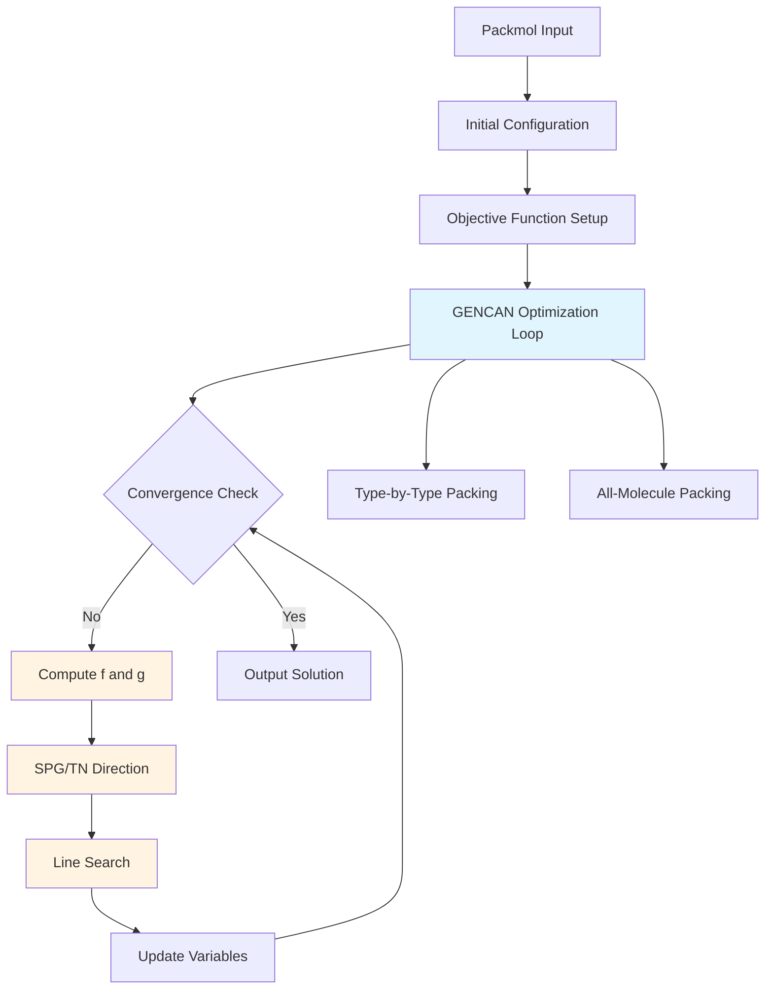
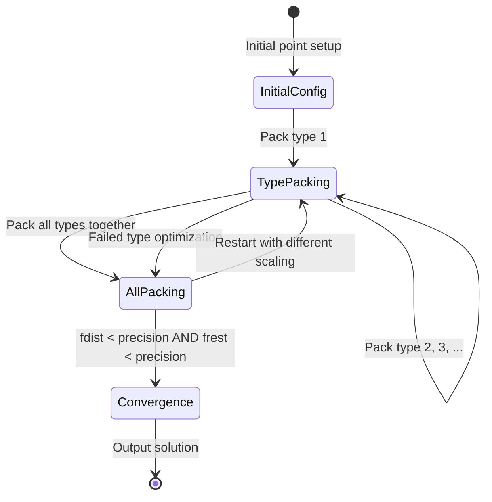

GENCAN (General Constrained Optimization Algorithm) serves as the core optimization engine in Packmol, implementing a sophisticated bound-constrained optimization approach based on the Spectral Projected Gradient (SPG) method with Truncated Newton (TN) iterations. This algorithm, developed as part of the TANGO (Trustable Algorithms for Nonlinear General Optimization) project, provides the mathematical foundation for packing molecules with minimal overlap while respecting spatial constraints.

## Algorithm Architecture and Integration

The GENCAN method operates as the mathematical optimization solver within Packmol's multi-stage architecture. The integration follows a layered design where Packmol's problem formulation (molecular positions and orientations) maps to GENCAN's bound-constrained minimization framework.



The core algorithm resides in [`src/gencan.f`](src/gencan.f) (approximately 5,992 lines of FORTRAN code), with the interface wrapper in [`src/pgencan.f90`](src/pgencan.f90) that adapts GENCAN to Packmol's specific needs. The optimization state and parameters are managed through the [`usegencan.f90`](src/usegencan.f90) module.

## Mathematical Foundation

GENCAN solves the box-constrained minimization problem:

**Minimize** f(x)  
**Subject to** l ≤ x ≤ u

where f(x) represents the objective function combining molecular overlap penalties and constraint violations. The algorithm employs two primary search directions:

1. **Spectral Projected Gradient (SPG) Direction**: Computed using the spectral steplength, providing an initial descent direction that handles bound constraints through projection. This method scales the gradient by a parameter that approximates the inverse of the Lipschitz constant, ensuring convergence.

2. **Truncated Newton (TN) Direction**: Computed via an iterative Conjugate Gradient (CG) method that approximates the Newton step without fully solving the linear system. The Truncated Newton approach is particularly effective for large-scale problems as it limits the number of CG iterations based on progress criteria.

Sources: [`src/gencan.f`](src/gencan.f#L200-L400), [`src/gencan.f`](src/gencan.f#L750-L850)

## Objective Function and Gradient Computation

The objective function evaluated by GENCAN combines two critical components: molecular overlap penalties and spatial constraint violations. Packmol computes the objective function through [`computef.f90`](src/computef.f90), which calculates both `fdist` (distance violation term) and `frest` (restriction violation term).

The function evaluation follows this structure:

```
f(x) = scale × fdist(x) + scale2 × frest(x)
```

Where:
- **fdist(x)**: Measures molecular overlap using a cell-indexing algorithm for efficient pairwise distance computation
- **frest(x)**: Evaluates violations of spatial constraints (box, sphere, cylinder, plane, etc.)
- **scale, scale2**: Penalty weighting factors (default: 1.0 and 0.01 respectively)

The gradient computation in [`computeg.f90`](src/computeg.f90) provides analytical derivatives with respect to both molecular baricenter positions (first 3×ntotmol variables) and Euler angles (last 3×ntotmol variables). This analytical gradient approach significantly accelerates convergence compared to finite-difference approximations.

Sources: [`src/computef.f90`](src/computef.f90#L1-L100), [`src/computeg.f90`](src/computeg.f90#L1-L100), [`src/initial.f90`](src/initial.f90#L45-L55)

## Key Algorithm Components

### Bound Constraint Handling

GENCAN handles bound constraints through projection onto the feasible region defined by lower bounds `l` and upper bounds `u`. In Packmol's context:

- **Position variables** (baricenter coordinates): Typically unbounded (±1.0×10²⁰) to allow molecules anywhere within the simulation box
- **Orientation variables** (Euler angles): Can be constrained using the `constrain_rotation` keyword to limit rotation about specific axes to specified angular ranges

The interface in [`pgencan.f90`](src/pgencan.f90#L15-L60) establishes these bounds before calling the optimizer.

### Line Search Strategy

GENCAN implements sophisticated line search procedures with the following features:

| Parameter | Value | Purpose |
|-----------|-------|---------|
| `gamma` (Armijo) | 1.0×10⁻⁴ | Sufficient decrease condition |
| `theta` (angle) | 1.0×10⁻⁶ | Direction cosine condition |
| `sigma1`, `sigma2` | 0.1, 0.9 | Quadratic interpolation safeguards |
| `maxextrap` | 100 | Maximum extrapolation steps |
| `mininterp` | 4 | Minimum interpolations before failure |

The line search can extrapolate when the beta condition (0.5) indicates that a larger step is promising, or interpolate when a step is too large. Non-monotone line search options are available to improve convergence on difficult landscapes.

Sources: [`src/gencan.f`](src/gencan.f#L400-L500)

### Conjugate Gradient Parameters

The Truncated Newton direction computation uses Conjugate Gradient iterations controlled by these parameters:

| Parameter | Default Value | Description |
|-----------|---------------|-------------|
| `cgmaxit` | Variable | Maximum CG iterations per TN step |
| `cgepsf` | Variable | CG stopping tolerance (function decrease) |
| `cgepsi` | Variable | CG stopping tolerance (gradient norm) |
| `cggpnf` | Variable | CG stopping tolerance (gradient norm relative to f) |
| `maxitnqmp` | 5 | Maximum iterations without quadratic model progress |
| `epsnqmp` | 1.0×10⁻⁴ | Tolerance for quadratic model progress |

These parameters balance computational cost per iteration against convergence rate, with GENCAN automatically adapting based on problem characteristics.

Sources: [`src/gencan.f`](src/gencan.f#L600-L700)

## Packmol Integration Strategy

Packmol implements a **staged optimization strategy** that leverages GENCAN's capabilities through multiple optimization loops:

1. **Type-by-Type Packing**: Each molecular type is optimized independently first, reducing the search space complexity
2. **All-Molecule Packing**: After individual types are positioned, all molecules are optimized together to resolve inter-type overlaps
3. **Radius Scaling**: Molecular interaction radii are progressively scaled during optimization to improve convergence

This strategy is implemented in the main program loop in [`app/packmol.f90`](app/packmol.f90#L750-L900):



The optimization loop control in [`app/packmol.f90`](app/packmol.f90#L800-L850) manages:
- **Multiple GENCAN iterations** (`nloop` parameter, typically 0-10)
- **Dynamic radius scaling** (`discale` parameter to adjust interaction distances)
- **Progress monitoring** through improvement percentages and violation metrics
- **Solution detection** when both `fdist` and `frest` fall below the user-specified `precision` tolerance

> [!TIP]
> The staged optimization approach dramatically improves success rates for complex systems by reducing the dimensionality of the search space at each stage. The type-by-type phase establishes a rough configuration that the all-molecule phase can refine to meet precision requirements.

Sources: [`app/packmol.f90`](app/packmol.f90#L750-L900), [`src/initial.f90`](src/initial.f90#L1-L100)

## Convergence Criteria and Termination Conditions

GENCAN supports multiple stopping criteria, with Packmol primarily using the **projected gradient sup-norm** criterion:

### Primary Termination Conditions

1. **Convergence**: When `gpsupn ≤ epsgpsn` (sup-norm of projected gradient ≤ 1.0×10⁻⁶)
2. **Packmol Precision**: When `fdist < precision AND frest < precision` (checked via [`packmolprecision()`](src/pgencan.f90#L70-L90))
3. **Maximum Iterations**: When iteration count exceeds `maxit`
4. **Maximum Function Evaluations**: When function evaluations exceed `maxfc`

### Information Return Codes

The `inform` parameter indicates termination reason:
- **inform = 0**: Converged via Euclidean projected gradient norm
- **inform = 1**: Converged via sup-norm projected gradient norm (used in Packmol)
- **inform = 7**: Maximum iterations achieved
- **Negative values**: Errors in user-provided subroutines

Sources: [`src/pgencan.f90`](src/pgencan.f90#L70-L90), [`src/gencan.f`](src/gencan.f#L300-L400)

## Performance Optimization Features

### Analytical Gradients

Packmol implements analytical gradient computation in [`computeg.f90`](src/computeg.f90), providing significant performance advantages over finite-difference approximations. The gradient computation includes:

- **Positional gradients**: Derivatives with respect to molecular baricenter coordinates
- **Rotational gradients**: Derivatives with respect to Euler angles using chain rule through rotation matrices
- **Constraint gradients**: Contributions from wall and boundary constraint violations

### Cell Indexing for Pairwise Interactions

The objective function computation in [`computef.f90`](src/computef.f90#L100-L155) uses efficient cell indexing to reduce the O(N²) complexity of pairwise distance calculations to approximately O(N). The algorithm:

1. Partitions the simulation domain into a 3D grid of cells
2. Places atoms into cells based on their positions
3. Evaluates interactions only within each cell and with neighboring cells (sharing faces, edges, or vertices)
4. Handles periodic boundary conditions through proper cell wrapping

This approach enables GENCAN to efficiently scale to systems with thousands of atoms.

> [!TIP]
> The cell indexing scheme in Packmol evaluates 26 neighbor cells for each atom (including the atom's own cell), covering all possible pairwise interactions while maintaining O(N) complexity. The algorithm carefully handles periodic boundary conditions by wrapping cell indices appropriately.

Sources: [`src/computef.f90`](src/computef.f90#L100-L155), [`src/cell_indexing.f90`](src/cell_indexing.f90) (referenced module)

## GENCAN Parameter Configuration

Packmol configures GENCAN through the `easygencan` interface with the following key parameters:

### Essential User-Configurable Parameters

| Parameter | Location | Default | Description |
|-----------|----------|---------|-------------|
| `maxit` | Input file | 1000 | Maximum GENCAN iterations |
| `precision` | Input file | 0.1 | Target precision for convergence |
| `iprint1`, `iprint2` | [`usegencan.f90`](src/usegencan.f90#L11-L12) | 0, 0 | Output verbosity levels |
| `epsgpsn` | [`pgencan.f90`](src/pgencan.f90#L63) | 1.0×10⁻⁶ | Projected gradient tolerance |
| `delmin` | [`pgencan.f90`](src/pgencan.f90#L66) | 2.0 | Minimum trust-region radius |
| `ncomp` | [`pgencan.f90`](src/pgencan.f90#L65) | 50 | Number of components to display |

### Working Memory Allocation

GENCAN requires working arrays allocated through [`usegencan.f90`](src/usegencan.f90):

```fortran
integer, allocatable :: wi(:)      ! Integer workspace: (nn)
double precision, allocatable :: l(:), u(:), g(:)  ! Bounds and gradient: (nn)
double precision, allocatable :: wd(:)             ! Double workspace: (8*nn)
```

The memory requirement is approximately 10×n double-precision values, where n is the number of optimization variables (typically 6×ntotmol for 3D positions + 3 Euler angles per molecule).

Sources: [`src/usegencan.f90`](src/usegencan.f90), [`src/pgencan.f90`](src/pgencan.f90#L60-L70)

## Implementation Notes and Limitations

### Hessian-Vector Product Approximation

GENCAN supports exact Hessian-vector products through the `evalhd` subroutine. However, Packmol's implementation sets `htvtype = 1`, which enables GENCAN's internal finite-difference approximation:

```fortran
! In gencan.f, line 520:
htvtype = 1  ! Use incremental quotient approximation
```

This avoids the complexity of implementing second derivatives while maintaining convergence properties. The incremental quotient approximation is sufficiently accurate for the Truncated Newton iterations.

### Active Set Strategy

GENCAN uses a sophisticated active-set strategy to handle bound constraints efficiently. The algorithm:

1. Identifies variables likely at their bounds (the active set)
2. Works primarily with free variables during optimization
3. Tests periodically whether active variables should become free
4. Uses the `eta` parameter (0.9) to control the active-set abandonment threshold

This strategy reduces the effective problem dimension as optimization progresses, improving computational efficiency.

Sources: [`src/gencan.f`](src/gencan.f#L500-L600), [`src/gencan.f`](src/gencan.f#L520)

## Summary and Next Steps

The GENCAN optimization method provides Packmol with a mathematically robust foundation for molecular packing problems. Its combination of Spectral Projected Gradient and Truncated Newton methods, sophisticated line search procedures, and efficient active-set handling enables convergence on complex systems that would be intractable with simpler approaches.

The key strengths of GENCAN in Packmol's context include:
- **Scalability**: Efficient handling of large systems through cell indexing and gradient-based optimization
- **Robustness**: Multiple convergence criteria and non-monotone line search improve reliability
- **Flexibility**: Support for bound constraints on both positions and orientations
- **Efficiency**: Analytical gradients and active-set strategies minimize computational overhead

To deepen your understanding of Packmol's optimization system, explore these related documentation pages:

- **[Objective Function Design in computef.f90](10-objective-function-design-in-computef-f90)** - Detailed analysis of how the overlap and constraint penalties are computed
- **[Gradient Computation in computeg.f90](11-gradient-computation-in-computeg-f90)** - Mathematical derivation and implementation of analytical gradients
- **[Convergence Criteria and Precision Parameters](12-convergence-criteria-and-precision-parameters)** - Practical guidance on tuning optimization parameters for specific applications

For practical applications using GENCAN's optimization capabilities, see:
- **[Building Simple Water Boxes](25-building-simple-water-boxes)** - Step-by-step tutorial on basic packing
- **[Solvating Proteins with Ions](27-solvating-proteins-with-ions)** - Complex system optimization strategies
- **[Creating Lipid Bilayers](26-creating-lipid-bilayers)** - Handling constrained geometries
