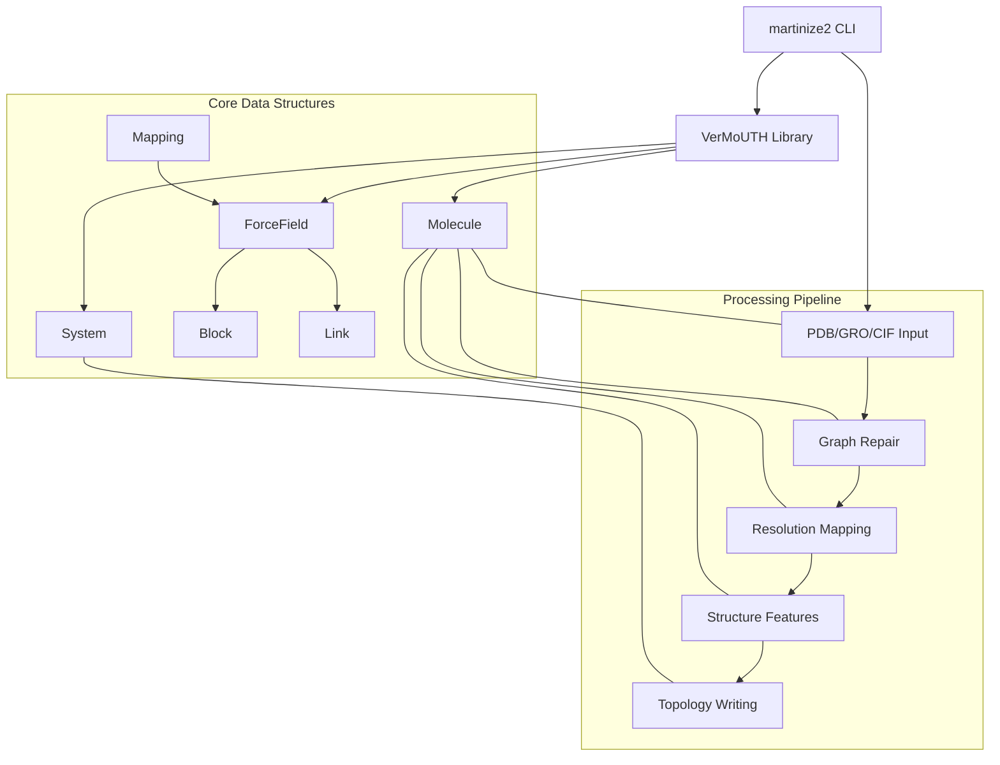
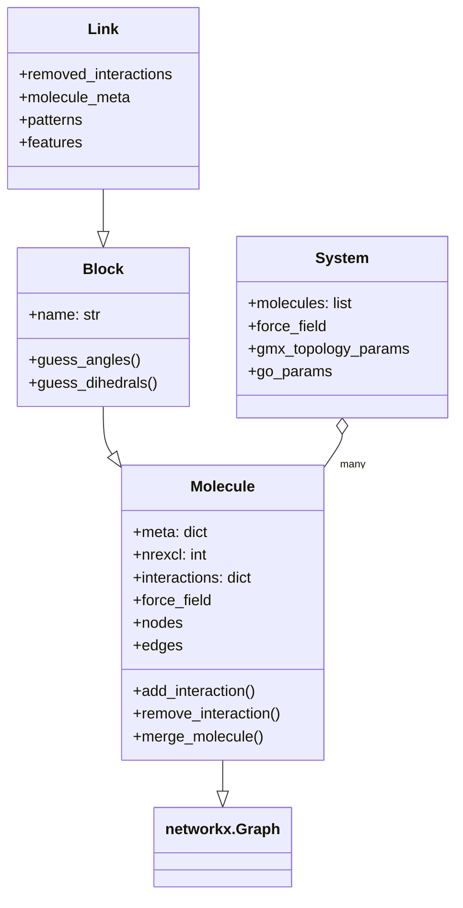
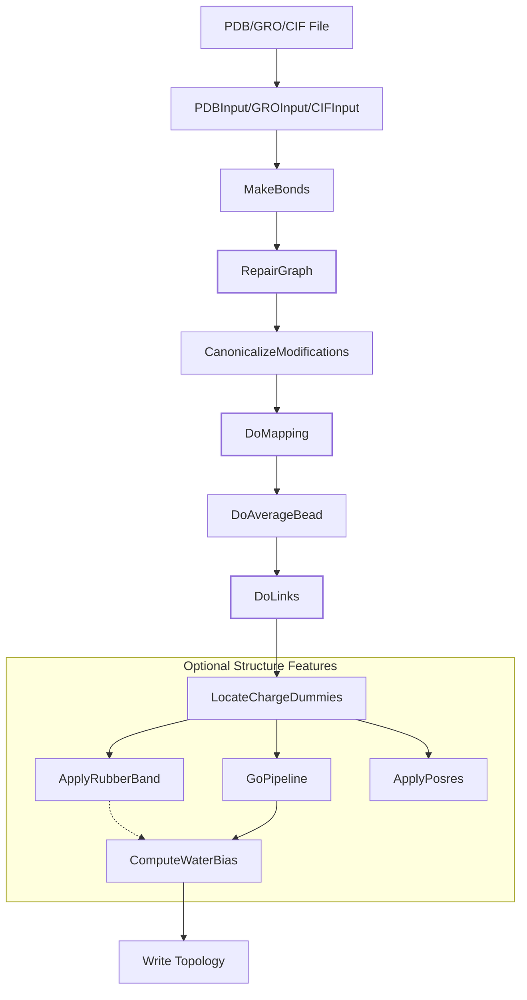
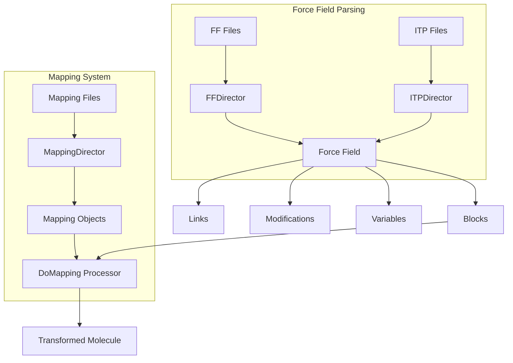

# Overview

<details>
<summary>Relevant source files</summary>

The following files were used as context for generating this wiki page:

- [.zenodo.json](.zenodo.json)
- [README.md](README.md)
- [bin/martinize2](bin/martinize2)
- [doc/source/data.rst](doc/source/data.rst)
- [doc/source/file_formats.rst](doc/source/file_formats.rst)
- [doc/source/general_overview.rst](doc/source/general_overview.rst)
- [doc/source/graph_algorithms.rst](doc/source/graph_algorithms.rst)
- [doc/source/martinize2_workflow.rst](doc/source/martinize2_workflow.rst)
- [doc/source/processors.rst](doc/source/processors.rst)
- [doc/source/technical_background.rst](doc/source/technical_background.rst)
- [setup.cfg](setup.cfg)
- [setup.py](setup.py)
- [vermouth/dssp/dssp.py](vermouth/dssp/dssp.py)
- [vermouth/log_helpers.py](vermouth/log_helpers.py)
- [vermouth/processors/__init__.py](vermouth/processors/__init__.py)
- [vermouth/processors/annotate_idrs.py](vermouth/processors/annotate_idrs.py)
- [vermouth/tests/__init__.py](vermouth/tests/__init__.py)
- [vermouth/tests/test_annotate_idrs.py](vermouth/tests/test_annotate_idrs.py)
- [vermouth/tests/test_dssp.py](vermouth/tests/test_dssp.py)
- [vermouth/tests/test_logging.py](vermouth/tests/test_logging.py)
- [vermouth/tests/test_selectors.py](vermouth/tests/test_selectors.py)
- [vermouth/tests/test_version.py](vermouth/tests/test_version.py)

</details>


VerMoUTH (VERsatile, MOdular, and Universal Transformation Helper) and martinize2 form a powerful toolkit for transforming molecular structures, with a particular focus on converting atomistic models to coarse-grained representations for molecular dynamics simulations. This document introduces the system's purpose, architecture, and key components.

Sources: [README.md:9-19](), [bin/martinize2:17-19]()

## Purpose and Scope

Vermouth is a Python library that powers molecular structure transformations using graph-based algorithms. It allows for the description and application of transformations on molecular structures and topologies by representing molecules as graphs where atoms are nodes and bonds are edges.

Martinize2 is a command-line tool built on top of vermouth, providing a user-friendly interface for coarse-graining atomistic structures. While primarily developed for the Martini coarse-grained force field and the Gromacs simulation engine, the architecture allows for supporting a broader range of force fields and simulation engines.

This overview introduces the fundamental architecture, core components, and processing workflow of vermouth and martinize2. For installation guidance, see [Installation and Quick Start](#1.1), and for CLI details, see [Command-Line Interface](#1.3).

Sources: [README.md:15-19](), [bin/martinize2:17-19](), [README.md:9-14]()

## System Architecture

### Component Overview



The architecture consists of:
1. **Core Data Structures**: Molecule, Block, Link, ForceField, System, and Mapping
2. **Processing Pipeline**: A series of processors that transform molecular structures
3. **Command-Line Interface**: martinize2, which exposes vermouth's functionality to users

Sources: [vermouth/processors/__init__.py:17-48](), [doc/source/data.rst:1-116](), [doc/source/processors.rst:1-19]()

### Core Data Structures



- **Molecule**: Extends NetworkX's Graph to represent molecules as graphs with atoms as nodes and bonds as edges. Stores interactions, metadata, and force field information.
- **Block**: Extends Molecule to represent residue templates with defined atoms and interactions.
- **Link**: Extends Block to represent connections and modifications between residues.
- **System**: Contains multiple molecules and system-wide parameters.

Sources: [doc/source/data.rst:9-52]()

## Processing Pipeline

The martinize2 workflow consists of a series of processors, each performing a specific transformation on molecular structures:



Key stages in the pipeline:

1. **Input Reading**: Parse structures from PDB, GRO, or CIF files using `PDBInput`, `GROInput`, or `CIFInput`.
2. **Graph Repair**: Add bonds with `MakeBonds`, identify and correct missing atoms with `RepairGraph`, and process modifications with `CanonicalizeModifications`.
3. **Resolution Mapping**: Transform molecular structures using `DoMapping` and average coordinates with `DoAverageBead`.
4. **Apply Links**: Generate interactions between residues using `DoLinks`.
5. **Structural Features**: Add optional features like elastic networks, Gō models, or water bias.
6. **Output Writing**: Generate topology and structure files for simulation.

Sources: [bin/martinize2:81-192](), [bin/martinize2:132-167](), [bin/martinize2:170-192](), [vermouth/processors/__init__.py:21-48]()

### Force Field Handling



Force fields contain blocks (residue templates), links (connecting residues), modifications, and variables. They can be parsed from both custom `.ff` files and GROMACS `.itp` files using specialized directors. The mapping system defines transformations between force fields, enabling resolution changes (e.g., atomistic to coarse-grained).

Sources: [doc/source/file_formats.rst:1-37](), [doc/source/data.rst:93-105](), [doc/source/martinize2_workflow.rst:179-205]()

## Key Features

### Secondary Structure Assignment

For protein coarse-graining, the assignment of secondary structure is crucial as it influences parameterization in coarse-grained models. The `AnnotateDSSP` processor can either call an external DSSP executable or use MDTraj to compute secondary structure. This information is then converted to the format used by the Martini force field.

Sources: [vermouth/dssp/dssp.py:15-17](), [vermouth/dssp/dssp.py:564-596](), [bin/martinize2:924-937]()

### Structural Features

Vermouth supports several features to maintain protein structure:

- **Elastic Networks**: The `ApplyRubberBand` processor adds harmonic bonds between backbone beads within a cutoff distance with customizable force constants.
- **Gō Models**: The `GoPipeline` processor adds structure-based potentials based on native contacts.
- **Water Bias**: The `ComputeWaterBias` processor adjusts interactions to account for different solvation properties.
- **Intrinsically Disordered Regions**: The `AnnotateIDRs` processor handles disordered protein regions differently.

Sources: [bin/martinize2:472-546](), [bin/martinize2:547-608](), [bin/martinize2:610-639](), [vermouth/processors/annotate_idrs.py:16-115]()

### Logging and Warnings

Vermouth uses a sophisticated logging system through the `StyleAdapter` and `TypeAdapter` classes, which extend Python's logging to support better formatting and message categorization. The `CountingHandler` tracks warnings by type, and martinize2 can be configured to abort if too many warnings occur (using `-maxwarn`).

Sources: [vermouth/log_helpers.py:17-20](), [vermouth/log_helpers.py:102-114](), [bin/martinize2:769-779]()

## Installation and Basic Usage

Vermouth and martinize2 require Python 3.9 or greater and can be installed via pip:

```
pip install vermouth
```

This installs both the vermouth library and the martinize2 command-line tool. Basic usage:

```
martinize2 -f input.pdb -o topology.top -x output.pdb -ff martini3 -dssp -elastic
```

This command reads an atomistic structure, converts it to Martini 3 coarse-grained, determines secondary structure using DSSP, adds an elastic network, and writes the output files.

Sources: [README.md:30-42](), [setup.cfg:28-42](), [README.md:53-62](), [bin/martinize2:290-781]()

---