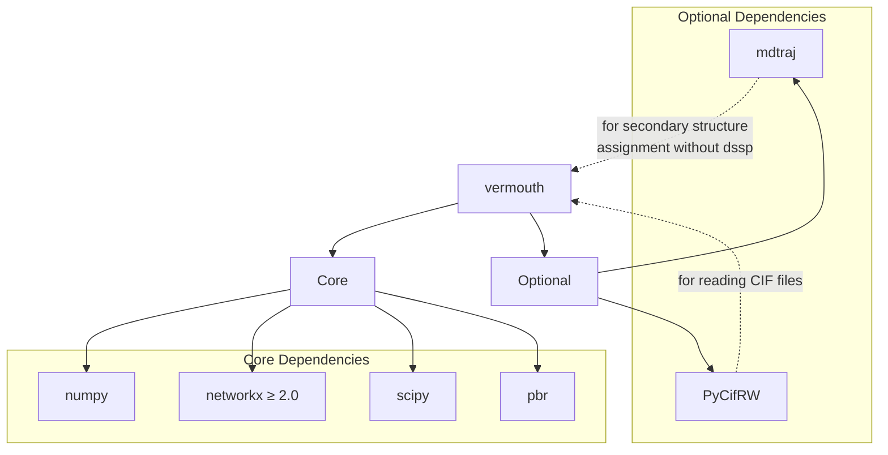
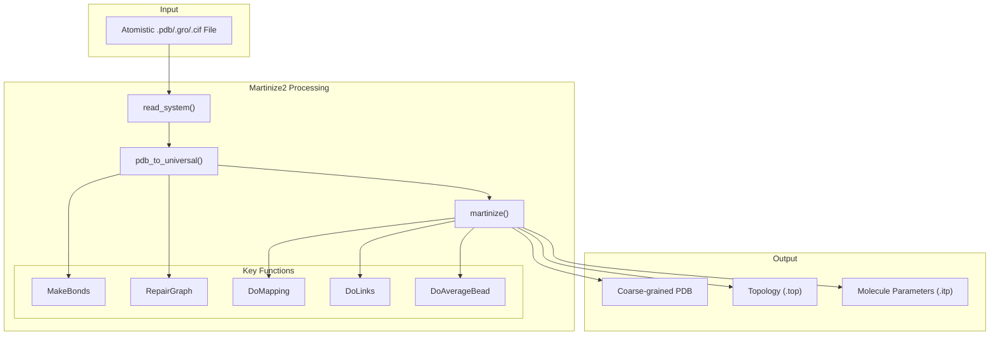

# Installation and Quick Start

<details>
<summary>Relevant source files</summary>

The following files were used as context for generating this wiki page:

- [.zenodo.json](.zenodo.json)
- [README.md](README.md)
- [bin/martinize2](bin/martinize2)
- [doc/source/tutorials/basic_usage.rst](doc/source/tutorials/basic_usage.rst)
- [doc/source/tutorials/elastic_examples.png](doc/source/tutorials/elastic_examples.png)
- [doc/source/tutorials/elastic_networks.rst](doc/source/tutorials/elastic_networks.rst)
- [doc/source/tutorials/go_models.rst](doc/source/tutorials/go_models.rst)
- [doc/source/tutorials/index.rst](doc/source/tutorials/index.rst)
- [doc/source/tutorials/mutations_and_modifications.rst](doc/source/tutorials/mutations_and_modifications.rst)
- [doc/source/tutorials/water_biasing.rst](doc/source/tutorials/water_biasing.rst)
- [setup.cfg](setup.cfg)
- [setup.py](setup.py)
- [vermouth/dssp/dssp.py](vermouth/dssp/dssp.py)
- [vermouth/log_helpers.py](vermouth/log_helpers.py)
- [vermouth/processors/__init__.py](vermouth/processors/__init__.py)
- [vermouth/processors/annotate_idrs.py](vermouth/processors/annotate_idrs.py)
- [vermouth/tests/__init__.py](vermouth/tests/__init__.py)
- [vermouth/tests/test_annotate_idrs.py](vermouth/tests/test_annotate_idrs.py)
- [vermouth/tests/test_dssp.py](vermouth/tests/test_dssp.py)
- [vermouth/tests/test_logging.py](vermouth/tests/test_logging.py)
- [vermouth/tests/test_selectors.py](vermouth/tests/test_selectors.py)
- [vermouth/tests/test_version.py](vermouth/tests/test_version.py)

</details>


This page guides you through installing Martinize2 and vermouth, and running your first commands. It covers basic installation methods, dependencies, and provides simple example commands to get you started. For information about the overall system architecture and components, see [Architecture Overview](#1.2).

## Installation

Martinize2 and vermouth can be installed through Python's package manager (pip) or directly from the repository. Both tools require Python 3.9 or greater.

### Installation via PyPI (Recommended)

The recommended way to install the latest stable version is through PyPI:

```bash
pip install vermouth
```

To update an existing installation:

```bash
pip install -U vermouth
```

Sources: [README.md:32-37]()

### Installation from Repository (Development Version)

If you want to use the latest development version:

```bash
pip install git+https://github.com/marrink-lab/vermouth-martinize.git#vermouth
```

Note that development versions may contain bugs that could produce incorrect topologies.

Sources: [README.md:38-44]()

### Dependencies

Martinize2 has several dependencies:



The `mdtraj` package is an optional dependency that provides an alternative to DSSP for secondary structure assignment.

Sources: [setup.cfg:28-43](), [README.md:46-47]()

## Quick Start

After installation, the `martinize2` command will be available in your system's PATH.

### Checking Installation

To verify the installation and see available options:

```bash
martinize2 -h
```

This will display all available command-line options.

### Basic Usage Example

The simplest command to convert a protein from atomistic to coarse-grained representation:

```bash
martinize2 -f protein.pdb -o topol.top -x cg_protein.pdb
```

This will:
1. Read the atomistic structure from `protein.pdb`
2. Generate a coarse-grained structure in `cg_protein.pdb`
3. Create a topology file in `topol.top`

By default, this uses the Martini 3 force field.

Sources: [bin/martinize2:289-783](), [doc/source/tutorials/basic_usage.rst:5-13]()

### Command Execution Flow



Sources: [bin/martinize2:81-168](), [bin/martinize2:170-192]()

## Secondary Structure Assignment

For proper physical behavior, coarse-grained models need secondary structure information. Martinize2 offers several ways to handle this:

### Using DSSP

If you have DSSP installed:

```bash
martinize2 -f protein.pdb -o topol.top -x cg_protein.pdb -dssp /path/to/dssp
```

Or using mdtraj's implementation:

```bash
martinize2 -f protein.pdb -o topol.top -x cg_protein.pdb -dssp
```

This will calculate the secondary structure automatically.

Sources: [bin/martinize2:444-452](), [doc/source/tutorials/basic_usage.rst:26-52](), [vermouth/dssp/dssp.py:564-582]()

### Manual Secondary Structure Assignment

You can manually specify the secondary structure:

```bash
martinize2 -f protein.pdb -o topol.top -x cg_protein.pdb -ss HHHHHHHHHH
```

Where each letter corresponds to one residue's secondary structure (H for helix, E for extended, C for coil, etc.).

You can also use a single letter to apply the same secondary structure to the entire protein:

```bash
martinize2 -f protein.pdb -o topol.top -x cg_protein.pdb -ss H
```

Sources: [bin/martinize2:455-460](), [doc/source/tutorials/basic_usage.rst:57-84]()

## Advanced Options

### Side Chain Corrections

Side chain corrections (important for correct side chain dynamics) are applied by default in newer versions. To disable:

```bash
martinize2 -f protein.pdb -o topol.top -x cg_protein.pdb -noscfix
```

Sources: [bin/martinize2:957-974](), [doc/source/tutorials/basic_usage.rst:89-108]()

### Elastic Networks

To maintain protein structure, you can add elastic networks:

```bash
martinize2 -f protein.pdb -o topol.top -x cg_protein.pdb -elastic
```

Sources: [bin/martinize2:473-546](), [doc/source/tutorials/basic_usage.rst:110-124]()

### Handling Cysteine Bridges

Martinize2 automatically detects cysteine bridges. You can control this behavior:

```bash
martinize2 -f protein.pdb -o topol.top -x cg_protein.pdb -cys auto     # Default
martinize2 -f protein.pdb -o topol.top -x cg_protein.pdb -cys 5        # Custom distance in nm
martinize2 -f protein.pdb -o topol.top -x cg_protein.pdb -cys none     # No bridges
```

Sources: [bin/martinize2:664-670](), [bin/martinize2:983-987](), [doc/source/tutorials/basic_usage.rst:125-152]()

### Molecule Naming

Control molecule naming with the `-name` flag:

```bash
martinize2 -f protein.pdb -o topol.top -x cg_protein.pdb -name MyProtein
```

Instead of default `molecule_0`, `molecule_1`, etc., outputs will use `MyProtein_0`, `MyProtein_1`, etc.

Sources: [bin/martinize2:328-335](), [doc/source/tutorials/basic_usage.rst:153-171]()

## Understanding the Processing Pipeline

```mermaid
flowchart TD
    Input["PDB/GRO/CIF File"] --> Reader["PDBInput/GROInput/CIFInput"]
    Reader --> BondMaker["MakeBonds\nGuesses connectivity"]
    BondMaker --> GraphRepair["RepairGraph\nCompletes missing atoms"]
    GraphRepair --> CanonMod["CanonicalizeModifications\nStandardizes chemical modifications"]
    CanonMod --> DoMapping["DoMapping\nTransforms to target force field"]
    DoMapping --> DoDSSP["AnnotateDSSP\nAssigns secondary structure"]
    DoDSSP --> DoLinks["DoLinks\nApplies force field parameters"]
    
    subgraph "Optional Features"
        Elastic["ApplyRubberBand\nElastic network"]
        Go["GōModel\nNative structure contacts"]
        WaterBias["ComputeWaterBias\nSolvation properties"]
    end
    
    DoLinks --> Elastic
    DoLinks --> Go
    Elastic --> WaterBias
    Go --> WaterBias
    
    WaterBias --> Write["Write Topology"]
    
    classDef box fill:none,stroke:#333,stroke-width:1px
    class "Optional Features" box
```

Sources: [bin/martinize2:290-1145](), [vermouth/dssp/dssp.py:33-701](), [vermouth/processors/__init__.py:1-49]()

## Common Issues and Solutions

| Issue | Possible Solution |
|-------|------------------|
| `ImportError: No module named vermouth` | Ensure the installation was successful. Try reinstalling with `pip install -U vermouth`. |
| DSSP version warning | Martinize2 is tested with DSSP versions 2.2.1 and 3.0.0. Other versions may work but will generate warnings. |
| Missing atoms in output | Use the `-noscfix` flag if side-chain corrections cause issues with your structure. |
| Incorrect secondary structure | Manually specify the secondary structure with the `-ss` flag. |
| Multiple copies of the same molecule name | Use the `-name` flag to assign unique prefixes to avoid naming conflicts. |

Sources: [vermouth/dssp/dssp.py:282-296](), [bin/martinize2:957-974](), [doc/source/tutorials/basic_usage.rst:173-185]()

## Next Steps

After successfully installing and running your first commands, you might want to explore:

- [Architecture Overview](#1.2) - Understanding the overall system design
- [Command-Line Interface](#1.3) - Detailed documentation of all available options
- [Elastic Networks](#5.2) - Adding elastic networks to maintain protein structure
- [Gō Models](#5.3) - Using Gō models for structure-based potentials
- [Water Biasing](#5.4) - Applying water bias to different regions of proteins

Sources: [README.md:53-65](), [doc/source/tutorials/index.rst:1-20]()

---