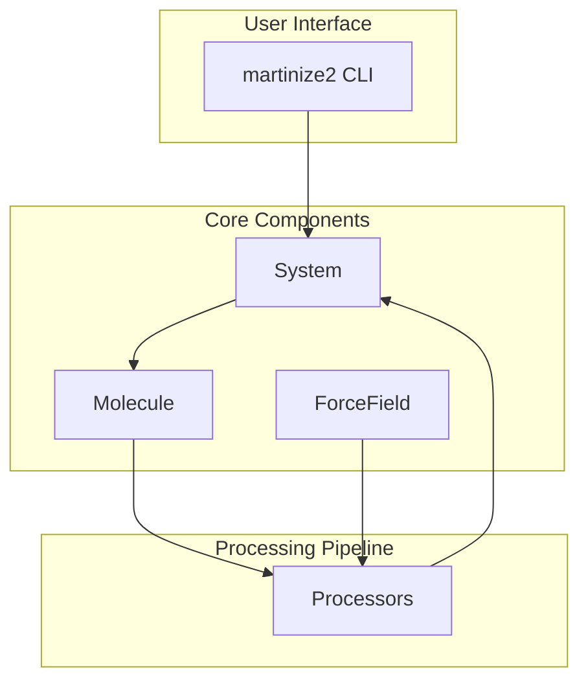
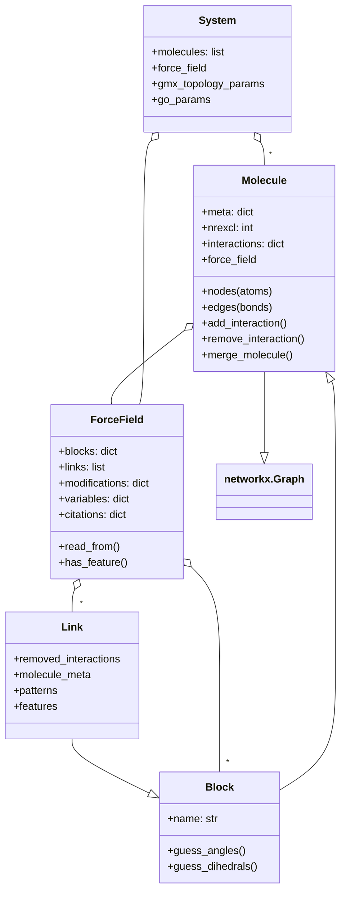
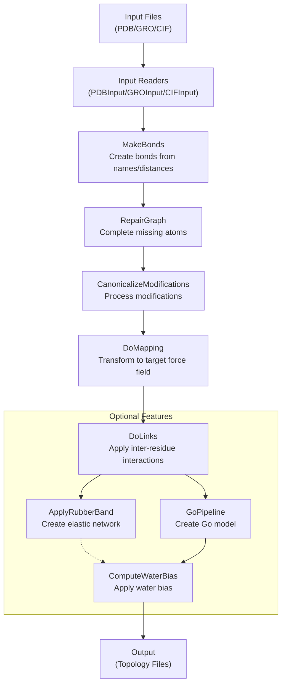
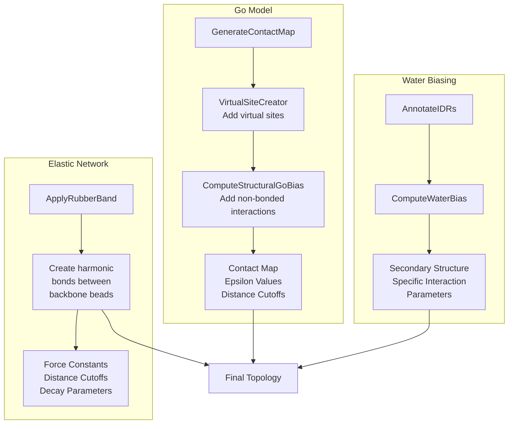
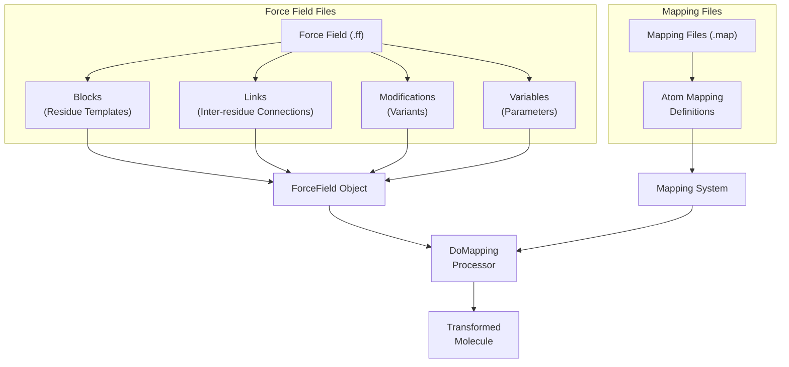

# Architecture Overview

Relevant source files

The following files were used as context for generating this wiki page:

- [bin/martinize2](bin/martinize2)
- [doc/source/data.rst](doc/source/data.rst)
- [doc/source/file_formats.rst](doc/source/file_formats.rst)
- [doc/source/general_overview.rst](doc/source/general_overview.rst)
- [doc/source/graph_algorithms.rst](doc/source/graph_algorithms.rst)
- [doc/source/martinize2_workflow.rst](doc/source/martinize2_workflow.rst)
- [doc/source/processors.rst](doc/source/processors.rst)
- [doc/source/technical_background.rst](doc/source/technical_background.rst)
- [vermouth/data/force_fields/martini3001/aminoacids.ff](vermouth/data/force_fields/martini3001/aminoacids.ff)
- [vermouth/data/force_fields/martini3001/general.ff](vermouth/data/force_fields/martini3001/general.ff)
- [vermouth/dssp/dssp.py](vermouth/dssp/dssp.py)
- [vermouth/forcefield.py](vermouth/forcefield.py)
- [vermouth/molecule.py](vermouth/molecule.py)
- [vermouth/processors/__init__.py](vermouth/processors/__init__.py)
- [vermouth/processors/annotate_idrs.py](vermouth/processors/annotate_idrs.py)
- [vermouth/processors/name_moltype.py](vermouth/processors/name_moltype.py)
- [vermouth/selectors.py](vermouth/selectors.py)
- [vermouth/tests/data/2dn2.pdb](vermouth/tests/data/2dn2.pdb)
- [vermouth/tests/molecule_strategies.py](vermouth/tests/molecule_strategies.py)
- [vermouth/tests/rcsu/test_go_structure_bias.py](vermouth/tests/rcsu/test_go_structure_bias.py)
- [vermouth/tests/test_annotate_idrs.py](vermouth/tests/test_annotate_idrs.py)
- [vermouth/tests/test_dssp.py](vermouth/tests/test_dssp.py)
- [vermouth/tests/test_molecule.py](vermouth/tests/test_molecule.py)
- [vermouth/tests/test_selectors.py](vermouth/tests/test_selectors.py)
- [vermouth/tests/test_utils.py](vermouth/tests/test_utils.py)
- [vermouth/tests/test_version.py](vermouth/tests/test_version.py)
- [vermouth/tests/test_vs_generation.py](vermouth/tests/test_vs_generation.py)
- [vermouth/tests/test_water_bias.py](vermouth/tests/test_water_bias.py)
- [vermouth/utils.py](vermouth/utils.py)

This page provides a high-level overview of VerMoUTH's and martinize2's architecture, explaining the core data structures, processing pipeline, and how different components work together. For a general introduction to the system, see [Overview](#1). For installation and quick start, see [Installation and Quick Start](#1.1). For CLI reference, see [Command-Line Interface](#1.3).

## Core Architecture

VerMoUTH is a Python library for molecular structure processing with a focus on coarse-graining. Martinize2 is a command-line interface built on top of VerMoUTH. The system follows a modular, pipeline-based architecture where molecules flow through a series of transformations from input to output.

The core architecture revolves around three main concepts:
1. **Data structures** representing molecular systems (Molecule, ForceField, System)
2. **Processors** that transform these structures in various ways
3. **Command-line interface** for user interaction

Sources:
- [bin/martinize2:27-54]()
- [vermouth/molecule.py:313-410]()
- [vermouth/forcefield.py:36-62]()
- [vermouth/processors/__init__.py:16-48]()

## Data Structures

The fundamental data structures in VerMoUTH are graph-based, leveraging the NetworkX library to represent molecules as graphs.

### Molecule

The `Molecule` class is the central data structure that extends NetworkX's `Graph` class. It represents molecules as graphs where:
- **Nodes** are atoms/particles with attributes (e.g., position, name, type)
- **Edges** are bonds between atoms
- **Interactions** are stored separately and include various bonded interactions (bonds, angles, dihedrals, etc.)

A key feature of the `Molecule` class is that it can represent molecules at both atomistic and coarse-grained levels using the same data structure.

Sources:
- [vermouth/molecule.py:313-410]()
- [vermouth/tests/test_molecule.py:44-66]()
- [doc/source/data.rst:9-32]()

### Block, Link, and Modifications

These specialized molecular structures are used for building and modifying molecules:

- **Block**: A canonical residue template containing all atoms and interactions with correct naming. Blocks are building blocks for creating larger molecular structures.
  
- **Link**: Defines how blocks connect together, what changes are applied to atoms, and which interactions are added, removed, or altered when connecting residues.

- **Modification**: Used to edit molecules or blocks, e.g., for specifying protonation states or post-translational modifications.

Sources:
- [doc/source/data.rst:34-64]()
- [doc/source/file_formats.rst:107-162]()
- [vermouth/molecule.py:134-247]()

### ForceField

The `ForceField` class contains all parameters and definitions needed for molecular modeling:
- Blocks (residue templates)
- Links (inter-residue connections)
- Modifications
- Variables (force field-wide parameters)
- Citations

Force fields can be read from files using different parsers, including Gromacs-compatible formats.

Sources:
- [vermouth/forcefield.py:36-140]()
- [doc/source/file_formats.rst:38-81]()

### System

The `System` class represents a complete molecular system containing:
- A list of molecules
- A force field
- Global parameters for topology generation
- Parameters for structural features like elastic networks or Go models

Sources:
- [bin/martinize2:89-104]()
- [doc/source/data.rst:9-32]()

## Processing Pipeline

VerMoUTH uses a modular pipeline architecture where each processing step is implemented as a `Processor` class that can transform molecules.

The pipeline processes molecules through several stages:

1. **Reading Input**: Converting PDB/GRO/CIF files to molecule graphs
2. **Bond Creation**: Establishing bonds based on atom names and distances
3. **Graph Repair**: Completing missing atoms and structures
4. **Canonicalization**: Processing modifications like protonation states
5. **Mapping**: Transforming between force fields (e.g., atomistic to coarse-grained)
6. **Applying Links**: Adding inter-residue interactions
7. **Structural Features**: Optional additions like elastic networks, Go models, and water biasing
8. **Writing Output**: Generating topology files and structures

Each processor implements a standard interface, making it easy to create custom transformation pipelines.

Sources:
- [bin/martinize2:106-192]()
- [vermouth/processors/__init__.py:16-48]()
- [doc/source/martinize2_workflow.rst:1-32]()
- [doc/source/processors.rst:1-17]()

### Processor Architecture

The `Processor` base class provides a simple but powerful interface:

- `run_system(system)`: Process an entire system of molecules
- `run_molecule(molecule)`: Process a single molecule

Most processors implement `run_molecule()` for molecule-independent operations, while system-wide operations use `run_system()`. This architecture makes it easy to compose processors into complex pipelines.

Sources:
- [doc/source/processors.rst:1-17]()
- [vermouth/processors/__init__.py:16-48]()

## Structural Feature Systems

VerMoUTH includes several specialized subsystems for maintaining protein structure in coarse-grained models:

### Elastic Network

An elastic network adds harmonic bonds between backbone beads to maintain the protein's tertiary structure. Key parameters include:
- Force constants 
- Distance cutoffs
- Decay functions

Sources:
- [bin/martinize2:472-546]()
- [vermouth/processors/__init__.py:32]()

### Go Model

The Go model approach uses native contacts identified in the atomistic structure to create a structure-based potential in the coarse-grained model:
1. Generate contact map from atomistic structure
2. Create virtual sites anchored to backbone beads
3. Add non-bonded interactions between virtual sites

Sources:
- [bin/martinize2:547-601]()
- [vermouth/tests/test_go_structure_bias.py:14-30]()
- [vermouth/rcsu/go_structure_bias.py]()

### Water Biasing and IDR Support

The system includes specialized support for:
- Water biasing based on secondary structure
- Identification and special handling of intrinsically disordered regions (IDRs)

Sources:
- [bin/martinize2:610-645]()
- [vermouth/processors/water_bias.py]()
- [vermouth/processors/annotate_idrs.py:18-115]()

## Secondary Structure Assignment

Secondary structure assignment is crucial for proper coarse-graining of proteins. The system supports:
- DSSP-based assignment from input structure
- Manual secondary structure specification
- Conversion from atomistic to coarse-grained secondary structure representations

Sources:
- [vermouth/dssp/dssp.py:15-115]()
- [bin/martinize2:442-474]()

## Force Field System

Force fields are defined through a flexible file format system that combines different components:

The force field system provides:
- Loading of force field definitions from multiple file formats
- Support for user-defined force fields
- Atom mappings between different force fields
- Citations tracking for proper scientific attribution

Sources:
- [vermouth/forcefield.py:36-232]()
- [doc/source/file_formats.rst:38-81]()
- [bin/martinize2:784-845]()

## High-Level Workflow

The overall workflow of martinize2 can be summarized as:

1. Process command-line arguments to determine parameters
2. Load force fields and mappings
3. Read input structure
4. Repair and canonicalize the structure
5. Run secondary structure assignment (if needed)
6. Map to target force field (coarse-graining)
7. Apply links and interactions
8. Apply optional structural features (elastic network, Go model, water bias)
9. Write output files

This modular design allows for flexibility in how molecules are processed and transformed.

Sources:
- [bin/martinize2:289-1079]()
- [doc/source/martinize2_workflow.rst:1-32]()

---