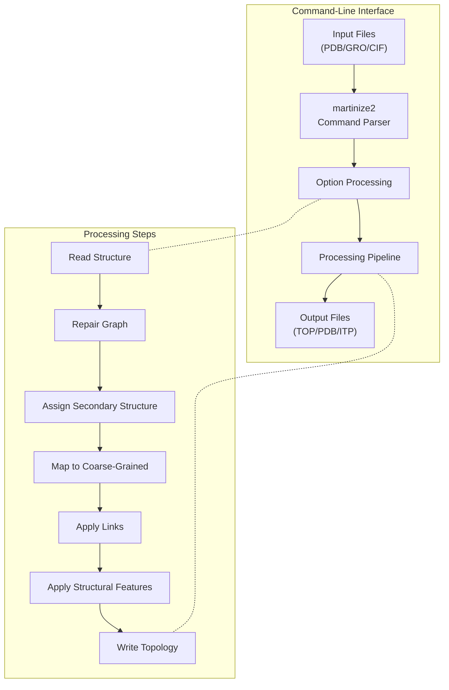
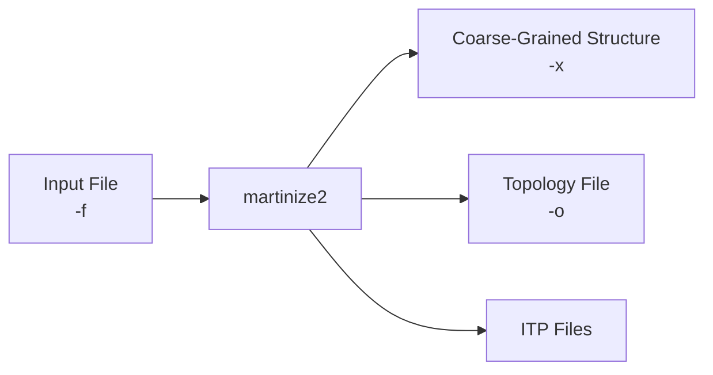
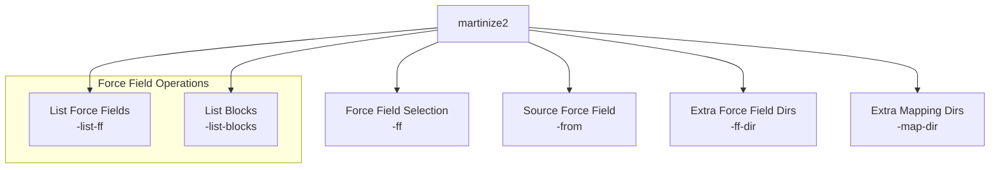
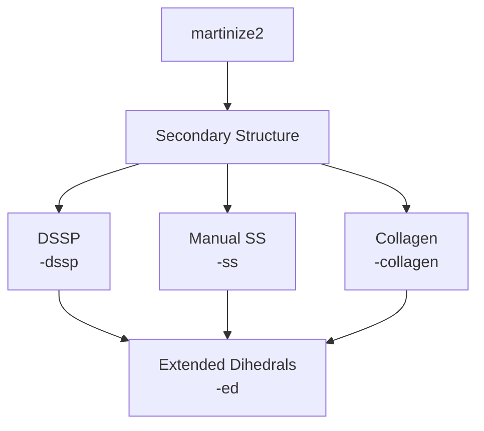
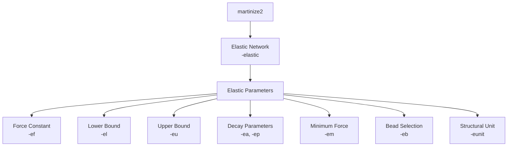
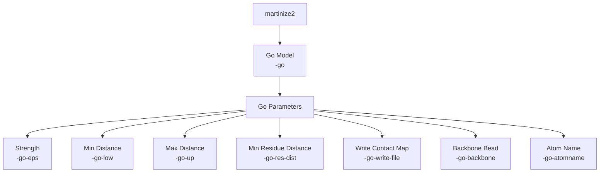
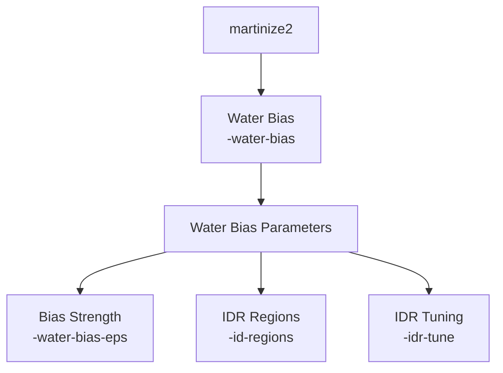
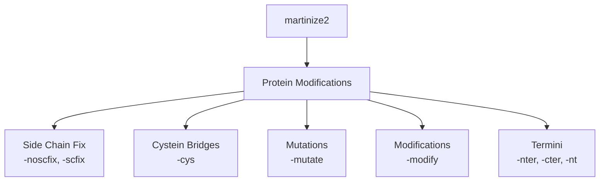
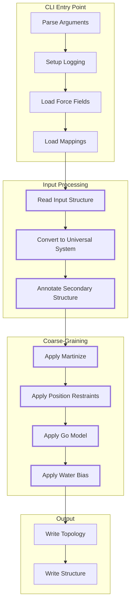
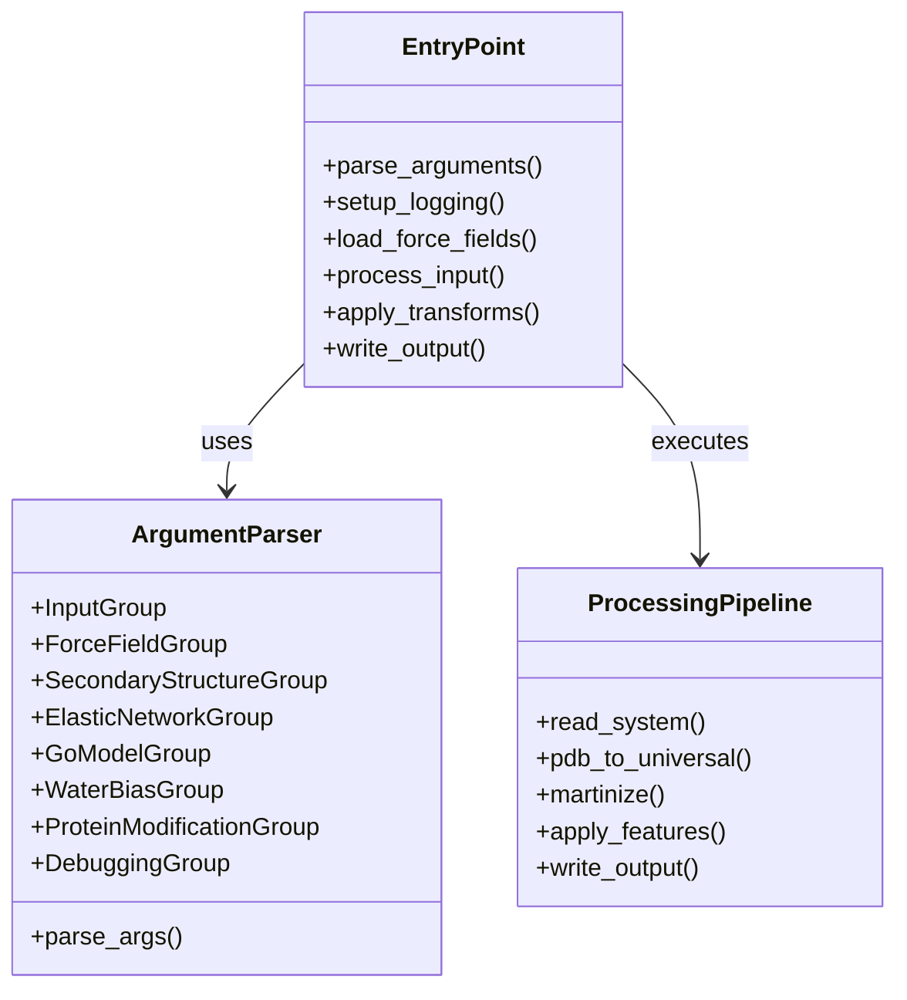

# Command-Line Interface

<details>
<summary>Relevant source files</summary>

The following files were used as context for generating this wiki page:

- [bin/martinize2](bin/martinize2)
- [doc/source/tutorials/basic_usage.rst](doc/source/tutorials/basic_usage.rst)
- [doc/source/tutorials/elastic_examples.png](doc/source/tutorials/elastic_examples.png)
- [doc/source/tutorials/elastic_networks.rst](doc/source/tutorials/elastic_networks.rst)
- [doc/source/tutorials/go_models.rst](doc/source/tutorials/go_models.rst)
- [doc/source/tutorials/index.rst](doc/source/tutorials/index.rst)
- [doc/source/tutorials/mutations_and_modifications.rst](doc/source/tutorials/mutations_and_modifications.rst)
- [doc/source/tutorials/water_biasing.rst](doc/source/tutorials/water_biasing.rst)
- [vermouth/dssp/dssp.py](vermouth/dssp/dssp.py)
- [vermouth/processors/__init__.py](vermouth/processors/__init__.py)
- [vermouth/processors/annotate_idrs.py](vermouth/processors/annotate_idrs.py)
- [vermouth/tests/test_annotate_idrs.py](vermouth/tests/test_annotate_idrs.py)
- [vermouth/tests/test_dssp.py](vermouth/tests/test_dssp.py)
- [vermouth/tests/test_selectors.py](vermouth/tests/test_selectors.py)
- [vermouth/tests/test_version.py](vermouth/tests/test_version.py)

</details>


This page documents the `martinize2` command-line interface, which is the primary way to interact with the vermouth-martinize library. Martinize2 is a tool for converting atomistic molecular structures (particularly proteins) to coarse-grained representations using the Martini force field. For details about the architecture and core components, please see [Architecture Overview](#1.2).

## Overview

The martinize2 command-line tool processes molecular structures through a pipeline of operations, including reading input files, repairing molecular graphs, mapping to coarse-grained representations, and generating output topology files.



Sources: [bin/martinize2:21-81](), [bin/martinize2:289-781]()

## Basic Usage

The most basic usage of martinize2 is:

```
martinize2 -f protein.pdb -o topol.top -x cg_protein.pdb
```

This converts an atomistic protein structure to a coarse-grained model using default settings (Martini 3.0.0.1 force field).

Sources: [bin/martinize2:289-781](), [doc/source/tutorials/basic_usage.rst:1-13]()

## Command-Line Options

The martinize2 command-line interface provides numerous options organized into functional groups. Below is a comprehensive reference.

### Input and Output Options



| Option | Description | Default |
|--------|-------------|---------|
| `-f` | Input structure file (PDB/GRO/CIF) | *required* |
| `-x` | Output coarse-grained structure (PDB) | *optional* |
| `-o` | Output topology file (TOP) | *optional* |
| `-sep` | Write separate topologies for identical chains | `False` |
| `-merge` | Merge chains (comma-separated list or 'all') | None |
| `-name` | Name for the output molecule | `"molecule"` |
| `-resid` | How to handle resid (`mol` or `input`) | `"mol"` |
| `-ignore` | Ignore residues with specified names | `[]` |
| `-ignh` | Ignore all hydrogen atoms in the input file | `False` |
| `-model` | Which MODEL to select in PDB files | `1` |

Sources: [bin/martinize2:298-385]()

### Force Field Options



| Option | Description | Default |
|--------|-------------|---------|
| `-ff` | Target force field | `"martini3001"` |
| `-from` | Source force field | `"charmm"` |
| `-ff-dir` | Additional directory for custom force fields | `[]` |
| `-map-dir` | Additional directory for mapping files | `[]` |
| `-list-ff` | List all known force fields and exit | `False` |
| `-list-blocks` | List all known blocks and modifications and exit | `False` |

Sources: [bin/martinize2:387-425]()

### Secondary Structure Options



| Option | Description | Default |
|--------|-------------|---------|
| `-dssp` | Use DSSP for determining secondary structure | None |
| `-ss` | Manually set the secondary structure | None |
| `-collagen` | Use collagen parameters | `False` |
| `-ed` | Use dihedrals for extended regions | `False` |

The `-dssp` option can be used without a value to use the mdtraj library, or with a path to the DSSP executable.

The `-ss` option takes a DSSP sequence, either one character per residue or a single character to be applied to the entire protein.

Sources: [bin/martinize2:442-470](), [vermouth/dssp/dssp.py:15-135]()

### Elastic Network Options



| Option | Description | Default |
|--------|-------------|---------|
| `-elastic` | Write elastic bonds | `False` |
| `-ef` | Elastic bond force constant (kJ/mol/nm²) | `700` |
| `-el` | Elastic bond lower cutoff | `0` |
| `-eu` | Elastic bond upper cutoff | `0.9` |
| `-ermd` | Minimum residue separation for elastic bonds | Force field default |
| `-ea` | Elastic bond decay factor | `0` |
| `-ep` | Elastic bond decay power | `1` |
| `-em` | Minimum force constant threshold | `0` |
| `-eb` | Comma-separated list of bead names for elastic bonds | backbone beads |
| `-eunit` | Structural unit for the elastic network | `"molecule"` |

Sources: [bin/martinize2:472-546](), [doc/source/tutorials/elastic_networks.rst:1-137]()

### Go Model Options



| Option | Description | Default |
|--------|-------------|---------|
| `-go` | Use Martini Go model | None |
| `-go-eps` | Go model strength (kJ/mol) | `9.414` |
| `-go-low` | Minimum distance cutoff (nm) | `0.3` |
| `-go-up` | Maximum distance cutoff (nm) | `1.1` |
| `-go-res-dist` | Minimum graph distance for contacts | `3` |
| `-go-write-file` | Write contact map to file | `False` |
| `-go-backbone` | Name of protein backbone bead | `"BB"` |
| `-go-atomname` | Name of virtual interaction site | `"CA"` |

Sources: [bin/martinize2:547-608](), [doc/source/tutorials/go_models.rst:1-184]()

### Water Bias Options



| Option | Description | Default |
|--------|-------------|---------|
| `-water-bias` | Apply water bias to secondary structure elements | `False` |
| `-water-bias-eps` | Strength of water bias by secondary structure type | `[]` |
| `-id-regions` | Intrinsically disordered regions by resid | `[]` |
| `-idr-tune` | Tune IDR regions with specific potentials | `False` |

Sources: [bin/martinize2:610-646](), [doc/source/tutorials/water_biasing.rst:1-73](), [vermouth/processors/annotate_idrs.py:1-115]()

### Protein Modification Options



| Option | Description | Default |
|--------|-------------|---------|
| `-noscfix` | Don't apply side chain corrections | `False` |
| `-scfix` | Apply side chain corrections (deprecated) | N/A |
| `-cys` | Cystein bonds (`auto`, `none`, or distance) | `"auto"` |
| `-mutate` | Mutate a residue | `[]` |
| `-modify` | Add a modification to a residue | `[]` |
| `-nter` | Patch N-termini | `[]` |
| `-cter` | Patch C-termini | `[]` |
| `-nt` | Set neutral termini | `False` |

The `-mutate` and `-modify` options use the syntax `<chain>-<resname><resid>:<new resname/modification>`.

Sources: [bin/martinize2:649-730](), [doc/source/tutorials/mutations_and_modifications.rst:1-55]()

### Debugging Options

```mermaid
flowchart TD
    martinize2 --> debug["Debugging Options"]
    
    debug --> write["Intermediate Output"]
    write --> graph["Write Graph\n-write-graph"]
    write --> repair["Write After Repair\n-write-repair"]
    write --> canon["Write After Canonicalization\n-write-canon"]
    
    debug --> verbosity["Verbosity\n-v"]
    debug --> maxwarn["Max Warnings\n-maxwarn"]
```

| Option | Description | Default |
|--------|-------------|---------|
| `-write-graph` | Write the graph as PDB after MakeBonds | None |
| `-write-repair` | Write the graph as PDB after RepairGraph | None |
| `-write-canon` | Write the graph as PDB after Canonicalization | None |
| `-v` | Enable debug logging (can be repeated) | `0` |
| `-maxwarn` | Maximum number of allowed warnings | `[]` |

Sources: [bin/martinize2:732-779]()

## Command Processing Pipeline

The CLI options are processed through a pipeline of operations, shown in the diagram below:



Sources: [bin/martinize2:289-1057]()

## Examples

### Basic Usage
```
martinize2 -f protein.pdb -o topol.top -x cg_protein.pdb
```
Converts a protein structure to coarse-grained Martini 3 representation.

### Using DSSP for Secondary Structure
```
martinize2 -f protein.pdb -o topol.top -x cg_protein.pdb -dssp
```
Uses the mdtraj library to compute secondary structure assignments.

### Manual Secondary Structure
```
martinize2 -f protein.pdb -o topol.top -x cg_protein.pdb -ss HHHHHHCCCCCC
```
Manually assigns helical structure to the first 6 residues and coil to the next 6.

### Adding Elastic Network
```
martinize2 -f protein.pdb -o topol.top -x cg_protein.pdb -dssp -elastic -ef 500 -el 0.5 -eu 0.9
```
Adds an elastic network with a force constant of 500 kJ/mol/nm² between backbone beads 0.5-0.9 nm apart.

### Using Go Model
```
martinize2 -f protein.pdb -o topol.top -x cg_protein.pdb -dssp -go
```
Applies a Go model to maintain tertiary structure.

### Water Biasing
```
martinize2 -f protein.pdb -o topol.top -x cg_protein.pdb -dssp -water-bias -water-bias-eps H:3.6 C:2.1
```
Applies water bias with different strengths based on secondary structure.

### Mutating Residues
```
martinize2 -f protein.pdb -o topol.top -x cg_protein.pdb -dssp -mutate A-PHE45:ALA
```
Mutates PHE45 on chain A to ALA.

Sources: [doc/source/tutorials/basic_usage.rst:1-186](), [doc/source/tutorials/elastic_networks.rst:1-137](), [doc/source/tutorials/go_models.rst:1-184](), [doc/source/tutorials/water_biasing.rst:1-73](), [doc/source/tutorials/mutations_and_modifications.rst:1-55]()

## Command-Line Interface Implementation

The martinize2 CLI is implemented in the `bin/martinize2` file, with the main entry point being the `entry()` function. The CLI uses Python's `argparse` module to parse command-line arguments and organize them into logical groups.



Sources: [bin/martinize2:289-1057]()

The CLI interacts with the core components of vermouth-martinize, including:

1. **Force Field Management**: Loading and selecting force fields, finding mappings
2. **Molecule Processing**: Reading molecules, repairing graphs, applying mappings
3. **Structural Features**: Adding elastic networks, Go models, water bias
4. **Topology Generation**: Writing out topology files for use with simulation software

Sources: [bin/martinize2:289-1057]()

---