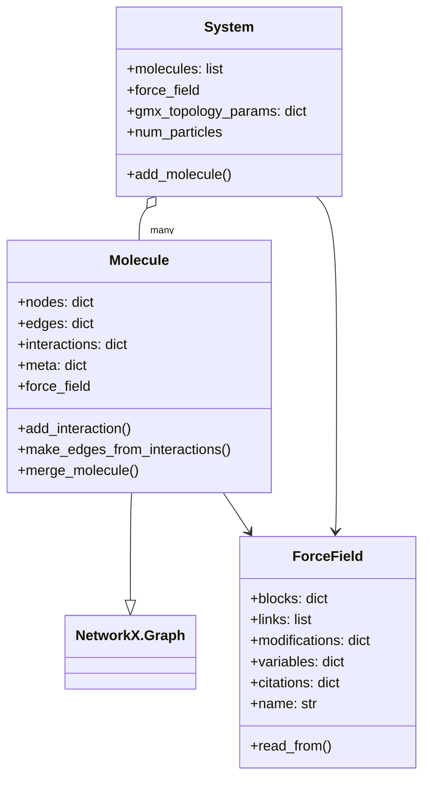
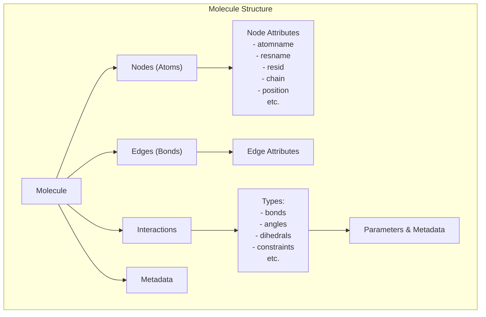
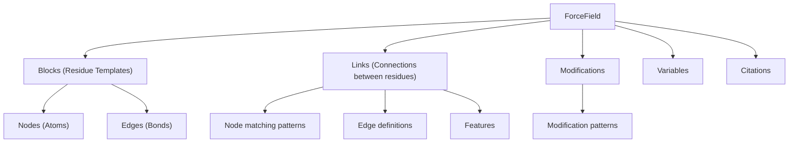
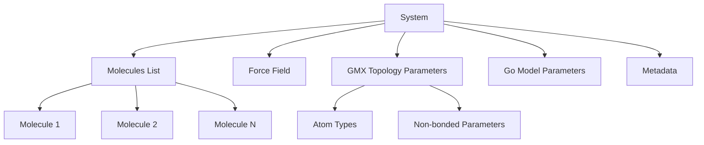
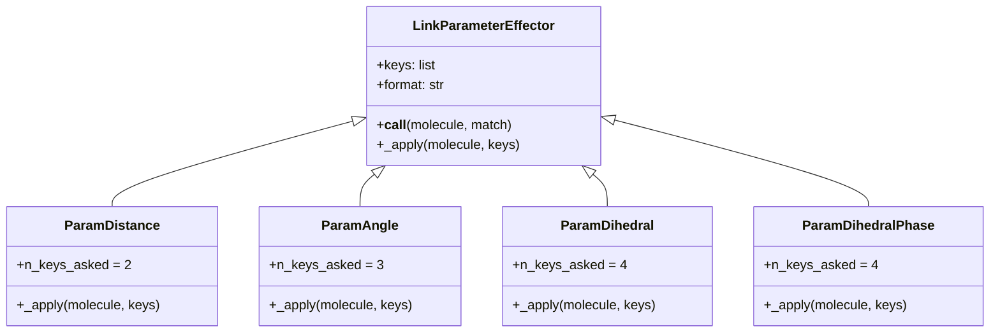
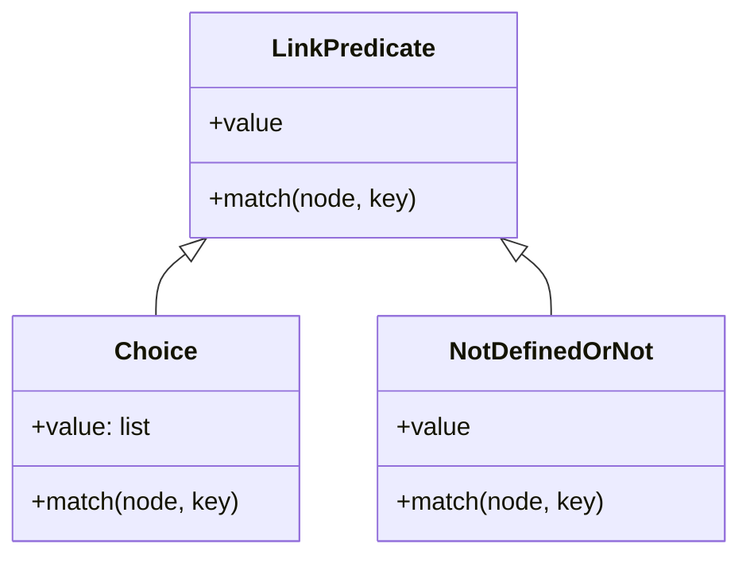
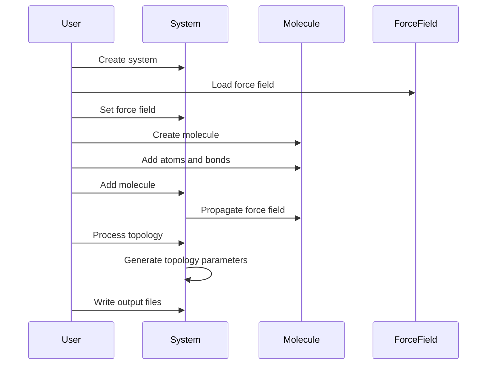

# Core Components

<details>
<summary>Relevant source files</summary>

The following files were used as context for generating this wiki page:

- [vermouth/data/__init__.py](vermouth/data/__init__.py)
- [vermouth/data/data.py](vermouth/data/data.py)
- [vermouth/data/force_fields/martini3001/aminoacids.ff](vermouth/data/force_fields/martini3001/aminoacids.ff)
- [vermouth/data/force_fields/martini3001/general.ff](vermouth/data/force_fields/martini3001/general.ff)
- [vermouth/data/quotes.txt](vermouth/data/quotes.txt)
- [vermouth/forcefield.py](vermouth/forcefield.py)
- [vermouth/gmx/topology.py](vermouth/gmx/topology.py)
- [vermouth/molecule.py](vermouth/molecule.py)
- [vermouth/processors/name_moltype.py](vermouth/processors/name_moltype.py)
- [vermouth/processors/quote.py](vermouth/processors/quote.py)
- [vermouth/selectors.py](vermouth/selectors.py)
- [vermouth/system.py](vermouth/system.py)
- [vermouth/tests/data/2dn2.pdb](vermouth/tests/data/2dn2.pdb)
- [vermouth/tests/gmx/test_topology.py](vermouth/tests/gmx/test_topology.py)
- [vermouth/tests/molecule_strategies.py](vermouth/tests/molecule_strategies.py)
- [vermouth/tests/rcsu/test_go_structure_bias.py](vermouth/tests/rcsu/test_go_structure_bias.py)
- [vermouth/tests/rcsu/test_read_go_map.py](vermouth/tests/rcsu/test_read_go_map.py)
- [vermouth/tests/test_molecule.py](vermouth/tests/test_molecule.py)
- [vermouth/tests/test_utils.py](vermouth/tests/test_utils.py)
- [vermouth/tests/test_vs_generation.py](vermouth/tests/test_vs_generation.py)
- [vermouth/tests/test_water_bias.py](vermouth/tests/test_water_bias.py)
- [vermouth/utils.py](vermouth/utils.py)

</details>


This page documents the fundamental data structures and classes that form the backbone of the vermouth-martinize system. These core components provide the foundation upon which the entire molecular transformation pipeline is built. For information about the specific transformation processes, see [Processing Pipeline](#3).

## Overview of Core Components

The vermouth-martinize system is built around a few essential components that work together to represent, manipulate, and transform molecular structures. The key components are:



The diagram above shows the three main classes that form the foundation of the system:

- `Molecule`: Represents a molecular structure as a graph
- `ForceField`: Contains parameters and definitions for molecular interactions
- `System`: Groups multiple molecules together in a simulation system

Sources: 
- [vermouth/molecule.py:313-974](vermouth/molecule.py:313-974)
- [vermouth/forcefield.py:36-140](vermouth/forcefield.py:36-140)
- [vermouth/system.py:21-96](vermouth/system.py:21-96)

## Molecule: Graph-Based Molecular Representation

The `Molecule` class is the cornerstone of molecular representation in vermouth. It inherits from NetworkX's `Graph` class, providing a flexible graph-based representation of molecules.



### Key Features of the Molecule Class

- **Nodes (Atoms)**: Atoms are represented as nodes in the graph with attributes like `atomname`, `resname`, `resid`, `chain`, and `position`.
- **Edges (Bonds)**: Bonds between atoms are represented as edges in the graph.
- **Interactions**: Beyond simple bonds, molecules support various types of interactions like angles, dihedrals, and constraints. These are stored in the `interactions` dictionary.
- **Metadata**: Molecules can store arbitrary metadata in the `meta` dictionary.

### Interaction Representation

Interactions in a molecule are stored as named tuples:

```python
Interaction = namedtuple('Interaction', 'atoms parameters meta')
```

This allows for flexible representation of various interaction types, with each having:
- `atoms`: The atoms involved in the interaction
- `parameters`: Parameters for the interaction
- `meta`: Additional metadata for the interaction

Sources:
- [vermouth/molecule.py:29-31](vermouth/molecule.py:29-31)
- [vermouth/molecule.py:313-363](vermouth/molecule.py:313-363)
- [vermouth/tests/test_molecule.py:44-66](vermouth/tests/test_molecule.py:44-66)

### Key Methods

The `Molecule` class provides methods to manipulate its structure:

| Method | Purpose |
|--------|---------|
| `add_interaction` | Add interactions between atoms |
| `remove_interaction` | Remove specific interactions |
| `copy` | Create a copy of the molecule |
| `subgraph` | Create a molecule from a subset of atoms |
| `merge_molecule` | Combine another molecule with this one |
| `make_edges_from_interactions` | Generate edges from interaction definitions |

Sources:
- [vermouth/molecule.py:490-520](vermouth/molecule.py:490-520)
- [vermouth/molecule.py:580-610](vermouth/molecule.py:580-610)
- [vermouth/molecule.py:673-745](vermouth/molecule.py:673-745)
- [vermouth/molecule.py:1004-1012](vermouth/molecule.py:1004-1012)

## Force Field Framework

The `ForceField` class provides a framework for describing molecular force fields, which define how atoms interact with each other.



### Key Components of Force Fields

- **Blocks**: Templates for residues or molecular fragments. Blocks are specialized molecules that serve as building blocks for creating larger structures.
- **Links**: Define how blocks connect to each other, specifying which atoms form bonds between residues.
- **Modifications**: Define how residues can be modified (e.g., protonation states).
- **Variables**: Define force field-specific parameters and constants.

### Reading Force Fields

Force fields can be read from files using file format-specific parsers:

```python
FORCE_FIELD_PARSERS = {'.rtp': read_rtp, '.ff': read_ff, '.bib': read_bib}
```

The system supports multiple file formats, including custom `.ff` files and GROMACS `.rtp` files.

Sources:
- [vermouth/forcefield.py:36-140](vermouth/forcefield.py:36-140)
- [vermouth/forcefield.py:27](vermouth/forcefield.py:27)
- [vermouth/data/force_fields/martini3001/aminoacids.ff:15-20](vermouth/data/force_fields/martini3001/aminoacids.ff:15-20)
- [vermouth/data/force_fields/martini3001/general.ff:15-21](vermouth/data/force_fields/martini3001/general.ff:15-21)

## System and Topology

The `System` class is a container for multiple molecules and system-wide parameters.



### Key Features of the System Class

- **Molecules Collection**: A system contains a list of molecules.
- **Force Field Consistency**: All molecules in a system share the same force field.
- **Topology Parameters**: The system stores GROMACS topology parameters like atom types and non-bonded parameters.
- **Metadata**: The system can store arbitrary metadata.

### GMX Topology Parameters

The system's `gmx_topology_params` dictionary stores parameters for generating GROMACS topology files:

- **Atom Types**: Defined as named tuples that store atom parameters like sigma and epsilon.
- **Non-bonded Parameters**: Define interactions between atom types.

These parameters are used when writing topology files for GROMACS simulations.

Sources:
- [vermouth/system.py:21-96](vermouth/system.py:21-96)
- [vermouth/gmx/topology.py:17-18](vermouth/gmx/topology.py:17-18)
- [vermouth/gmx/topology.py:40-76](vermouth/gmx/topology.py:40-76)
- [vermouth/gmx/topology.py:78-114](vermouth/gmx/topology.py:78-114)

## Parameter Effectors

Parameter effectors are a specialized component that allows dynamic calculation of interaction parameters based on molecular structure.



Parameter effectors are used in interaction definitions to calculate parameters based on actual molecular geometry, rather than using fixed values. Each type of effector calculates a specific geometric property:

- **ParamDistance**: Calculates the distance between two atoms
- **ParamAngle**: Calculates the angle formed by three atoms
- **ParamDihedral**: Calculates the dihedral angle formed by four atoms
- **ParamDihedralPhase**: Calculates a phase-shifted dihedral angle

Sources:
- [vermouth/molecule.py:134-298](vermouth/molecule.py:134-298)
- [vermouth/tests/test_molecule.py:517-540](vermouth/tests/test_molecule.py:517-540)
- [vermouth/tests/test_molecule.py:574-667](vermouth/tests/test_molecule.py:574-667)

## Link Predicates

Link predicates are used for matching atoms in molecules against patterns defined in links.



These predicates are used to create flexible matching patterns for links:

- **Choice**: Matches if an attribute is in a predefined list
- **NotDefinedOrNot**: Matches if an attribute is not defined or not equal to a value

Sources:
- [vermouth/molecule.py:34-131](vermouth/molecule.py:34-131)
- [vermouth/tests/test_molecule.py:268-271](vermouth/tests/test_molecule.py:268-271)

## Component Interactions

Understanding how these core components interact is key to understanding the vermouth-martinize system.



The typical workflow involves:

1. Creating a system and loading a force field
2. Creating molecules and adding them to the system
3. Processing the system through a pipeline of transformations
4. Writing output files for use in simulations

As the diagram shows, the force field is shared between the system and all its molecules, ensuring consistency throughout the transformation process.

Sources:
- [vermouth/system.py:38-75](vermouth/system.py:38-75)
- [vermouth/gmx/topology.py:116-256](vermouth/gmx/topology.py:116-256)

## Utilities and Helpers

The core components are supported by various utilities and helper functions:

| Utility | Purpose |
|---------|---------|
| `attributes_match` | Check if node attributes match a template |
| `distance` | Calculate Euclidean distance between points |
| `are_different` | Compare values with special handling for various types |
| `filter_minimal` | Filter atoms based on a selector function |

These utilities simplify common operations used throughout the system.

Sources:
- [vermouth/utils.py:27-199](vermouth/utils.py:27-199)
- [vermouth/selectors.py:150-179](vermouth/selectors.py:150-179)

## Summary

The core components of vermouth-martinize provide a flexible framework for representing and transforming molecular structures:

- **Molecule**: A graph-based representation of molecules with support for complex interactions
- **ForceField**: A description of how atoms interact, including residue templates and connection rules
- **System**: A container for molecules with system-wide parameters
- **Parameter Effectors**: Tools for dynamic calculation of interaction parameters
- **Link Predicates**: Tools for flexible matching of molecular patterns

Together, these components form the foundation of the vermouth-martinize system, enabling sophisticated molecular transformations for coarse-grained simulations.

Sources:
- All files reviewed in this document

---