# Molecule Representation

<details>
<summary>Relevant source files</summary>

The following files were used as context for generating this wiki page:

- [vermouth/molecule.py](vermouth/molecule.py)
- [vermouth/processors/make_bonds.py](vermouth/processors/make_bonds.py)
- [vermouth/processors/name_moltype.py](vermouth/processors/name_moltype.py)
- [vermouth/tests/data/2dn2.pdb](vermouth/tests/data/2dn2.pdb)
- [vermouth/tests/molecule_strategies.py](vermouth/tests/molecule_strategies.py)
- [vermouth/tests/test_make_bonds.py](vermouth/tests/test_make_bonds.py)
- [vermouth/tests/test_molecule.py](vermouth/tests/test_molecule.py)
- [vermouth/tests/test_utils.py](vermouth/tests/test_utils.py)
- [vermouth/utils.py](vermouth/utils.py)

</details>


## Introduction

This page describes the graph-based representation of molecules in the VerMoUTH & martinize2 system. The molecule representation is a fundamental component that serves as the core data structure for all molecular operations, transformations, and simulations. The `Molecule` class extends NetworkX's Graph class to provide specialized functionality for molecular structures, where atoms are represented as nodes and bonds as edges.

For information about force fields that define the rules for these molecules, see [Force Fields](#2.2). For understanding how the system stores multiple molecules, see [System and Topology](#2.3).

Sources: [vermouth/molecule.py:313-363](vermouth/molecule.py:313-363)

## Molecule Data Model

### Graph Representation

The core architecture of the `Molecule` class uses a graph-based representation that leverages NetworkX, a powerful Python graph library:

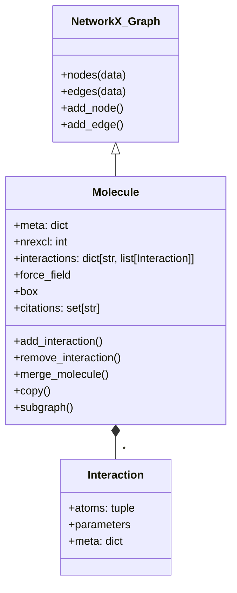

In this model:
- Atoms are nodes in the graph, with attributes like positions, names, types, and charges
- Bonds are edges in the graph, with optional attributes like bond parameters
- Additional interactions like angles, dihedrals, and non-bonded terms are stored separately

The `Molecule` class maintains an ordered dictionary of nodes to ensure consistent ordering, which is important for output file generation.

Sources: [vermouth/molecule.py:313-363](vermouth/molecule.py:313-363), [vermouth/molecule.py:29-32](vermouth/molecule.py:29-32)

## Key Attributes and Properties

### Core Attributes

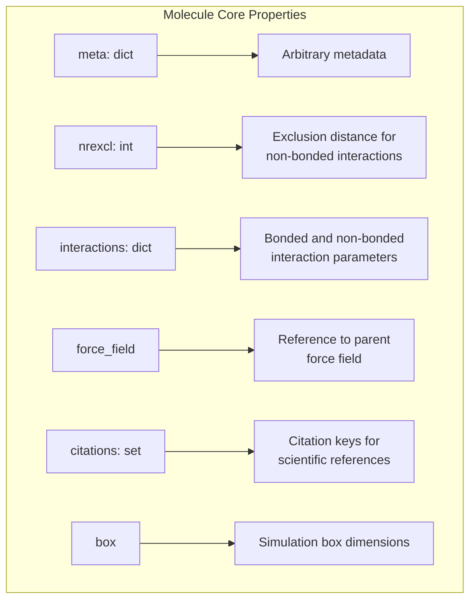

Each `Molecule` instance has several key attributes:

| Attribute | Type | Description |
|-----------|------|-------------|
| `meta` | dict | Metadata about the molecule (e.g., name, type) |
| `nrexcl` | int | Number of bonds to exclude for non-bonded interactions |
| `interactions` | dict[str, list[Interaction]] | Stores interactions by type (bonds, angles, etc.) |
| `force_field` | ForceField | Reference to the force field the molecule is described for |
| `citations` | set[str] | Citation keys for scientific references related to the molecule |
| `box` | array | Simulation box dimensions (if applicable) |

Sources: [vermouth/molecule.py:346-364](vermouth/molecule.py:346-364)

### Interactions

Interactions represent various bonded and non-bonded terms in the molecule, including:
- Bonds between atom pairs
- Angles between atom triplets
- Dihedrals between four consecutive atoms
- Improper dihedrals
- Other specialized interactions defined by the force field

Each interaction is represented as a named tuple `Interaction` with fields:
- `atoms`: Tuple of atoms involved in the interaction
- `parameters`: Values defining the interaction (e.g., force constants, equilibrium values)
- `meta`: Dictionary of metadata about the interaction

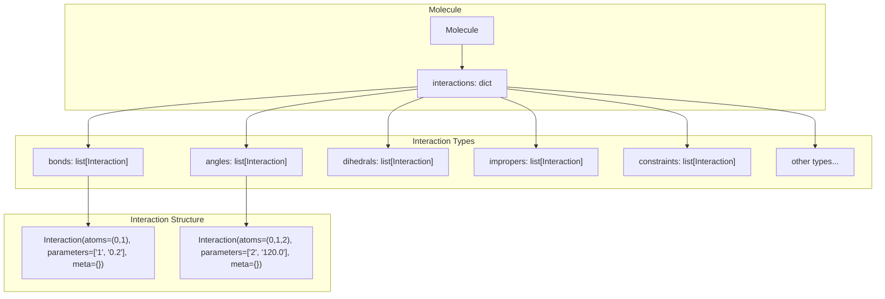

Sources: [vermouth/molecule.py:29-32](vermouth/molecule.py:29-32), [vermouth/molecule.py:490-520](vermouth/molecule.py:490-520)

## Working with Molecules

### Creating and Modifying Molecules

Creating a molecule and adding atoms and bonds:

```python
# Create a new molecule
molecule = Molecule()

# Add atoms (nodes)
molecule.add_node(0, atomname='C', element='C', position=[0, 0, 0])
molecule.add_node(1, atomname='H', element='H', position=[0, 0, 1.1])

# Add a bond (edge)
molecule.add_edge(0, 1)

# Add an interaction
molecule.add_interaction(
    type_='bonds',
    atoms=(0, 1),
    parameters=['1', '0.2', '200'],
    meta={'comment': 'C-H bond'}
)
```

The `Molecule` class also provides methods to remove atoms and bonds, and to manipulate interactions:

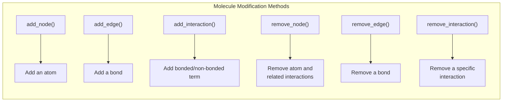

Sources: [vermouth/molecule.py:490-520](vermouth/molecule.py:490-520), [vermouth/molecule.py:580-610](vermouth/molecule.py:580-610), [vermouth/molecule.py:954-974](vermouth/molecule.py:954-974)

### Automatic Bond Generation

The system can automatically generate bonds based on:

1. **Distance criteria**: Using van der Waals radii to estimate when atoms are close enough to be bonded
2. **Reference structures**: Using known molecular topologies to define bonds

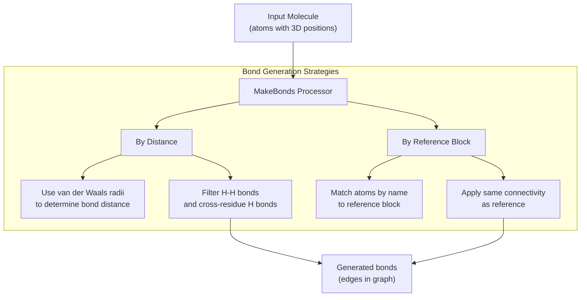

The `MakeBonds` processor can use a combination of geometric and topological criteria to create bonds between atoms, with customizable parameters to control the process.

Sources: [vermouth/processors/make_bonds.py:222-306](vermouth/processors/make_bonds.py:222-306)

## Advanced Features

### Molecule Comparison and Equality

The `Molecule` class provides methods to compare molecules at different levels:

1. **Full equality** (`__eq__`): Compares all aspects including node order, edges, and interactions
2. **Topology equality** (`share_moltype_with`): Checks if two molecules have the same topological structure (useful for grouping similar molecules)

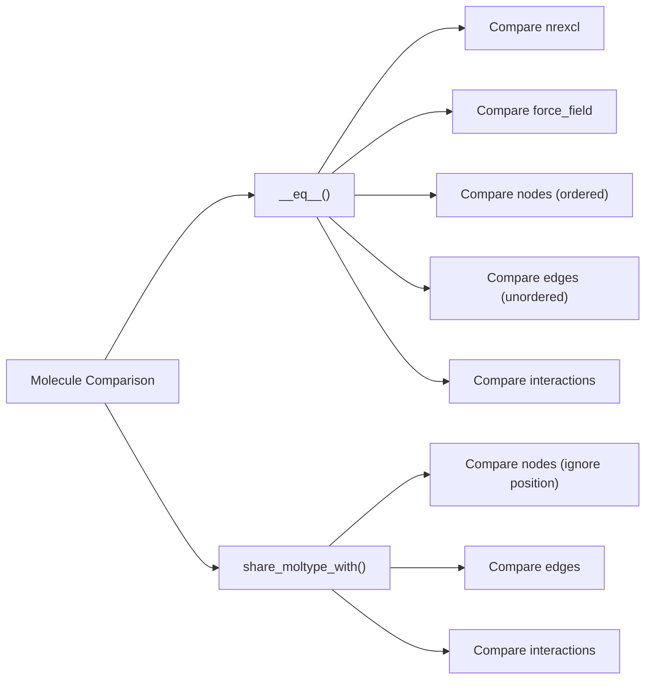

These comparison methods support efficient molecule grouping and classification, which is critical for operations like creating molecular dynamics topology files.

Sources: [vermouth/molecule.py:366-373](vermouth/molecule.py:366-373), [vermouth/molecule.py:748-773](vermouth/molecule.py:748-773)

### Molecule Copying and Subgraphs

The `Molecule` class provides methods to create copies and subgraphs:

1. **Copy** (`copy`): Creates a complete copy of the molecule
2. **Subgraph** (`subgraph`): Creates a molecule containing only the specified subset of atoms

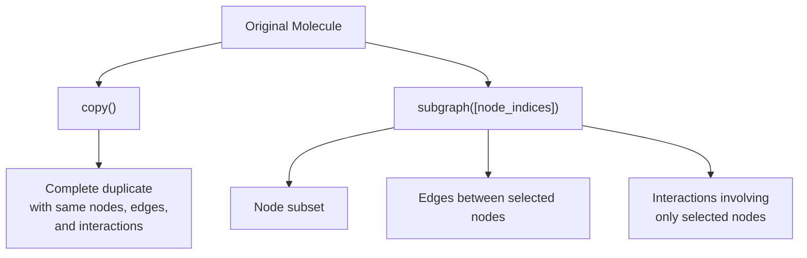

These methods are essential for operations like extracting specific residues, creating fragments, or duplicating molecules for mutation.

Sources: [vermouth/molecule.py:439-488](vermouth/molecule.py:439-488)

### Merging Molecules

The `merge_molecule` method allows combining two molecules into one:

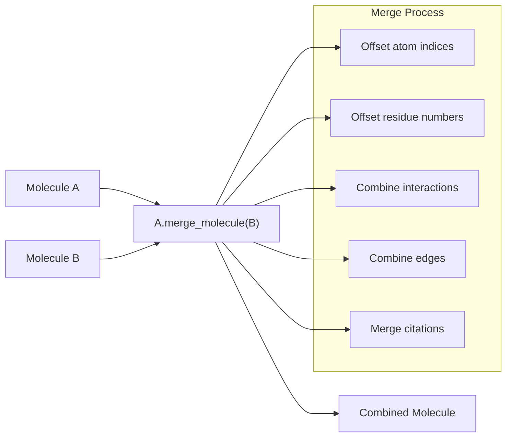

This is useful for building larger structures from smaller components, such as constructing a protein from individual residues or creating multi-component systems.

Sources: [vermouth/molecule.py:673-746](vermouth/molecule.py:673-746)

## Dynamic Parameter Calculation

The `LinkParameterEffector` system provides a way to calculate interaction parameters dynamically based on the molecular structure:

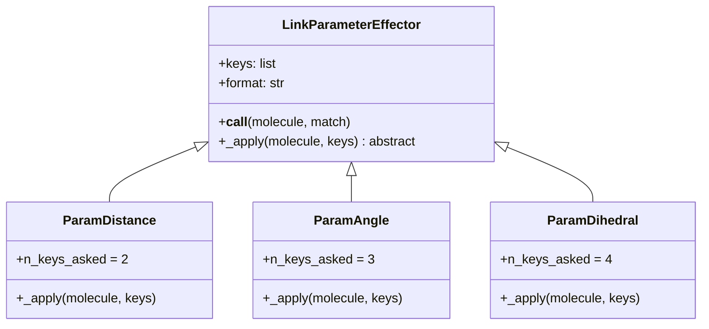

These parameter effectors can compute:
- Bond distances between atoms
- Angles between three atoms
- Dihedral angles between four atoms

This system allows for dynamic parameter generation based on molecular geometry, which is particularly useful when applying force field transformations or when constructing force field parameters based on the current conformation.

Sources: [vermouth/molecule.py:134-246](vermouth/molecule.py:134-246), [vermouth/molecule.py:249-310](vermouth/molecule.py:249-310)

## Implementation Details

### Attribute Comparison

The system uses specialized comparison mechanisms to handle different attribute types:

1. **Attribute equality**: The `are_different` utility provides sophisticated equality testing for various data types
2. **LinkPredicate**: Defines special comparison criteria for node attributes in links

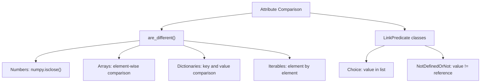

These mechanisms support flexible pattern matching when applying force field transformations and when comparing molecule structures.

Sources: [vermouth/molecule.py:34-132](vermouth/molecule.py:34-132), [vermouth/utils.py:147-199](vermouth/utils.py:147-199)

### Node and Edge Management

The `Molecule` class extends NetworkX's graph management but adds specialized behaviors:

1. Removing nodes also removes associated interactions
2. Adding nodes updates atom indexing
3. Making edges from interactions automatically converts interaction definitions to graph connectivity

These behaviors ensure the graph structure remains consistent with the chemical understanding of the molecule.

Sources: [vermouth/molecule.py:935-1012](vermouth/molecule.py:935-1012)

## Integration with Other Components

The molecule representation serves as the foundation for nearly all operations in the vermouth-martinize system:

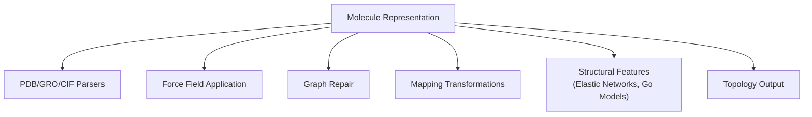

This central role makes the `Molecule` class one of the most critical components of the entire system, with its design influencing all downstream processing and analysis.

Sources: [vermouth/molecule.py:313-363](vermouth/molecule.py:313-363)

---