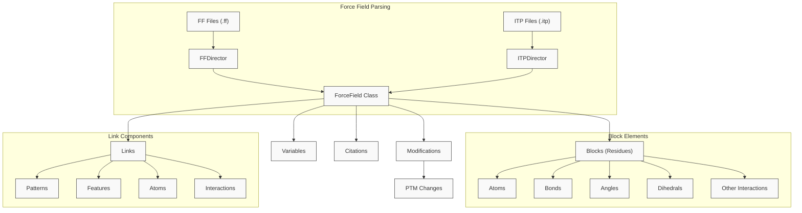
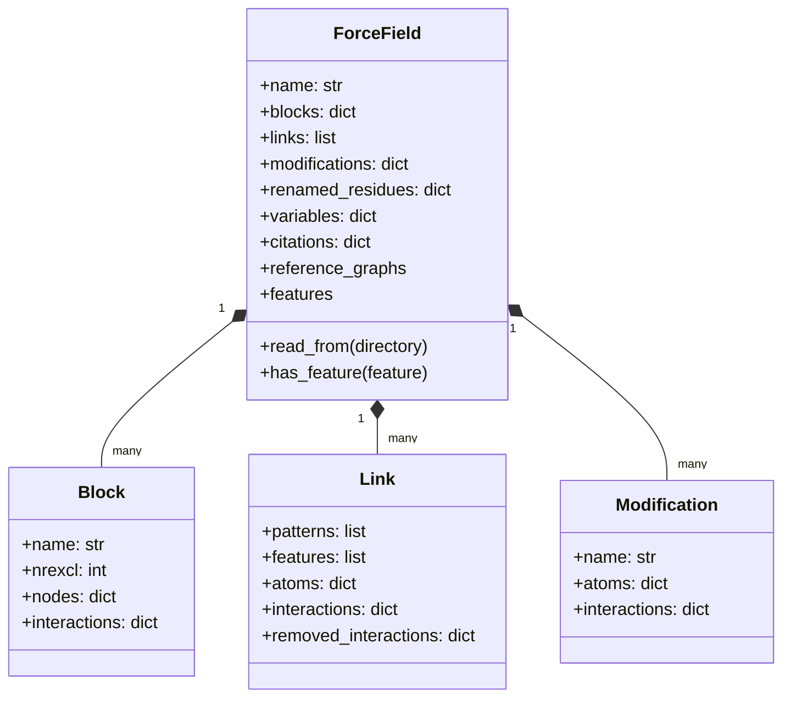
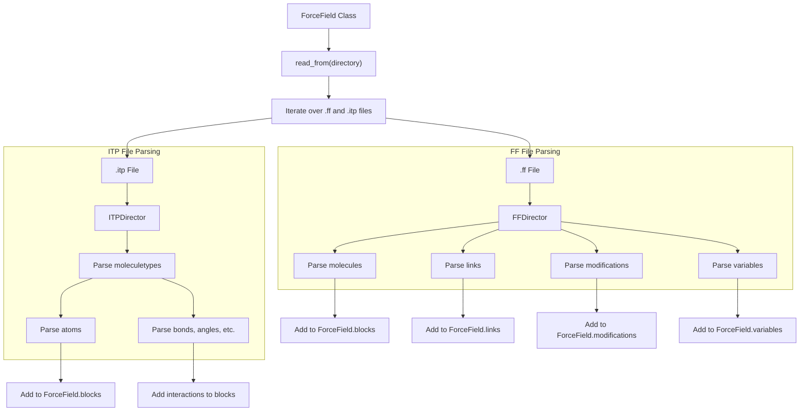
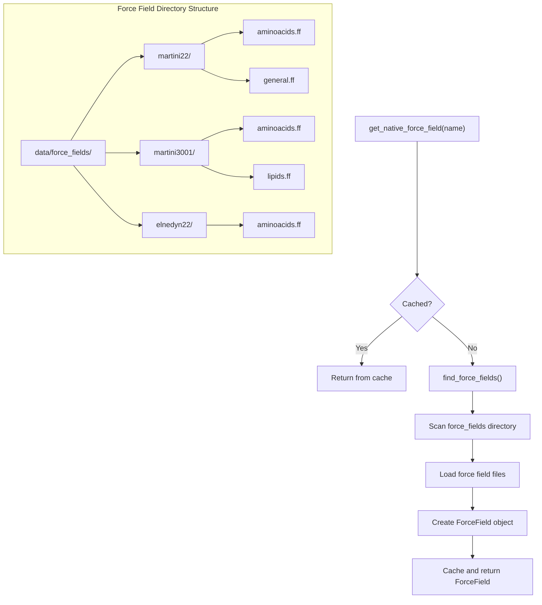

# Force Fields

<details>
<summary>Relevant source files</summary>

The following files were used as context for generating this wiki page:

- [vermouth/data/force_fields/elnedyn21/aminoacids.ff](vermouth/data/force_fields/elnedyn21/aminoacids.ff)
- [vermouth/data/force_fields/elnedyn22/aminoacids.ff](vermouth/data/force_fields/elnedyn22/aminoacids.ff)
- [vermouth/data/force_fields/elnedyn22p/aminoacids.ff](vermouth/data/force_fields/elnedyn22p/aminoacids.ff)
- [vermouth/data/force_fields/martini22/aminoacids.ff](vermouth/data/force_fields/martini22/aminoacids.ff)
- [vermouth/data/force_fields/martini22p/aminoacids.ff](vermouth/data/force_fields/martini22p/aminoacids.ff)
- [vermouth/data/force_fields/martini3001/aminoacids.ff](vermouth/data/force_fields/martini3001/aminoacids.ff)
- [vermouth/data/force_fields/martini3001/general.ff](vermouth/data/force_fields/martini3001/general.ff)
- [vermouth/data/force_fields/martini30b32/aminoacids.ff](vermouth/data/force_fields/martini30b32/aminoacids.ff)
- [vermouth/data/force_fields/martini30dev/aminoacids.ff](vermouth/data/force_fields/martini30dev/aminoacids.ff)
- [vermouth/ffinput.py](vermouth/ffinput.py)
- [vermouth/forcefield.py](vermouth/forcefield.py)
- [vermouth/gmx/itp_read.py](vermouth/gmx/itp_read.py)
- [vermouth/parser_utils.py](vermouth/parser_utils.py)
- [vermouth/selectors.py](vermouth/selectors.py)
- [vermouth/tests/rcsu/test_go_structure_bias.py](vermouth/tests/rcsu/test_go_structure_bias.py)
- [vermouth/tests/test_ff_files.py](vermouth/tests/test_ff_files.py)
- [vermouth/tests/test_forcefield.py](vermouth/tests/test_forcefield.py)
- [vermouth/tests/test_itp_files.py](vermouth/tests/test_itp_files.py)
- [vermouth/tests/test_vs_generation.py](vermouth/tests/test_vs_generation.py)
- [vermouth/tests/test_water_bias.py](vermouth/tests/test_water_bias.py)

</details>


Force Fields in the vermouth-martinize system define the parameters and representations of molecules for coarse-grained molecular dynamics simulations. They specify how atoms are grouped into beads, the interactions between these beads, and the structural features of molecules like proteins, lipids, and other biomolecules.

For information about how force fields are applied during the mapping process, see [Force Field Mapping](#3.2).

## Force Field Architecture

The force field system is built around several key components that work together to define molecular structures and interactions.



Sources:
- [vermouth/forcefield.py:36-63]()
- [vermouth/ffinput.py:63-103]()
- [vermouth/gmx/itp_read.py:24-48]()

## Force Field Class

The `ForceField` class is the central component that organizes all force field information. It stores the blocks (residue definitions), links (how residues connect), modifications, variables, and citations for a particular force field.



Sources:
- [vermouth/forcefield.py:36-140]()
- [vermouth/molecule.py]()

The `ForceField` class can be initialized empty or by reading from a directory:

```python
ff = ForceField(name='martini22')  # Empty force field
ff = ForceField(directory='/path/to/force_field')  # Read from directory
```

## Force Field Components

### Blocks

Blocks represent molecular building units, typically residues in biomolecules. Each block defines:

- Atoms (beads in coarse-grained models)
- Bonds, angles, dihedrals, and other interactions between atoms
- Metadata such as exclusions for non-bonded interactions

Blocks are used as templates when building molecules and are referenced by their name (e.g., `ALA` for alanine).

### Links

Links define how blocks connect to each other, such as peptide bonds between amino acids. They contain:

- Pattern matching rules to identify where they should be applied
- Atoms to add, remove, or modify
- Interactions to add or remove
- Features that describe what the link represents (e.g., "peptide bond")

### Modifications

Modifications represent post-translational modifications (PTMs) or other alterations to standard blocks, such as phosphorylation or methylation.

### Variables

Variables store force field-wide parameters that can be referenced throughout the force field files, such as bond strengths or atom types.

Table of common variables in Martini force fields:

| Variable | Description | Example Value |
|----------|-------------|--------------|
| `elastic_network_bond_type` | Type of bond for elastic networks | `1` |
| `res_min_dist` | Minimum residue distance for elastic networks | `3` |
| `prot_default_bb_type` | Default backbone bead type | `P2` |
| `bb_atomname` | Name of the backbone atom | `BB` |
| `water_type` | Water particle type | `W` |

Sources:
- [vermouth/data/force_fields/martini3001/general.ff:15-22]()
- [vermouth/data/force_fields/martini3001/aminoacids.ff:17-22]()

## Force Field File Format

Force fields are defined using custom `.ff` files and GROMACS-compatible `.itp` files. These files use a section-based format with headers in square brackets.

### FF File Format

Here's an example of a simplified `.ff` file structure:

```
[ macros ]
protein_resnames "GLY|ALA|CYS|VAL|LEU|ILE|MET|PRO|HYP|ASN|GLN"

[ variables ]
elastic_network_bond_type 1
res_min_dist 3

[ citations ]
Martini3

[ moleculetype ]
; molname       nrexcl
ALA                1

[ atoms ]
;id type resnr residu atom cgnr   charge
 1   P4    1     ALA    BB     1      0
 2   TC3   1     ALA    SC1    2      0 

[ bonds ]
;  i     j   funct   length  force.c.
  BB   SC1    1       0.270  $stiff_fc

[ link ]
resname $protein_resnames
[ bonds ]
BB +BB 1 0.350 1250 {"group": "Backbone bonds"}
```

### ITP File Format

The `.itp` file format is compatible with GROMACS topology files but processed differently in vermouth-martinize:

```
[ moleculetype ]
; molname       nrexcl
ALA                1

[ atoms ]
;id type resnr residu atom cgnr   charge mass
1  P4  1  ALA  BB  1  0  72
2  P3  1  ALA  SC1 2  0  72

[ bonds ]
;  i     j   funct   length  force.c.
   1     2    1       0.270  1250
```

The key difference is that in `.ff` files, atoms are referenced by their names (e.g., `BB`, `SC1`), while in `.itp` files, they are referenced by their indices.

Sources:
- [vermouth/data/force_fields/martini3001/aminoacids.ff:15-62]()
- [vermouth/gmx/itp_read.py:238-280]()
- [vermouth/ffinput.py:180-250]()

## Force Field Parsing

Force field files are parsed using two dedicated parsers:



Sources:
- [vermouth/forcefield.py:89-103]()
- [vermouth/ffinput.py:63-166]()
- [vermouth/gmx/itp_read.py:24-66]()

Both parsers extend `SectionLineParser`, which provides a framework for parsing section-based files:

1. Each section (e.g., `[ atoms ]`, `[ bonds ]`) is processed by a specific method
2. The parser tracks the current context (block, link, or modification)
3. As sections are processed, they populate the force field data structures

## Available Force Fields

Vermouth-martinize includes several pre-defined force fields:

| Force Field | Description | Main Features |
|-------------|-------------|--------------|
| `martini22` | Martini 2.2 | Standard Martini 2.2 coarse-grained model |
| `martini22p` | Martini 2.2P | Martini 2.2 with polarizable water |
| `martini3001` | Martini 3.0.0.1 | Updated Martini 3 model with improved parameterization |
| `martini30b32` | Martini 3.0 beta 3.2 | Beta version of Martini 3 |
| `elnedyn22` | ElNeDyn 2.2 | Martini 2.2 with elastic network for proteins |
| `elnedyn22p` | ElNeDyn 2.2P | ElNeDyn 2.2 with polarizable water |
| `elnedyn21` | ElNeDyn 2.1 | Earlier version of ElNeDyn |

To load a force field, you can use:

```python
from vermouth.forcefield import get_native_force_field

ff = get_native_force_field('martini22')
```

Sources:
- [vermouth/forcefield.py:202-232]()
- [vermouth/data/force_fields/]()

## Force Field Selection and Loading

The system loads force fields dynamically from the `data/force_fields` directory. Each force field is stored in its own subdirectory.



Sources:
- [vermouth/forcefield.py:143-189]()
- [vermouth/forcefield.py:202-232]()

## Force Field Applications

Force fields are central to the molecular transformation pipeline in vermouth-martinize:

1. **Input Reading**: Atoms from the input structure are matched to blocks in the force field
2. **Resolution Mapping**: Atoms are mapped to coarse-grained beads based on force field definitions
3. **Link Application**: Links are applied to connect blocks and create complete molecules
4. **Interaction Generation**: Force field parameters are used to generate interactions for simulation

The parameters and structures defined in force fields dictate how molecules behave in subsequent molecular dynamics simulations.

Sources:
- [vermouth/processors/do_mapping.py]()
- [vermouth/processors/do_links.py]()

## Creating Custom Force Fields

Custom force fields can be created by:

1. Creating a new directory structure with `.ff` files
2. Defining blocks, links, and modifications
3. Setting appropriate variables and parameters
4. Loading the custom force field with `ForceField(directory='/path/to/custom_ff')`

This allows users to adapt existing force fields or create entirely new ones for specific systems or applications.

Sources:
- [vermouth/forcefield.py:89-103]()
- [vermouth/forcefield.py:63-76]()

## Common Issues and Troubleshooting

- **Missing blocks**: Ensure all required residues are defined in your force field
- **Link application failures**: Check that link patterns match your molecular structure
- **Parameter issues**: Verify that all required parameters are defined and in the correct format
- **Force field compatibility**: Ensure the force field is compatible with your target simulation software

---