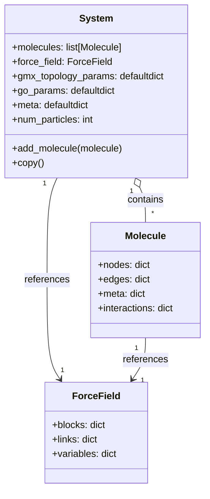
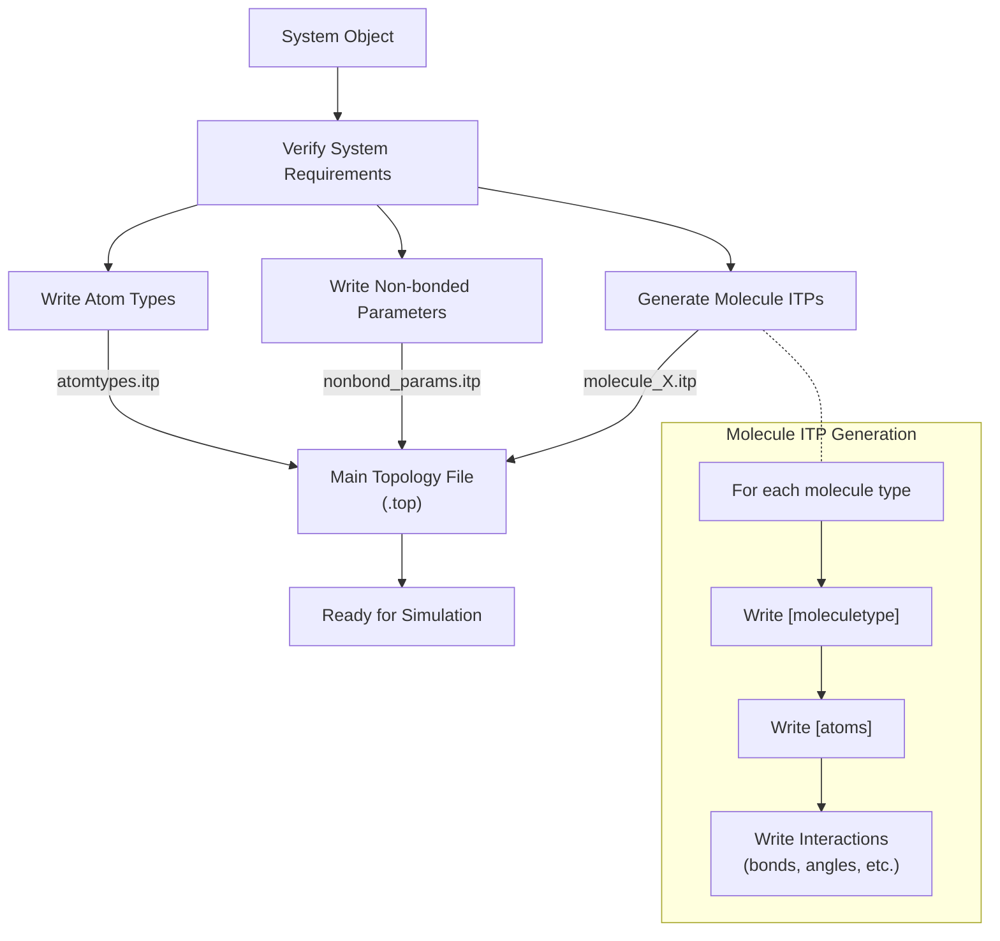
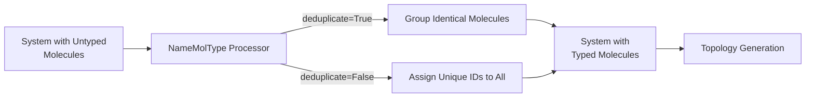
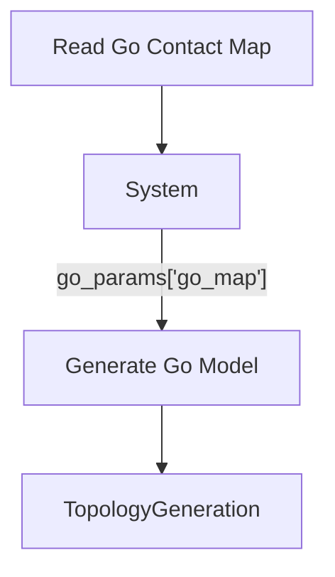
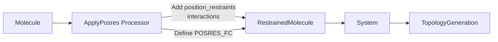

# System and Topology

<details>
<summary>Relevant source files</summary>

The following files were used as context for generating this wiki page:

- [doc/source/gromacs_variables.rst](doc/source/gromacs_variables.rst)
- [doc/source/index.rst](doc/source/index.rst)
- [vermouth/data/__init__.py](vermouth/data/__init__.py)
- [vermouth/data/data.py](vermouth/data/data.py)
- [vermouth/data/quotes.txt](vermouth/data/quotes.txt)
- [vermouth/gmx/itp.py](vermouth/gmx/itp.py)
- [vermouth/gmx/topology.py](vermouth/gmx/topology.py)
- [vermouth/processors/apply_posres.py](vermouth/processors/apply_posres.py)
- [vermouth/processors/quote.py](vermouth/processors/quote.py)
- [vermouth/system.py](vermouth/system.py)
- [vermouth/tests/gmx/test_itp.py](vermouth/tests/gmx/test_itp.py)
- [vermouth/tests/gmx/test_topology.py](vermouth/tests/gmx/test_topology.py)
- [vermouth/tests/rcsu/test_read_go_map.py](vermouth/tests/rcsu/test_read_go_map.py)
- [vermouth/tests/test_apply_posres.py](vermouth/tests/test_apply_posres.py)
- [vermouth/tests/test_name_moltype.py](vermouth/tests/test_name_moltype.py)

</details>


This page documents the `System` class in the VerMoUTH library and the process of generating molecular simulation topologies from these systems. The `System` class serves as a container for collections of molecules and provides the foundation for building complete molecular topologies for simulation software like GROMACS.

For details about the underlying molecular representation, see [Molecule Representation](#2.1). For information about force field definitions, see [Force Fields](#2.2).

## The System Class

The `System` class represents a complete molecular system consisting of one or more molecules that share a common force field. It serves as the primary container for molecules processed by the VerMoUTH library and provides the foundation for topology generation.



**Key Attributes:**

- `molecules`: A list of `Molecule` objects contained in the system
- `force_field`: The force field applied to all molecules in the system
- `gmx_topology_params`: A dictionary containing parameters for GROMACS topology generation, including:
  - `atomtypes`: List of atom type definitions
  - `nonbond_params`: List of non-bonded interaction parameters
- `go_params`: Parameters for structure-based Go models
- `meta`: System-wide metadata (e.g., header comments for output files)

**Key Methods:**

- `add_molecule(molecule)`: Adds a molecule to the system, enforcing force field consistency
- `num_particles`: Property that returns the total number of particles in the system
- `copy()`: Creates a deep copy of the system

Sources: [vermouth/system.py:19-96]()

## Topology Generation

The VerMoUTH library can generate complete molecular topologies in GROMACS format based on the molecules contained in a `System` object. This process creates a main topology (`.top`) file and multiple include topology (`.itp`) files.



The topology generation process involves several key components:

1. **Main Topology File**: A `.top` file that includes all the necessary components
2. **Atom Types File**: Contains definitions of all atom types used in the system
3. **Non-bonded Parameters File**: Contains parameters for non-bonded interactions
4. **Molecule ITP Files**: One file per molecule type, containing molecule-specific definitions

Sources: [vermouth/gmx/topology.py:116-256](), [vermouth/gmx/itp.py:58-251]()

## Molecular Type Assignment

Before generating topology files, molecules in the system need unique molecule type identifiers (moltypes). The `NameMolType` processor handles this task, either assigning unique identifiers to each molecule or deduplicating identical molecules.



When deduplication is enabled (default), molecules that share the same molecular structure are assigned the same moltype (e.g., "molecule_0"). This reduces redundancy in the output topology files.

Sources: [vermouth/processors/name_moltype.py](), [vermouth/tests/test_name_moltype.py:116-137]()

## Topology Parameters

The GROMACS topology parameters are stored in the `gmx_topology_params` attribute of the `System` class, which is a defaultdict containing various parameter types.

### Atom Types

Atom types define the physical properties of atoms in the system, including their mass, charge, and non-bonded interaction parameters.

```python
Atomtype = namedtuple('Atomtype', 'molecule node sigma epsilon meta')
```

Each atom type definition includes:
- Reference to the molecule and node (atom)
- Sigma and epsilon parameters for Lennard-Jones interactions
- Metadata (comments, conditionals, grouping)

### Non-bonded Parameters

Non-bonded parameters define how atoms of different types interact with each other.

```python
NonbondParam = namedtuple('NonbondParam', 'atoms sigma epsilon meta')
```

Each non-bonded parameter includes:
- Atom type identifiers (pair of atom types)
- Sigma and epsilon parameters for the interaction
- Metadata (comments, conditionals, grouping)

Sources: [vermouth/gmx/topology.py:17-18](), [vermouth/gmx/topology.py:40-114]()

## System-Level Simulation Features

The `System` class supports various system-level simulation features that are applied across molecules.

### Go Models

Go models are structure-based potentials that help maintain the 3D structure of proteins. The Go parameters are stored in the `go_params` attribute of the `System` class.



Go contact maps define which residue pairs should interact to maintain the protein structure. These maps can be read from external files and stored in the system for later processing.

Sources: [vermouth/tests/rcsu/test_read_go_map.py:59-71]()

### Position Restraints

Position restraints can be applied to atoms to limit their movement during simulation. These are often used during system equilibration.



Position restraints are implemented as special interactions in the molecule topology, with force constants that can be controlled through preprocessing directives in GROMACS.

Sources: [vermouth/processors/apply_posres.py:18-66](), [vermouth/tests/test_apply_posres.py:21-57]()

## Writing GROMACS Topologies

The `write_gmx_topology` function is the main entry point for generating GROMACS topology files from a `System` object.

### Main Topology File (TOP)

The main topology file includes:
- Preprocessor directives (defines)
- Include statements for force field parameters
- Include statements for molecule-specific ITP files
- System definition
- Molecules section listing the molecule types and their counts

### Atom Types and Non-bonded Parameters

Atom types and non-bonded parameters are written to separate ITP files that are included in the main topology:

- `write_atomtypes` generates the `[ atomtypes ]` section
- `write_nonbond_params` generates the `[ nonbond_params ]` section

### Molecule-Specific ITP Files

For each molecule type in the system, a separate ITP file is generated containing:
- Molecule type definition
- Atoms section with atom properties
- Interaction sections (bonds, angles, dihedrals, etc.)
- Optional preprocessor conditionals for flexibility

Sources: [vermouth/gmx/topology.py:116-256](), [vermouth/gmx/itp.py:58-251]()

## Example System and Topology Workflow

The following table illustrates the typical workflow for creating a system and generating topology files:

| Step | Description | Key Components |
|------|-------------|----------------|
| 1 | Create a System object | `system = System()` |
| 2 | Add molecules to the system | `system.add_molecule(molecule)` |
| 3 | Assign molecule types | `NameMolType().run_system(system)` |
| 4 | Define topology parameters | `system.gmx_topology_params['atomtypes']` |
| 5 | Apply structural features | Position restraints, elastic networks, Go models |
| 6 | Write topology files | `write_gmx_topology(system, top_path)` |

This workflow integrates with the broader VerMoUTH processing pipeline, particularly in the final steps where processed molecular structures are converted to simulation-ready topologies.

Sources: [vermouth/tests/gmx/test_topology.py:162-209]()

## Summary

The `System` class serves as a container for collections of molecules and provides the foundation for generating complete molecular topologies. It stores all the information needed to write GROMACS topology files, including atom types, non-bonded parameters, and molecule-specific interactions.

The topology generation process converts this information into a set of interconnected files that define the molecular system for simulation, following GROMACS file format conventions. This process is highly customizable through the use of metadata, preprocessor directives, and system-level parameters.

---