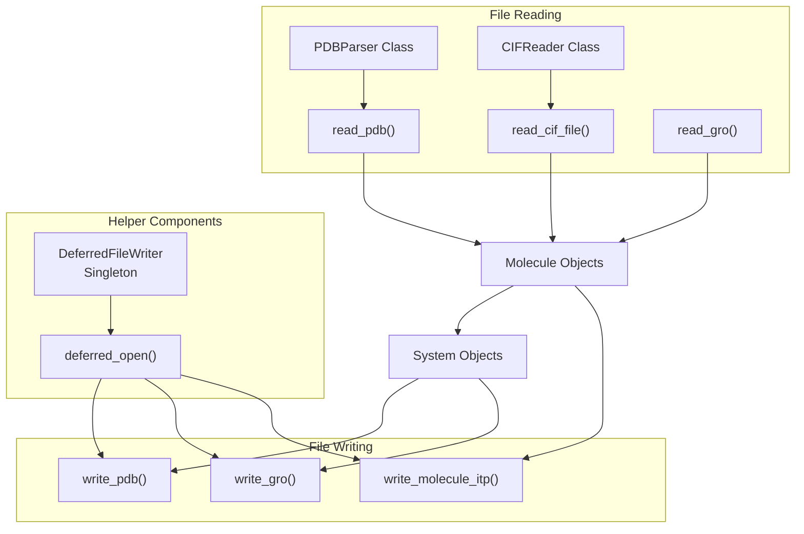
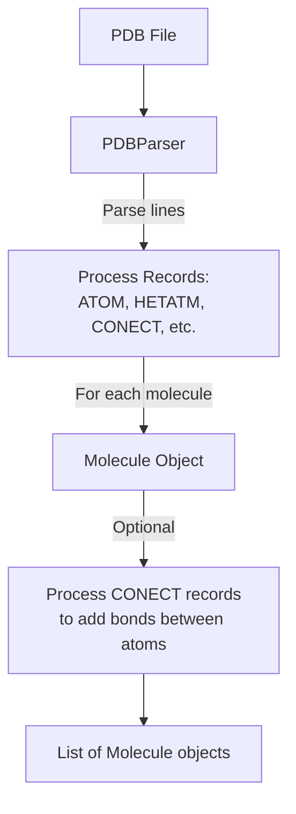
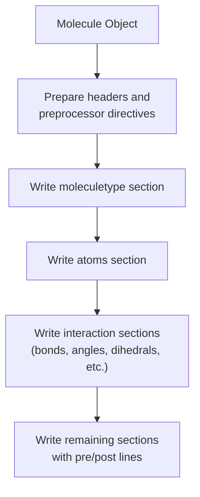
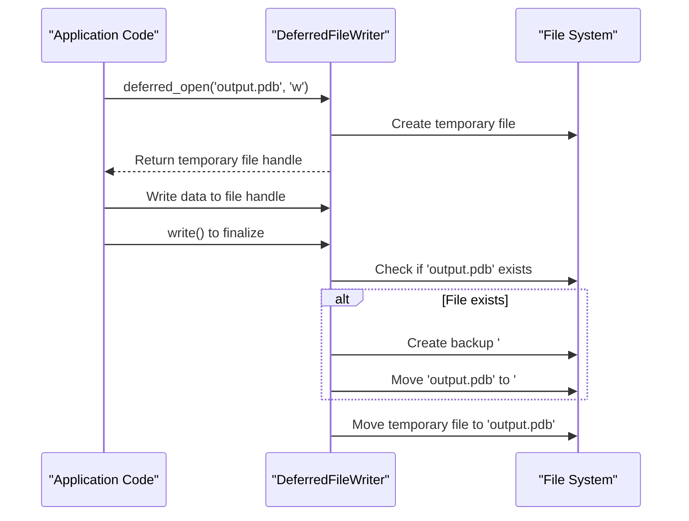

# File I/O

<details>
<summary>Relevant source files</summary>

The following files were used as context for generating this wiki page:

- [doc/source/gromacs_variables.rst](doc/source/gromacs_variables.rst)
- [doc/source/index.rst](doc/source/index.rst)
- [requirements-tests.txt](requirements-tests.txt)
- [vermouth/file_writer.py](vermouth/file_writer.py)
- [vermouth/gmx/__init__.py](vermouth/gmx/__init__.py)
- [vermouth/gmx/gro.py](vermouth/gmx/gro.py)
- [vermouth/gmx/itp.py](vermouth/gmx/itp.py)
- [vermouth/pdb/__init__.py](vermouth/pdb/__init__.py)
- [vermouth/pdb/cif.py](vermouth/pdb/cif.py)
- [vermouth/pdb/pdb.py](vermouth/pdb/pdb.py)
- [vermouth/processors/apply_posres.py](vermouth/processors/apply_posres.py)
- [vermouth/processors/cif_reader.py](vermouth/processors/cif_reader.py)
- [vermouth/tests/data/1UBQ.cif](vermouth/tests/data/1UBQ.cif)
- [vermouth/tests/data/1UBQ.pdb](vermouth/tests/data/1UBQ.pdb)
- [vermouth/tests/data/1UBQ_nocell_occupancy.cif](vermouth/tests/data/1UBQ_nocell_occupancy.cif)
- [vermouth/tests/data/6E8W.pdb](vermouth/tests/data/6E8W.pdb)
- [vermouth/tests/data/cif_missing_atomname.cif](vermouth/tests/data/cif_missing_atomname.cif)
- [vermouth/tests/data/cif_missing_resname.cif](vermouth/tests/data/cif_missing_resname.cif)
- [vermouth/tests/data/multiple.cif](vermouth/tests/data/multiple.cif)
- [vermouth/tests/datafiles.py](vermouth/tests/datafiles.py)
- [vermouth/tests/gmx/test_gro.py](vermouth/tests/gmx/test_gro.py)
- [vermouth/tests/gmx/test_itp.py](vermouth/tests/gmx/test_itp.py)
- [vermouth/tests/integration_tests/test_integration.py](vermouth/tests/integration_tests/test_integration.py)
- [vermouth/tests/pdb/test_cif.py](vermouth/tests/pdb/test_cif.py)
- [vermouth/tests/pdb/test_read_pdb.py](vermouth/tests/pdb/test_read_pdb.py)
- [vermouth/tests/pdb/test_write_pdb.py](vermouth/tests/pdb/test_write_pdb.py)
- [vermouth/tests/test_apply_posres.py](vermouth/tests/test_apply_posres.py)
- [vermouth/tests/test_cif_reader.py](vermouth/tests/test_cif_reader.py)
- [vermouth/tests/test_file_writer.py](vermouth/tests/test_file_writer.py)
- [vermouth/tests/test_name_moltype.py](vermouth/tests/test_name_moltype.py)

</details>


This page documents the file input/output capabilities of the VerMoUTH and Martinize2 system. It covers how the system reads and writes molecular structure files (PDB, GRO, CIF) and topology files (ITP), and details the deferred file writing mechanism that ensures output files are only written when processing completes successfully.

## Supported File Formats

VerMoUTH supports several molecular structure and topology file formats:

| Format | Read | Write | Description |
|--------|------|-------|-------------|
| PDB | ✓ | ✓ | Protein Data Bank format - standard format for 3D molecular structures |
| GRO | ✓ | ✓ | GROMACS structure format - contains molecular coordinates and velocities |
| CIF | ✓ | ✗ | Crystallographic Information File - detailed structural data format |
| ITP | ✓ | ✓ | GROMACS include topology file - contains molecular topology information |

## File I/O Components



Sources: 
- [vermouth/pdb/pdb.py:22-47]()
- [vermouth/pdb/cif.py:21-36]()
- [vermouth/gmx/gro.py:18-28]() 
- [vermouth/file_writer.py:14-34]()

## Reading Molecular Structure Files

### PDB File Reading

The `PDBParser` class parses Protein Data Bank (PDB) files line by line, extracting atomic coordinates and other metadata to create `Molecule` objects. Multiple molecules can be parsed from a single PDB file.



Key features of the PDB parser:
- Processes ATOM and HETATM records to create atoms with 3D coordinates
- Handles CONECT records to establish bonds between atoms
- Supports MODEL/ENDMDL records for multiple models
- Processes TER records to separate molecules
- Extracts crystal information from CRYST1 records
- Can exclude specific residue types (e.g., water molecules)
- Can ignore hydrogen atoms

Usage example:
```python
from vermouth.pdb import read_pdb

# Read molecules from a PDB file
molecules = read_pdb('protein.pdb', exclude=('SOL', 'HOH'), ignh=False)
```

Sources:
- [vermouth/pdb/pdb.py:32-446]()
- [vermouth/tests/pdb/test_read_pdb.py:138-168]()

### GRO File Reading

The `read_gro()` function parses GROMACS structure (GRO) files to create `Molecule` objects. GRO files contain atom coordinates and, optionally, velocities.

Key features:
- Parses atom positions and optional velocities
- Extracts box dimensions
- Can exclude specific residue types
- Can ignore hydrogen atoms
- Detects file format precision automatically

Usage example:
```python
from vermouth.gmx import read_gro

# Read a molecule from a GRO file
molecule = read_gro('system.gro', exclude=('SOL',), ignh=False)
```

Sources:
- [vermouth/gmx/gro.py:29-115]()
- [vermouth/tests/gmx/test_gro.py:529-543]()

### CIF File Reading

The `CIFReader` class reads Crystallographic Information Files (CIF), extracting atomic coordinates and metadata to create `Molecule` objects.

Key features:
- Uses the PyCifRW library to parse CIF files
- Extracts atom positions and properties
- Reads cell dimensions
- Can exclude specific residue types
- Can ignore hydrogen atoms
- Supports multiple models in a single file

Usage example:
```python
from vermouth.pdb import CIFReader

# Read molecules from a CIF file
reader = CIFReader(file='protein.cif', exclude=('SOL', 'HOH'), ignh=False, modelidx=1)
molecules = reader.reader()
```

Sources:
- [vermouth/pdb/cif.py:162-237]()
- [vermouth/processors/cif_reader.py:29-60]()
- [vermouth/tests/pdb/test_cif.py:110-128]()

## Writing Molecular Structure Files

### PDB File Writing

The `write_pdb()` function converts a `System` object (containing one or more molecules) to a PDB-formatted file.

Key features:
- Writes atom coordinates with proper PDB formatting
- Can optionally write CONECT records for bonds
- Can omit charges or convert them to PDB format
- Option to handle missing atomic positions (by writing NaN coordinates)
- Uses the deferred file writing mechanism to ensure file integrity

Usage example:
```python
from vermouth.pdb import write_pdb
from vermouth import System

system = System()
# Add molecules to the system
# ...

# Write the system to a PDB file
write_pdb(system, 'output.pdb', conect=True, omit_charges=True)
```

Sources:
- [vermouth/pdb/pdb.py:502-626]()
- [vermouth/tests/pdb/test_write_pdb.py:87-111]()

### GRO File Writing

The `write_gro()` function converts a `System` object to a GROMACS structure (GRO) file.

Key features:
- Writes atom coordinates with proper GRO formatting
- Writes velocities if available
- Configurable precision for coordinates and velocities
- Writes box dimensions
- Uses the deferred file writing mechanism

Usage example:
```python
from vermouth.gmx import write_gro
from vermouth import System

system = System()
# Add molecules to the system
# ...

# Write the system to a GRO file
write_gro(system, 'output.gro', precision=7, title='Martinized!', box=(10.0, 10.0, 10.0))
```

Sources:
- [vermouth/gmx/gro.py:118-176]()
- [vermouth/tests/gmx/test_gro.py:554-570]()

## Writing Topology Files

### ITP File Writing

The `write_molecule_itp()` function writes a `Molecule` object to a GROMACS topology include (ITP) file.



Key features:
- Writes moleculetype definition with exclusion number
- Writes atoms with their properties (type, charge, mass, etc.)
- Writes various interaction types (bonds, angles, dihedrals, etc.)
- Supports #ifdef/#ifndef preprocessing directives
- Supports pre- and post-section custom lines
- Groups interactions by metadata (ifdef/ifndef, group)

Usage example:
```python
from vermouth.gmx import write_molecule_itp
from vermouth import Molecule

molecule = Molecule()
# Add atoms and interactions to the molecule
# ...

# Write the molecule to an ITP file
with open('molecule.itp', 'w') as outfile:
    write_molecule_itp(molecule, outfile, header=['Generated by Martinize2'], moltype='Protein')
```

Sources:
- [vermouth/gmx/itp.py:58-251]()
- [vermouth/tests/gmx/test_itp.py:89-215]()

## Deferred File Writing

The VerMoUTH system includes a sophisticated deferred file writing mechanism implemented as a singleton class called `DeferredFileWriter`. This ensures that output files are only written when processing completes successfully, and existing files are backed up before being overwritten.



Key features:
- Files are initially written to temporary locations
- Original files are only replaced when explicitly requested via the `write()` method
- Existing files are backed up using GROMACS-style naming (#file.n#)
- Supports various file modes ('r', 'w', 'a', 'r+', 'w+', etc.)
- Handles both text and binary files
- Cleans up temporary files if writing is aborted

Usage example:
```python
from vermouth.file_writer import deferred_open, DeferredFileWriter

# Open a file for writing (creates a temporary file)
with deferred_open('output.pdb', 'w') as outfile:
    outfile.write('ATOM...')

# At this point, the temporary file is still not moved to the final location
# To commit all pending files:
DeferredFileWriter().write()
```

Sources:
- [vermouth/file_writer.py:36-205]()
- [vermouth/tests/test_file_writer.py:64-79]()
- [vermouth/pdb/pdb.py:590-626]()
- [vermouth/gmx/gro.py:148-152]()

## File I/O in the Processing Pipeline

File I/O operations are integrated into the VerMoUTH processing pipeline through specialized processor classes.

### CIF Input Processor

The `CIFInput` processor reads a CIF file and adds the resulting molecules to a system.

Usage example:
```python
from vermouth import System
from vermouth.processors import CIFInput

system = System()
CIFInput(filename='protein.cif', exclude=('HOH',), ignh=False).run_system(system)
```

Sources:
- [vermouth/processors/cif_reader.py:29-60]()
- [vermouth/tests/test_cif_reader.py:25-29]()

## Integration with Position Restraints

The system supports writing position restraints to ITP files. Position restraints are essential for minimization and equilibration in molecular dynamics simulations.

The `ApplyPosres` processor adds position restraint interactions to molecules. These are written as preprocessor directives in ITP files, allowing them to be activated or deactivated via the GROMACS mdp file.

Usage example:
```python
from vermouth.processors import ApplyPosres
from vermouth.selectors import select_backbone

# Apply position restraints to backbone atoms
ApplyPosres((select_backbone, "BB"), 1000).run_system(system)
```

Sources:
- [vermouth/processors/apply_posres.py:18-66]()
- [vermouth/tests/test_apply_posres.py:21-58]()
- [doc/source/gromacs_variables.rst:24-42]()

---