# Processing Pipeline

Relevant source files

The following files were used as context for generating this wiki page:

- [bin/martinize2](bin/martinize2)
- [vermouth/dssp/dssp.py](vermouth/dssp/dssp.py)
- [vermouth/graph_utils.py](vermouth/graph_utils.py)
- [vermouth/ismags.py](vermouth/ismags.py)
- [vermouth/map_input.py](vermouth/map_input.py)
- [vermouth/map_parser.py](vermouth/map_parser.py)
- [vermouth/processors/__init__.py](vermouth/processors/__init__.py)
- [vermouth/processors/annotate_idrs.py](vermouth/processors/annotate_idrs.py)
- [vermouth/processors/canonicalize_modifications.py](vermouth/processors/canonicalize_modifications.py)
- [vermouth/processors/do_mapping.py](vermouth/processors/do_mapping.py)
- [vermouth/processors/repair_graph.py](vermouth/processors/repair_graph.py)
- [vermouth/tests/helper_functions.py](vermouth/tests/helper_functions.py)
- [vermouth/tests/test_annotate_idrs.py](vermouth/tests/test_annotate_idrs.py)
- [vermouth/tests/test_do_mapping.py](vermouth/tests/test_do_mapping.py)
- [vermouth/tests/test_dssp.py](vermouth/tests/test_dssp.py)
- [vermouth/tests/test_graph_utils.py](vermouth/tests/test_graph_utils.py)
- [vermouth/tests/test_ismags.py](vermouth/tests/test_ismags.py)
- [vermouth/tests/test_map_input.py](vermouth/tests/test_map_input.py)
- [vermouth/tests/test_mapping_integrative.py](vermouth/tests/test_mapping_integrative.py)
- [vermouth/tests/test_ptm_detection.py](vermouth/tests/test_ptm_detection.py)
- [vermouth/tests/test_repair_graph.py](vermouth/tests/test_repair_graph.py)
- [vermouth/tests/test_selectors.py](vermouth/tests/test_selectors.py)
- [vermouth/tests/test_version.py](vermouth/tests/test_version.py)

The Processing Pipeline is the core workflow in VerMoUTH that transforms molecular structures through a series of well-defined steps. It handles everything from reading input files to generating coarse-grained models with the desired structural features. This page explains how the pipeline is structured, how each processor works, and how they combine to create a flexible transformation system.

For information about specific processors, see their respective dedicated pages in the [Core Components](#2) section. For details on adding structural features like elastic networks, see [Structural Features](#3.4).

## Pipeline Overview

The Processing Pipeline applies a sequence of transformation steps (processors) to molecular structures. Each processor performs a specific task and can be combined flexibly to achieve different outcomes.

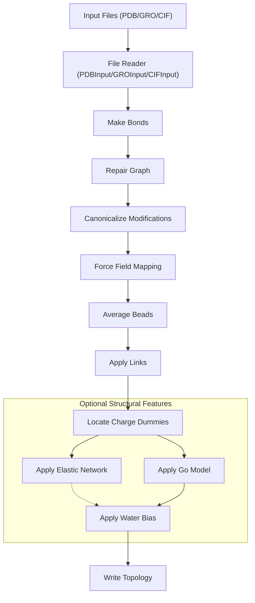

Sources: [bin/martinize2:106-167](), [bin/martinize2:162-191](), [vermouth/processors/__init__.py]()

## Processor Architecture

Processors are the building blocks of the pipeline. Each processor implements a standard interface allowing them to be chained together.

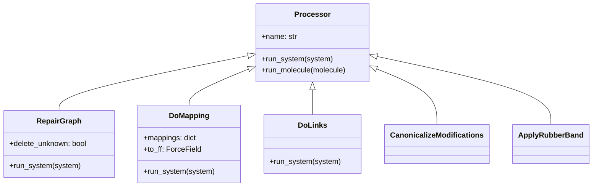

Each processor follows a common pattern:
1. Accepts a `System` object containing `Molecule` objects
2. Transforms the system or its molecules
3. Returns the modified system

Sources: [vermouth/processors/processor.py](), [vermouth/processors/__init__.py]()

## Key Pipeline Stages

### Input Reading

The pipeline begins by reading input files and creating a molecular system.

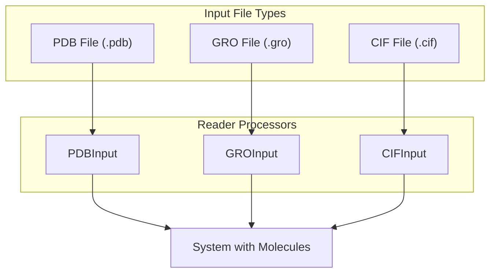

The system is populated with molecules containing atoms but typically without explicitly defined bonds. Bonds are added in the next step.

Sources: [bin/martinize2:81-104](), [vermouth/processors/pdb_reader.py](), [vermouth/processors/gro_reader.py](), [vermouth/processors/cif_reader.py]()

### Making Bonds

The `MakeBonds` processor creates connections between atoms in the molecule.

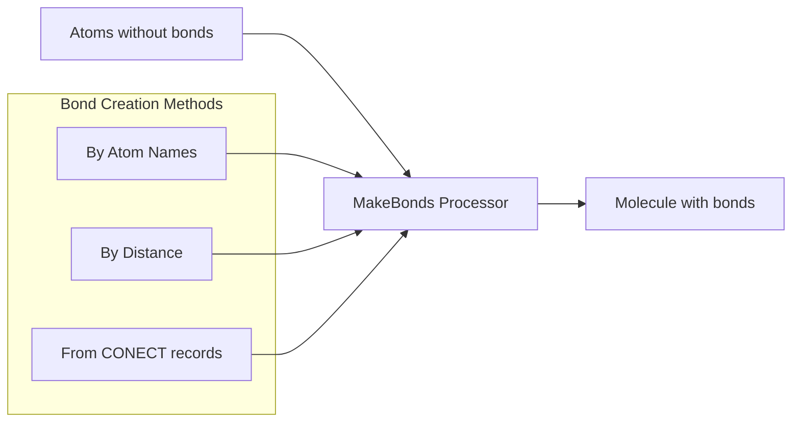

Bonds can be created based on:
- Atom naming conventions in standard residues
- Distance between atoms (using van der Waals radii)
- CONECT records from input files (if available)

Sources: [bin/martinize2:132-136](), [vermouth/processors/make_bonds.py]()

### Graph Repair

The `RepairGraph` processor is responsible for fixing incomplete molecular structures by:
1. Identifying missing atoms
2. Adding these atoms with the correct connectivity
3. Correcting atom names that don't match the reference force field

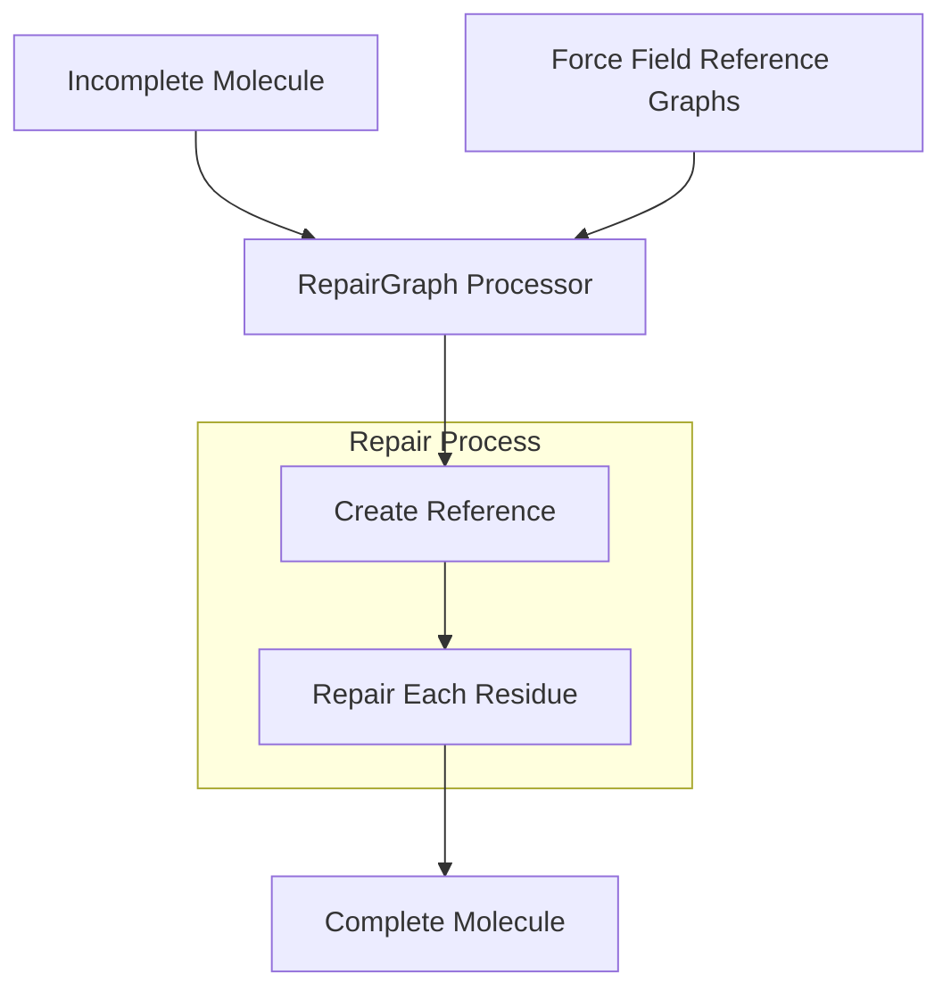

This step ensures that all molecules contain the complete set of atoms expected by the force field.

Sources: [bin/martinize2:144-147](), [vermouth/processors/repair_graph.py](), [vermouth/graph_utils.py]()

### Canonicalization of Modifications

The `CanonicalizeModifications` processor handles post-translational modifications (PTMs) and other molecular modifications:

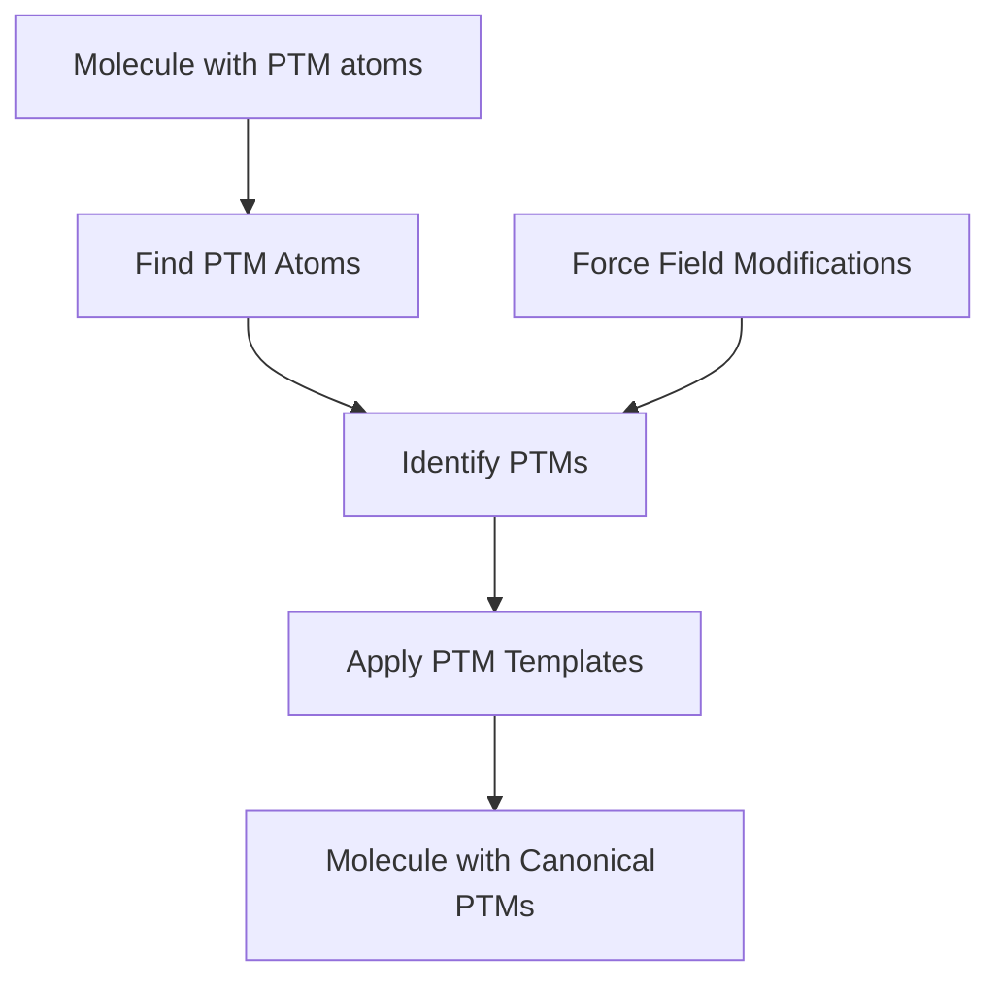

This processor:
1. Identifies atoms marked as modifications
2. Matches them against known modification patterns
3. Applies the correct templates from the force field

Sources: [bin/martinize2:156-157](), [vermouth/processors/canonicalize_modifications.py]()

### Resolution Mapping (DoMapping)

The `DoMapping` processor is central to coarse-graining, transforming molecules from one resolution to another:

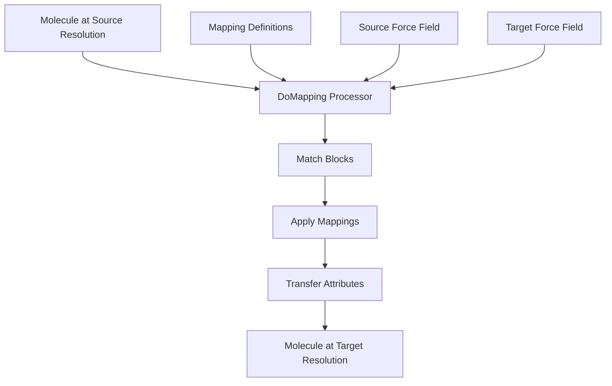

The mapping process involves:
1. Finding correspondences between atoms in the source molecule and beads in the target molecule
2. Creating a new molecule at the target resolution
3. Transferring appropriate properties from the source to the target

Sources: [bin/martinize2:174-177](), [vermouth/processors/do_mapping.py]()

### Bead Position Averaging

After mapping, the `DoAverageBead` processor calculates positions for the coarse-grained beads:

Bead positions are typically calculated as a weighted average of the positions of the atoms that map to each bead.

Sources: [bin/martinize2:183-184](), [vermouth/processors/average_beads.py]()

### Applying Links

The `DoLinks` processor applies links between residues and adds the appropriate interactions:

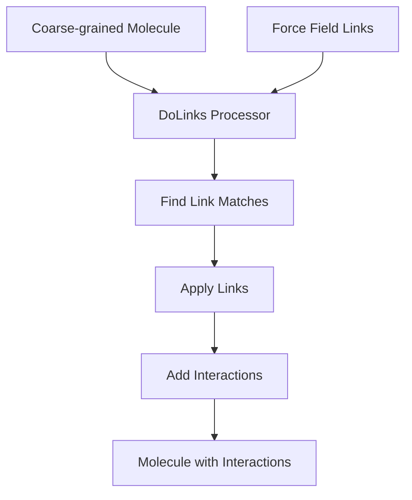

This step adds bonds, angles, dihedrals, and other interactions between residues according to the force field definition.

Sources: [bin/martinize2:188-189](), [vermouth/processors/do_links.py]()

### Secondary Structure Assignment

Secondary structure can be assigned in several ways:

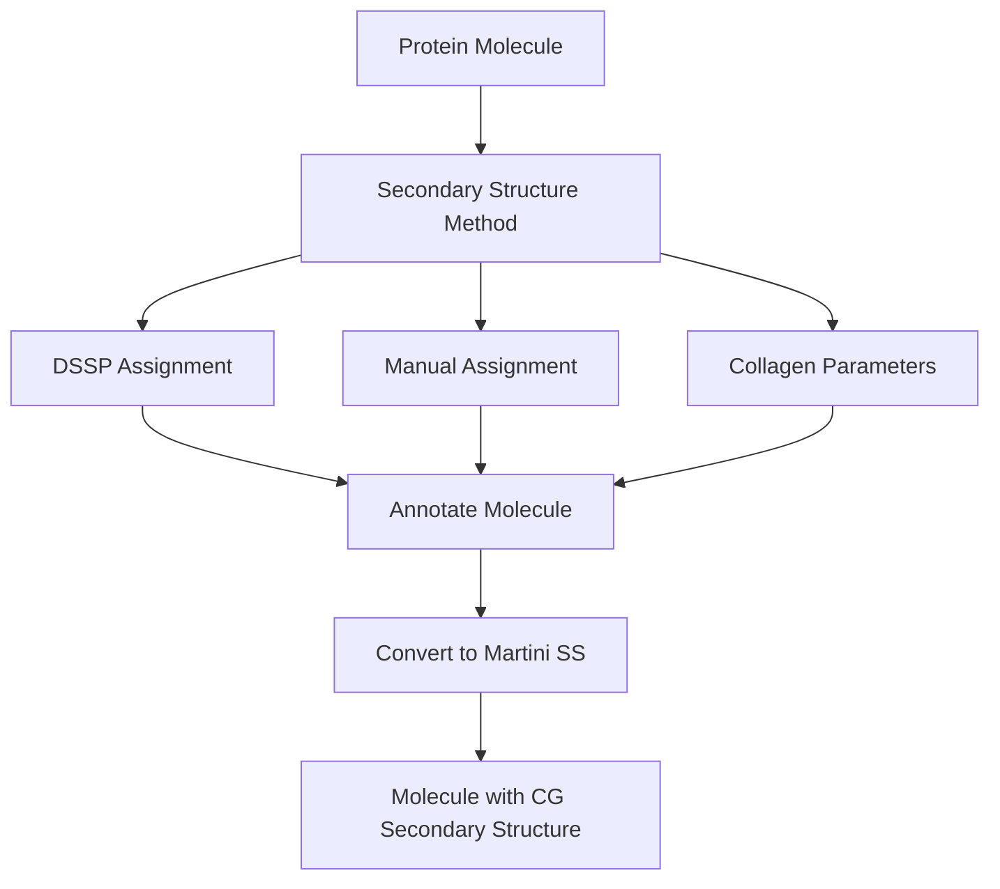

The secondary structure assignment is crucial for determining the appropriate parameters for the coarse-grained model, particularly for elastic networks and backbone parameters.

Sources: [bin/martinize2:924-949](), [vermouth/dssp/dssp.py]()

## Optional Structural Features

### Elastic Networks

Elastic networks can be added to maintain the tertiary structure of proteins:

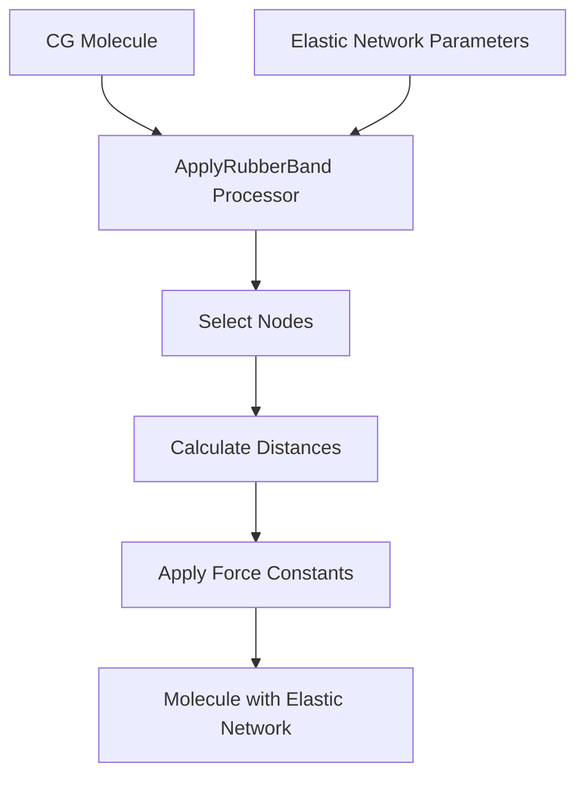

The elastic network adds harmonic bonds between selected beads (typically backbone beads) within a certain distance cutoff, with force constants that can decay with distance.

Sources: [bin/martinize2:472-546](), [vermouth/processors/apply_rubber_band.py]()

### Go Models

Go models provide an alternative approach to maintaining structure:

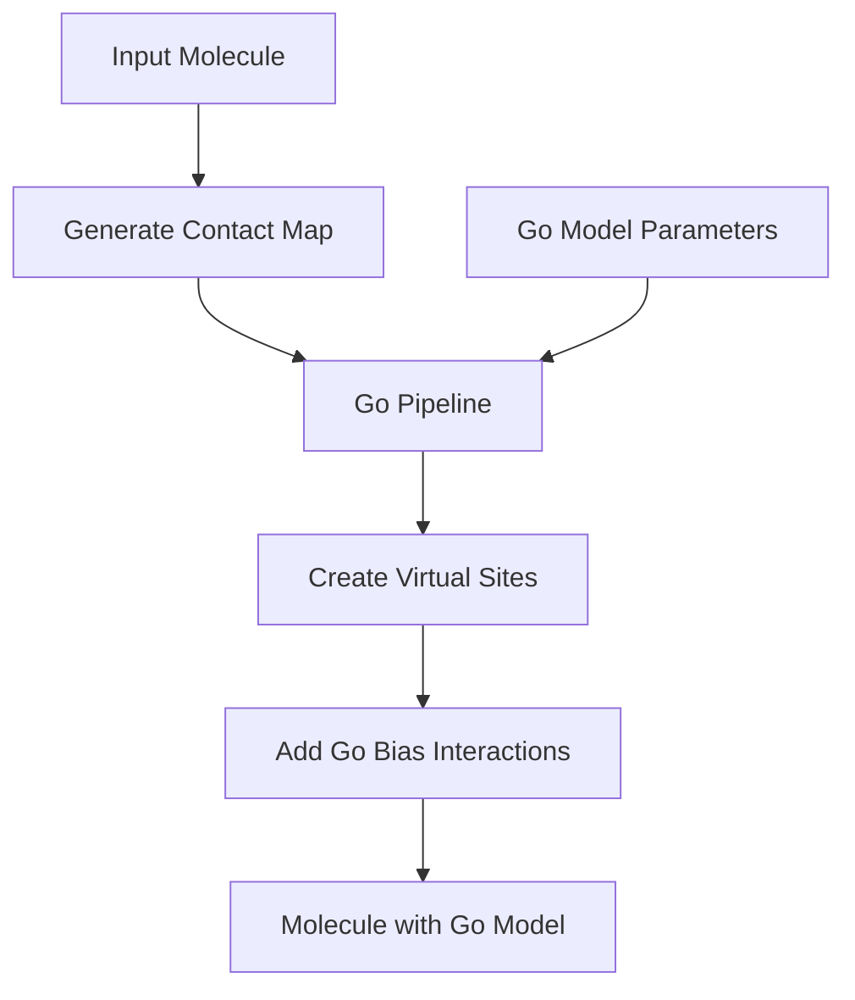

Go models use structure-based potentials between virtual sites to maintain the native structure of proteins.

Sources: [bin/martinize2:547-608](), [vermouth/rcsu/go_pipeline.py](), [vermouth/rcsu/contact_map.py]()

### Water Bias

Water bias can be applied to affect the solvation behavior of different regions:

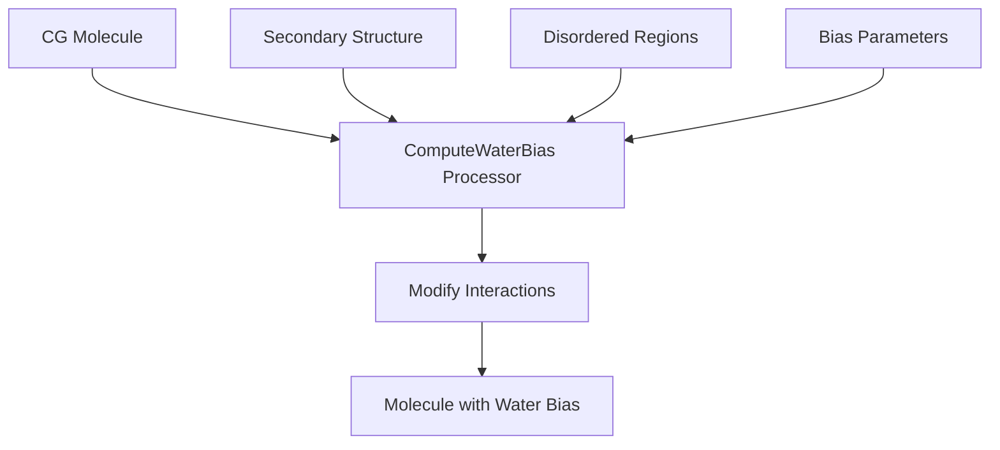

Water bias adjusts the interactions of specific regions (like helices, sheets, or disordered regions) with water to better reproduce experimental behavior.

Sources: [bin/martinize2:610-645](), [vermouth/processors/water_bias.py]()

## Integration in Martinize2

The entire pipeline is integrated into the `martinize2` command-line tool, which configures and runs the appropriate processors based on user arguments:

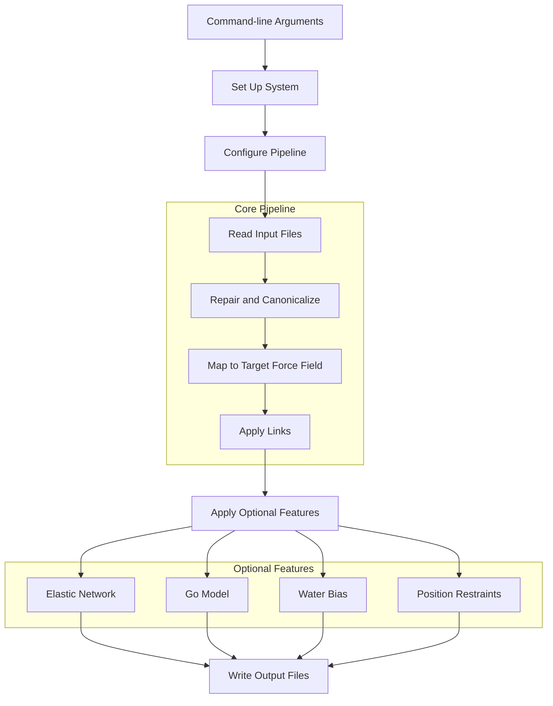

This integration provides a flexible and powerful tool for coarse-graining molecular structures with various customization options.

Sources: [bin/martinize2:289-781](), [bin/martinize2:923-1057]()

## Error Handling and Logging

The pipeline includes comprehensive error handling and logging to help users identify and fix issues:

| Log Level | Purpose | Example |
|-----------|---------|---------|
| ERROR | Critical issues that prevent completion | Can't find isomorphism between residue and its reference |
| WARNING | Issues that might affect results | Unknown post-translational modifications |
| INFO | Major processing steps | Reading input, applying mappings |
| DEBUG | Detailed processing information | Adding specific atoms |

Sources: [bin/martinize2:54-77](), [vermouth/log_helpers.py]()

## Extending the Pipeline

The modular nature of the processing pipeline makes it relatively straightforward to extend:

1. Create a new processor class inheriting from `Processor`
2. Implement the `run_system` and/or `run_molecule` methods
3. Insert the processor at the appropriate point in the pipeline

This architecture allows for great flexibility in customizing the coarse-graining process to meet specific research needs.

Sources: [vermouth/processors/processor.py](), [vermouth/processors/__init__.py]()

---