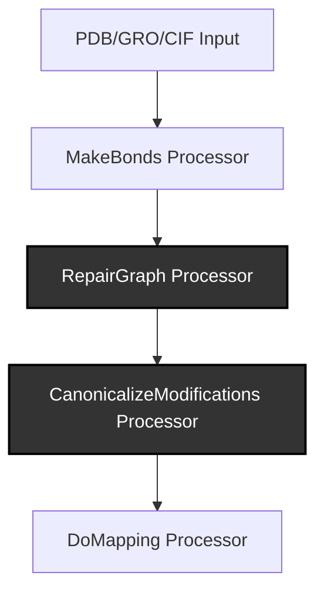
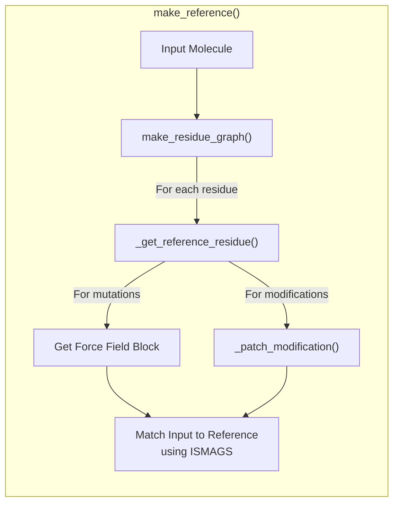
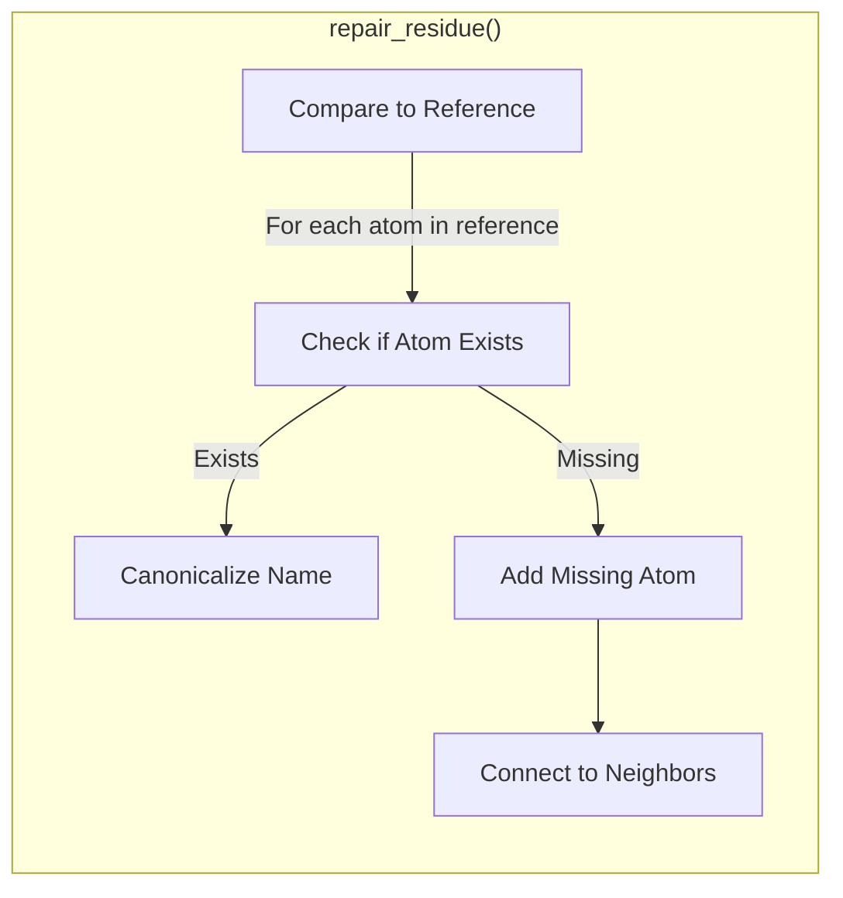
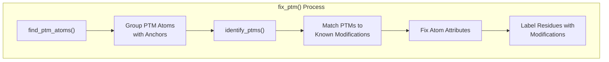
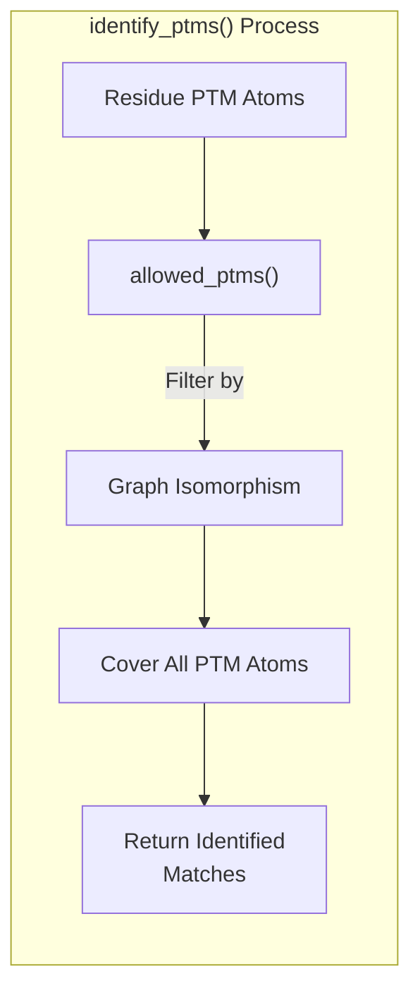

# Graph Repair and Canonicalization

<details>
<summary>Relevant source files</summary>

The following files were used as context for generating this wiki page:

- [vermouth/graph_utils.py](vermouth/graph_utils.py)
- [vermouth/ismags.py](vermouth/ismags.py)
- [vermouth/processors/canonicalize_modifications.py](vermouth/processors/canonicalize_modifications.py)
- [vermouth/processors/make_bonds.py](vermouth/processors/make_bonds.py)
- [vermouth/processors/repair_graph.py](vermouth/processors/repair_graph.py)
- [vermouth/tests/helper_functions.py](vermouth/tests/helper_functions.py)
- [vermouth/tests/test_graph_utils.py](vermouth/tests/test_graph_utils.py)
- [vermouth/tests/test_ismags.py](vermouth/tests/test_ismags.py)
- [vermouth/tests/test_make_bonds.py](vermouth/tests/test_make_bonds.py)
- [vermouth/tests/test_ptm_detection.py](vermouth/tests/test_ptm_detection.py)
- [vermouth/tests/test_repair_graph.py](vermouth/tests/test_repair_graph.py)

</details>


This page documents the graph repair and canonicalization components of the vermouth-martinize system, which are responsible for fixing incomplete molecular structures and standardizing molecular modifications. These processes are essential intermediate steps in the processing pipeline between reading molecular input files and mapping to coarse-grained representations.

For information about how molecules are initially constructed from input files, see [File I/O](#2.4). For details on how force field mapping is applied to the repaired molecules, see [Force Field Mapping](#3.2).

## Purpose and Role in Pipeline

Graph repair addresses a common problem in molecular simulations: incomplete or inconsistent structural data from experimental sources. The repair process:

1. Identifies missing atoms in molecular structures
2. Adds these missing atoms based on reference structures from the force field
3. Corrects atom naming inconsistencies
4. Identifies and standardizes modifications (like protonations or post-translational modifications)



Sources: [vermouth/processors/repair_graph.py:478-507](), [vermouth/processors/canonicalize_modifications.py:372-382]()

## The Repair Graph Process

The repair process works by comparing the molecule to a reference structure from the force field, then identifying and fixing differences.

```mermaid
flowchart TB
    subgraph "Main Repair Process"
        makeRef["make_reference()"] --> repGraph["repair_graph()"]
    end
    
    subgraph "make_reference()"
        readMol["Input Molecule"] --> resPart["Make Residue Graph"]
        resPart --> refBlock["Get Reference Block\nfor each Residue"]
        refBlock --> matchRes["Match Residue to Reference"]
    end
    
    subgraph "repair_graph()"
        repRes["repair_residue()\nfor each residue"] --> misAtoms["Add Missing Atoms"]
        misAtoms --> fixNames["Correct Atom Names"]
        fixNames --> markPTM["Mark PTM Atoms"]
    end
```



Sources: [vermouth/processors/repair_graph.py:157-304](), [vermouth/processors/repair_graph.py:307-414](), [vermouth/processors/repair_graph.py:415-475]()

### Reference Creation

The first step is creating a reference graph that describes how the input molecule should look according to the force field:

1. The molecule is partitioned into residues
2. For each residue, the corresponding reference block is retrieved from the force field
3. Mutations and modifications are applied to the reference block if specified
4. The input residue is matched to the reference using a subgraph isomorphism algorithm (ISMAGS)



Sources: [vermouth/processors/repair_graph.py:157-304](), [vermouth/processors/repair_graph.py:113-154](), [vermouth/processors/repair_graph.py:58-110](), [vermouth/ismags.py:113-564]()

### Repairing Residues

Once the reference graph is created, the `repair_graph` function:

1. For each residue, calls `repair_residue` to:
   - Match atoms between the input and reference
   - Canonicalize atom names based on the reference
   - Identify missing atoms
   - Add missing atoms by placing them according to the reference
2. Mark atoms not present in the reference as PTM (post-translational modification) atoms



Sources: [vermouth/processors/repair_graph.py:307-414]()

### Handling Special Cases

The repair process handles several special cases:

1. **Mutations**: When a residue should be mutated to a different type
2. **Modifications**: When a residue has modifications like protonation states
3. **Missing heavy atoms**: These are reconstructed based on the reference
4. **Missing hydrogens**: These are added with correct connectivity

Examples of mutations and modifications:

```
Mutation:     ALA → GLY (changes residue type)
Modification: GLU → GLU-H (adds a proton to glutamic acid)
```

Sources: [vermouth/processors/repair_graph.py:113-154](), [vermouth/tests/test_repair_graph.py:279-298]()

## Canonicalizing Modifications

After repairing the graph, the next step is to canonicalize any modifications (like PTMs or protonations) by using the `CanonicalizeModifications` processor:



Sources: [vermouth/processors/canonicalize_modifications.py:251-370](), [vermouth/processors/canonicalize_modifications.py:53-111](), [vermouth/processors/canonicalize_modifications.py:114-189]()

### PTM Detection

The process of detecting and canonicalizing PTMs involves:

1. Identifying all atoms marked as `PTM_atom=True` (usually done by `RepairGraph`)
2. Grouping these atoms into connected components
3. Finding the "anchor" atoms that connect these PTM atoms to the main structure
4. Matching these groups to known modifications in the force field
5. Updating atom names and attributes based on the identified modifications



Sources: [vermouth/processors/canonicalize_modifications.py:114-189](), [vermouth/processors/canonicalize_modifications.py:225-248]()

## Implementation Details

### RepairGraph Processor

The `RepairGraph` processor is the main entry point for the graph repair process:

```python
class RepairGraph(Processor):
    """
    Repairs a molecule such that it contains all atoms with appropriate atom
    names, as per the blocks in the system's force field, while taking any
    mutations and modification into account.
    """
    def __init__(self, delete_unknown=False, include_graph=True):
        ...
    
    def run_molecule(self, molecule):
        molecule = molecule.copy()
        reference_graph = make_reference(molecule)
        repair_graph(molecule, reference_graph, include_graph=self.include_graph)
        return molecule
```

Sources: [vermouth/processors/repair_graph.py:478-507]()

### CanonicalizeModifications Processor

The `CanonicalizeModifications` processor identifies and standardizes modifications:

```python
class CanonicalizeModifications(Processor):
    """
    Identifies all modifications in a molecule and corrects their atom names.
    """
    def run_molecule(self, molecule):
        fix_ptm(molecule)
        return molecule
```

Sources: [vermouth/processors/canonicalize_modifications.py:372-382]()

## Usage and Integration

The repair and canonicalization processors typically appear in sequence in the processing pipeline:

1. First, bonds are created using the `MakeBonds` processor
2. Then, the `RepairGraph` processor adds missing atoms and fixes names
3. Next, the `CanonicalizeModifications` processor standardizes modifications
4. Finally, the molecule is ready for mapping to the target resolution

Example sequence:

```python
# Typical processor sequence
processors = [
    MakeBonds(),
    RepairGraph(),
    CanonicalizeModifications(),
    DoMapping(target_forcefield)
]

system = System()
# Add molecules to system
for processor in processors:
    processor.run_system(system)
```

Sources: [vermouth/tests/test_repair_graph.py:171-180]()

## Practical Examples

### Handling Missing Atoms

When atoms are missing in an input structure, the repair process adds them:

| Before Repair | After Repair |
|---------------|--------------|
| N, CA, C      | N, CA, C, O, H, HA1, HA2 |

Sources: [vermouth/tests/test_repair_graph.py:116-120]()

### Handling Mutations

When a residue should be mutated:

| Input Attribute | Effect |
|-----------------|--------|
| `molecule.nodes[idx]['mutation'] = ['ALA']` | Residue will be mutated to alanine |

Sources: [vermouth/tests/test_repair_graph.py:279-298]()

### Handling Modifications

When a residue has a modification:

| Input Attribute | Effect |
|-----------------|--------|
| `molecule.nodes[idx]['modification'] = ['N-ter']` | N-terminal modification will be applied |

Sources: [vermouth/tests/test_repair_graph.py:279-298]()

## Common Issues and Solutions

1. **Unknown residues**: If a residue is not known to the force field, the processor can either raise an error or delete the molecule (controlled by the `delete_unknown` parameter)

2. **Conflicting modifications**: If multiple different modifications are specified for the same residue, an error is raised

3. **Unrecognized modifications**: If PTM atoms are found but don't match any known modification pattern, they are removed and a warning is logged

Sources: [vermouth/processors/repair_graph.py:498-523](), [vermouth/tests/test_repair_graph.py:327-370]()

## Related Components

The graph repair process relies on several key utilities:

1. **ISMAGS**: A subgraph isomorphism algorithm that takes symmetry into account, used to match molecular fragments

2. **Graph Utilities**: Functions for manipulating graphs, such as `make_residue_graph` which partitions a molecule into residues

3. **MakeBonds**: A processor that adds edges to a graph based on geometric criteria or atom names, often used before `RepairGraph`

Sources: [vermouth/ismags.py:113-564](), [vermouth/graph_utils.py:230-253](), [vermouth/processors/make_bonds.py:309-361]()

---