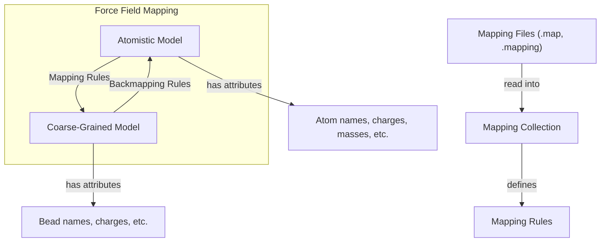
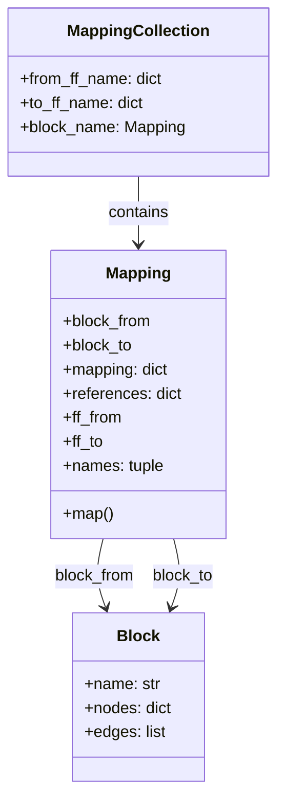
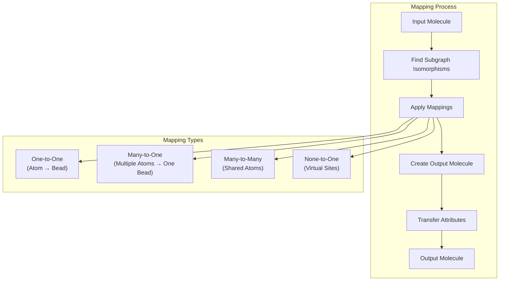
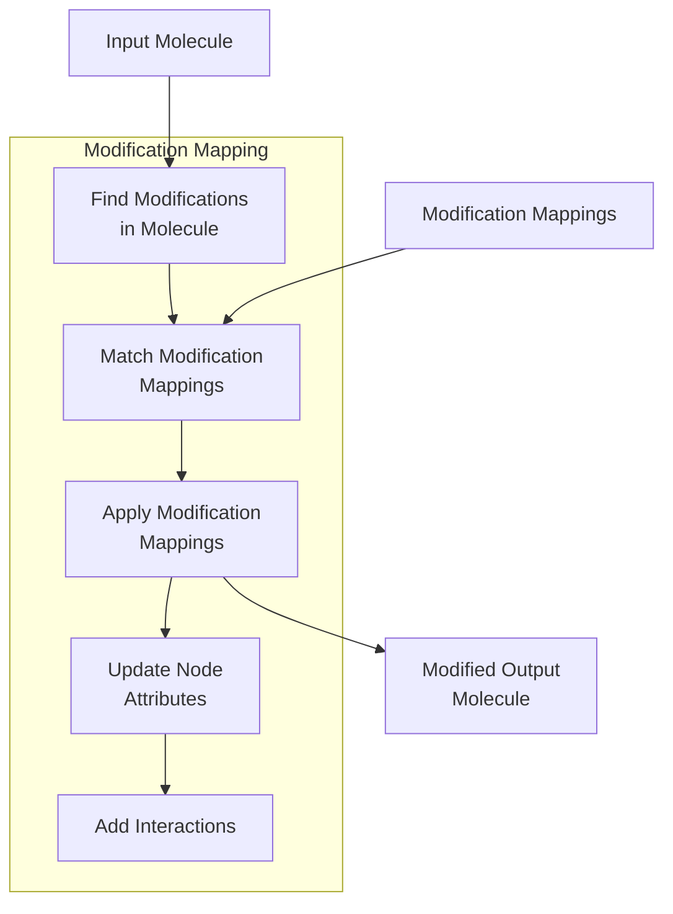
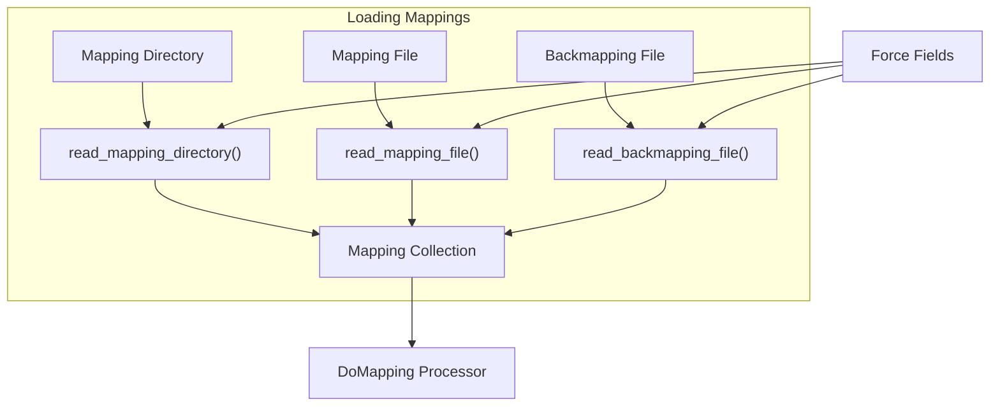
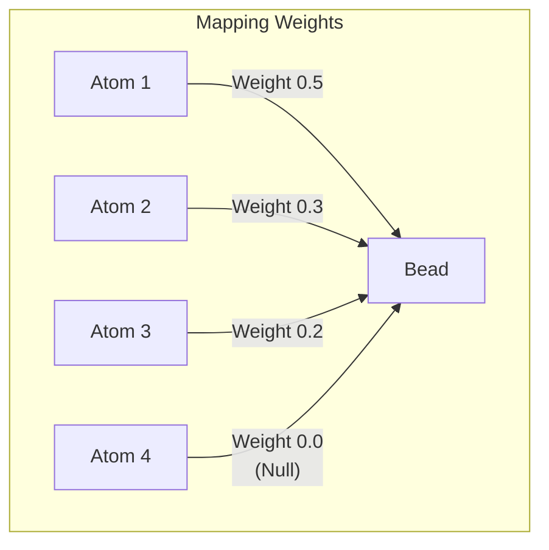
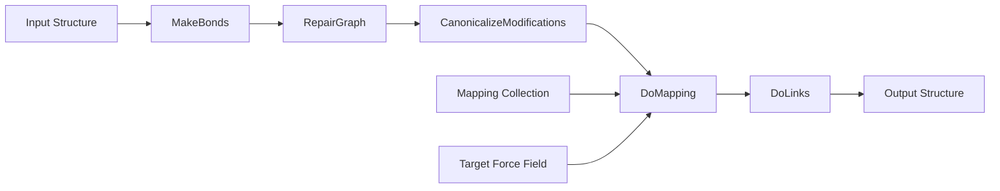

# Force Field Mapping

<details>
<summary>Relevant source files</summary>

The following files were used as context for generating this wiki page:

- [vermouth/ffinput.py](vermouth/ffinput.py)
- [vermouth/gmx/itp_read.py](vermouth/gmx/itp_read.py)
- [vermouth/map_input.py](vermouth/map_input.py)
- [vermouth/map_parser.py](vermouth/map_parser.py)
- [vermouth/parser_utils.py](vermouth/parser_utils.py)
- [vermouth/processors/do_mapping.py](vermouth/processors/do_mapping.py)
- [vermouth/tests/test_do_mapping.py](vermouth/tests/test_do_mapping.py)
- [vermouth/tests/test_ff_files.py](vermouth/tests/test_ff_files.py)
- [vermouth/tests/test_forcefield.py](vermouth/tests/test_forcefield.py)
- [vermouth/tests/test_itp_files.py](vermouth/tests/test_itp_files.py)
- [vermouth/tests/test_map_input.py](vermouth/tests/test_map_input.py)
- [vermouth/tests/test_mapping_integrative.py](vermouth/tests/test_mapping_integrative.py)

</details>


Force Field Mapping is a core functionality of the vermouth-martinize system that enables converting molecular representations between different resolutions or force fields. This system enables transformations such as converting atomistic representations to coarse-grained models (e.g., all-atom to Martini), or mapping between different coarse-grained models. For information about building molecular topologies, see [Core Components](#2).

## Overview of Force Field Mapping

Force field mapping defines how atoms or particles in one representation correspond to atoms or particles in another representation. This is essential for multi-scale molecular modeling, where different levels of detail are needed for different simulation purposes.



Sources: [vermouth/map_input.py:16-20](), [vermouth/processors/do_mapping.py:16-19]()

## Mapping Data Structures

The core data structures for force field mapping are:

1. `Mapping`: Represents a mapping between two force field representations
2. Mapping Collections: Dictionaries organizing mappings by force field names
3. Block and Link objects: Used to define the structures being mapped



Sources: [vermouth/map_parser.py:31-199](), [vermouth/map_input.py:28-30]()

### The Mapping Object

The `Mapping` class represents a mapping between two force field representations. It contains:

1. `block_from`: The source graph/block being mapped from
2. `block_to`: The destination graph/block being mapped to
3. `mapping`: Dictionary defining how nodes in `block_from` map to nodes in `block_to` with weights
4. `references`: Dictionary mapping nodes in `block_to` to reference nodes in `block_from`
5. Force field references and additional metadata

The mapping dictionary uses a nested structure: `{node_from: {node_to: weight, ...}, ...}` where weights determine how much each source node contributes to a destination node.

Sources: [vermouth/map_parser.py:31-124]()

## Mapping File Formats

Vermouth supports two main mapping file formats:

1. `.map` files: Legacy backward-compatible format
2. `.mapping` files: Modern format with more features

### Map File Format

The `.map` files follow a section-based format similar to GROMACS topology files:

```
[ molecule ]
ResName

[ atoms ]
1 AtomName1 BeadName1
2 AtomName2 BeadName1 BeadName2
3 AtomName3 !BeadName2    ; null-weight mapping

[from]
source_forcefield_name

[to]
target_forcefield_name

[extra]
Additional_CG_beads
```

Sources: [vermouth/map_input.py:36-147](), [vermouth/tests/test_map_input.py:42-207]()

### Mapping File Format

The newer `.mapping` format provides a more structured and powerful way to define mappings:

```
[ mapping ]
; Comments start with semicolons
target_forcefield

[ from ]
source_forcefield

[ name ]
ResName

[ molecule ]
; Source molecule definition
[ atoms ]
A { "atomname": "A", "atype": "A" }
B { "atomname": "B", "atype": "B" }

[ to ]
; Target molecule definition
[ atoms ]
X { "atomname": "X", "atype": "X" }

[ mapping ]
A X 1.0
B X 1.0
```

Sources: [vermouth/map_parser.py:454-996]()

## Mapping Process

The mapping process is performed by the `DoMapping` processor, which converts molecular structures from one force field to another using the following steps:



Sources: [vermouth/processors/do_mapping.py:514-736]()

### Mapping Algorithm

The force field mapping algorithm performs the following steps:

1. Find subgraph isomorphisms between the input molecule and the blocks defined in the mapping
2. Apply the mappings to create a new molecule with the target force field
3. Handle various mapping cases (one-to-one, many-to-one, many-to-many, etc.)
4. Transfer attributes from the original molecule to the mapped molecule
5. Create connections between mapped residues

Special cases handled by the mapping process include:

- **One-to-one mapping**: Direct correspondence between atoms
- **Many-to-one mapping**: Multiple atoms mapping to a single bead
- **Many-to-many mapping**: Atoms contributing to multiple beads
- **None-to-one mapping**: Virtual sites or beads without source atoms
- **Modification mappings**: Special handling for modified residues

Sources: [vermouth/processors/do_mapping.py:514-595](), [vermouth/processors/do_mapping.py:596-735]()

### Handling Modifications

The mapping process can also handle post-translational modifications (PTMs) and other molecular modifications. The system identifies modifications in the input molecule and applies the appropriate modification mappings.



Sources: [vermouth/processors/do_mapping.py:222-291](), [vermouth/processors/do_mapping.py:376-490]()

## Loading Mappings

Mappings can be loaded from files or directories using functions in the `map_input` module. The system supports both individual mapping files and directories containing multiple mapping files.



Sources: [vermouth/map_input.py:392-441](), [vermouth/map_input.py:174-180](), [vermouth/map_input.py:36-114]()

## Creating Custom Mappings

Custom mappings can be created by defining mapping files or by programmatically creating `Mapping` objects. The system also supports generating self-mappings (mappings from a force field to itself).

### Self Mappings

Self mappings are useful for testing and for creating identity transformations. They map each atom or bead in a force field to itself.

```python
# Example of generating self mappings
self_mappings = generate_all_self_mappings(force_fields)
```

Sources: [vermouth/map_input.py:444-483](), [vermouth/map_input.py:484-504]()

## Mapping Weights

Mapping weights determine how much each source atom contributes to a target particle. Weights can be:

1. Equal (default for many-to-one mappings)
2. Unequal (specified in mapping files)
3. Null (specified with a ! prefix in map files)

The weights are used to calculate properties of the target particles and to determine how atoms contribute to the target force field representation.



Sources: [vermouth/map_input.py:196-257](), [vermouth/map_parser.py:190-198]()

## Integration with the Processor Pipeline

The `DoMapping` processor integrates with the vermouth processor pipeline, allowing force field mapping to be combined with other molecular transformations.



Sources: [vermouth/processors/do_mapping.py:514-553](), [vermouth/tests/test_mapping_integrative.py:27-36]()

## Usage Examples

The `DoMapping` processor can be used in several ways:

### Basic Usage

```python
# Create a DoMapping processor
do_mapping = DoMapping(mappings, target_force_field, 
                      attribute_keep=['chain', 'resid'],
                      attribute_must=['resname'])

# Apply to a system
do_mapping.run_system(system)
```

### Mapping Between Force Fields

```python
# Map from atomistic to coarse-grained
aa_to_cg = DoMapping(aa_to_cg_mappings, martini_ff)
aa_to_cg.run_system(system)

# Map from coarse-grained to atomistic (backmapping)
cg_to_aa = DoMapping(cg_to_aa_mappings, atomistic_ff)
cg_to_aa.run_system(system)
```

Sources: [vermouth/tests/test_mapping_integrative.py:113-132](), [vermouth/tests/test_do_mapping.py:98-172]()

## Limitations and Considerations

When using force field mapping, consider the following:

1. **Overlapping mappings**: When atoms are mapped by multiple blocks, the attributes may be inconsistent.
2. **Disconnected mappings**: One-to-many mappings can result in disconnected beads if not properly defined.
3. **Unmapped atoms**: Atoms not covered by a mapping will not be included in the output.
4. **Self-consistency**: Ensure mappings are self-consistent and do not conflict with each other.

Sources: [vermouth/processors/do_mapping.py:704-736]()

## Summary

Force Field Mapping is a powerful system in vermouth-martinize that enables the conversion of molecular structures between different resolutions and force fields. It provides a flexible framework for defining mapping rules, handling modifications, and integrating with the processor pipeline.

The mapping process supports various types of mappings (one-to-one, many-to-one, etc.) and can be customized to preserve selected molecular attributes. This enables a wide range of applications in multi-scale molecular modeling.

---