# Applying Links and Interactions

<details>
<summary>Relevant source files</summary>

The following files were used as context for generating this wiki page:

- [doc/source/_static/.empty_for_git](doc/source/_static/.empty_for_git)
- [doc/source/conf.py](doc/source/conf.py)
- [requirements-docs.txt](requirements-docs.txt)
- [vermouth/edge_tuning.py](vermouth/edge_tuning.py)
- [vermouth/geometry.py](vermouth/geometry.py)
- [vermouth/processors/add_molecule_edges.py](vermouth/processors/add_molecule_edges.py)
- [vermouth/processors/do_links.py](vermouth/processors/do_links.py)
- [vermouth/processors/tune_cystein_bridges.py](vermouth/processors/tune_cystein_bridges.py)
- [vermouth/tests/data/dna-short.pdb](vermouth/tests/data/dna-short.pdb)
- [vermouth/tests/test_add_molecule_edges.py](vermouth/tests/test_add_molecule_edges.py)
- [vermouth/tests/test_edge_tuning.py](vermouth/tests/test_edge_tuning.py)
- [vermouth/tests/test_ffinput.py](vermouth/tests/test_ffinput.py)
- [vermouth/tests/test_geometry.py](vermouth/tests/test_geometry.py)
- [vermouth/tests/test_links.py](vermouth/tests/test_links.py)
- [vermouth/tests/test_native_forcefield.py](vermouth/tests/test_native_forcefield.py)
- [vermouth/tests/test_tune_cystein_bridges.py](vermouth/tests/test_tune_cystein_bridges.py)

</details>


## Purpose and Scope

This document explains how vermouth applies links and interactions to molecules in the processing pipeline. Links are crucial mechanisms that define connections between residues, modify molecules by adding or removing atoms, and establish interactions between atoms. This page focuses on the `DoLinks` processor, which is responsible for applying links from a molecule's force field to the molecule itself.

For information about force field mapping that precedes link application, see [Force Field Mapping](#3.2). For information about structural features that may be applied after links, see [Structural Features](#3.4).

## What are Links?

Links represent ways of connecting residues in a molecule. They define modifications that should be applied when specific patterns are found in a molecule. Links can:

1. Add or remove atoms
2. Modify atom properties
3. Add or remove interactions (bonds, angles, dihedrals, etc.)
4. Define order relationships between residues

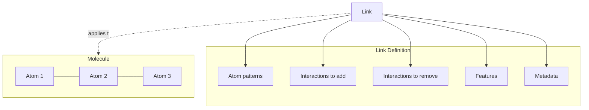

Sources: [vermouth/processors/do_links.py:290-326]()

## Link Matching Process

Before a link can be applied, the system must find where in the molecule the link matches. This matching process is at the heart of link application.

### Matching Algorithm

The matching process follows these steps:

1. Check if the molecule's metadata matches the link's metadata
2. Find subgraph isomorphisms between the link and the molecule
3. Verify non-edges (connections that should not exist)
4. Check if any pattern matches
5. Verify order relationships between matched residues

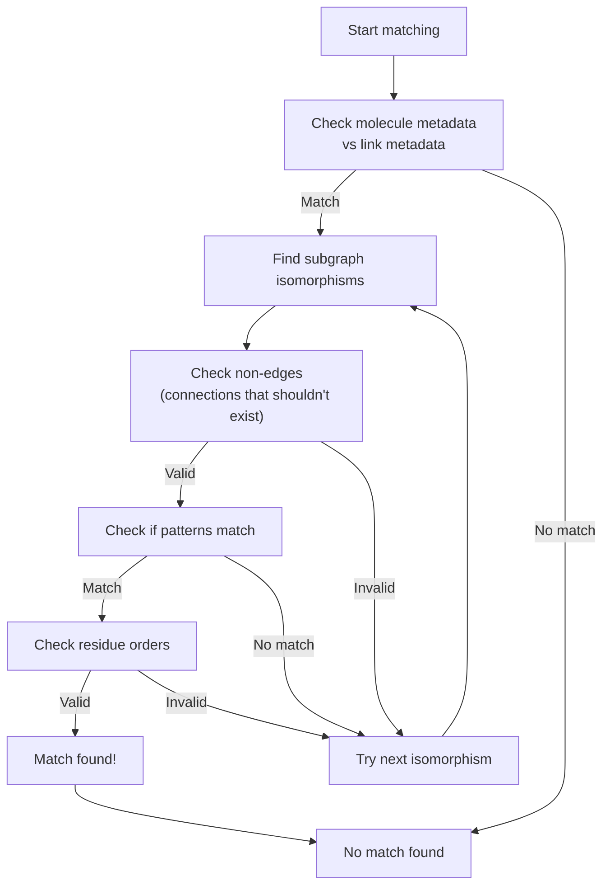

Sources: [vermouth/processors/do_links.py:237-274]()

### Atom Matching

A critical part of the link matching process is determining whether atoms in the molecule match atoms in the link. This is handled by the `_atoms_match` function.

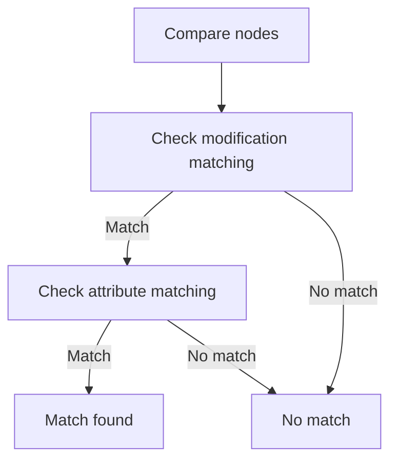

Sources: [vermouth/processors/do_links.py:27-53]()

### Order Constraints

One of the more complex aspects of link matching is handling "order" constraints. Order specifies the relationship between residues and can be:

- An integer: Defines the expected distance in residue ID
- A series of `>`: Residue must have a larger residue ID than a reference
- A series of `<`: Residue must have a smaller residue ID than a reference
- A series of `*`: Defines a different residue without specified order

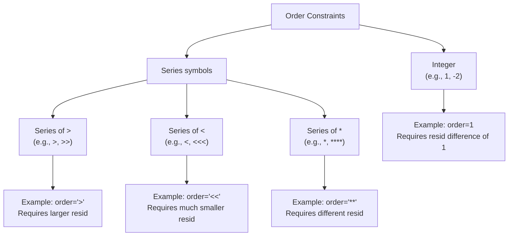

Sources: [vermouth/processors/do_links.py:126-196](), [vermouth/tests/test_links.py:26-184]()

## Applying Links

Once a match is found, the `DoLinks` processor applies the link to the molecule:

1. Replace or remove atoms as specified in the link
2. Remove interactions specified by the link
3. Add new interactions defined by the link
4. Update molecule log entries

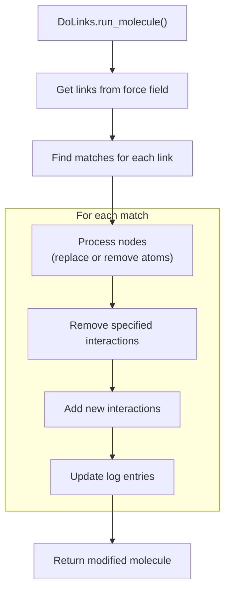

Sources: [vermouth/processors/do_links.py:290-326]()

### Atom Modifications

Links can modify atoms in two primary ways:

1. **Replace attributes**: Update atom properties like name, type, charge, etc.
2. **Remove atoms**: Entirely remove atoms from the molecule

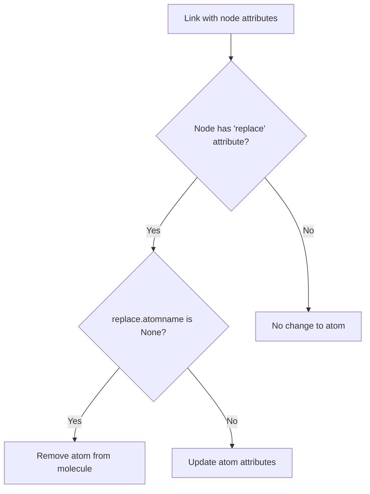

Sources: [vermouth/processors/do_links.py:301-307]()

### Interaction Management

Links modify interactions in two ways:

1. **Remove interactions**: Using the link's `removed_interactions` attribute
2. **Add interactions**: Using the link's `interactions` attribute

Each interaction is defined by:
- Interaction type (e.g., bonds, angles, dihedrals)
- Atoms involved
- Parameters (strength, equilibrium values, etc.)

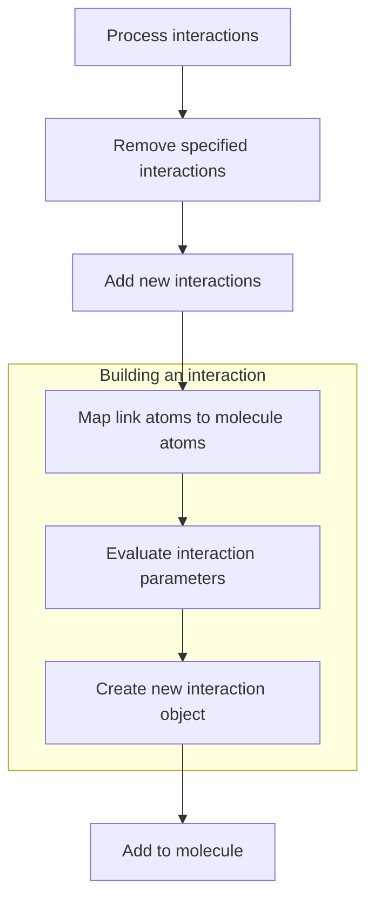

Sources: [vermouth/processors/do_links.py:308-318](), [vermouth/processors/do_links.py:277-287]()

## Example of Link Application

Let's walk through a conceptual example of applying a link to create a peptide bond between amino acid residues.

```mermaid
graph TB
    subgraph "Before Link Application"
        subgraph "Residue 1"
            R1C["C"] --- R1O["O"]
            R1C --- R1["Other atoms"]
        end
        
        subgraph "Residue 2"
            R2N["N"] --- R2H["H"]
            R2N --- R2["Other atoms"]
        end
    end
    
    subgraph "Peptide Bond Link"
        LC["C{'resid': 0}"]
        LN["N{'resid': 1}"]
        LC --- LN
        LCOH["Remove O-H\nAdd C-N bond"]
    end
    
    subgraph "After Link Application"
        subgraph "Connected Residues"
            AR1C["C"] --- AR2N["N"]
            AR1C --- AR1["Other atoms"]
            AR2N --- AR2["Other atoms"]
        end
    end
    
    "Before Link Application" --> "Peptide Bond Link"
    "Peptide Bond Link" --> "After Link Application"
```

Sources: [vermouth/processors/do_links.py:290-326]()

## Working with Orders in Links

The order system in links is particularly powerful for defining relationships between residues. This section explores how orders work in practice.

### Order Interpretation

The `_interpret_order` function converts an order specification into a type and value:

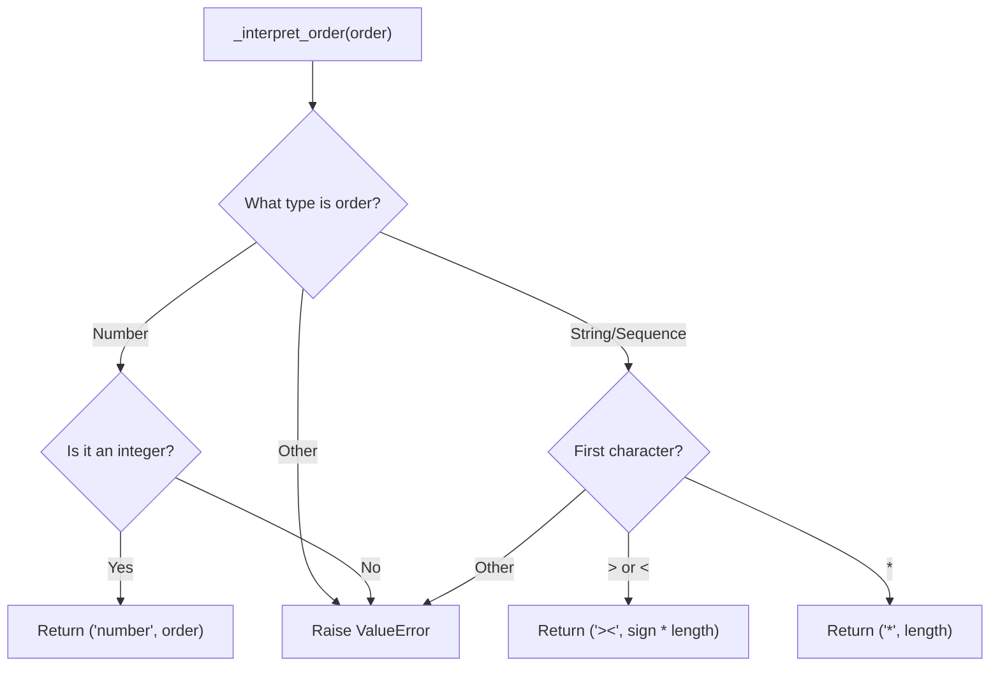

Sources: [vermouth/processors/do_links.py:88-123](), [vermouth/tests/test_links.py:189-206]()

### Order Matching

The `match_order` function is responsible for determining if two residues satisfy their order constraints:

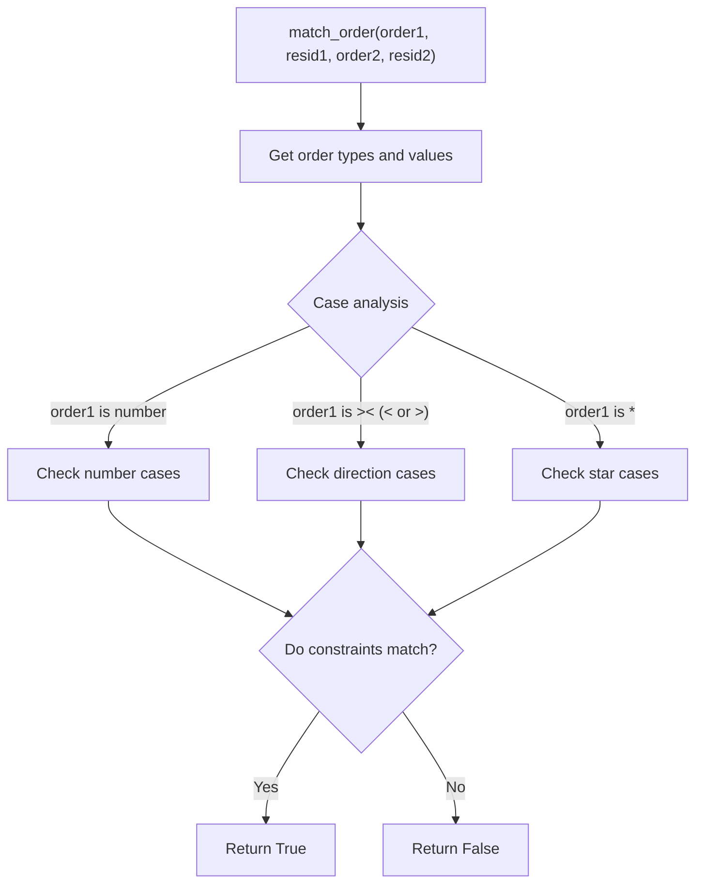

Sources: [vermouth/processors/do_links.py:126-234](), [vermouth/tests/test_links.py:26-184]()

## DoLinks Processor Implementation

The `DoLinks` processor is a key component in the vermouth processing pipeline. It is responsible for applying links from a molecule's force field to the molecule.

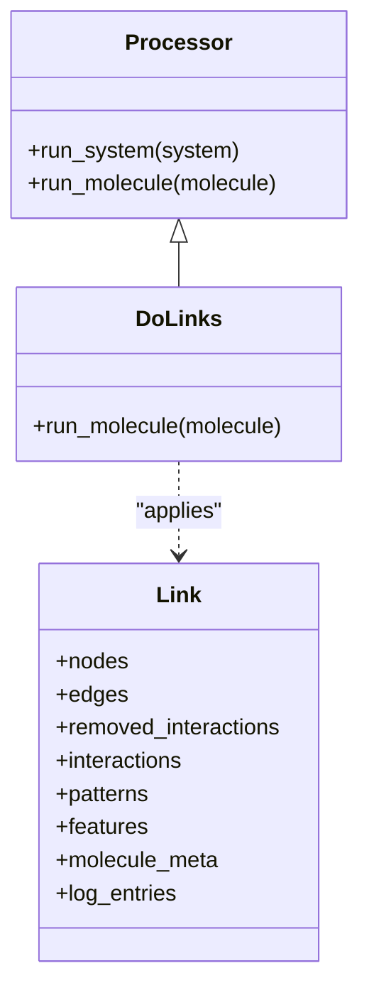

Sources: [vermouth/processors/do_links.py:290-326]()

## Real-World Applications

Links are used extensively in Vermouth for various purposes:

1. **Peptide bonds**: Connecting amino acid residues in proteins
2. **Nucleic acid connections**: Creating bonds in DNA/RNA structures
3. **Post-translational modifications**: Adding chemical groups to proteins
4. **Cystein bridges**: Creating disulfide bonds between cystein residues
5. **Terminal capping**: Modifying termini of protein chains

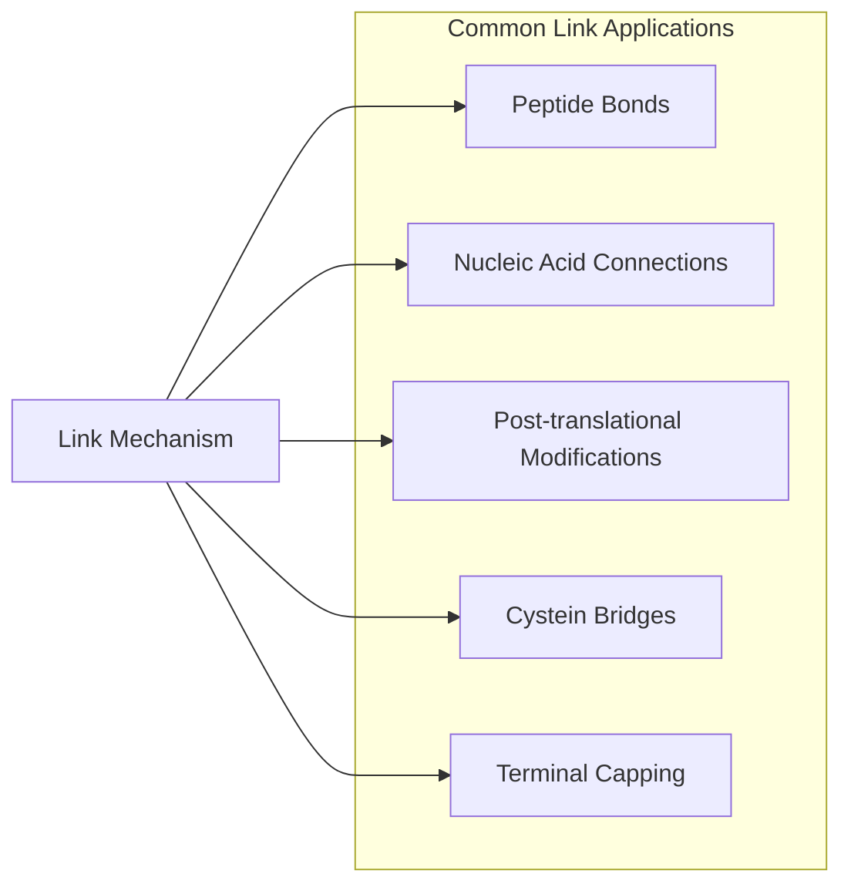

Sources: [vermouth/processors/do_links.py:290-326](), [vermouth/processors/tune_cystein_bridges.py:1-115]()

## Conclusions

Links are a powerful mechanism in Vermouth for modifying molecular structures. They provide a flexible way to define how residues should be connected and what interactions should be present. The `DoLinks` processor applies these links to molecules, enabling complex transformations to be performed automatically.

Key points to remember:
- Links define patterns, atoms, and interactions
- Matching is a multi-step process considering topology and attributes
- Order constraints provide flexible ways to express residue relationships
- Links can add, remove, or modify atoms and interactions

Understanding links is essential for working with the Vermouth system, especially when creating custom force fields or handling complex molecular structures.

---