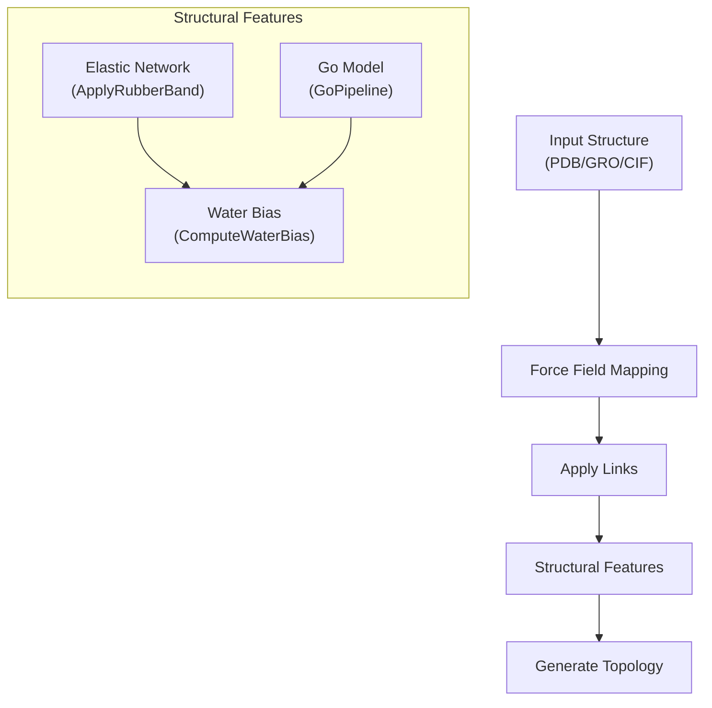
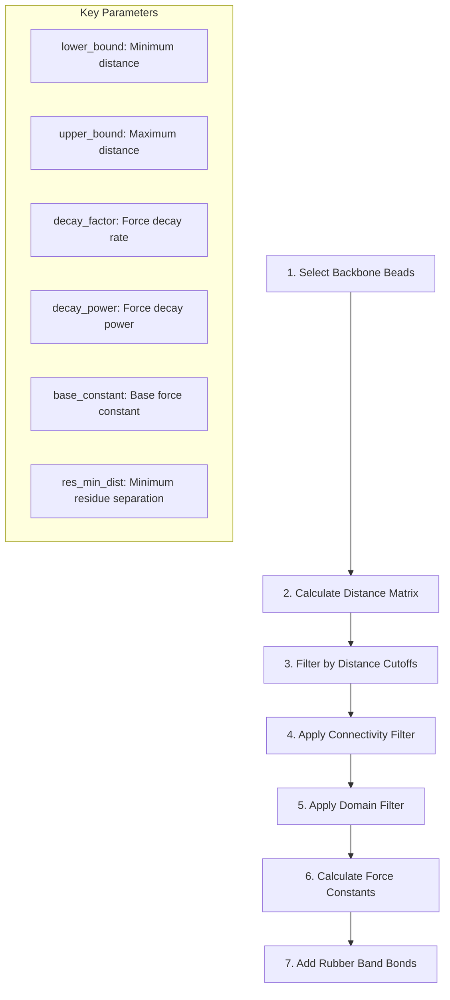
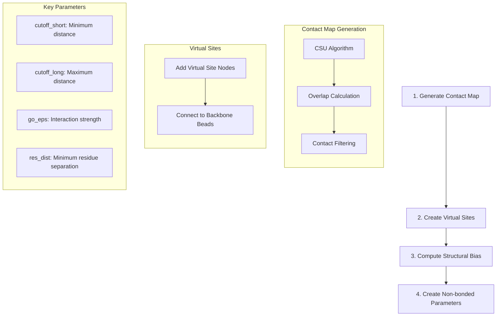
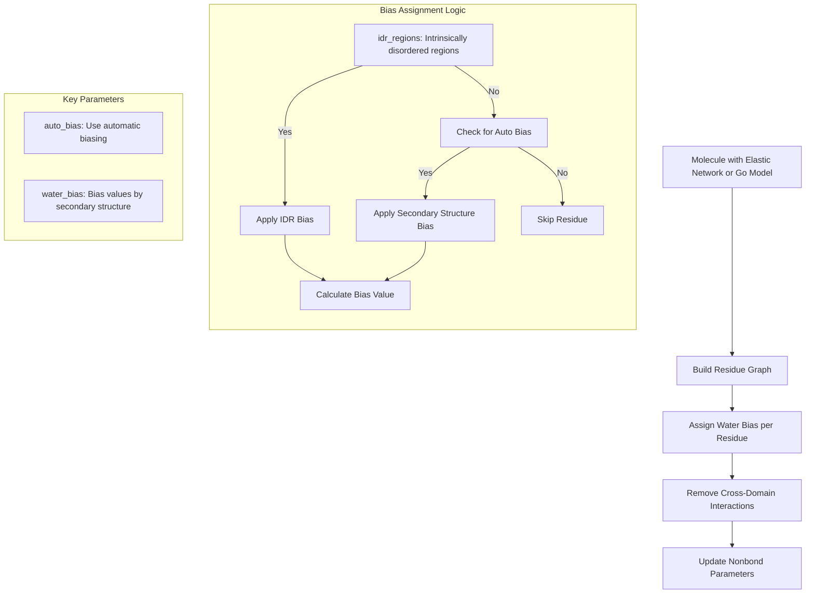
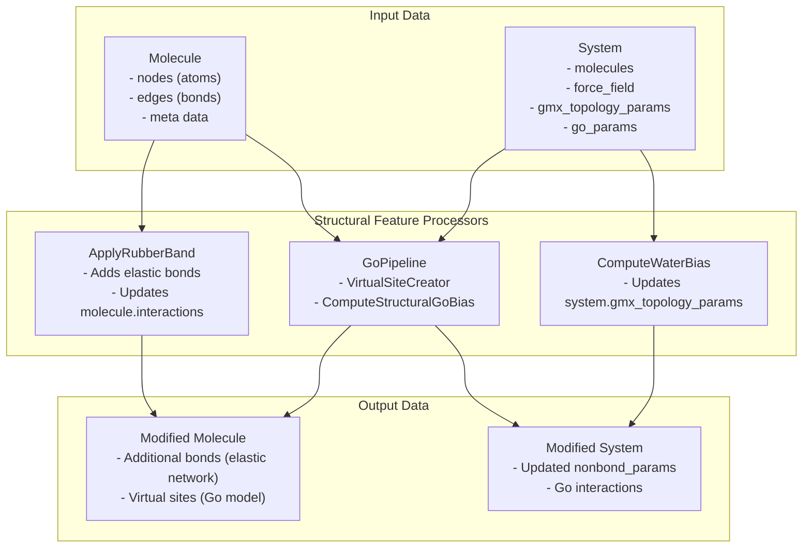

# Structural Features

<details>
<summary>Relevant source files</summary>

The following files were used as context for generating this wiki page:

- [vermouth/dssp/__init__.py](vermouth/dssp/__init__.py)
- [vermouth/processors/apply_rubber_band.py](vermouth/processors/apply_rubber_band.py)
- [vermouth/processors/attach_mass.py](vermouth/processors/attach_mass.py)
- [vermouth/processors/average_beads.py](vermouth/processors/average_beads.py)
- [vermouth/processors/gro_reader.py](vermouth/processors/gro_reader.py)
- [vermouth/processors/locate_charge_dummies.py](vermouth/processors/locate_charge_dummies.py)
- [vermouth/processors/pdb_reader.py](vermouth/processors/pdb_reader.py)
- [vermouth/processors/rename_modified_residues.py](vermouth/processors/rename_modified_residues.py)
- [vermouth/processors/water_bias.py](vermouth/processors/water_bias.py)
- [vermouth/rcsu/__init__.py](vermouth/rcsu/__init__.py)
- [vermouth/rcsu/contact_map.py](vermouth/rcsu/contact_map.py)
- [vermouth/rcsu/go_pipeline.py](vermouth/rcsu/go_pipeline.py)
- [vermouth/rcsu/go_structure_bias.py](vermouth/rcsu/go_structure_bias.py)
- [vermouth/rcsu/go_utils.py](vermouth/rcsu/go_utils.py)
- [vermouth/rcsu/go_vs_includes.py](vermouth/rcsu/go_vs_includes.py)
- [vermouth/tests/data/test_molecule_contacts.out](vermouth/tests/data/test_molecule_contacts.out)
- [vermouth/tests/rcsu/test_contact_map.py](vermouth/tests/rcsu/test_contact_map.py)
- [vermouth/tests/rcsu/test_go_utils.py](vermouth/tests/rcsu/test_go_utils.py)
- [vermouth/tests/test_apply_rubber_band.py](vermouth/tests/test_apply_rubber_band.py)

</details>


## Overview

Structural features in the vermouth-martinize system are optional components that can be added to coarse-grained molecular models to maintain their three-dimensional structure during simulation. When transforming atomistic models to coarse-grained representations, much of the detailed interaction information is lost. Structural features compensate for this by adding specific interactions that help preserve the original structure.

The vermouth-martinize system provides three main types of structural features:

1. **Elastic Networks**: Harmonic bonds between backbone beads that act like rubber bands
2. **Go Models**: Structure-based potentials based on native contacts 
3. **Water Biasing**: Modified interactions with water based on secondary structure or region

This page provides an overview of these features. For detailed information about each specific feature, see [Elastic Networks](#3.4.1), [Go Models](#3.4.2), and [Water Biasing](#3.4.3).

Sources: [vermouth/processors/apply_rubber_band.py:14-16](), [vermouth/rcsu/go_structure_bias.py:14-16](), [vermouth/processors/water_bias.py:14-16]()

## Role in the Processing Pipeline

Structural features are applied after force field mapping and link application, but before topology generation. They are implemented as processors in the modular processing pipeline.

### Structural Features in the Pipeline



Structural features are optional components that can be applied independently or in combination. The water bias can be applied on top of either elastic networks or Go models, but elastic networks and Go models are typically not used together.

Sources: [vermouth/processors/apply_rubber_band.py:433-539](), [vermouth/rcsu/go_pipeline.py:14-57](), [vermouth/processors/water_bias.py:21-191]()

## Feature Comparison

The following table compares the main structural features available in vermouth-martinize:

| Feature | Implementation | Interaction Type | Application | Configurability |
|---------|----------------|-----------------|-------------|-----------------|
| Elastic Network | `ApplyRubberBand` | Harmonic bonds | Between backbone beads | Distance cutoffs, force constants, decay parameters |
| Go Model | `GoPipeline` | Non-bonded interactions | Between virtual sites | Contact map, epsilon values |
| Water Bias | `ComputeWaterBias` | Non-bonded interactions | Between specific residues and water | Secondary structure dependent, IDR regions |

Sources: [vermouth/processors/apply_rubber_band.py:433-539](), [vermouth/rcsu/go_structure_bias.py:29-283](), [vermouth/processors/water_bias.py:21-191]()

## Elastic Networks (Rubber Bands)

Elastic networks add harmonic bonds between backbone beads to maintain the structure of the protein. These bonds act like rubber bands, pulling the protein back to its original shape when deformed.

### Elastic Network Generation



The `ApplyRubberBand` processor adds harmonic bonds between backbone beads that satisfy multiple criteria:
- Within a distance range (defined by `lower_bound` and `upper_bound`)
- Separated by at least `res_min_dist` residues in sequence
- Within the same domain (e.g., chain or region)

Force constants can be distance-dependent according to a decay function:

```
F(d) = base_constant * exp(-decay_factor * (d - lower_bound)^decay_power)
```

Sources: [vermouth/processors/apply_rubber_band.py:226-357](), [vermouth/processors/apply_rubber_band.py:433-539]()

## Go Models

Go models use knowledge of the native contacts in the protein structure to maintain its tertiary structure. This is achieved by adding attractive interactions between parts of the protein that are in contact in the native state.

### Go Model Implementation



The Go model implementation involves:
1. Identifying native contacts using the CSU (Contacts of Structural Units) algorithm
2. Creating virtual sites attached to backbone beads
3. Adding non-bonded interactions between virtual sites based on the identified contacts

The `GoPipeline` processor combines multiple sub-processors:
- `VirtualSiteCreator`: Creates virtual sites attached to backbone beads
- `ComputeStructuralGoBias`: Computes the interactions between virtual sites

Sources: [vermouth/rcsu/contact_map.py:14-796](), [vermouth/rcsu/go_vs_includes.py:14-139](), [vermouth/rcsu/go_structure_bias.py:29-283]()

## Water Biasing

Water biasing modifies the interaction between specific regions of the protein and water beads. This can be useful for fine-tuning solvation properties or handling intrinsically disordered regions.

### Water Bias Application



The `ComputeWaterBias` processor assigns water bias based on:
- Secondary structure (if `auto_bias` is enabled)
- Intrinsically disordered regions (if specified in `idr_regions`)

Water bias strength is defined per secondary structure element and can be customized for IDRs.

Sources: [vermouth/processors/water_bias.py:21-191]()

## Integration with the System

The structural features integrate with the overall system through the processor architecture. They modify the molecule and system objects in place, adding interactions and parameters as needed.

### Data Flow for Structural Features



The structural feature processors operate on the molecule and system objects, modifying them in place:
- `ApplyRubberBand` adds elastic bonds to the molecule's interaction list
- `GoPipeline` adds virtual sites to the molecule and non-bonded parameters to the system
- `ComputeWaterBias` modifies the non-bonded parameters in the system

Sources: [vermouth/processors/apply_rubber_band.py:433-539](), [vermouth/rcsu/go_pipeline.py:25-56](), [vermouth/processors/water_bias.py:21-191]()

## Command Line Usage

The structural features can be enabled and configured through the martinize2 command line interface. Here are some of the relevant options:

| Feature | Main Option | Additional Parameters |
|---------|------------|----------------------|
| Elastic Network | `-elastic` | `-ef <factor>`, `-el <lower>`, `-eu <upper>`, `-ea <decay_factor>`, `-ep <decay_power>`, `-em <fc_reduction>` |
| Go Model | `-go` | `-go-eps <value>`, `-gocut <cutoff>`, `-govs-include` |
| Water Bias | `-wb` | `-wb-particle <name>`, `-wb-auto`, `-wb-charge <name>`, `-wb-custom <custom_bias>` |

For detailed information on these options, refer to the [Command-Line Interface](#1.3) documentation.

Sources: [vermouth/processors/apply_rubber_band.py:433-539](), [vermouth/rcsu/go_pipeline.py:25-56](), [vermouth/processors/water_bias.py:21-191]()

## Summary

Structural features in vermouth-martinize provide various methods to maintain the native structure of proteins in coarse-grained simulations:

1. **Elastic Networks** add harmonic bonds between backbone beads to preserve the overall shape
2. **Go Models** use knowledge of native contacts to create structure-based potentials
3. **Water Biasing** modifies water interactions for different structural elements

These features can be applied independently or in combination, and they can be extensively customized through various parameters to suit different simulation needs.

For more detailed information about each specific feature, see:
- [Elastic Networks](#3.4.1)
- [Go Models](#3.4.2)
- [Water Biasing](#3.4.3)

---