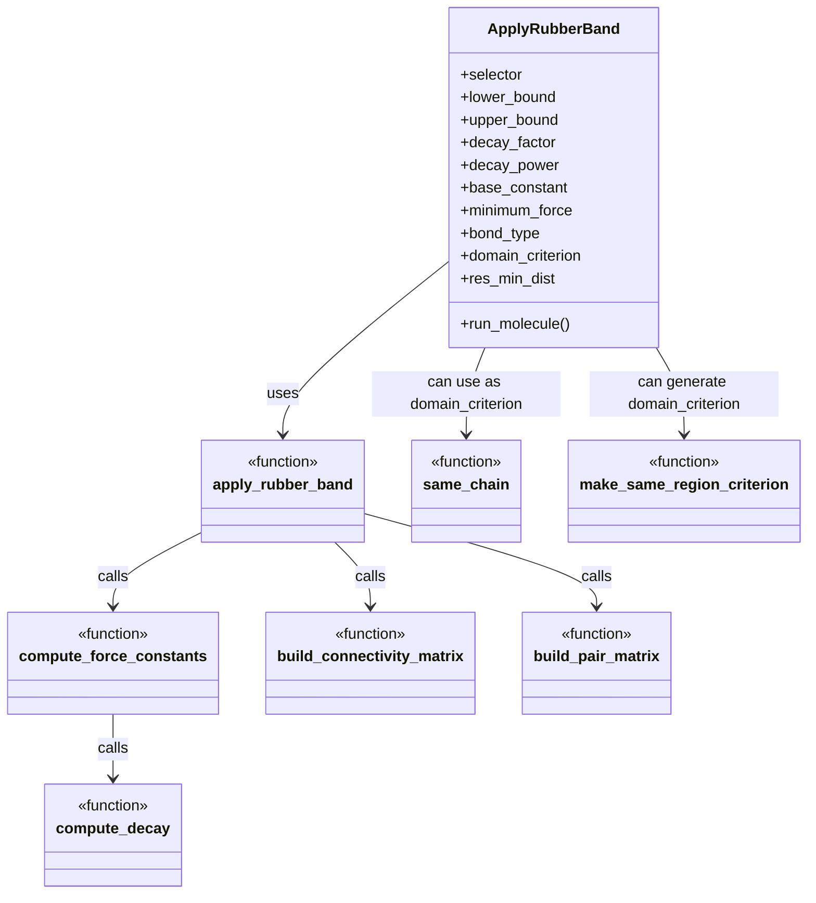
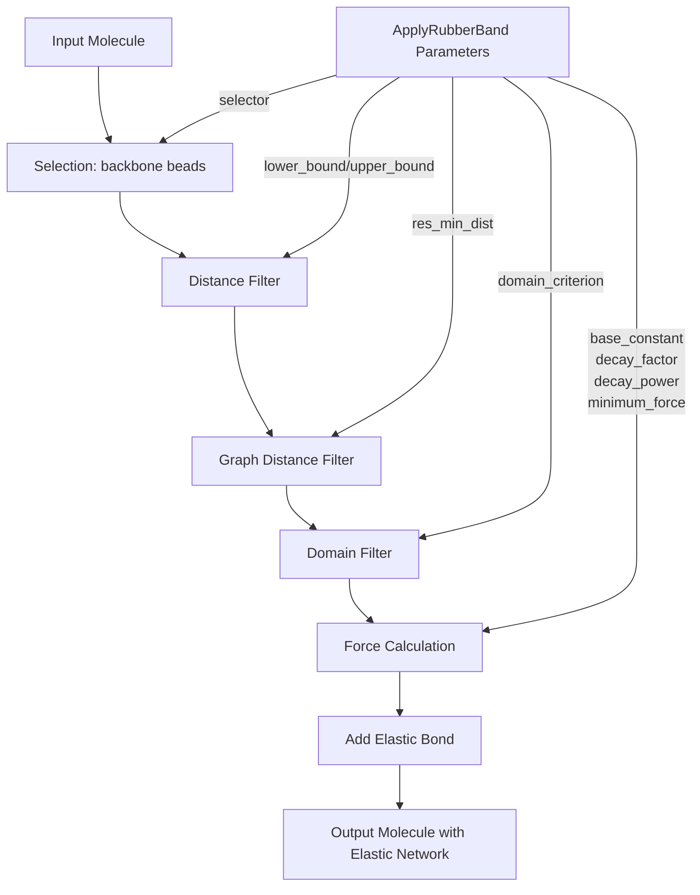
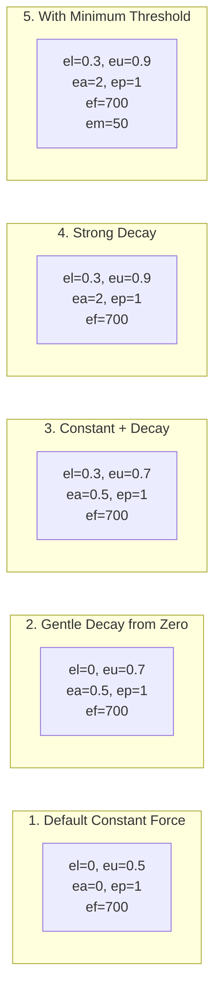
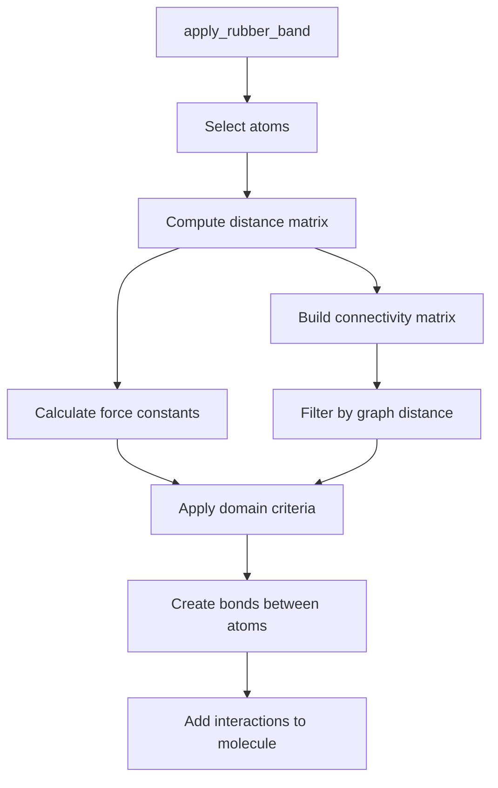

# Elastic Networks

<details>
<summary>Relevant source files</summary>

The following files were used as context for generating this wiki page:

- [doc/source/tutorials/basic_usage.rst](doc/source/tutorials/basic_usage.rst)
- [doc/source/tutorials/elastic_examples.png](doc/source/tutorials/elastic_examples.png)
- [doc/source/tutorials/elastic_networks.rst](doc/source/tutorials/elastic_networks.rst)
- [doc/source/tutorials/go_models.rst](doc/source/tutorials/go_models.rst)
- [doc/source/tutorials/index.rst](doc/source/tutorials/index.rst)
- [doc/source/tutorials/mutations_and_modifications.rst](doc/source/tutorials/mutations_and_modifications.rst)
- [doc/source/tutorials/water_biasing.rst](doc/source/tutorials/water_biasing.rst)
- [vermouth/processors/apply_rubber_band.py](vermouth/processors/apply_rubber_band.py)
- [vermouth/processors/attach_mass.py](vermouth/processors/attach_mass.py)
- [vermouth/processors/average_beads.py](vermouth/processors/average_beads.py)
- [vermouth/processors/gro_reader.py](vermouth/processors/gro_reader.py)
- [vermouth/processors/locate_charge_dummies.py](vermouth/processors/locate_charge_dummies.py)
- [vermouth/processors/pdb_reader.py](vermouth/processors/pdb_reader.py)
- [vermouth/processors/rename_modified_residues.py](vermouth/processors/rename_modified_residues.py)
- [vermouth/tests/test_apply_rubber_band.py](vermouth/tests/test_apply_rubber_band.py)

</details>


## Purpose and Scope

Elastic Networks are a critical feature in Martinize2 that helps maintain the secondary and tertiary structure of coarse-grained protein models. In coarse-grained molecular dynamics simulations, particularly with the Martini force field, extra restraints are needed to retain folded protein structure in the absence of explicit hydrogen bonding. This page details the implementation and usage of Elastic Networks in the vermouth-martinize codebase.

For information about other structural features like Go Models, see page [3.4.2](#3.4.2) and for Water Biasing, see page [3.4.3](#3.4.3).

Sources: [vermouth/processors/apply_rubber_band.py:14-17]()/[doc/source/tutorials/elastic_networks.rst:1-16]()

## Theory and Implementation

Elastic networks function by identifying contacts between protein backbone beads within a specified cutoff distance and applying harmonic bonds between them, thereby restraining atoms at their initial distance throughout a simulation. The strength of these bonds can be modulated based on distance using a decay function.

The decay function for the force constant is defined as:

```
F = K * exp(-r * (d - s)^p)
```

Where:
- `K` is the base force constant
- `r` is the decay rate factor
- `p` is the decay power
- `s` is the lower bound shift
- `d` is the distance between atoms

If the decay rate or power is set to 0, the decay function does not modify the force constant.

Sources: [vermouth/processors/apply_rubber_band.py:60-81]()/[doc/source/tutorials/elastic_networks.rst:60-77]()

### Core Components

The elastic network implementation is centered around the `ApplyRubberBand` processor class and its supporting functions.



Sources: [vermouth/processors/apply_rubber_band.py:433-539]()

### Parameter Influence Flow

This diagram illustrates how different parameters influence the elastic network generation:



Sources: [vermouth/processors/apply_rubber_band.py:226-357]()/[doc/source/tutorials/elastic_networks.rst:38-105]()

## Usage in Martinize2

To apply an elastic network in Martinize2, the `-elastic` flag is used, along with several optional parameters to customize the behavior.

### Basic Usage

The simplest way to add an elastic network is:

```
martinize2 -f protein.pdb -o topol.top -x cg_protein.pdb -ff martini3001 -dssp -elastic
```

This applies the default harmonic bond constant (700 kJ/mol/nm²) between non-successive BB beads which are < 0.9 nm apart in space.

Sources: [doc/source/tutorials/elastic_networks.rst:36-46]()

### Configuration Parameters

| Parameter | Description | Default Value |
|-----------|-------------|---------------|
| `-elastic` | Enable elastic networks | False |
| `-ef` | Elastic bond force constant (kJ/mol/nm²) | 700 |
| `-el` | Elastic bond lower cutoff | 0 |
| `-eu` | Elastic bond upper cutoff | 0.9 |
| `-ermd` | Minimum residue separation | Force field specific |
| `-ea` | Decay factor | 0 |
| `-ep` | Decay power | 1 |
| `-em` | Minimum force constant threshold | 0 |
| `-eb` | Bead selection for elastic bonds | None (BB) |
| `-eunit` | Structural unit for elastic network | "molecule" |

The `-eunit` parameter defines the boundaries for applying elastic bonds, with options:
- `molecule`: bonds only within each molecule
- `chain`: bonds only within each chain
- `all`: bonds between all molecules/chains
- `<start_resid_1>:<end_resid_1>,<start_resid_2>:<end_resid_2>...`: bonds only within specified regions

Sources: [doc/source/tutorials/elastic_networks.rst:16-31]()/[vermouth/processors/apply_rubber_band.py:433-538]()

### Force Constant Behavior

The strength of elastic network bonds can be tuned with various parameter combinations. The diagram below illustrates how different parameter settings affect the force constant as a function of distance:



In scenarios 1-5:
1. Constant force is applied between backbone beads within 0.5 nm.
2. Force decays exponentially with distance, starting from 0 nm.
3. Force is constant for beads within 0.3 nm, then decays for distances between 0.3-0.7 nm.
4. Similar to 3 but with stronger decay.
5. Similar to 4 but forces below the minimum threshold (50 kJ/mol/nm²) are removed.

Sources: [doc/source/tutorials/elastic_networks.rst:78-101]()

## Technical Implementation Details

### Core Function: apply_rubber_band

The heart of the elastic network implementation is the `apply_rubber_band` function, which:

1. Selects atoms based on the provided selection function
2. Computes distances between selected atoms
3. Filters pairs based on distance, graph separation, and domain criteria
4. Calculates force constants with decay
5. Adds bonds between qualifying atom pairs



Sources: [vermouth/processors/apply_rubber_band.py:226-357]()

### Domain Criteria

Elastic networks can be limited to specific domains using domain criteria functions:

1. `always_true`: Default - doesn't limit the network
2. `same_chain`: Limits elastic bonds to atoms within the same chain
3. `make_same_region_criterion`: Creates a function that limits bonds to atoms within specified residue ranges

This allows for flexible definition of structural units for the elastic network, particularly useful for multi-domain or multi-chain proteins.

Sources: [vermouth/processors/apply_rubber_band.py:360-431]()

### Distance Calculation

Distance calculation between atoms is handled by the `self_distance_matrix` function, which:

1. Takes an array of 3D coordinates as input
2. Computes the Euclidean distance between all pairs of points
3. Returns a distance matrix that is used for bond creation

Note that this function does not account for periodic boundary conditions.

Sources: [vermouth/processors/apply_rubber_band.py:36-58]()

## Integration with Molecule Processing

The elastic network generation is integrated into the vermouth processing pipeline through the `ApplyRubberBand` processor class. This class:

1. Takes elastic network parameters as initialization arguments
2. Implements the `run_molecule` method that processes each molecule
3. Calls `apply_rubber_band` with the appropriate parameters
4. Returns the modified molecule with elastic bonds added


Sources: [vermouth/processors/apply_rubber_band.py:433-539]()

## Common Usage Patterns

### Basic Elastic Network

For proteins in Martini 3, a simple elastic network with default parameters:

```
martinize2 -f protein.pdb -o topol.top -x cg_protein.pdb -ff martini3001 -dssp -elastic
```

### Customized Cutoffs

To apply elastic networks between beads within a specific distance range:

```
martinize2 -f protein.pdb -o topol.top -x cg_protein.pdb -ff martini3001 -dssp -elastic -el 0.1 -eu 0.5
```

### Domain-Specific Networks

To apply elastic networks only within specific domains or regions:

```
martinize2 -f protein.pdb -o topol.top -x cg_protein.pdb -ff martini3001 -dssp -elastic -eunit 1:100,150:200
```

This applies elastic networks within residues 1-100 and 150-200, but not between these regions.

Sources: [doc/source/tutorials/elastic_networks.rst:36-128]()

## Conclusion

Elastic Networks provide a critical function in maintaining protein structure during coarse-grained simulations. The implementation in vermouth-martinize offers a flexible and customizable approach to generate these networks, with parameters to fine-tune the behavior based on the specific requirements of the system being studied.

The `ApplyRubberBand` processor handles the core functionality, while the martinize2 command-line interface provides an accessible way for users to apply and configure elastic networks in their protein models.

---