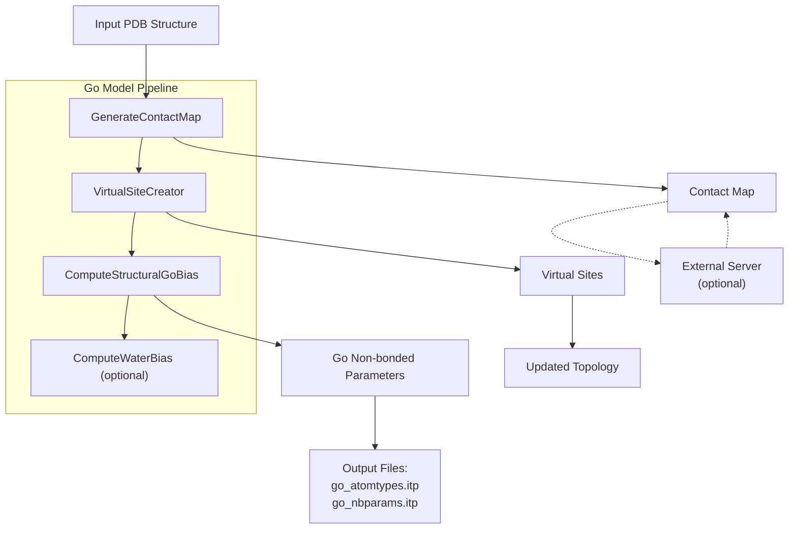
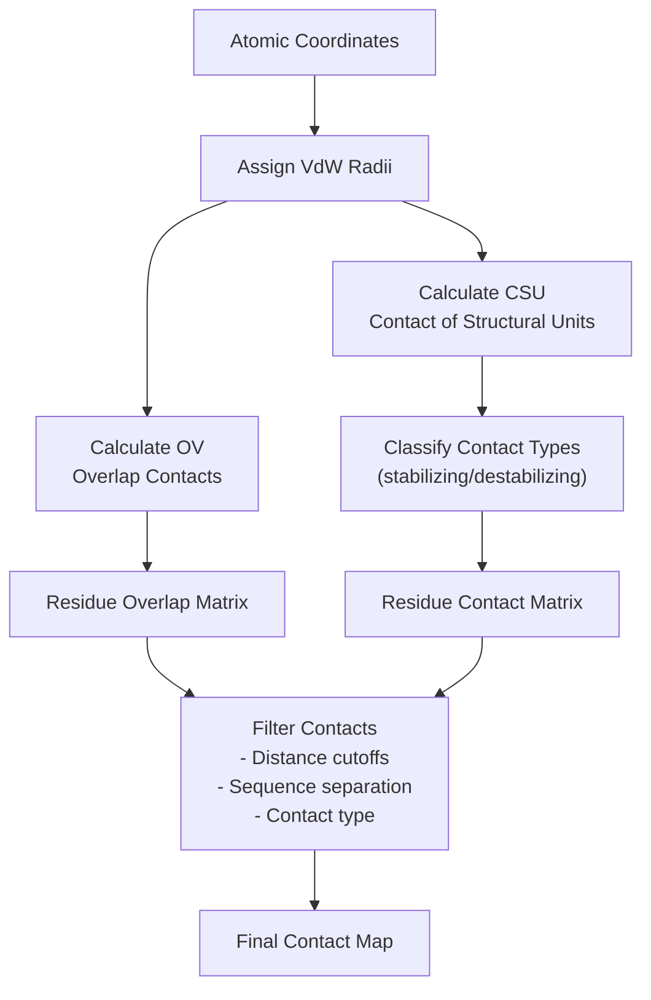
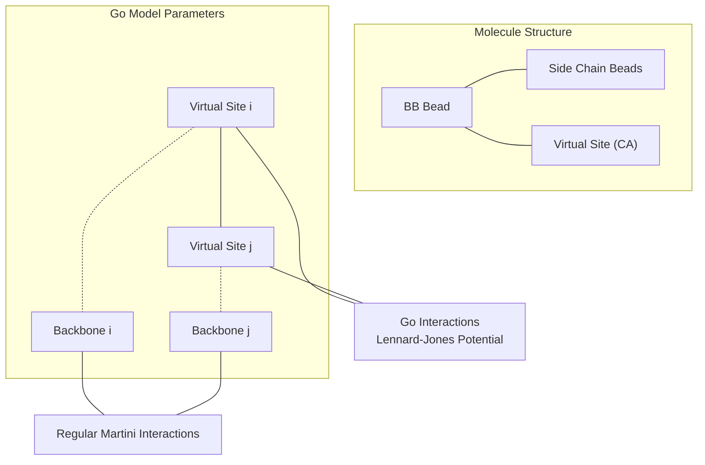
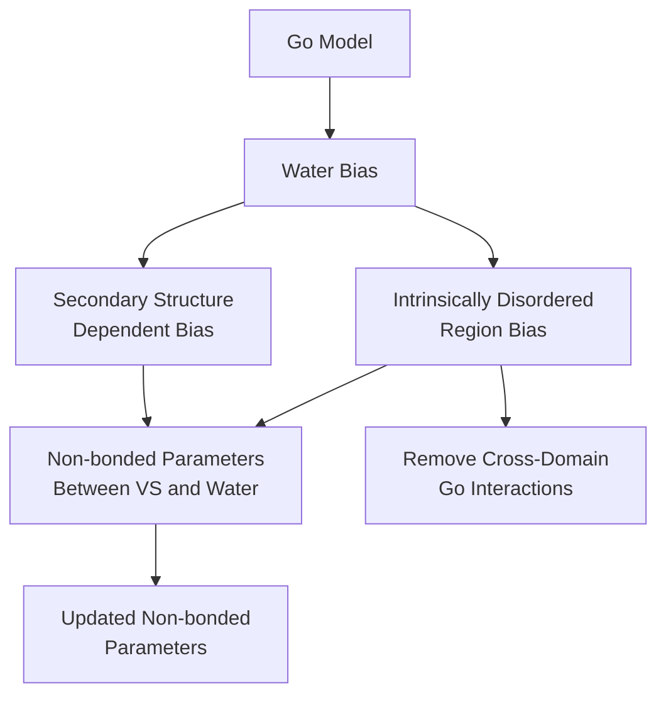
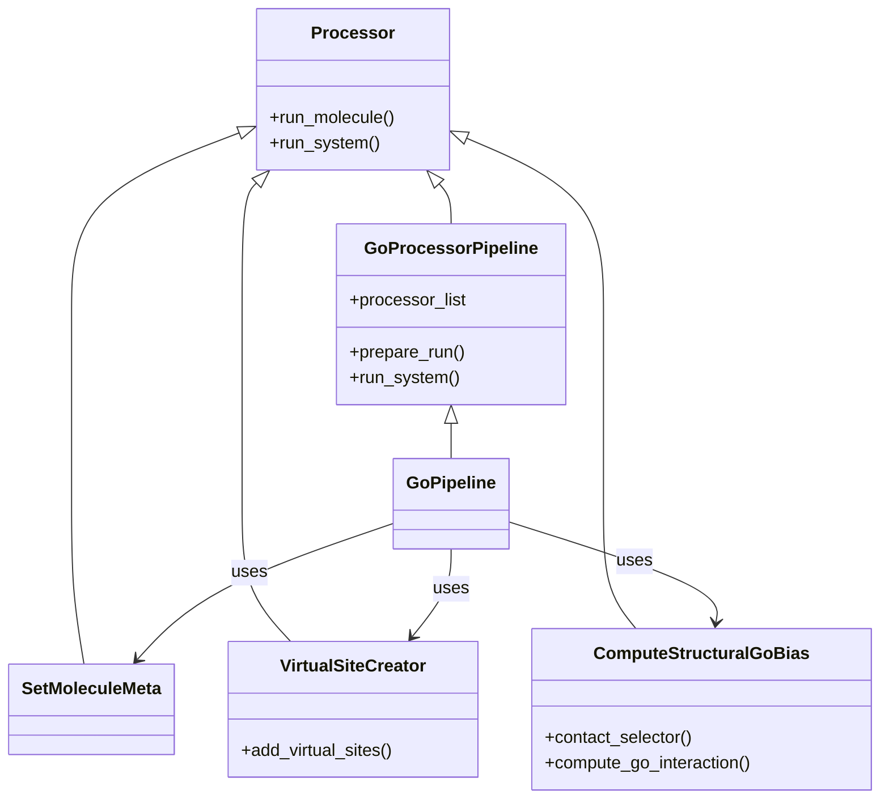

# Go Models

<details>
<summary>Relevant source files</summary>

The following files were used as context for generating this wiki page:

- [doc/source/tutorials/basic_usage.rst](doc/source/tutorials/basic_usage.rst)
- [doc/source/tutorials/elastic_examples.png](doc/source/tutorials/elastic_examples.png)
- [doc/source/tutorials/elastic_networks.rst](doc/source/tutorials/elastic_networks.rst)
- [doc/source/tutorials/go_models.rst](doc/source/tutorials/go_models.rst)
- [doc/source/tutorials/index.rst](doc/source/tutorials/index.rst)
- [doc/source/tutorials/mutations_and_modifications.rst](doc/source/tutorials/mutations_and_modifications.rst)
- [doc/source/tutorials/water_biasing.rst](doc/source/tutorials/water_biasing.rst)
- [vermouth/dssp/__init__.py](vermouth/dssp/__init__.py)
- [vermouth/processors/water_bias.py](vermouth/processors/water_bias.py)
- [vermouth/rcsu/__init__.py](vermouth/rcsu/__init__.py)
- [vermouth/rcsu/contact_map.py](vermouth/rcsu/contact_map.py)
- [vermouth/rcsu/go_pipeline.py](vermouth/rcsu/go_pipeline.py)
- [vermouth/rcsu/go_structure_bias.py](vermouth/rcsu/go_structure_bias.py)
- [vermouth/rcsu/go_utils.py](vermouth/rcsu/go_utils.py)
- [vermouth/rcsu/go_vs_includes.py](vermouth/rcsu/go_vs_includes.py)
- [vermouth/tests/data/test_molecule_contacts.out](vermouth/tests/data/test_molecule_contacts.out)
- [vermouth/tests/rcsu/test_contact_map.py](vermouth/tests/rcsu/test_contact_map.py)
- [vermouth/tests/rcsu/test_go_utils.py](vermouth/tests/rcsu/test_go_utils.py)

</details>


This page documents the Go Models system in VerMoUTH & martinize2, which provides a method for maintaining protein tertiary structure in coarse-grained simulations. In contrast to [Elastic Networks](#3.4.1), which use harmonic restraints, Go Models apply non-bonded Lennard-Jones interactions between pairs of beads to maintain the native structure of proteins.

## Overview

The MartiniGō model is a structure-based approach that maintains protein conformation by applying specific non-bonded interactions between backbone beads based on their native contacts. These interactions are mediated through virtual sites placed on backbone beads, with contact parameters derived from the original protein structure.



Sources: [vermouth/rcsu/go_pipeline.py:53-56](), [vermouth/rcsu/contact_map.py:779-801](), [vermouth/rcsu/go_vs_includes.py:27-139](), [vermouth/rcsu/go_structure_bias.py:29-283]()

## Contact Map Generation

The contact map is the foundation of the Go Model, identifying which residue pairs should interact to maintain the protein's tertiary structure. Contact maps can be obtained in two ways:

1. Generated internally by martinize2 using the `GenerateContactMap` processor
2. Imported from an external file (e.g., from the RCSU web server)

The contact map generation process analyzes atomic overlaps and chemical structural units to identify meaningful contacts between residues:



The contact map generation algorithm uses a sophisticated approach that considers:

1. Van der Waals radii of atoms
2. Overlap between atoms (OV contacts) 
3. Contacts of structural units (CSU)
4. Classification of contacts as stabilizing or destabilizing

The output is a list of residue pairs that form meaningful contacts in the native structure.

Sources: [vermouth/rcsu/contact_map.py:302-398](), [vermouth/rcsu/contact_map.py:457-607](), [vermouth/rcsu/contact_map.py:610-650]()

## Virtual Sites

To implement Go interactions without disrupting standard force field parameters, the model places virtual sites on top of backbone beads:



The `VirtualSiteCreator` processor creates these virtual sites with:
- Position identical to backbone beads (default name `BB`)
- Atomname `CA` (can be customized)
- Mass of 0.0 (no impact on dynamics)
- Unique atom types based on residue number
- Added to the system as virtual sites with default parameter "1"

The virtual sites serve as anchors for the Go-specific non-bonded interactions without interfering with the standard Martini interactions.

Sources: [vermouth/rcsu/go_vs_includes.py:43-139]()

## Structural Bias Calculation

The `ComputeStructuralGoBias` processor calculates the non-bonded parameters for the Go interactions:

```mermaid
flowchart LR
    map["Contact Map"] --> select["contact_selector()"]
    select --> pairs["Contact Pairs\nmeeting criteria"]
    pairs --> compute["compute_go_interaction()"]
    
    subgraph "Contact Selection Criteria"
        dist["Distance cutoffs\n- Lower: 0.3 nm (default)\n- Upper: 1.1 nm (default)"]
        graph["Graph distance ≥ 3\n(sequence separation)"]
    end
    
    dist --> select
    graph --> select
    
    compute --> params["Non-bonded Parameters\n- sigma = dist/2^(1/6)\n- epsilon = go_eps"]
    params --> output["Go Non-bonded Parameters\nin system.gmx_topology_params"]
```

For each contact pair that meets the selection criteria, the processor:
1. Creates exclusions between backbone beads
2. Calculates the optimal sigma parameter from the native distance
3. Applies the specified epsilon value (default: 9.414 kJ/mol)
4. Adds the parameters to the system's topology

The calculated parameters implement a Lennard-Jones potential that stabilizes the native structure with an energy minimum at the native distance.

Sources: [vermouth/rcsu/go_structure_bias.py:150-234](), [vermouth/rcsu/go_structure_bias.py:236-270]()

## Water Bias (Optional)

The Go Model can be extended with water bias parameters, which modify interactions between virtual sites and water molecules based on secondary structure:



The `ComputeWaterBias` processor:
1. Assigns water bias parameters based on secondary structure or defined IDR regions
2. Optionally removes Go interactions between folded and disordered regions
3. Creates non-bonded parameters between water and virtual sites

This feature is particularly useful for simulating proteins with both structured and disordered regions.

Sources: [vermouth/processors/water_bias.py:21-191]()

## Go Model Pipeline

The complete Go model generation process is encapsulated in the `GoPipeline`, which sequences the required processors:



The pipeline works as follows:
1. `SetMoleculeMeta` assigns molecule type information
2. `VirtualSiteCreator` adds virtual sites to backbone beads
3. `ComputeStructuralGoBias` calculates and applies Go interactions
4. (Optional) `ComputeWaterBias` adds water-specific interactions

This modular design allows for customization of the Go model generation process.

Sources: [vermouth/rcsu/go_pipeline.py:25-56]()

## Using Go Models

To apply a Go model to a protein structure with martinize2, you can use the following command-line options:

```
-go [GO]              Use Martini Go model. Accept input file or calculate as part of Martinize.
-go-eps GO_EPS        Strength of Go model structural bias in kJ/mol (default: 9.414).
-go-low GO_LOW        Minimum distance (nm) below which contacts are removed (default: 0.3).
-go-up GO_UP          Maximum distance (nm) above which contacts are removed (default: 1.1).
-go-res-dist GO_RES_DIST Minimum graph distance below which contacts are removed (default: 3).
-go-write-file [GO_WRITE_FILE] Write out contact map to file.
-go-backbone GO_BACKBONE Name of backbone bead for virtual sites (default: BB).
-go-atomname GO_ATOMNAME Name of the virtual interaction site atom (default: CA).
```

### Basic Usage

Calculate contact map as part of martinize2:
```
martinize2 -f protein.pdb -o topol.top -x cg_protein.pdb -ff martini3001 -dssp -go
```

Use an existing contact map file:
```
martinize2 -f protein.pdb -o topol.top -x cg_protein.pdb -ff martini3001 -dssp -go contact_map.out
```

### Output Files

The Go model generates two additional files:
1. `go_atomtypes.itp` - Defines virtual site atom types
2. `go_nbparams.itp` - Defines non-bonded parameters between virtual sites

These files must be included in your topology by adding to `martini_v3.0.0.itp`:

```
[ atomtypes ]
...
#ifdef GO_VIRT
#include "go_atomtypes.itp"
#endif

[ nonbond_params ]
...
#ifdef GO_VIRT
#include "go_nbparams.itp"
#endif
```

Then activate in your topology file with:
```
#define GO_VIRT
```

Sources: [doc/source/tutorials/go_models.rst:16-41](), [doc/source/tutorials/go_models.rst:96-140]()

## Advanced Topics

### Multiple Go Models

When working with multiple proteins that each have their own Go model:

1. Use unique molecule names with the `-name` flag to ensure unique virtual site names:
   ```
   martinize2 -f protein1.pdb -o topol.top -go -name protein1
   martinize2 -f protein2.pdb -o topol.top -go -name protein2
   ```

2. Concatenate all `go_atomtypes.itp` and `go_nbparams.itp` files into single files

3. Include these in your master force field file as described above

Note that Go interactions are typically defined within each molecule, not between copies of molecules or different molecules.

### Combining with Water Bias

Go models can be combined with water bias to improve solvation properties:

```
martinize2 -f protein.pdb -o topol.top -x cg_protein.pdb -dssp -go -water-bias -water-bias-eps H:1 C:0.5
```

For intrinsically disordered regions:

```
martinize2 -f protein.pdb -o topol.top -x cg_protein.pdb -dssp -go -id-regions 1:10 65:92 -water-bias -water-bias-eps idr:0.5
```

Sources: [doc/source/tutorials/go_models.rst:149-182](), [doc/source/tutorials/water_biasing.rst:26-67]()

## Implementation Details

### Contact Map Algorithm

The contact map generation uses several key algorithms:

1. **Overlap Detection**: Calculates when atoms are within each other's van der Waals radii
2. **CSU Calculation**: Uses Fibonacci sphere points to find contacts of structural units
3. **Contact Classification**: Categorizes contacts as hydrogen bonds, hydrophobic, aromatic, ionic, or destabilizing
4. **Filtering**: Applies distance and graph connectivity filters to remove spurious contacts

The algorithm identifies meaningful tertiary contacts while ignoring interactions between residues that are already connected by primary or secondary structure.

Sources: [vermouth/rcsu/contact_map.py:436-516](), [vermouth/rcsu/contact_map.py:520-549]()

### Structural Bias Implementation

The structural bias is implemented as Lennard-Jones interactions with:

- Sigma parameter derived from native distance: `sigma = distance / 2^(1/6)`
- Epsilon parameter (default: 9.414 kJ/mol) controls interaction strength
- Exclusions between backbone beads to prevent double-counting interactions

This implementation produces an energy minimum at the native distance, stabilizing the protein's tertiary structure.

Sources: [vermouth/rcsu/go_structure_bias.py:236-270]()

## Limitations and Considerations

- Go models only define interactions within each molecule, not between different molecules
- If you have multiple copies of a protein, the Go interactions won't maintain structure between copies
- For proteins with intrinsically disordered regions, consider using water bias parameters
- Performance impact is minimal as virtual sites have no mass or dynamics
- Unlike elastic networks, Go models allow more natural conformational transitions

For more details on structural features for maintaining protein structure, see also [Elastic Networks](#3.4.1) and [Water Biasing](#3.4.3).

---