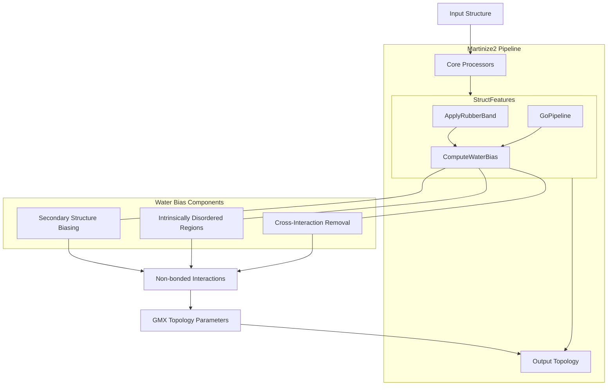
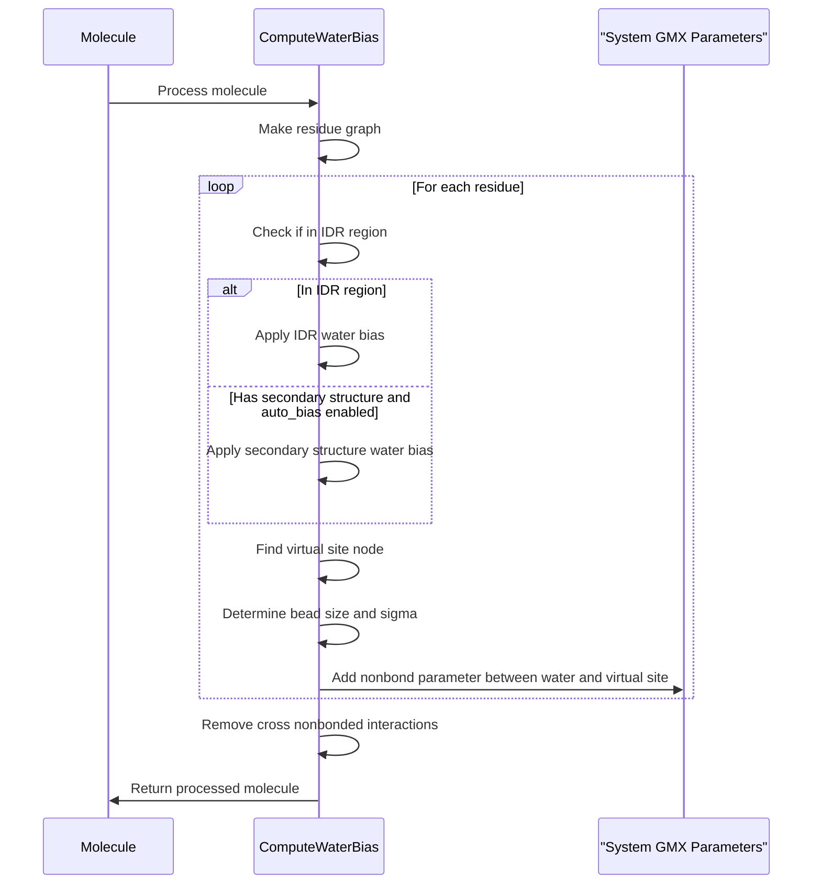
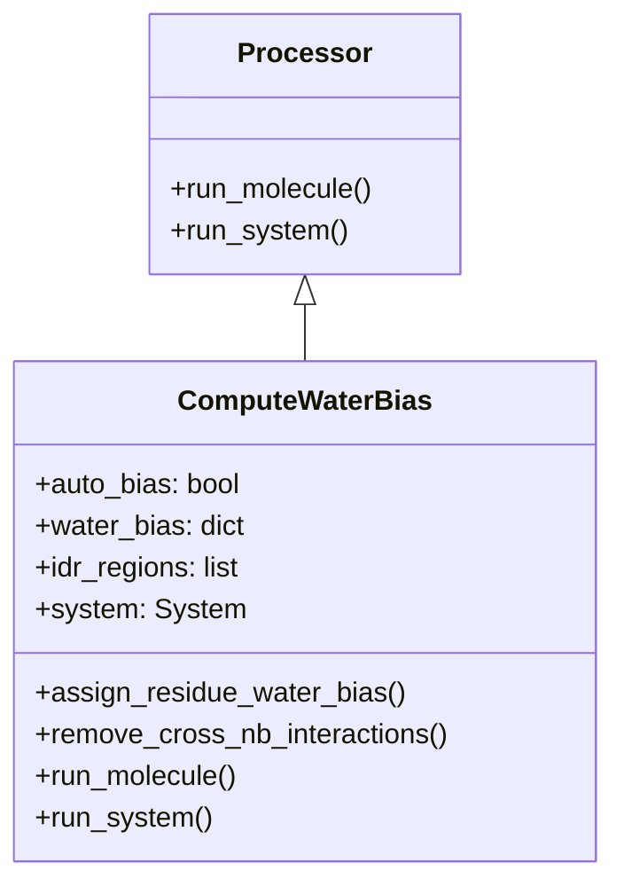
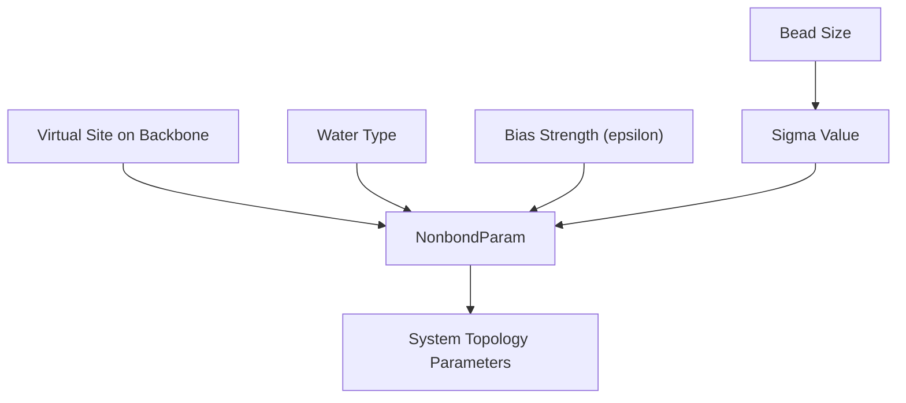

# Water Biasing

<details>
<summary>Relevant source files</summary>

The following files were used as context for generating this wiki page:

- [doc/source/tutorials/basic_usage.rst](doc/source/tutorials/basic_usage.rst)
- [doc/source/tutorials/elastic_examples.png](doc/source/tutorials/elastic_examples.png)
- [doc/source/tutorials/elastic_networks.rst](doc/source/tutorials/elastic_networks.rst)
- [doc/source/tutorials/go_models.rst](doc/source/tutorials/go_models.rst)
- [doc/source/tutorials/index.rst](doc/source/tutorials/index.rst)
- [doc/source/tutorials/mutations_and_modifications.rst](doc/source/tutorials/mutations_and_modifications.rst)
- [doc/source/tutorials/water_biasing.rst](doc/source/tutorials/water_biasing.rst)
- [vermouth/dssp/__init__.py](vermouth/dssp/__init__.py)
- [vermouth/processors/water_bias.py](vermouth/processors/water_bias.py)
- [vermouth/rcsu/__init__.py](vermouth/rcsu/__init__.py)
- [vermouth/rcsu/contact_map.py](vermouth/rcsu/contact_map.py)
- [vermouth/rcsu/go_pipeline.py](vermouth/rcsu/go_pipeline.py)
- [vermouth/rcsu/go_structure_bias.py](vermouth/rcsu/go_structure_bias.py)
- [vermouth/rcsu/go_utils.py](vermouth/rcsu/go_utils.py)
- [vermouth/rcsu/go_vs_includes.py](vermouth/rcsu/go_vs_includes.py)
- [vermouth/tests/data/test_molecule_contacts.out](vermouth/tests/data/test_molecule_contacts.out)
- [vermouth/tests/rcsu/test_contact_map.py](vermouth/tests/rcsu/test_contact_map.py)
- [vermouth/tests/rcsu/test_go_utils.py](vermouth/tests/rcsu/test_go_utils.py)

</details>


Water biasing is a technique used in the vermouth-martinize framework to adjust the interactions between water molecules and specific regions of proteins in coarse-grained molecular dynamics simulations. This page explains how water biasing works, its implementation, and how to use it effectively in your simulations.

Water biasing is particularly useful for:
1. Fine-tuning solvation properties of different secondary structure elements
2. Properly treating intrinsically disordered regions (IDRs) of proteins
3. Improving the behavior of proteins in explicit solvent simulations

For related structural features, see [Elastic Networks](#3.4.1) and [Go Models](#3.4.2).

## Architecture and Integration

Water biasing builds upon the virtual site framework used in the Go model implementation. It modifies the non-bonded interactions between these virtual sites and water molecules based on secondary structure or user-defined regions.

### System Integration Diagram



Sources: [vermouth/processors/water_bias.py:1-191](), [vermouth/rcsu/go_pipeline.py:1-57]()

### Water Biasing Process



Sources: [vermouth/processors/water_bias.py:21-174]()

## Implementation Details

The water biasing functionality is implemented in the `ComputeWaterBias` processor class, which adjusts interactions between water molecules and virtual sites placed on protein backbone beads.

### Key Components

1. **Virtual Sites**: Created by the `VirtualSiteCreator` processor, these are massless particles placed on backbone beads
2. **Water Bias Strengths**: Epsilon values that define interaction strengths between water and protein regions
3. **IDR Regions**: User-defined regions of intrinsically disordered residues that receive special treatment
4. **Secondary Structure Assignment**: Used to determine appropriate bias values for structured regions

### ComputeWaterBias Class

The `ComputeWaterBias` processor is the main component responsible for applying water bias:



Sources: [vermouth/processors/water_bias.py:21-191]()

### Water Bias Application Process

The water bias is applied through these main steps:

1. **Residue Selection**: The processor iterates through all residues in the protein
2. **Bias Assignment**: Based on secondary structure or IDR region classification
3. **Parameter Creation**: Creates non-bonded interaction parameters between water and virtual sites
4. **Cross-Interaction Removal**: Optionally removes interactions between folded and disordered regions

The `assign_residue_water_bias` method handles the core logic of determining and applying the appropriate water bias for each residue:

```python
# Simplified pseudocode of the assignment process
for residue in protein:
    if residue in idr_regions:
        epsilon = water_bias.get('idr', 0.0)
    elif auto_bias:
        sec_struct = residue.secondary_structure
        epsilon = water_bias.get(sec_struct, 0.0)
    
    if epsilon > 0:
        create_water_bias_interaction(residue, epsilon)
```

Sources: [vermouth/processors/water_bias.py:71-120]()

### Cross-Interaction Removal

For proteins with both folded domains and intrinsically disordered regions, interactions between these regions can be automatically removed:

```python
# Simplified pseudocode for removing cross interactions
all_go_pairs = [all Go model nonbonded interactions]
disordered_sites = [virtual sites in IDR regions]

for disordered_site in disordered_sites:
    find and mark interactions involving this site
    
remove all marked interactions from topology
```

Sources: [vermouth/processors/water_bias.py:122-156]()

## Usage Guide

### Command Line Options

Water biasing can be enabled and configured through the following command line options:

| Option | Description |
|--------|-------------|
| `-water-bias` | Enable automatic water biasing based on secondary structure |
| `-water-bias-eps` | Define bias strength by secondary structure (format: `H:3.6 C:2.1`) |
| `-id-regions` | Specify intrinsically disordered regions by residue ranges (format: `1:10 65:92`) |
| `-idr-tune` | Enable special bonded parameters for IDR regions |

### Basic Examples

1. **Simple secondary structure-based biasing**:
   ```
   martinize2 -f protein.pdb -o topol.top -x cg_protein.pdb -dssp -water-bias -water-bias-eps H:1
   ```

2. **Multiple secondary structure biasing**:
   ```
   martinize2 -f protein.pdb -o topol.top -x cg_protein.pdb -dssp -water-bias -water-bias-eps H:1 C:0.5 E:2
   ```

3. **Biasing intrinsically disordered regions**:
   ```
   martinize2 -f protein.pdb -o topol.top -x cg_protein.pdb -dssp -id-regions 1:10 65:92 -idr-tune -water-bias -water-bias-eps idr:0.5
   ```

Sources: [doc/source/tutorials/water_biasing.rst:1-74]()

### Integration with Go Models

Water biasing is often used in conjunction with Go models to maintain protein structure. To use both features together:

```
martinize2 -f protein.pdb -o topol.top -x cg_protein.pdb -dssp -go -water-bias -water-bias-eps H:1 C:0.5 -id-regions 80:100 -water-bias-eps idr:2.0
```

This creates a Go model for the entire protein while applying different water interaction strengths to the various secondary structure elements and the specified IDR region.

Sources: [doc/source/tutorials/go_models.rst:1-186](), [doc/source/tutorials/water_biasing.rst:1-74]()

## Technical Implementation

### Bias Application Mechanism

The water bias is implemented by adding specific non-bonded Lennard-Jones interactions between water molecules and virtual sites placed on protein backbone beads. The epsilon value controls the interaction strength, while sigma is determined based on the bead size.



Sources: [vermouth/processors/water_bias.py:71-120](), [vermouth/rcsu/go_utils.py:74-81]()

### Code Structure

The water biasing functionality relies on several key functions and utilities:

1. `_in_resid_region`: Checks if a residue is within a specified region range
2. `_get_bead_size`: Determines the bead size (regular, small, tiny) based on atom type
3. `get_go_type_from_attributes`: Finds virtual sites based on residue attributes

The `assign_residue_water_bias` method applies the water bias by:
1. Determining if the residue should be biased based on IDR region or secondary structure
2. Finding the corresponding virtual site
3. Determining the appropriate bead size and sigma value
4. Creating a non-bonded parameter with the specified epsilon value
5. Adding the parameter to the system's topology

The `remove_cross_nb_interactions` method:
1. Identifies all Go model nonbonded pairs
2. Finds pairs that connect folded and disordered regions
3. Removes these cross-interactions from the topology

Sources: [vermouth/processors/water_bias.py:21-191](), [vermouth/rcsu/go_utils.py:52-81]()

## Best Practices and Recommendations

### Parameter Selection

- **Helical regions** (`H`): Typical values range from 1-4 kJ/mol
- **Extended/beta-sheet regions** (`E`): Often require higher bias (2-5 kJ/mol)
- **Coil regions** (`C`): Lower bias values (0.5-2 kJ/mol)
- **IDR regions** (`idr`): Often require specific tuning (0.5-3 kJ/mol)

### Performance Considerations

- Adding water bias increases the computational cost due to additional nonbonded interactions
- For large systems, consider using water bias only for critical regions
- IDR tuning with `-idr-tune` adds additional bonded parameters, further increasing computational cost

### Common Issues and Solutions

| Issue | Solution |
|-------|----------|
| Protein collapses despite water bias | Increase bias strength for relevant secondary structure |
| IDR regions remain too compact | Increase `idr` bias value and ensure `-idr-tune` is enabled |
| Simulation instability | Reduce bias values gradually until stability is achieved |
| No effect on solvation | Verify virtual sites are correctly created and bias values are non-zero |

## Conclusion

Water biasing provides a powerful mechanism to fine-tune the solvation properties of different protein regions in coarse-grained simulations. By adjusting interactions between water and specific structural elements, it allows for more accurate representation of protein behavior in solution, particularly for systems containing both structured domains and intrinsically disordered regions.

When combined with other structural features such as elastic networks or Go models, water biasing contributes to a comprehensive approach for maintaining proper protein structure and dynamics in Martini coarse-grained simulations.

Sources: [vermouth/processors/water_bias.py:1-191](), [doc/source/tutorials/water_biasing.rst:1-74]()

---