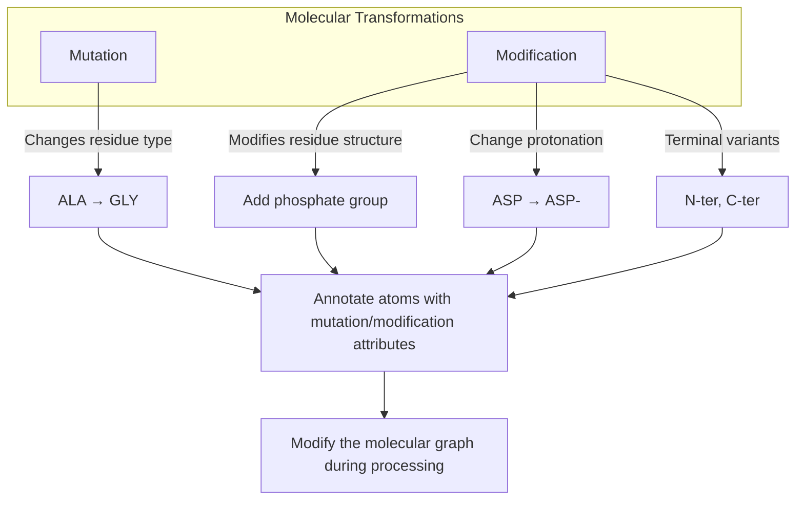
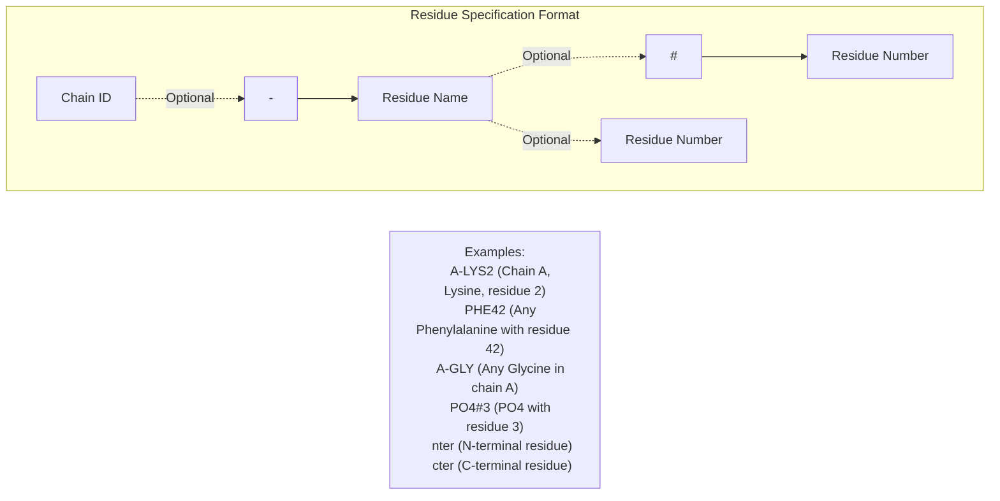
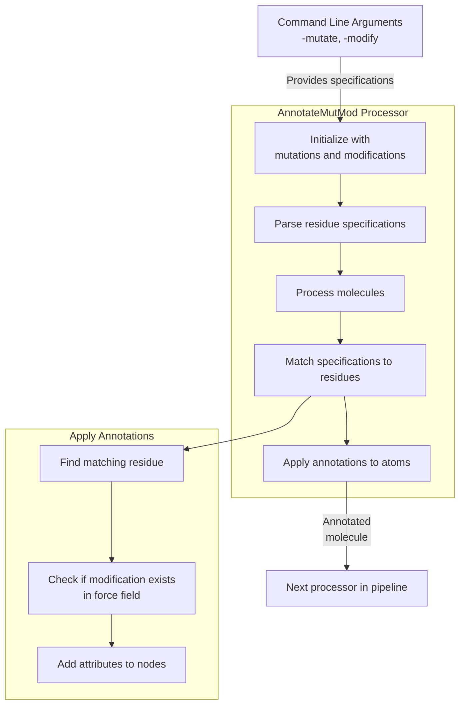
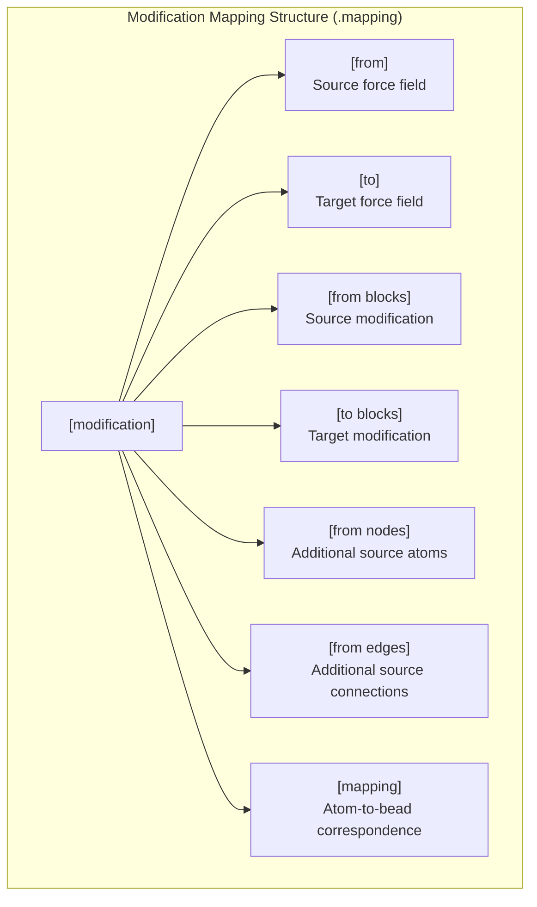
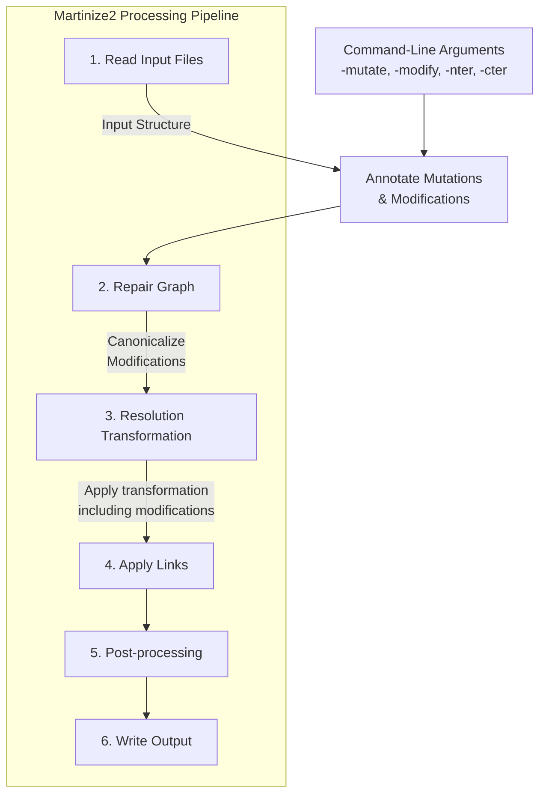

# Mutations and Modifications

<details>
<summary>Relevant source files</summary>

The following files were used as context for generating this wiki page:

- [doc/source/data.rst](doc/source/data.rst)
- [doc/source/file_formats.rst](doc/source/file_formats.rst)
- [doc/source/general_overview.rst](doc/source/general_overview.rst)
- [doc/source/graph_algorithms.rst](doc/source/graph_algorithms.rst)
- [doc/source/martinize2_workflow.rst](doc/source/martinize2_workflow.rst)
- [doc/source/processors.rst](doc/source/processors.rst)
- [doc/source/technical_background.rst](doc/source/technical_background.rst)
- [vermouth/processors/annotate_mut_mod.py](vermouth/processors/annotate_mut_mod.py)
- [vermouth/tests/test_annotate_mut_mod.py](vermouth/tests/test_annotate_mut_mod.py)

</details>


## Purpose and Scope

This document explains how to apply mutations and modifications to molecular structures in the vermouth-martinize system. Mutations allow you to change one residue type to another (e.g., mutating alanine to glycine), while modifications let you add, remove, or change atoms within residues (e.g., applying post-translational modifications or altering protonation states). This page covers:

- How to specify mutations and modifications
- How the annotation system works internally
- How to define custom modifications in force field files

For information about how mutations and modifications fit into the overall processing pipeline, see [Processing Pipeline](#3). For details on force field definitions including modifications, see [Force Fields](#2.2).

## Concept Overview

### Mutations and Modifications in Vermouth



Sources: [vermouth/processors/annotate_mut_mod.py:213-267](), [doc/source/file_formats.rst:153-161]()

- **Mutations**: Changes one residue type to another while maintaining its basic structure
- **Modifications**: Alters residue structure by adding, removing, or changing atoms and their properties
  - Common examples include: post-translational modifications, different protonation states, and terminal variants

Mutations and modifications are applied by annotating atoms with the appropriate attributes, which are then used by other processors in the pipeline to modify the molecular structure.

## Residue Specification

To target specific residues for mutation or modification, vermouth uses a residue specification syntax that can identify residues by chain, name, and/or ID.

### Specification Format



Sources: [vermouth/processors/annotate_mut_mod.py:28-69]()

The residue specification syntax allows for flexible targeting:
- `[chain]-[resname][[#]resid]` where all components are optional
- If `resname` ends with a number and `resid` is also specified, the `#` separator is required
- Special names `nter` and `cter` identify N-terminal and C-terminal residues respectively

### Residue Matching

Residue matching determines whether a given residue in the molecular graph matches a specification:

1. Parse the specification into components (chain, resname, resid)
2. For each residue in the molecule:
   - Check if all specified attributes match
   - For `nter` and `cter`, special logic identifies terminal residues based on connectivity

Sources: [vermouth/processors/annotate_mut_mod.py:82-120](), [vermouth/processors/annotate_mut_mod.py:123-159]()

## Annotation Process



Sources: [vermouth/processors/annotate_mut_mod.py:269-304](), [vermouth/processors/annotate_mut_mod.py:213-267]()

The `AnnotateMutMod` processor handles the annotation of mutations and modifications:

1. Initialize with a list of mutations and modifications
2. Parse residue specifications into components
3. For each molecule in the system:
   - Identify residues matching the specifications
   - Verify that specified modifications exist in the force field
   - Add mutation/modification attributes to the atoms in matching residues

The processor does not directly modify the molecular structure but annotates atoms with attributes that will be used by subsequent processors.

### Key Components

- `parse_residue_spec`: Parses residue specifications into their components
- `residue_matches`: Determines if a residue matches a specification
- `annotate_modifications`: Adds mutation/modification attributes to atoms

## Using Mutations and Modifications

### Command-Line Interface

Martinize2 provides several command-line options for applying mutations and modifications:

| Option | Description | Example |
|--------|-------------|---------|
| `-mutate` | Change residue type | `-mutate PHE42:ALA` |
| `-modify` | Apply modification | `-modify SER5:PHOS` |
| `-nter` | Specify N-terminus type | `-nter NH3+` |
| `-cter` | Specify C-terminus type | `-cter COO-` |

Sources: [doc/source/martinize2_workflow.rst:102-126]()

### Common Examples

**Point Mutation**:
```
martinize2 -f protein.pdb -mutate PHE42:ALA -ff martini3001
```
This mutates phenylalanine at position 42 to alanine.

**Terminal Modifications**:
```
martinize2 -f protein.pdb -nter NH2 -cter none
```
This applies a neutral N-terminus and removes any C-terminal modifications.

**Post-translational Modification**:
```
martinize2 -f protein.pdb -modify SER5:PHOS
```
This adds a phosphorylation to serine at position 5.

## Modification Definition and Mapping

### Defining Modifications in Force Field Files

Modifications are defined in force field (`.ff`) files under the `[modification]` directive:

```mermaid
flowchart TD
    subgraph "Modification Definition Structure"
        Mod["[modification]"]
        Name["Modification Name"]
        Atoms["[atoms]"]
        Interactions["[interaction_name]"]
    end
    
    Mod --> Name
    Name --> Atoms
    Name --> Interactions
    
    Atoms --> |"Lists anchor atoms\nand atoms to add"| AtomDef["Atom name + attributes
    BB {\"element\": \"C\"}
    SC1 {\"PTM_atom\": true, \"element\": \"P\"}"]
    
    Interactions --> |"Lists interactions\nto add/modify"| InterDef["Interaction specifications
    BB SC1 1 0.34 5000"]
```

Sources: [doc/source/file_formats.rst:153-161](), [doc/source/file_formats.rst:356-373]()

Key components:
- **[modification]**: Starts the modification definition
- **Modification Name**: Identifies the modification
- **[atoms]**: Lists anchor atoms and atoms to be added/modified
  - Atoms with `"PTM_atom": true` attribute are added by the modification
  - Other atoms must already exist in the residue
- **[interaction_name]**: Defines interactions to be added by the modification

### Mapping Modifications Between Force Fields

When transforming between force fields (e.g., atomistic to coarse-grained), modification mappings are needed:



Sources: [doc/source/file_formats.rst:510-547](), [doc/source/file_formats.rst:548-576]()

Mapping files describe how modifications transform between force fields:
- Specify source and target force fields
- Define which blocks correspond between force fields
- List additional nodes and edges that may not be in the source block
- Define the mapping between atoms in the source force field and beads in the target force field

## Integration with Processing Pipeline

Mutations and modifications integrate with the martinize2 processing pipeline as follows:



Sources: [doc/source/martinize2_workflow.rst:102-126](), [doc/source/martinize2_workflow.rst:169-191]()

1. **Annotate Mutations & Modifications**: Early in the pipeline, residues are annotated with mutation and modification attributes
2. **Repair Graph**: The graph is repaired to include all atoms described by the reference blocks
3. **Canonicalize Modifications**: Unidentified atoms are processed to identify modifications
4. **Resolution Transformation**: The system is transformed to the target force field, applying mappings for mutations and modifications
5. **Apply Links**: Inter-residue interactions are added, taking modifications into account

## Error Handling and Warnings

The annotation system includes error handling for common issues:

- If a specified modification does not exist in the force field, a `NameError` is raised
- If a residue specification does not match any residue, a warning is logged
- Multiple mutations or modifications can be applied to the same residue

Sources: [vermouth/processors/annotate_mut_mod.py:296-304](), [vermouth/processors/annotate_mut_mod.py:260-267]()

## Conclusion

The mutations and modifications system in vermouth-martinize provides a flexible way to alter molecular structures during topology generation. By annotating atoms with mutation and modification attributes early in the pipeline, these transformations can be properly handled during subsequent processing steps, including force field transformations and the application of inter-residue interactions.

---